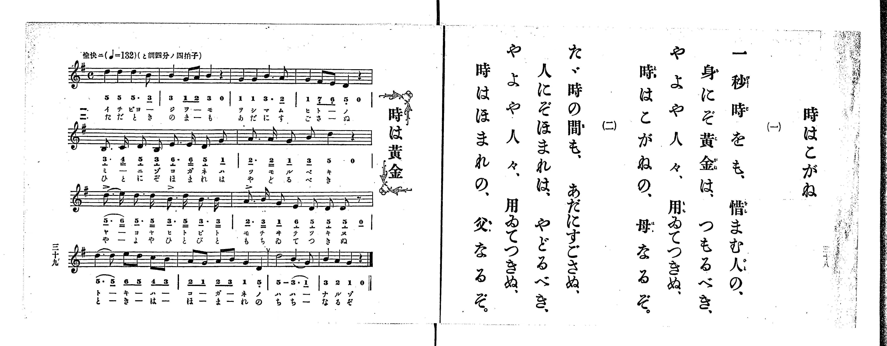

# 時はこがね

> Re:Shōka 使用 AI 協助辨識與重建樂譜，可能會有錯誤。歡迎[回報](https://github.com/TMDLang/reshoka/issues)。

- **鋼琴伴奏版**：<br><audio controls src="toki_wa_kogane.mp3"></audio>
- **NEUTRINO 歌聲合成版**：<br><audio controls src="toki_wa_kogane_neutrino.mp3"></audio>

- 出處：共益商社樂器店《唱歌教科書 生徒用 巻一》第三十八～三十九頁（第十九曲）
- NDL Digital Collections PID 854862（https://dl.ndl.go.jp/pid/854862）掃描 P021.jpg

## 說明

原書資訊與歌詞全文（NDL PID 854862《唱歌教科書 生徒用 巻一》第三十八～三十九頁，掃描 P021.jpg）：
調性與拍號：と調四分ノ四拍子（G 大調 4/4 拍），♩=132，「愉快ニ」
註記：第三學期第五曲（全卷第十九曲）。歌詞頁（右頁）標題作「時はこがね」，卷首目次與樂譜頁（左頁）標題作「時は黃金」。全曲十二小節（第一、四行各四小節，第二、三行各二小節），分節歌，二節同一旋律。第七小節第一、三拍與第八小節第一拍五線譜上方印有重音記號（>）。第七小節首二音「5_. 6__」、第九小節首二音「5. 5_」、第十一小節後二音「3. 1_」印有圓滑線。第十小節末印有換氣記號（V）。五線譜與簡譜一致。


## 歌詞

```text
一、
一秒時をも、惜まむ人の、
身にぞ黃金は、つもるべき、
やよや人々、用ゐてつきぬ、
時はこがねの、母なるぞ。

二、
たゞ時の間も、あだにすごさぬ、
人にぞほまれは、やどるべき、
やよや人々、用ゐてつきぬ、
時はほまれの、父なるぞ。
```

## ABC

<div class="abc-score" data-abc-src="toki_wa_kogane.abc" aria-label="五線譜載入中"></div>

[下載 ABC 原始檔](toki_wa_kogane.abc)

## TMD 檔案連結

- [主旋律 TMD 檔案](toki_wa_kogane.tmd) [[在 TMD Studio 編輯](https://tmdlang.github.io/Tmd-TS/#tmd=s7IKdvYPcrWy4qpTUCpJTLdSSM7PyUlNLsnMz7PKrsxPzc6ML87Iz05Ugisoy88pzU21yk7MizeMtzA1sTAzQkgW55cWJadaFSdn5OfnxJekVpQk5edno8vHFySmp1oFGBgZImQKivLLUvMS84C6C4oy80pSU8DaEQpSyzJTUkHSxclAq8tSizLTMlNTkNyVWlQMcjXUipKixLzi5KLMApBXEKrSU_OKUq2SMzJzUopS8-KL8_PSEZJp-UW5VsUlRfkFGZnJCOGSjFSgh6F-yslMS0WXKs8vQvJjflFmemaeVW5qZlYmliDILyrJyE8vSizIqLTKyCwuASpPTsyJB4YnMJC1tBSezWx63Lj-cePkx409jxvXKmhpcSnaKhgaG3HZ2yq4c9mY6JvYgQx72r7rxcyp7_fMetq68fnsrqdT254v2fdsRdPTmSue7pr-uKHr6ZSNz9b2PJs68_nyic9m71B4PmX-032Tnk9ZofB0--4nOxoeN3Q_X7PmyY7Op72NT1tXv987D8J-snPuywWN7_d0AGUh3GezN73f0wn2gp-Lj4IL0H8liTkKzvCkUqwQ4OmiAEkMQI0ZJSUFxVb6-ik5enlAnJ6vl1WgX5CZog9T0fmsr_lZf78CKAkA5YBRwKWvpWBLLcCloKDwtG8-0NMvNre_WNH1oqMdGBIvVs572rri2bR2oAtB3kA4mQqB1YPmI6AfgVEDcsiLVfufNSwHOaG798XM-UDRx40rgIJPZ89-2tH2uLkPyABKPV07Aegud4WnS5YDJRWAsawAFAUb0_No5kpbYAIAsh439Dxr6Xy6f_Xj5u7HDb1g81fsfrFiBtBYqPvW7ng2Zz6IvWsKON46gJ5-2rsdLTIfNzRBggQS1U_7N4MZnc9WzHy5sOfJ3jkgm1BTItA-oAuARr1cNu357HXP1iwEeWpF04u1c6CGbF-Gy5CXu5tftk8EmgC0FxQJszeBHLOr5-mG_ufrGyBpDRzKjcDQeLGw5-mEFlD4QGV7wN4Ber4R6EGILJJeUAgBQxLIBvoIyAZKAdlPJ_QADXw2vfvpPmBINYHNb4ZogdsFNA0UKR3toMBpXY0sCxQHBuDz7bOAvnuyo-vZtJ1Pezc8m9P5sr335fzNwAAHR2WHHSQokU0Hhg7QBUBFQM-bxuspmMXHg_3dCFK0cy4WRXoKpggloHDZ0QBR9XQfyDMQVcZ6CoYgVRBnPJ0z-dnuiUDnQSwHJUqwjmdzVkMUPOuf_WzDYrg7wyDuhHsJ5OcNC8F-a3jRvgUoxQVKS5BggbKeL58EirymSY-bmoCiz5rnPG7c97ip4cmuXY8b10HVvdi1-nEjEM2DxjAwvTQ0Pm5cAtLT1P24cefjRpDHQEofN7U8buoAkiADGlpB3p2y4nHThMeNy0AagOoa10CVoqc8sHXP1gNVrAKbOg_uYHCqAJveOP9x0zywxnUvp02GuPlxI5C7AOzAmY8bpzxunIqwA-wNkMsfN-4GewxoE9jxQGc2rqSC4-Gmghz_vGMbiuOB6igv56BAQUufiyskPzszPNE7Pz0xD1i1Zibm5TvUGNRUgyxSsDE007IDs4Cl7OOmJQqPmxuBePLj5uVAao9CDVBwB5C1Ccx73LwIJALiNW0H0vOAeAFYZBIQd0DV9IFsBRlZo2CqoAuG6DQIGgNxDZgEQUMgNoKKgqABlK4By8BUwPTBIEgHQoV5PJAwAxGmIALFGLCDfAyBbm1sgYo9blwIZ21-3NSOZC7E5seNM2AKmibBWU1QFswKUBDBZRunw1n7kMwC5g2oiZvg8ivgrHXoJkIcawRSPx-uagGGTgivF2oyzBSEzVjd2ggTQzZxNYqJM6Eqp8BFpsJZa7C6FZR4mudD478baPE-IN4MxGuA_F4g7genkhZwCnrcvBqIZwJlgU0YWEoxhhhoEg-JOzAXHJVgCiwGiuYacJSDIh7EAyUFWJLCFtP7UTwIzF9gcjJUrAeI14JZ66EeXgIPNmB2BMvsBJOgIMYVQZAIBUUKqi27oeKgkOhBtqUJkv6AJQlRtoCDFpQvQUELtATMhmW3yWAaFLSgYAXl3A1A3AYJamDwPm7uQc-MZlDaFJqRYLQxPGyNwWGLyEcIAhTGSOEL9QkoxDqgNNBalBDZDGeD1EOSHijfActHMGsZmASFO8T_kAQGsgspjOlgDziUoQUYONxAod0PLwKBSRksA0rOIBlQku4DhztIDVxdcxckcQOTP0YRCAlrUPhDaBNwSMNSNHLxByvO4IUYqiGQKEKwIdkCJgKJQoQh2LIFcvkBCShY0oMkUoidsIwCySow1lo4C1begFTCdCFMRBcBqVoFkwUne4g6UGYBQWxZi1h3QrIaasmHcDGyO2EFPsJEdBHi3VnLxaVrp4BcuSoA-cpcAA)]
- [鋼琴伴奏 TMD 檔案](toki_wa_kogane_piano.tmd) [[在 TMD Studio 編輯](https://tmdlang.github.io/Tmd-TS/#tmd=s7IKdvYPcrWy4qpTUCpJTLdSyC8qychPL0osyKi0ysgsLskvykxOzInPTsxLVOLS0lJ4NrPpceP6x42THzf2PG5c-35Px8vuPc8nbHmyZ8vTpf3POzve7-lU0NLiUrRVMDQ24rK3VXDnsjHRN7ED2fC0fdeLmVPf75n1tHXj89ldT6e2PV-y79mKpqczVzzdNf1xQ9fTKRufre15NnXm8-UTn83eofB8yvyn-yY9n7JC4en23U92NDxu6H6-Zs2THZ1Pexuftq5-v3cehP1k59yXCxqBjgHKQrjPZm8CukQJZKufi4-CS2Z6ZklijoJzfk5OanJJZn5esUKAp4uChamJhZkRUGNGSUlBsZW-fkqOXh4Qp-frZRXoF2Sm6MNUdD7ra37W368QYGBkCJRLV-LiCsnPzgxP9M5PT8xLtQrITMzLD_JwqDGoqeZSAAIbQzMtOzBLX0vhcdMShcfNjUA8-XHzciC1R6EGKLgDyNoE5j1uXgQSAfGatgPpeUC8ACwyCYg7oGr6FLT0wUbWKJgq6IIhOg2CxkBcAyZB0BCIjaCiIGgApWvAMjAVMH0wCNKBUGEeDyTMQIQpiEAxBuwgH0OgWxtboGKPGxfCWZsfN7UjmQux-XHjDJiCpklwVhOUBbMCFERw2cbpcNY-JLMeNzVATdwEl18BZ61DNxHiWCOQ-vlwVQswdEJ4vVCTYaYgbMbq1kaYGLKJq1FMnAlVOQUuMhXOWoPVraDE0zwfGv_dQIv3AfFmIF4D5PcCcT84lbSAU9Dj5tVAPBMouxaRUowhBprEQ-IOzAVHJZgCi4GiuQYc5aCIB_FASQGWpLDF9H4UDz5unAcmJ0PFeoB4LZi1HurhJfBge9zUDZbZCSZBQYwrgiARCooUVFt2Q8VBIdGDbEsTJP09blxJlC3goAXlS1DQAi0Bs2HZbTKYBgUtKFhBOXcDELdBghoYvI-be9AzoxmUNoVmJBhtDA9bY3DYIvIRggCFMVL4Qn0CCrEOKA20FiVENsPZIPWQpAfKd4-bJoBZy8AkKNwh_ockMJBdSGFMB3vAoQwtwMDhBgrtfngRCEzKYBlQcgbJgJJ0HzjcQWrg6pq7IIkbmPwxikBIWIPCH0KbgEMalqKRiz9YcQYvxFANgUQRgg3JFjARSBQiDMGWLZDLD0hAwZIeJJFC7IRlFEhWgbHWwlmw8gakEqYLYSK6CEjVKpgsONlD1IEyCwhiy1rEuhOS1VBLPoSLkd0JK_ARJqKLEO_OWmx1qw9y3WqCqFpf9HW9bO992rrj5exWSCsEkUIM4xWiDWNhVA1CxDQeSJvGA8VQVSLEQUkDxgEWndEmCLVQLkwUWSXMJlSVSPZTbiZOPwEpA0jg6dopIIdftA9QFkPMCCymzAUA)]

## 分析

```text
================================================================================
📊 TMD Song Profile: [ 時はこがね ]
================================================================================
⏱  Duration:       0:21 (21.8s), 12 measures total
🎼 Key & Tempo:    首調基準 G, != 132.0 BPM, <4/4>
   - 分析範圍：      由實際發聲的音符與和弦推測調性；播放脈絡另行呈現
🎤 人聲音域:    B3 (MIDI 59) – E5 (MIDI 76) [跨度: 17 個半音 / 1.4 個八度, 難度: challenging]
   - 最低音:  B3 in [TokiWaKogane #1 @ m.5, 0:07]
   - 最高音: E5 in [TokiWaKogane #1 @ m.7, 0:11]
   - 適合: soprano, mezzo-soprano, contralto, tenor, baritone, bass
🏛  結構:      TokiWaKogane (21.8s)
⚡ 編曲密度:        Peak 1 軌道同時演奏
🗝  調性診斷：       B 調性不明確（純淨自然大調，未偵測到可信轉調）
   - 風格氣質:    純淨自然大調（陽光明朗、易唱易記，無明顯調外色彩）
   - 轉調歷程:    全曲維持單一推測調性（未偵測到可信轉調）
   - 核心骨幹音:  D, B, G, A, E
   - 調性數值:    B 調性不明確 [相關度: 0.79, 穩定度: Ambiguous, 自然音純度: 98.3%]
   - 候選調性 (K-S): B 小調 (0.79), G 大調 (0.79), D 大調 (0.77)
   - 五度圈歷程:   +5
   - 各段落調性細節:
     • [TokiWaKogane #1]: B 調性不明確 (r: 0.79, 自然音純度: 98.3%, 調外音: C)

  [ 五度圈游移軌跡 ]
               C  
         F            G  
      Bb               D  
      Eb               A  
         Ab           E  
            Db      [B ]*
               F# 
     (* = active key center)

  [ 十二半音累積音高分佈 ]
     C  : █                          1.7%
     C# :                            0.0%
     D  : ████████████████████████  35.6%
     D# :                            0.0%
     E  : ████                       6.3%
     F  :                            0.0%
     F# : █                          1.1%
     G  : ████████████              18.4%
     G# :                            0.0%
     A  : ███████                   10.9%
     A# :                            0.0%
     B  : █████████████████         25.9%
--------------------------------------------------------------------------------
Assignment 軌道音域：
  - Piano         : B3 – E5 (17 個半音 / 1.4 個八度, 62 個音符)
================================================================================
```


## 原書掃描頁




