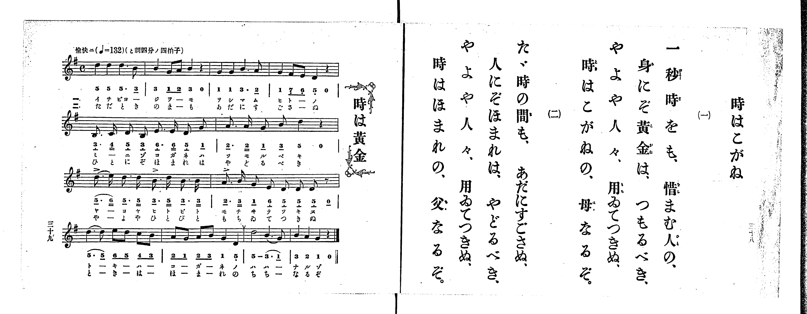

# 時はこがね

> Re:Shoka 使用 AI 協助辨識與重建樂譜，可能會有錯誤。歡迎回報。

<audio controls src="toki_wa_kogane.mp3"></audio>

- 出處：共益商社樂器店《唱歌教科書 生徒用 巻一》第三十八～三十九頁（第十九曲）
- NDL Digital Collections PID 854862（https://dl.ndl.go.jp/pid/854862）掃描 P021.jpg

## 說明

原書資訊與歌詞全文（NDL PID 854862《唱歌教科書 生徒用 巻一》第三十八～三十九頁，掃描 P021.jpg）：
調性與拍號：と調四分ノ四拍子（G 大調 4/4 拍），♩=132，「愉快ニ」
註記：第三學期第五曲（全卷第十九曲）。歌詞頁（右頁）標題作「時はこがね」，卷首目次與樂譜頁（左頁）標題作「時は黃金」。全曲十二小節（第一、四行各四小節，第二、三行各二小節），分節歌，二節同一旋律。第七小節第一、三拍與第八小節第一拍五線譜上方印有重音記號（>）。第七小節首二音「5_. 6__」、第九小節首二音「5. 5_」、第十一小節後二音「3. 1_」印有圓滑線。第十小節末印有換氣記號（V）。五線譜與簡譜一致。

## 歌詞

```text
一、
一秒時をも、惜まむ人の、
身にぞ黃金は、つもるべき、
やよや人々、用ゐてつきぬ、
時はこがねの、母なるぞ。

二、
たゞ時の間も、あだにすごさぬ、
人にぞほまれは、やどるべき、
やよや人々、用ゐてつきぬ、
時はほまれの、父なるぞ。
```

## ABC

```abc
X:1
T:時はこがね
M:4/4
L:1/16
Q:1/4=132
K:G
V:V1 name="Piano" snm="Pia"
[V:V1]
d4 d4 d6 B2 | B4 G2 A2 B4 z4 | G4 G4 B6 A2 | G4 F2 E2 D4 z4 |
B,3 C D2 B,2 E3 E D2 G2 | A3 A G2 B2 d4 z4 | d3 e d3 d B3 d B3 B | A3 B G2 E2 D2 D2 D2 z2 |
d6 d2 e2 d2 c2 B2 | A2 G2 A2 B2 G4 D4 | d8 B6 G2 | B4 A4 G4 z4 |
d4 d4 d6 B2 | B4 G2 A2 B4 z4 | G4 G4 B6 A2 | G4 F2 E2 D4 z4 |
B,3 C D2 B,2 E3 E D2 G2 | A3 A G2 B2 d4 z4 | d3 e d3 d B3 d B3 B | A3 B G2 E2 D2 D2 D2 z2 |
d6 d2 e2 d2 c2 B2 | A2 G2 A2 B2 G4 D4 | d8 B6 G2 | B4 A4 G4 z4 |
```

## TMD 檔案連結

- [主旋律 TMD 檔案](toki_wa_kogane.tmd) [[在 TMD Studio 編輯](https://tmdlang.github.io/Tmd-TS/#tmd=s7IKdvYPcrWy4qpTUCpJTLdSSM7PyUlNLsnMz7PKrsxPzc6ML87Iz05Ugisoy88pzU21yk7MizeMtzA1sTAzQkgW55cWJadaFSdn5OfnxJekVpQk5edno8vHFySmp1oFGBgZImQKivLLUvMS84C6C4oy80pSU8DaEQpSyzJTUkHSxclAq8tSizLTMlNTkNyVWlQMcjXUipKixLzi5KLMApBXEKrSU_OKUq2SMzJzUopS8-KL8_PSEZJp-UW5VsUlRfkFGZnJCOGSjFSgh6F-yslMS0WXKs8vAvpRS0vh2cymx43rHzdOftzY87hxrYKWFpeirYKhsRGXva2CO5eNib6JHUjv0_ZdL2ZOfb9n1tPWjc9ndz2d2vZ8yb5nK5qezlzxdNf0xw1dT6dsfLa259nUmc-XT3w2e4fC8ynzn-6b9HzKCoWn23c_2dHwuKH7-Zo1T3Z0Pu1tfNq6-v3eeRD2k51zXy5ofL-nAygL4T6bven9nk6wi_1cfBRcMtMzSxJzFJzh0VysEODpogCJSKDGjJKSgmIrff2UHL08IE7P18sq0C_ITNGHqeh81tf8rL9fARR9QDlg8HHpaynYUgtwKSgoPO2bD_T0i83tL1Z0vehoB4bEi5XznraueDatHehCkDcQTqZCYPWg-QjoR2DUgBzyYtX-Zw3LQU7o7n0xcz5Q9HHjCqDg09mzn3a0PW7uAzKAUk_XTgC6y13h6ZLlQEkFYCwrAEXBxvQ8mrnSFpgAgKzHDT3PWjqf7l_9uLn7cUMv2PwVu1-smAE0Fuq-tTuezZkPYu-aAo63DqCnn_ZuR4vMxw1NkCCBRPXT_s1gRuezFTNfLux5sncOyCbUlAi0D-gCoFEvl017PnvdszULQZ5a0fRi7RyoIduX4TLk5e7ml-0TgSYA7QVFwuxNIMfs6nm6of_5-gZIWgOHciMwNF4s7Hk6oQUUPlDZHrB3gJ5vBHoQIoukFxRCwJAEsoE-ArKBUkD20wk9QAOfTe9-ug8YUk1g85shWuB2AU0DRUpHOyhwWlcjywLFgQH4fPssoO-e7Oh6Nm3n094Nz-Z0vmzvfTl_MzDAwVHZYQcJSmTTgaEDdAFQEdDzpvF6Cmbx8WB_N4IU7ZyLRZGegilCCShcdjRAVD3dB_IMRJWxnoIhSBXEGU_nTH62eyLQeRDLQYkSrOPZnNUQBc_6Zz_bsBjuzjCIO-FeAvl5w0Kw3xpetG8BSnGB0hIkWKCs58sngSKvadLjpiag6LPmOY8b9z1uaniya9fjxnVQdS92rX7cCETzoDEMTC8NjY8bl4D0NHU_btz5uBHkMZDSx00tj5s6gCTIgIZWkHenrHjcNOFx4zKQBqC6xjVQpegpD2zds_VAFavAps6DOxicKsCmN85_3DQPrHHdy2mTIW5-3AjkLgA7cObjximPG6ci7AB7A-Tyx427wR4D2gR2PNCZjSup4Hi4qSDHP-_YhuJ4oDrKyzkoUNDS5-IKyc_ODE_0zk9PzANWi5mJefkONQY1CtUgmxRsDM207MAsYDH7uGmJwuPmRiCe_Lh5OZDao1ADFNwBZG0C8x43LwKJgHhN24H0PCBeABaZBMQdUDV9IGtBRtYomCrogiE6DYLGQFwDJkHQEIiNoKIgaACla8AyMBUwfTAI0oFQYR4PJMxAhCmIQDEG7sfm-VBndgM9sQ-INwPxGiC_F4j7wZ5pAXv0cfNqIJ4JlAVWtTAPGUMMNomHWAHmgm0EU2AxkGtqwC4DuQ_EA7kY5nMsDgIFOshBK6BsWFhOBtMgB4EcA4qWDUDcBnEg0FGPm3vQQ9oMSptCQwlGG8NdZAx2ESKQEATIZUiugsYm2B6Q6_rh6QEYYGAZUKCBZEAB1wd2J0gNXF1zFyQIgYGMkR5gacEMSptAQwniSuS0AItbeIyiGoKeICCBDxOBeBlhCCLwa7m4dO0UkLOGAha-MhcA)]

## 分析

```text
================================================================================
📊 TMD Song Profile: [ 時はこがね ]
================================================================================
⏱  Duration:       0:43 (43.6s), 24 measures total
🎼 Key & Tempo:    首調基準 G, != 132.0 BPM, <4/4>
   - 分析範圍：      由實際發聲的音符與和弦推測調性；播放脈絡另行呈現
🎤 人聲音域:    B3 (MIDI 59) – E5 (MIDI 76) [跨度: 17 個半音 / 1.4 個八度, 難度: challenging]
   - 最低音:  B3 in [TokiWaKogane #1 @ m.5, 0:07]
   - 最高音: E5 in [TokiWaKogane #1 @ m.7, 0:11]
   - 適合: soprano, mezzo-soprano, contralto, tenor, baritone, bass
🏛  結構:      TokiWaKogane (21.8s) -> TokiWaKogane (21.8s)
⚡ 編曲密度:        Peak 1 軌道同時演奏
🗝  調性診斷：       B 調性不明確（純淨自然大調，未偵測到可信轉調）
   - 風格氣質:    純淨自然大調（陽光明朗、易唱易記，無明顯調外色彩）
   - 轉調歷程:    全曲維持單一推測調性（未偵測到可信轉調）
   - 核心骨幹音:  D, B, G, A, E
   - 調性數值:    B 調性不明確 [相關度: 0.79, 穩定度: Ambiguous, 自然音純度: 98.3%]
   - 候選調性 (K-S): B 小調 (0.79), G 大調 (0.79), D 大調 (0.77)
   - 五度圈歷程:   +5 -> +5
   - 各段落調性細節:
     • [TokiWaKogane #1]: B 調性不明確 (r: 0.79, 自然音純度: 98.3%, 調外音: C)
     • [TokiWaKogane #2]: B 調性不明確 (r: 0.79, 自然音純度: 98.3%, 調外音: C)

  [ 五度圈游移軌跡 ]
               C  
         F            G  
      Bb               D  
      Eb               A  
         Ab           E  
            Db      [B ]*
               F# 
     (* = active key center)

  [ 十二半音累積音高分佈 ]
     C  : █                          1.7%
     C# :                            0.0%
     D  : ████████████████████████  35.6%
     D# :                            0.0%
     E  : ████                       6.3%
     F  :                            0.0%
     F# : █                          1.1%
     G  : ████████████              18.4%
     G# :                            0.0%
     A  : ███████                   10.9%
     A# :                            0.0%
     B  : █████████████████         25.9%
--------------------------------------------------------------------------------
Assignment 軌道音域：
  - Piano         : B3 – E5 (17 個半音 / 1.4 個八度, 124 個音符)
================================================================================
```


## 原書掃描頁




