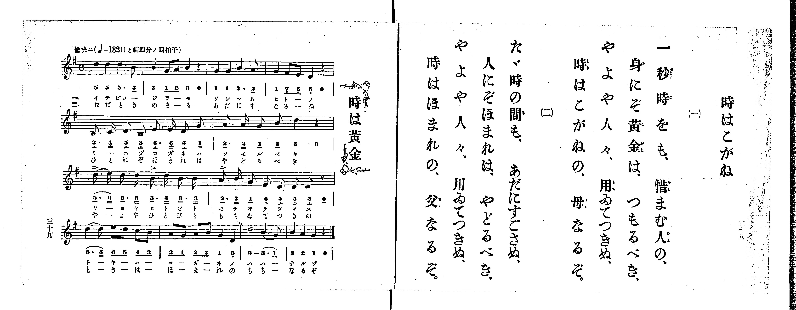

# 時はこがね

> Re:Shōka 使用 AI 協助辨識與重建樂譜，可能會有錯誤。歡迎回報。

- **鋼琴伴奏版**：<br><audio controls src="toki_wa_kogane.mp3"></audio>
- **NEUTRINO 歌聲合成版**：<br><audio controls src="toki_wa_kogane_neutrino.mp3"></audio>

- 出處：共益商社樂器店《唱歌教科書 生徒用 巻一》第三十八～三十九頁（第十九曲）
- NDL Digital Collections PID 854862（https://dl.ndl.go.jp/pid/854862）掃描 P021.jpg

## 說明

原書資訊與歌詞全文（NDL PID 854862《唱歌教科書 生徒用 巻一》第三十八～三十九頁，掃描 P021.jpg）：
調性與拍號：と調四分ノ四拍子（G 大調 4/4 拍），♩=132，「愉快ニ」
註記：第三學期第五曲（全卷第十九曲）。歌詞頁（右頁）標題作「時はこがね」，卷首目次與樂譜頁（左頁）標題作「時は黃金」。全曲十二小節（第一、四行各四小節，第二、三行各二小節），分節歌，二節同一旋律。第七小節第一、三拍與第八小節第一拍五線譜上方印有重音記號（>）。第七小節首二音「5_. 6__」、第九小節首二音「5. 5_」、第十一小節後二音「3. 1_」印有圓滑線。第十小節末印有換氣記號（V）。五線譜與簡譜一致。


## 歌詞

```text
一、
一秒時をも、惜まむ人の、
身にぞ黃金は、つもるべき、
やよや人々、用ゐてつきぬ、
時はこがねの、母なるぞ。

二、
たゞ時の間も、あだにすごさぬ、
人にぞほまれは、やどるべき、
やよや人々、用ゐてつきぬ、
時はほまれの、父なるぞ。
```

## ABC

```abc
X:1
T:時はこがね
M:4/4
L:1/16
Q:1/4=132
K:G
V:V1 name="Piano" snm="Pia"
[V:V1]
d4 d4 d6 B2 | B4 G2 A2 B4 z4 | G4 G4 B6 A2 | G4 F2 E2 D4 z4 |
w: 1.~い ち びょ _ | じ を _ も | を し ま む | ひ と _ の
w: 2.~た だ と き | の ま _ も | あ だ に す | ご さ _ ぬ
B,3 C D2 B,2 E3 E D2 G2 | A3 A G2 B2 d4 z4 | d3 e d3 d B3 d B3 B | A3 B G2 E2 D2 D2 D2 z2 |
w: 1.~み _ に ぞ こ が ね は | つ も る べ き | や _ よ や ひ と び と | も ち ゐ て つ き ぬ
w: 2.~ひ と に ぞ ほ ま れ は | や ど る べ き | や _ よ や ひ と び と | も ち ゐ て つ き ぬ
d6 d2 e2 d2 c2 B2 | A2 G2 A2 B2 G4 D4 | d8 B6 G2 | B4 A4 G4 z4 |
w: 1.~と _ き _ は _ | こ _ が _ ね の | は は _ | な る ぞ
w: 2.~と _ き _ は _ | ほ _ ま _ れ の | ち ち _ | な る ぞ
```

## TMD 檔案連結

- [主旋律 TMD 檔案](toki_wa_kogane.tmd) [[在 TMD Studio 編輯](https://tmdlang.github.io/Tmd-TS/#tmd=s7IKdvYPcrWy4qpTUCpJTLdSSM7PyUlNLsnMz7PKrsxPzc6ML87Iz05Ugisoy88pzU21yk7MizeMtzA1sTAzQkgW55cWJadaFSdn5OfnxJekVpQk5edno8vHFySmp1oFGBgZImQKivLLUvMS84C6C4oy80pSU8DaEQpSyzJTUkHSxclAq8tSizLTMlNTkNyVWlQMcjXUipKixLzi5KLMApBXEKrSU_OKUq2SMzJzUopS8-KL8_PSEZJp-UW5VsUlRfkFGZnJCOGSjFSgh6F-yslMS0WXKs8vQvJjflFmemaeVW5qZlYmUhBoaSk8m9n0uHH948bJjxt7HjeuVdDS4lK0VTA0NuKyt1Vw57Ix0TexAxnztH3Xi5lT3--Z9bR14_PZXU-ntj1fsu_ZiqanM1c83TX9cUPX0ykbn63teTZ15vPlE5_N3qHwfMr8p_smPZ-yQuHp9t1PdjQ8buh-vmbNkx2dT3sbn7aufr93HoT9ZOfclwsa3-_pAMpCuM9mb3q_pxPseD8XHwUXoNNLEnMUnOGpoFghwNNFARLPQI0ZJSUFxVb6-ik5enlAnJ6vl1WgX5CZog9T0fmsr_lZf78CKHaBcsDQ5dLXUrClFuBSUFB42jcf6OkXm9tfrOh60dEODIkXK-c9bV3xbFo70IUgbyCcTIXA6kHzEdCPwKgBOeTFqv3PGpaDnNDd-2LmfKDo48YVQMGns2c_7Wh73NwHZAClnq6dAHSXu8LTJcuBkgrAWFYAioKN6Xk0c6UtMAEAWY8bep61dD7dv_pxc_fjhl6w-St2v1gxA2gs1H1rdzybMx_E3jUFHG8dQE8_7d2OFpmPG5ogQQKJ6qf9m8GMzmcrZr5c2PNk7xyQTagpEWgf0AVAo14um_Z89rpnaxaCPLWi6cXaOVBDti_DZcjL3c0v2ycCTQDaC4qE2ZtAjtnV83RD__P1DZC0Bg7lRmBovFjY83RCCyh8oLI9YO8APd8I9CBEFkkvKISAIQlkA30EZAOlgOynE3qABj6b3v10HzCkmsDmN0O0wO0CmgaKlI52UOC0rkaWBYoDA_D59llA3z3Z0fVs2s6nvRuezel82d77cv5mYICDo7LDDhKUyKYDQwfoAqAioOdN4_UUzOLjwf5uBCnaOReLIj0FU4QSULjsaICoeroP5BmIKmM9BUOQKogzns6Z_Gz3RKDzIJaDEiVYx7M5qyEKnvXPfrZhMdydYRB3wr0E8vOGhWC_Nbxo3wKU4gKlJUiwQFnPl08CRV7TpMdNTUDRZ81zHjfue9zU8GTXrseN66DqXuxa_bgRiOZBYxiYXhoaHzcuAelp6n7cuPNxI8hjIKWPm1oeN3UASZABDa0g705Z8bhpwuPGZSANQHWNa6BK0VMe2Lpn64EqVoFNnQd3MDhVgE1vnP-4aR5Y47qX0yZD3Py4EchdAHbgzMeNUx43TkXYAfYGyOWPG3eDPQa0Cex4oDMbV1LB8XBTQY5_3rENxfFAdZSXc1CgoKXPxRWSn50Znuidn56YB6w1MxPz8h1qDGqqQRYp2BiaadmBWcBS9nHTEoXHzY1APPlx83IgtUehBii4A8jaBOY9bl4EEgHxmrYD6XlAvAAsMgmIO6Bq-kC2goysUTBV0AVDdBoEjYG4BkyCoCEQG0FFQdAASteAZWAqYPpgEKQDocI8HkiYgQhTEIFiDNhBPoZAtza2QMUeNy6EszY_bmpHMhdi8-PGGTAFTZPgrCYoC2YFKIjgso3T4ax9SGYB8wbUxE1w-RVw1jp0EyGONQKpnw9XtQBDJ4TXCzUZZgrCZqxubYSJIZu4GsXEmVCVU-AiU-GsNVjdCko8zfOh8d8NtHgfEG8G4jVAfi8Q94NTSQs4BT1uXg3EM4GywCYMLKUYQww0iYfEHZgLjkowBRYDRXMNOMpBEQ_igZICLElhi-n9KB4E5i8wORkq1gPEa8Gs9VAPL4EHGzA7gmV2gklQEOOKIEiEgiIF1ZbdUHFQSPQg29IESX_AkoQoW8BBC8qXoKAFWgJmw7LbZDANClpQsIJy7gYgboMENTB4Hzf3oGdGMyhtCs1IMNoYHrbG4LBF5CMEAQpjpPCF-gQUYh1QGmgtSohshrNB6iFJD5TvgOUjmLUMTILCHeJ_SAID2YUUxnSwBxzK0AIMHG6g0O6HF4HApAyWASVnkAwoSfeBwx2kBq6uuQuSuIHJH6MIhIQ1KPwhtAk4pGEpGrn4gxVn8EIM1RBIFCHYkGwBE4FEIcIQbNkCufyABBQs6UESKcROWEaBZBUYay2cBStvQCphuhAmoouAVK2CyYKTPUQdKLOAILasRaw7IVkNteRDuBjZnbACH2Eiugjx7qzl4tK1U0CuXBWAfGUuAA)]
- [鋼琴伴奏 TMD 檔案](toki_wa_kogane_piano.tmd) [[在 TMD Studio 編輯](https://tmdlang.github.io/Tmd-TS/#tmd=s7IKdvYPcrWy4tLSUng2s-lx4_rHjZMfN_Y8blz7fk_Hy-49zydsebJny9Ol_c87O97v6VTQ0uJStFUwNDbisrdVcOeyMdE3seOqU1B62r7rxcyp7_fMetq68fnsrqdT254v2fdsRdPTmSue7pr-uKHr6ZSNz9b2PJs68_nyic9m71B4PmX-032Tnk9ZofB0--4nOxoeN3Q_X7PmyY7Op72NT1tXv987D8J-snPuywWNQMcAZSHcZ7M3AV2iBLLVz8VHwSUzPbMkMUfBOT8nJzW5JDM_r1ghwNNFwcLUxMLMCKgxo6SkoNhKXz8lRy8PiNPz9bIK9AsyU_RhKjqf9TU_6-9XCDAwMgTKpStxcYXkZ2eGJ3rnpyfmpVoFZCbm5Qd5ONQY1FRzKQCBjaGZlh2Ypa-l8LhpicLj5kYgnvy4eTmQ2qNQAxTcAWRtAvMeNy8CiYB4TduB9DwgXgAWmQTEHVA1fQpa-mAjaxRMFXTBEJ0GQWMgrgGTIGgIxEZQURA0gNI1YBmYCpg-GATpQKgwjwcSZiDCFESgGAN2kI8h0K2NLVCxx40L4azNj5vakcyF2Py4cQZMQdMkOKsJyoJZAQoiuGzjdDhrH5JZj5saoCZugsuvgLPWoZsIcawRSP18uKoFGDohvF6oyTBTEDZjdWsjTAzZxNUoJs6EqpwCF5kKZ63B6lZQ4mmeD43_bqDF-4B4MxCvAfJ7gbgfnEpawCnocfNqIJ4JlF2LSCnGEANN4iFxB-aCoxJMgcVA0VwDjnJQxIN4oKQAS1LYYno_igcfN84Dk5OhYj1AvBbMWg_18BJ4sD1u6gbL7ASToCDGFUGQCAVFCqotu6HioJDoQbalCZL-HjeuJMoWcNCC8iUoaIGWgNmw7DYZTIOCFhSsoJy7AYjbIEENDN7HzT3omdEMSptCMxKMNoaHrTE4bBH5CEGAwhgpfKE-AYVYB5QGWosSIpvhbJB6SNID5bvHTRPArGVgEhTuEP9DEhjILqQwpoM94FCGFmDgcAOFdj-8CAQmZbAMKDmDZEBJug8c7iA1cHXNXZDEDUz-GEUgJKxB4Q-hTcAhDUvRyMUfrDiDF2KohkCiCMGGZAuYCCQKEYZgyxbI5QckoGBJD5JIIXbCMgokq8BYa-EsWHkDUgnThTARXQSkahVMFpzsIepAmQUEsWUtYt0JyWqoJR_CxcjuhBX4CBPRRYh3Zy22utUHuW41QVStL_q6Xrb3Pm3d8XJ2K6QVgkghhvEK0YaxMKoGIWIaD6RN44FiqCoR4qCkAeMAi85oE4RaKBcmiqwSZhOqSiT7KTcTp5-AlAEk8HTtFJDDL9oHKIshZgQWU-YCAA)]

## 分析

```text
================================================================================
📊 TMD Song Profile: [ 時はこがね ]
================================================================================
⏱  Duration:       0:21 (21.8s), 12 measures total
🎼 Key & Tempo:    首調基準 G, != 132.0 BPM, <4/4>
   - 分析範圍：      由實際發聲的音符與和弦推測調性；播放脈絡另行呈現
🎤 人聲音域:    B3 (MIDI 59) – E5 (MIDI 76) [跨度: 17 個半音 / 1.4 個八度, 難度: challenging]
   - 最低音:  B3 in [TokiWaKogane #1 @ m.5, 0:07]
   - 最高音: E5 in [TokiWaKogane #1 @ m.7, 0:11]
   - 適合: soprano, mezzo-soprano, contralto, tenor, baritone, bass
🏛  結構:      TokiWaKogane (21.8s)
⚡ 編曲密度:        Peak 1 軌道同時演奏
🗝  調性診斷：       B 調性不明確（純淨自然大調，未偵測到可信轉調）
   - 風格氣質:    純淨自然大調（陽光明朗、易唱易記，無明顯調外色彩）
   - 轉調歷程:    全曲維持單一推測調性（未偵測到可信轉調）
   - 核心骨幹音:  D, B, G, A, E
   - 調性數值:    B 調性不明確 [相關度: 0.79, 穩定度: Ambiguous, 自然音純度: 98.3%]
   - 候選調性 (K-S): B 小調 (0.79), G 大調 (0.79), D 大調 (0.77)
   - 五度圈歷程:   +5
   - 各段落調性細節:
     • [TokiWaKogane #1]: B 調性不明確 (r: 0.79, 自然音純度: 98.3%, 調外音: C)

  [ 五度圈游移軌跡 ]
               C  
         F            G  
      Bb               D  
      Eb               A  
         Ab           E  
            Db      [B ]*
               F# 
     (* = active key center)

  [ 十二半音累積音高分佈 ]
     C  : █                          1.7%
     C# :                            0.0%
     D  : ████████████████████████  35.6%
     D# :                            0.0%
     E  : ████                       6.3%
     F  :                            0.0%
     F# : █                          1.1%
     G  : ████████████              18.4%
     G# :                            0.0%
     A  : ███████                   10.9%
     A# :                            0.0%
     B  : █████████████████         25.9%
--------------------------------------------------------------------------------
Assignment 軌道音域：
  - Piano         : B3 – E5 (17 個半音 / 1.4 個八度, 62 個音符)
================================================================================
```


## 原書掃描頁




