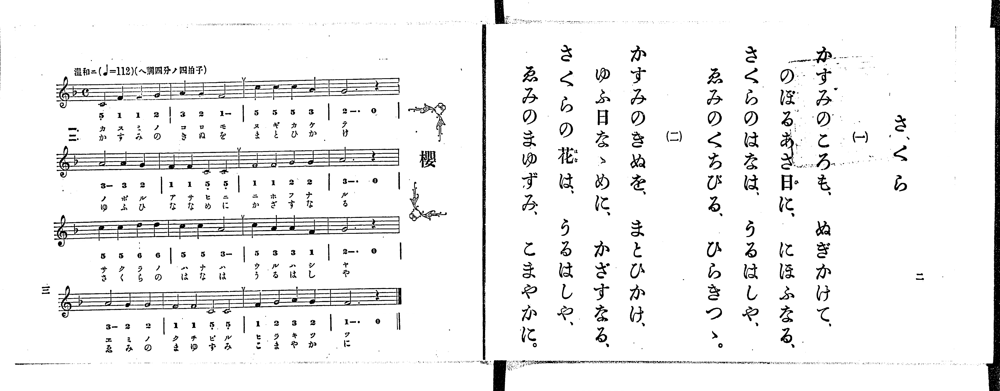

# 櫻

> Re:Shōka 使用 AI 協助辨識與重建樂譜，可能會有錯誤。歡迎回報。

- **鋼琴伴奏版**：<br><audio controls src="sakura.mp3"></audio>
- **NEUTRINO 歌聲合成版**：<br><audio controls src="sakura_neutrino.mp3"></audio>

- 出處：共益商社樂器店《唱歌教科書 生徒用 巻一》第二～三頁（第一曲）
- NDL Digital Collections PID 854862（https://dl.ndl.go.jp/pid/854862）掃描 P003.jpg

## 說明

原書資訊與歌詞全文（NDL PID 854862《唱歌教科書 生徒用 巻一》第二～三頁，掃描 P003.jpg）：
調性與拍號：ヘ調四分ノ四拍子（F 大調 4/4 拍），♩=112，「温和ニ」
註記：目次與樂譜頁標題作「櫻」，歌詞頁標題作「さくら」。分節歌，二節同一旋律。五線譜每行第三小節前印有換氣記號（V）。五線譜與簡譜一致。


## 歌詞

```text
一、
かすみのころも、ぬぎかけて、
のぼるあさ日に、にほふなる、
さくらのはなは、うるはしや、
ゑみのくちびる、ひらきつゝ。

二、
かすみのきぬを、まとひかけ、
ゆふ日なゝめに、かざすなる、
さくらの花は、うるはしや、
ゑみのまゆずみ、こまやかに。
```

## ABC

<div class="abc-score" data-abc-src="sakura.abc" aria-label="五線譜載入中"></div>

[下載 ABC 原始檔](sakura.abc)

## TMD 檔案連結

- [主旋律 TMD 檔案](sakura.tmd) [[在 TMD Studio 編輯](https://tmdlang.github.io/Tmd-TS/#tmd=s7IKdvYPcrWy4qpTUCpJTLdSSM7PyUlNLsnMz7PKrsxPzc6ML87Iz05Ugisoy88pzU21yk7MizeMtzA1sTAzQkgW55cWJadaFSdn5OfnxJekVpQk5edno8vHFySmp1oFGBgYI2QKivLLUvMS84C6C4oy80pSU8DaEQpSyzJTUkHSxclAq8tSizLTMlNTkNyVWlQMcjXUipKixLzi5KLMApBXEKrSU_OKUq2SMzJzUopS8-KL8_PSEZJp-UW5VsUlRfkFGZnJCOGSjFSghwtyEvOQnAMRLE5NBBpRjBDOL8pMz8yzyk3NzMpE8r-WlsKz1bsVtLS4FG0VDA2NuOxtFdy4bEz0TexAWp-273oxc-r7PbOetm58Prvr6dS250v2PVvR9HTmiqe7pj9u6Ho6ZeOztT3Pps58vnzis9k7FJ5Pmf9036TnU1YoPN2--8mOhscN3c_XrHmyq-f93nlPdnS-XND4fk8HSGRHw7PZm97v6QS70M_FR8EF6L6SxBwFZ3g8FysEeLooQGISqCujpKSg2EpfPyVHLw-I0_P1sgr0CzJT9GEqOp_1NT_r71cAxR9QDhh-XPpaCrbUAlwKCgpP--YDfflic_uLFV0vOtqBXn-xct7T1hXPprUDXQjyBsLJZIZOD5ovgP4Chj_I8her9j9rWA6ytrv3xcz5QNHHzTOAgk9nz37a0fa4uQ_IAEo9XTsB6BY3hadLlgMlFYBRqQAUBRvT82jmSltgLANZjxt6nu1Y-XRSz-Pm7scNvWDzV-x-sWIG0Njns9c9W7MQZNGKphdr5wCd9WzFzJcLe57snQPStno3UAPIoWDfo8k-bpz6uLH_cVMnUM3jhiagw56vbwCqBKoH-hPIfjqhBxT507uf7gNa3PRk15Tn22cBbXm2vv_Fwh5w0uh8uqEfpLKz92nvhmdzOp_1z362YTHQbWBfd4QB_YKsE-jQ5xsWAhlAc1-0bwFKcYG8Aw7fRhDrcWP348aZjxv3P25c97hx8uOm3sdNTUC5x41rHjf2gWUnPm5cBlcNVLTncRNQtAnom2fTlz5uXA1Wvfpx4-7HjVsfN64CycJUw_wL0rYeJAckQarbwEYARaY_bmqBqW4CWgRxRv_jxoWPGzdDTHrcuAlsRO_jxiWPm-bCvbALGE9YvABUtuZx0ySwxn2PG1eAtEN8AbOmDehOsMuBTp37uAnseJBqoKJpYINweOFF10Yi3b8PbMksEBekejJYpAVsA9CqJpBqyvMcFCho6XNxBSdmlxYlWgVkJublO9QY1FSDrFCwMdGyAzOAWR1oORDPBOL9oFhUqAGSk4Fu7gXiJjBvDRD3QdVNBIssA5kN0l-jYBqvYAiERkCmMZA0VNAFCYKhMZBlBOTrKhgo1ICV-xiCdOOzD6Qbu40gc-Jh5hhhNwdoBkhv0ySoOfuAeAUQbwKrBolMRDEH7P11QLwHqAmioAkUs1Atq8Eiq4F4NxBvBeJVIBGgSrj3jYGmgfxdAw4FYGAAEYRtBA0TTP-vA4qQbiWG_5vawOaA1GwC61oFwU2NcHNAITQNGkrYzAH7H2R1P1CqEx6M66GGrQfz2sDaIKLTwYa0IEU_EJoBIYQF8i2IZQyEhjhiH591kFjDZiFm7FNuDsj3TROBkogEBDSwcSEQb4ZHDjBSwFaAktYSsCFzUWMfEs-osW8ETxMY_gdaCIo1kqwEkpixj24OMK0DUwSwcAGLQnMVWLQFnBIg6QpmTi0Xl66dAqR0UACylLkA)]
- [鋼琴伴奏 TMD 檔案](sakura_piano.tmd) [[在 TMD Studio 編輯](https://tmdlang.github.io/Tmd-TS/#tmd=s7IKdvYPcrWy4tLSUni2evf7PR0vu_c8n7DlyZ4tT5f2P-_seL-nU0FLi0vRVsHQ0IjL3lbBjcvGRN_EjqtOQelp-64XM6e-3zPraevG57O7nk5te75k37MVTU9nrni6a_rjhq6nUzY-W9vzbOrM58snPpu9Q-H5lPlP9016PmWFwtPtu5_saHjc0P18zZonu3re7533ZEfnywWNQAeARHY0PJu9CWi1EsgaPxcfBZfM9MySxBwF5_ycnNTkksz8vGKFAE8XBQtTEwszI6CujJKSgmIrff2UHL08IE7P18sq0C_ITNGHqeh81tf8rL9fIcDAwBgol67ExRWcmF1alGgVkJmYlx_k4VBjUFPNpQAENiZadmCGvpbC48ZuIJ4JxPuBeJ1CDZCcrPC4qReIm8C8NUDcB1U3ESyyTEFLH6y_RsE0XsEQCI2ATGMgaaigCxIEQ2MgywjI11UwUKgBK_cxBOnGZx9IN3YbQebEw8wxwm4O0AyQ3qZJUHP2AfEKIN4EVg0SmYhiDtj764B4D1ATREETEE-FalkNFlkNxLuBeCsQrwKJAFXCvW8MNA3k7xpwKAADA4ggbCNomGD6fx1QhHQrMfzf1AY2B6RmE1jXKghuaoSbAwqhadBQwmYO2P8gq_uBUp3wYFwPNWw9mNcG1gYRnQ42pAUp-oHQDAghLJBvQSxjIDTEEfv4rIPEGjYLMWOfcnNAvm-aCJREJCCggY0LgXgzPHKAkQK2ApS0loANmYsa-5B4Ro19I3iawPA_0EJQrJFkJZDEjH10c4BpHZgiHjfOAotCcxVYtAWcEiDpCmZOLWrh4IOjcHjR1_Wyvfdp646Xs1shJSbC84bxCtGGsUAvA2nT-FigCBYxVLVQCqQSrgSXWmzmwvSTq9IESJkQoY7K7sRiBopaUAIBRoiunQIkTqJ9gOJIPCMwT5kLAA)]

## 分析

```text
================================================================================
📊 TMD Song Profile: [ 櫻 ]
================================================================================
⏱  Duration:       0:34 (34.3s), 16 measures total
🎼 Key & Tempo:    首調基準 F, != 112.0 BPM, <4/4>
   - 分析範圍：      由實際發聲的音符與和弦推測調性；播放脈絡另行呈現
🎤 人聲音域:    C4 (MIDI 60) – D5 (MIDI 74) [跨度: 14 個半音 / 1.2 個八度, 難度: moderate]
   - 最低音:  C4 in [Sakura #1 @ m.1, 0:00]
   - 最高音: D5 in [Sakura #1 @ m.9, 0:18]
   - 適合: soprano, mezzo-soprano, contralto, tenor, baritone, bass
🏛  結構:      Sakura (34.3s)
⚡ 編曲密度:        Peak 1 軌道同時演奏
🗝  調性診斷：       F 大調（純淨自然大調，未偵測到可信轉調）
   - 風格氣質:    純淨自然大調（陽光明朗、易唱易記，無明顯調外色彩）
   - 轉調歷程:    全曲維持單一推測調性（未偵測到可信轉調）
   - 核心骨幹音:  F, G, A, C, D
   - 調性數值:    F 大調 [相關度: 0.77, 穩定度: Moderate, 自然音純度: 100.0%]
   - 候選調性 (K-S): F 大調 (0.77), C 大調 (0.73), A 小調 (0.63)
   - 五度圈歷程:   -1
   - 各段落調性細節:
     • [Sakura #1]: F 大調 (r: 0.77, 自然音純度: 100.0%)

  [ 五度圈游移軌跡 ]
               C  
        [F ]*          G  
      Bb               D  
      Eb               A  
         Ab           E  
            Db       B  
               F# 
     (* = active key center)

  [ 十二半音累積音高分佈 ]
     C  : █████████████████████     21.7%
     C# :                            0.0%
     D  : ███                        3.3%
     D# :                            0.0%
     E  :                            0.0%
     F  : ████████████████████████  25.0%
     F# :                            0.0%
     G  : ████████████████████████  25.0%
     G# :                            0.0%
     A  : ████████████████████████  25.0%
     A# :                            0.0%
     B  :                            0.0%
--------------------------------------------------------------------------------
Assignment 軌道音域：
  - Piano         : C4 – D5 (14 個半音 / 1.2 個八度, 48 個音符)
================================================================================
```


## 原書掃描頁




