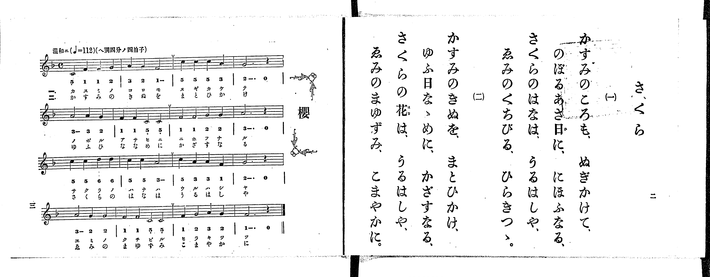

# 櫻

<audio controls src="sakura.mp3"></audio>

- 出處：共益商社樂器店《唱歌教科書 生徒用 巻一》第二～三頁（第一曲）
- NDL Digital Collections PID 854862（https://dl.ndl.go.jp/pid/854862）掃描 P003.jpg

## 說明

原書資訊與歌詞全文（NDL PID 854862《唱歌教科書 生徒用 巻一》第二～三頁，掃描 P003.jpg）：
調性與拍號：ヘ調四分ノ四拍子（F 大調 4/4 拍），♩=112，「温和ニ」
註記：目次與樂譜頁標題作「櫻」，歌詞頁標題作「さくら」。分節歌，二節同一旋律。五線譜每行第三小節前印有換氣記號（V）。五線譜與簡譜一致。

## 歌詞

```text
一、
かすみのころも、ぬぎかけて、
のぼるあさ日に、にほふなる、
さくらのはなは、うるはしや、
ゑみのくちびる、ひらきつゝ。

二、
かすみのきぬを、まとひかけ、
ゆふ日なゝめに、かざすなる、
さくらの花は、うるはしや、
ゑみのまゆずみ、こまやかに。
```

## ABC

```abc
X:1
T:櫻
M:4/4
L:1/16
Q:1/4=112
K:F
V:V1 name="Piano" snm="Pia"
[V:V1]
C4 F4 F4 G4 | A4 G4 F8 | c4 c4 c4 A4 | G12 z4 |
A8 A4 G4 | F4 F4 C4 C4 | F4 F4 G4 G4 | A12 z4 |
c4 c4 d4 d4 | c4 c4 A8 | c4 A4 A4 F4 | G12 z4 |
A8 G4 G4 | F4 F4 C4 C4 | F4 G4 A4 G4 | F12 z4 |
C4 F4 F4 G4 | A4 G4 F8 | c4 c4 c4 A4 | G12 z4 |
A8 A4 G4 | F4 F4 C4 C4 | F4 F4 G4 G4 | A12 z4 |
c4 c4 d4 d4 | c4 c4 A8 | c4 A4 A4 F4 | G12 z4 |
A8 G4 G4 | F4 F4 C4 C4 | F4 G4 A4 G4 | F12 z4 |
```

## TMD 檔案連結

- [主旋律 TMD 檔案](sakura.tmd) [[在 TMD Studio 編輯](https://tmdlang.github.io/Tmd-TS/#tmd=s7IKdvYPcrWy4qpTUCpJTLdSSM7PyUlNLsnMz7PKrsxPzc6ML87Iz05Ugisoy88pzU21yk7MizeMtzA1sTAzQkgW55cWJadaFSdn5OfnxJekVpQk5edno8vHFySmp1oFGBgYI2QKivLLUvMS84C6C4oy80pSU8DaEQpSyzJTUkHSxclAq8tSizLTMlNTkNyVWlQMcjXUipKixLzi5KLMApBXEKrSU_OKUq2SMzJzUopS8-KL8_PSEZJp-UW5VsUlRfkFGZnJCOGSjFSghwtyEvOQnAMRLE5NBBpRrMSlpaXwbPVuBS0tLkVbBUNDIy57WwU3LhsTfRM7kJan7btezJz6fs-sp60bn8_uejq17fmSfc9WND2dueLprumPG7qeTtn4bG3Ps6kzny-f-Gz2DoXnU-Y_3Tfp-ZQVCk-3736yo-FxQ_fzNWue7Op5v3fekx2dLxc0vt_TARLZ0fBs9qb3ezrBLvNz8VFwyUzPLEnMUXCGR2SxQoCniwIkqoC6MkpKCoqt9PVTcvTygDg9Xy-rQL8gM0UfpqLzWV_zs_5-BVAEAeWAAcSlr6VgSy3ApaCg8LRvPtCXLza3v1jR9aKjHej1FyvnPW1d8WxaO9CFIG8gnExm6PSg-QLoL2D4gyx_sWr_s4blIGu7e1_MnA8Ufdw8Ayj4dPbspx1tj5v7gAyg1NO1E4BucVN4umQ5UFIBGJUKQFGwMT2PZq60BcYykPW4oefZjpVPJ_U8bu5-3NALNn_F7hcrZgCNfT573bM1C0EWrWh6sXYO0FnPVsx8ubDnyd45IG2rdwM1gBwK9j2a7OPGqY8b-x83dQLVPG5oAjrs-foGoEqgeqA_geynE3pAkT-9--k-oMVNT3ZNeb59FtCWZ-v7XyzsASeNzqcb-kEqO3uf9m54NqfzWf_sZxsWA90G9nVHGNAvyDqBDn2-YSGQATT3RfsWoBQXyDvg8G0EsR43dj9unPm4cf_jxnWPGyc_bup93NQElHvcuOZxYx9YduLjxmVw1UBFex43AUWbgL55Nn3p48bVYNWrHzfufty49XHjKpAsTDXMvyBt60FyQBKkug1sBFBk-uOmFpjqJqBFEGf0P25c-LhxM8Skx42bwEb0Pm5c8rhpLtwLu4DxhMULQGVrHjdNAmvc97hxBUg7xBcwa9qA7gS7HOjUuY-bwI4HqQYqmgY2CIcXXnRtJNL9-8CWzAJxQaong0VawDYArWoCqaY8z0GBgpY-F1dwYnZpUaJVQGZiXr5DjUGNQjXIDgUbCy07MAOY14G2A_FMIN4PikaFGiA5GejoXiBuAvPWAHEfVN1EsMgykOEg_TUKpvEKugqGUGwExDUKxlAWSAQEgYqAJAyDZGvA8jBoABJBOGcdEO8BWt4NtqoJFNRAvAmIV4NFVgPxbiDeCsSrQCJAlXDngEwHQZgbauBuAzsUTCDEQCoQbsbhHpDt_UBbOuHBsx5sM4gG8drALoCITge7pwUpeKC-NoNihAjMRogIiAfCIFfhC52miSgRBXRX40Ig3gwPL2A4gV0KjL7GJWDXzMUMHYS_cYUOSBY1DFHdU8vFpWunAEleCigsZS4A)]

## 分析

```text
================================================================================
📊 TMD Song Profile: [ 櫻 ]
================================================================================
⏱  Duration:       1:08 (68.6s), 32 measures total
🎼 Key & Tempo:    首調基準 F, != 112.0 BPM, <4/4>
   - 分析範圍：      由實際發聲的音符與和弦推測調性；播放脈絡另行呈現
🎤 人聲音域:    C4 (MIDI 60) – D5 (MIDI 74) [跨度: 14 個半音 / 1.2 個八度, 難度: moderate]
   - 最低音:  C4 in [Sakura #1 @ m.1, 0:00]
   - 最高音: D5 in [Sakura #1 @ m.9, 0:18]
   - 適合: soprano, mezzo-soprano, contralto, tenor, baritone, bass
🏛  結構:      Sakura (34.3s) -> Sakura (34.3s)
⚡ 編曲密度:        Peak 1 軌道同時演奏
🗝  調性診斷：       F 大調（純淨自然大調，未偵測到可信轉調）
   - 風格氣質:    純淨自然大調（陽光明朗、易唱易記，無明顯調外色彩）
   - 轉調歷程:    全曲維持單一推測調性（未偵測到可信轉調）
   - 核心骨幹音:  F, G, A, C, D
   - 調性數值:    F 大調 [相關度: 0.77, 穩定度: Moderate, 自然音純度: 100.0%]
   - 候選調性 (K-S): F 大調 (0.77), C 大調 (0.73), A 小調 (0.63)
   - 五度圈歷程:   -1 -> -1
   - 各段落調性細節:
     • [Sakura #1]: F 大調 (r: 0.77, 自然音純度: 100.0%)
     • [Sakura #2]: F 大調 (r: 0.77, 自然音純度: 100.0%)

  [ 五度圈游移軌跡 ]
               C  
        [F ]*          G  
      Bb               D  
      Eb               A  
         Ab           E  
            Db       B  
               F# 
     (* = active key center)

  [ 十二半音累積音高分佈 ]
     C  : █████████████████████     21.7%
     C# :                            0.0%
     D  : ███                        3.3%
     D# :                            0.0%
     E  :                            0.0%
     F  : ████████████████████████  25.0%
     F# :                            0.0%
     G  : ████████████████████████  25.0%
     G# :                            0.0%
     A  : ████████████████████████  25.0%
     A# :                            0.0%
     B  :                            0.0%
--------------------------------------------------------------------------------
Assignment 軌道音域：
  - Piano         : C4 – D5 (14 個半音 / 1.2 個八度, 96 個音符)
================================================================================
```


## 原書掃描頁




