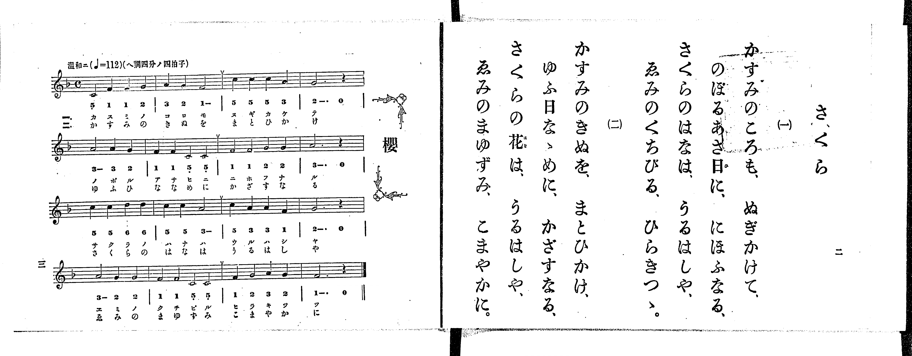

# 櫻

> Re:Shōka 使用 AI 協助辨識與重建樂譜，可能會有錯誤。歡迎[回報](https://github.com/TMDLang/reshoka/issues)。

- **鋼琴伴奏版**：<br><audio controls src="sakura.mp3"></audio>
- **NEUTRINO 歌聲合成版**：<br><audio controls src="sakura_neutrino.mp3"></audio>

- 出處：共益商社樂器店《唱歌教科書 生徒用 巻一》第二～三頁（第一曲）
- NDL Digital Collections PID 854862（https://dl.ndl.go.jp/pid/854862）掃描 P003.jpg

## 說明

原書資訊與歌詞全文（NDL PID 854862《唱歌教科書 生徒用 巻一》第二～三頁，掃描 P003.jpg）：
調性與拍號：ヘ調四分ノ四拍子（F 大調 4/4 拍），♩=112，「温和ニ」
註記：目次與樂譜頁標題作「櫻」，歌詞頁標題作「さくら」。分節歌，二節同一旋律。五線譜每行第三小節前印有換氣記號（V）。五線譜與簡譜一致。


## 歌詞

```text
一、
かすみのころも、ぬぎかけて、
のぼるあさ日に、にほふなる、
さくらのはなは、うるはしや、
ゑみのくちびる、ひらきつゝ。

二、
かすみのきぬを、まとひかけ、
ゆふ日なゝめに、かざすなる、
さくらの花は、うるはしや、
ゑみのまゆずみ、こまやかに。
```

## ABC

<div class="abc-score" data-abc-src="sakura.abc" aria-label="五線譜載入中"></div>

[下載 ABC 原始檔](sakura.abc)

## TMD 檔案連結

- [主旋律 TMD 檔案](sakura.tmd) [[在 TMD Studio 編輯](https://tmdlang.github.io/Tmd-TS/#tmd=s7IKdvYPcrWy4qpTUCpJTLdSSM7PyUlNLsnMz7PKrsxPzc6ML87Iz05Ugisoy88pzU21yk7MizeMtzA1sTAzQkgW55cWJadaFSdn5OfnxJekVpQk5edno8vHFySmp1oFGBgYI2QKivLLUvMS84C6C4oy80pSU8DaEQpSyzJTUkHSxclAq8tSizLTMlNTkNyVWlQMcjXUipKixLzi5KLMApBXEKrSU_OKUq2SMzJzUopS8-KL8_PSEZJp-UW5VsUlRfkFGZnJCOGSjFSghwtyEvOQnAMRLE5NBBpRjBDOL8pMz8yzyk3NzMrE4v_8opKM_PSixIKMSquMzOISoPLkxJx4YGACQ1hLS-HZ6t0KWlpcirYKhoZGXPa2Cm5cNib6JnYgA56273oxc-r7PbOetm58Prvr6dS250v2PVvR9HTmiqe7pj9u6Ho6ZeOztT3Pps58vnzis9k7FJ5Pmf9036TnU1YoPN2--8mOhscN3c_XrHmyq-f93nlPdnS-XND4fk8HSGRHw7PZm97v6QS708_FR8EF6ImSxBwFZ3hiKFYI8HRRgEQ3UFdGSUlBsZW-fkqOXh4Qp-frZRXoF2Sm6MNUdD7ra37W368AimSgHDCQufS1FGypBbgUFBSe9s0H-vLF5vYXK7pedLQDvf5i5bynrSueTWsHuhDkDYSTyQydHjRfAP0FDH-Q5S9W7X_WsBxkbXfvi5nzgaKPm2cABZ_Onv20o-1xcx-QAZR6unYC0C1uCk-XLAdKKgCjUgEoCjam59HMlbbAWAayHjf0PNux8umknsfN3Y8besHmr9j9YsUMoLHPZ697tmYhyKIVTS_WzgE669mKmS8X9jzZOwekbfVuoAaQQ8G-R5N93Dj1cWP_46ZOoJrHDU1Ahz1f3wBUCVQP9CeQ_XRCDyjyp3c_3Qe0uOnJrinPt88C2vJsff-LhT3gpNH5dEM_SGVn79PeDc_mdD7rn_1sw2Kg28C-7ggD-gVZJ9ChzzcsBDKA5r5o3wKU4gJ5Bxy-jSDW48bux40zHzfuf9y47nHj5MdNvY-bmoByjxvXPG7sA8tOfNy4DK4aqGjP4yagaBPQN8-mL33cuBqsevXjxt2PG7c-blwFkoWphvkXpG09SA5IglS3gY0Aikx_3NQCU90EtAjijP7HjQsfN26GmPS4cRPYiN7HjUseN82Fe2EXMJ6weAGobM3jpklgjfseN64AaYf4AmZNG9CdYJcDnTr3cRPY8SDVQEXTwAbh8MKLro1Eun8f2JJZIC5I9WSwSAvYBqBVTSDVlOc5KFDQ0ufiCk7MLi1KtArITMzLd6gxqKkGWaFgY6JlB2YAszrQciCeCcT7QbGoUAMkJwPd3AvETWDeGiDug6qbCBZZBjIbpL9GwTRewRAIjYBMYyBpqKALEgRDYyDLCMjXVTBQqAEr9zEE6cZnH0g3dhtB5sTDzDHCbg7QDJDepklQc_YB8Qog3gRWDRKZiGIO2PvrgHgPUBNEQRMoZqFaVoNFVgPxbiDeCsSrQCJAlXDvGwNNA_m7BhwKwMAAIgjbCBommP5fBxQh3UoM_ze1gc0BqdkE1rUKgpsa4eaAQmgaNJSwmQP2P8jqfqBUJzwY10MNWw_mtYG1QUSngw1pQYp-IDQDQggL5FsQyxgIDXHEPj7rILGGzULM2KfcHJDvmyYCJREJCGhg40Ig3gyPHGCkgK0AJa0lYEPmosY-JJ5RY98IniYw_A-0EBRrJFkJJDFjH90cYFoHpghg4QIWheYqsGgLOCVA0hXMnFouLl07BUjpoABkKXMBAA)]
- [鋼琴伴奏 TMD 檔案](sakura_piano.tmd) [[在 TMD Studio 編輯](https://tmdlang.github.io/Tmd-TS/#tmd=s7IKdvYPcrWy4qpTUCpJTLdSyC8qychPL0osyKi0ysgsLskvykxOzInPTsxLVOLS0lJ4tnr3-z0dL7v3PJ-w5cmeLU-X9j_v7Hi_p1NBS4tL0VbB0NCIy95WwY3LxkTfxA5k6tP2XS9mTn2_Z9bT1o3PZ3c9ndr2fMm-Zyuans5c8XTX9McNXU-nbHy2tufZ1JnPl098NnuHwvMp85_um_R8ygqFp9t3P9nR8Lih-_maNU929bzfO-_Jjs6XCxqBDgCJ7Gh4NnsT0GolkDV-Lj4KLpnpmSWJOQrO-Tk5qcklmfl5xQoBni4KFqYmFmZGQF0ZJSUFxVb6-ik5enlAnJ6vl1WgX5CZog9T0fmsr_lZf79CgIGBMVAuXYmLKzgxu7Qo0SogMzEvP8jDocagpppLAQhsTLTswAx9LYXHjd1APBOI9wPxOoUaIDlZ4XFTLxA3gXlrgLgPqm4iWGSZgpY-WH-Ngmm8giEQGgGZxkDSUEEXJAiGxkCWEZCvq2CgUANW7mMI0o3PPpBu7DaCzImHmWOE3RygGSC9TZOg5uwD4hVAvAmsGiQyEcUcsPfXAfEeoCaIgiYgngrVshosshqIdwPxViBeBRIBqoR73xhoGsjfNeBQAAYGEEHYRtAwwfT_OqAI6VZi-L-pDWwOSM0msK5VENzUCDcHFELToKGEzRyw_0FW9wOlOuHBuB5q2Howrw2sDSI6HWxIC1L0A6EZEEJYIN-CWMZAaIgj9vFZB4k1bBZixj7l5oB83zQRKIlIQEADGxcC8WZ45AAjBWwFKGktARsyFzX2IfGMGvtG8DSB4X-ghaBYI8lKIIkZ--jmANM6MEU8bpwFFoXmKrBoCzglQNIVzJxa1MLBB0fh8KKv62V779PWHS9nt0JKTITnDeMVog1jgV4G0qbxsUARLGKoaqEUSCVcCS612MyF6SdXpQmQMiFCHZXdicUMFLWgBAKMEF07BUicRPsAxZF4RmCeMhcA)]

## 分析

```text
================================================================================
📊 TMD Song Profile: [ 櫻 ]
================================================================================
⏱  Duration:       0:34 (34.3s), 16 measures total
🎼 Key & Tempo:    首調基準 F, != 112.0 BPM, <4/4>
   - 分析範圍：      由實際發聲的音符與和弦推測調性；播放脈絡另行呈現
🎤 人聲音域:    C4 (MIDI 60) – D5 (MIDI 74) [跨度: 14 個半音 / 1.2 個八度, 難度: moderate]
   - 最低音:  C4 in [Sakura #1 @ m.1, 0:00]
   - 最高音: D5 in [Sakura #1 @ m.9, 0:18]
   - 適合: soprano, mezzo-soprano, contralto, tenor, baritone, bass
🏛  結構:      Sakura (34.3s)
⚡ 編曲密度:        Peak 1 軌道同時演奏
🗝  調性診斷：       F 大調（純淨自然大調，未偵測到可信轉調）
   - 風格氣質:    純淨自然大調（陽光明朗、易唱易記，無明顯調外色彩）
   - 轉調歷程:    全曲維持單一推測調性（未偵測到可信轉調）
   - 核心骨幹音:  F, G, A, C, D
   - 調性數值:    F 大調 [相關度: 0.77, 穩定度: Moderate, 自然音純度: 100.0%]
   - 候選調性 (K-S): F 大調 (0.77), C 大調 (0.73), A 小調 (0.63)
   - 五度圈歷程:   -1
   - 各段落調性細節:
     • [Sakura #1]: F 大調 (r: 0.77, 自然音純度: 100.0%)

  [ 五度圈游移軌跡 ]
               C  
        [F ]*          G  
      Bb               D  
      Eb               A  
         Ab           E  
            Db       B  
               F# 
     (* = active key center)

  [ 十二半音累積音高分佈 ]
     C  : █████████████████████     21.7%
     C# :                            0.0%
     D  : ███                        3.3%
     D# :                            0.0%
     E  :                            0.0%
     F  : ████████████████████████  25.0%
     F# :                            0.0%
     G  : ████████████████████████  25.0%
     G# :                            0.0%
     A  : ████████████████████████  25.0%
     A# :                            0.0%
     B  :                            0.0%
--------------------------------------------------------------------------------
Assignment 軌道音域：
  - Piano         : C4 – D5 (14 個半音 / 1.2 個八度, 48 個音符)
================================================================================
```


## 原書掃描頁




