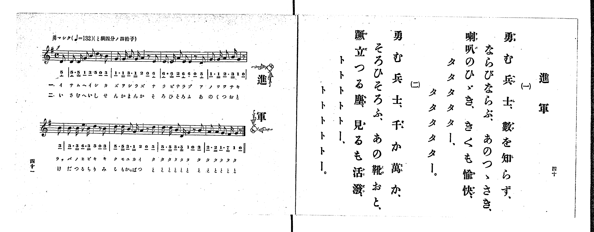

# 進軍

> Re:Shōka 使用 AI 協助辨識與重建樂譜，可能會有錯誤。歡迎回報。

- **鋼琴伴奏版**：<br><audio controls src="shingun.mp3"></audio>
- **NEUTRINO 歌聲合成版**：<br><audio controls src="shingun_neutrino.mp3"></audio>

- 出處：共益商社樂器店《唱歌教科書 生徒用 巻一》第四十～四十一頁（第二十曲）
- NDL Digital Collections PID 854862（https://dl.ndl.go.jp/pid/854862）掃描 P022.jpg

## 說明

原書資訊與歌詞全文（NDL PID 854862《唱歌教科書 生徒用 巻一》第四十～四十一頁，掃描 P022.jpg）：
調性與拍號：と調四分ノ四拍子（G 大調 4/4 拍），♩=132，「勇マシク」，弱起半拍（八分音符）
註記：第三學期第六曲（全卷第二十曲）。分節歌，二節同一旋律。開頭標 f。全曲兩行各以八分音符弱起開始，第一行末以四分音符加八分休止符收尾（與第二行弱起合成完整小節）。第三小節第二拍五線譜為八分音符 A4、E4（2_ 6_.），簡譜「2」下漏印底線。末句右頁歌詞印長音「タタタター、タタタター。」／「トトトトー、トトトトー。」，譜下配字印「タタタタタ タタタタタ」／「ととととと ととととと」。


## 歌詞

```text
一、
勇む兵士、數を知らず、
ならびならぶ、あのつゝさき、
喇叭のひゞき、きくも愉快、
タタタター、タタタター。

二、
勇む兵士、千か萬か、
そろひそろふ、あの靴おと、
蹴立つる塵、見るも活潑、
トトトトー、トトトトー。
```

## ABC

```abc
X:1
T:進軍
M:4/4
L:1/16
Q:1/4=132
K:G
V:V1 name="Piano" snm="Pia"
[V:V1]
!f! z2 z2 z2 z2 z2 z2 z2 D2 | D3 D G2 B2 d4 z2 B2 | G3 G B3 G A4 z2 E2 | E3 E A2 E2 E4 z2 D2 |
w: 1.~い | さ む へ い し か | ず を し ら ず な | ら び な ら ぶ あ
w: 2.~い | さ む へ い し せ | ん か ま ん か そ | ろ ひ そ ろ ふ あ
G3 G A3 B G4 z2 B2 | B3 B e3 B d4 z2 B2 | d3 d B3 G A4 z2 d2 | d3 d B3 D G4 z2 B2 |
w: 1.~の つ つ さ き らっ | ぱ の ひ び き き | く も ゆ か い た | た た た た た た
w: 2.~の く つ お と け | だ つ る ち り み | る も かっ ぱ つ と | と と と と と と
A3 A G3 F G4 z2 z2 |
w: 1.~た た た た た
w: 2.~と と と と と
```

## TMD 檔案連結

- [主旋律 TMD 檔案](shingun.tmd) [[在 TMD Studio 編輯](https://tmdlang.github.io/Tmd-TS/#tmd=s7IKdvYPcrWy4qpTUCpJTLdSSM7PyUlNLsnMz7PKrsxPzc6ML87Iz05Ugisoy88pzU21yk7MizeMtzA1sTAzQkgW55cWJadaFSdn5OfnxJekVpQk5edno8vHFySmp1oFGBgh6Swoyi9LzUvMA-ouKMrMK0lNAWtHKEgty0xJBUkXJwOtLkstykzLTE1BcldqUTHI1VArSooS84qTizILQF5BqEpPzStKtcpNLErOQAim5RflWhWXFOUXZGQmI4RLMlKBHs3NzMksSSyqRIjnF2WmZ-ZZ5aZmZmUi-VFLS-Flw6YXu3sVtLS4FG0VDI2NuOxtFdy5bEz0TexAup-273oxc-r7PbOetm58Prvr6dS250v2PVvR9HTmiqe7pj9u6Ho6ZeOztT3Pps58vnzis9k7FJ5Pmf9036TnU1YoPN2--8mOhscN3c_XrHk6e_bT3sb3e-dBGEDxlwsa3-_pAEo92dUDFHk2e9P7PZ1gB_u5-Ci4AJ1bkpij4AyP2mKFAE8XBUjkATVmlJQUFFvp66fk6OUBcXq-XlaBfkFmij5MReezvuZn_f0KoCgDyqUrcXHpaynYUgtwKSgoPO2bD_Txi83tL1Z0vehoBwbDi5XznraueDatHehCkDcQTqY0pHrQvAP0IDBSQK54sWr_s4blIPu7e1_MnA8Ufdy4AigI0t_R9ri5D8gASj1dOwHoKHeFp0uWAyUVgPGrABQFG9PzaOZKW2DUA1mPG3qedrc_bp73uGn746b1jxuAKnqe7tn4Yuv2p71dYA0dT1tXAw1-OX_z8zXLgPrBblix-8WKGUCrQfG5o_Pp2h3P5swHeaZ1LThigXpWPO3djhbbjxuagAY9X98ADBagNUApIPvphB6gn59N7366rxuo4OW07pcL1j5bMVMhDaQcGLizNz1tXfliYc_TCS1Pdi9FdgzEnUAdT5d3A80Du6UBqPLZnNUgleDwgKrsWgDR-GTPxGdrFwFFnk3Z9nTDPqBLgQEJcSbICojHJ3Q865jwdB0w6rY83dAPdCPE7VC_gkUgWoDh82TXlOfbZ71YO-d50y5ktyk4mjxuaHQ1AdpgFK9gFq8HCfnnGxYC1QJDHZhAep_s6H62p_9p74anu6YCDQFaAXT50_6lT_s3A9MANHn1bng5dTvQTKCex037Eah5D9B8DJEmcAz2gxQ3dyAhsGJ0EYjiHqCDgC552QpMMtOB1qFb1LRfAY2PsKNxBTJSQOMD1QEt4QIlGHBybwRnImBya2p42rr16eLVQKFnU3c8bpr0fP7Sx02djxuBYQBW9LhxFZi_GcbYBnJ_Y9PjxnWPG5c8bpr7uHHq40ag6RAjp7U_7V8Lltv0uGkeRAJENvY_bmp61tL5dD_IKrDBRAQhxMG7gHkDm4Of9jY_bux-MWENkIS7du7jJqBtm2CMrXDXvpy75XFjFzgswEpf7NzyfHU32A_dTxeC1L1Y1g1kg9y5ZfezvRNhRhIReyB1lBdsUKCgpc_FFZyRmZdemmcVkJmYl-9Qo2tYUw2yRMHG0EzLDsyqTqsF08CiVQOSWzSBYbpEoQZIbgW6egEQzwCLAAsUIF4NltkFFN0EEWleCeV3gWRAvObJYB6EPQ0ouwgs0wfELRAMMrlprYIGUMnj5mZNkFNBbqhRMFDQxYlN44FEDYQC8wyBlDGICRaAKALxa8AyukASxAPRRkgqzCDGgCkwDyQJ5kGFUGyDmQQxwRjKR7IL7HAfwxoFkHpc-HFjC9g0YCIH6wYmPyB7B1zmceN0qLkQ1d1Q1bOgqifBVQDzDlwcpnoVRDVQBqyicTNUDCICzGooqpugZq-DqgZGLBBD2FOBuBdZNSinLkZ404i63pwNdfhkqPXdQLwPqhOYhsDBgFA9F6oa4kBg5oSKQUSAeRSvN_uRvAlMm8CyDVn1RLgfgfngcfNEaHIFhjsoMQOTKgiDLF8PFFkExMvAWQGSLfaDZcCFKgbGlIGndUjiNFYwg9KYyRgiYoo1GYPk0FVA8wSqIRBNRlAZc1QlIIxIwo8bN0JDaB04fBHJCSVRgHkg1f0QFU1NQNwGVQ2KQ1BcI1TPh6oG0RA-NjY5qsFZFJ4yHzcugKoDRQok7TxuXAhkd6HYsB9iA0wFyPXAgh-czEHSG-EJBaYBlFRAxkOSDLRaxGCToxrigVouLl07BWhRrQBkKnMBAA)]
- [鋼琴伴奏 TMD 檔案](shingun_piano.tmd) [[在 TMD Studio 編輯](https://tmdlang.github.io/Tmd-TS/#tmd=s7IKdvYPcrWy4tLSUnjZsOnF7t73ezpedu95PmHLkz1bni7tf97Z8X5Pp4KWFpeirYKhsRGXva2CO5eNib6JHVedgtLT9l0vZk59v2fW09aNz2d3PZ3a9nzJvmcrmp7OXPF01_THDV1Pp2x8trbn2dSZz5dPfDZ7h8LzKfOf7pv0fMoKhafbdz_Z0fC4ofv5mjVPZ89-2tv4fu88CAMo_nJBI9AlQKknu3qAIs9mbwI6QwlkpZ-Lj4JLZnpmSWKOgnN-Tk5qcklmfl6xQoCni4KFqYmFmRFQY0ZJSUGxlb5-So5eHhCn5-tlFegXZKbow1R0PutrftbfrxBgYGQElEtX4uIKzsjMSy_NswrITMzLD_JwqNE1rKnmUgACG0MzLTswqzqtFkzrayloPN2z8cXW7ZoKj5uWKNQAya0Kj5sXAPEMsMjjpu1AvBosswsougki0rwSyu8CyYB4zZPBPAh7GlB2EVimD4hbIBhkctNaBQ2gksfNzZoKWvpgN9QoGCjo4sSm8UCiBkKBeYZAyhjEBAtAFIH4NWAZXSAJ4oFoIyQVZhBjwBSYB5IE86BCKLbBTIKYYAzlI9kFdriPYY0CSD0u_LixBWza48apYN2PmxqA7B1wmceN06HmQlR3Q1XPgqqeBFfxuKkTLg5TvQqiGigDVtG4GSoGEXncuA1FdRPU7HVQ1cCIBWIIeyoQ9yKrbup83LgY4U0j6npzNtThk6HWdwPxPqhOYBoCBwNC9VyoaogDHzcC0x9YDCLyuHErXm_2I3kTmDYbV6Congj3IzAfPG6eCE2uwHAHJWZgUgVhkOXrgSKLgHgZOCtAssV-sMx-rBhTBp7WIYnTWMEMSmMmY4iIKdZkDJJDVwHNE6iGQDQZQWXMUZWAMCIJP27cCA2hdeDwRSQnlEQB5oFU90NUNDUBcRtUNSgOQXGNUD0fqhpEQ_jY2OSoBmdReMp83LgAqg4UKZC087hxIZDdhWLDfogNMBUg1zd2Q5I5SHojPKHANICSCsh4SJIB0djY5KiGeKAWraT2QSmpTaAFNTBhvujretne-7R1x8vZrZDKDJGaDOMVog1jYVQNpgiqOtN4IG0aD1EJ55gAaROEWrg4kqlQJUSYitd-IGUA8bqunQLU99E-QAlkrhGYq8wFAA)]

## 分析

```text
================================================================================
📊 TMD Song Profile: [ 進軍 ]
================================================================================
⏱  Duration:       0:14 (14.5s), 8 measures total
🎼 Key & Tempo:    首調基準 G, != 132.0 BPM, <4/4>
   - 分析範圍：      由實際發聲的音符與和弦推測調性；播放脈絡另行呈現
🎤 人聲音域:    D4 (MIDI 62) – E5 (MIDI 76) [跨度: 14 個半音 / 1.2 個八度, 難度: moderate]
   - 最低音:  D4 in [Shingun #1 @ m.1, 0:01]
   - 最高音: E5 in [Shingun #1 @ m.6, 0:09]
   - 適合: soprano, mezzo-soprano, contralto, tenor, baritone, bass
🏛  結構:      Shingun (14.5s)
⚡ 編曲密度:        Peak 1 軌道同時演奏
🗝  調性診斷：       G 大調（純淨自然大調，未偵測到可信轉調）
   - 風格氣質:    純淨自然大調（陽光明朗、易唱易記，無明顯調外色彩）
   - 轉調歷程:    全曲維持單一推測調性（未偵測到可信轉調）
   - 核心骨幹音:  D, G, B, A, E
   - 調性數值:    G 大調 [相關度: 0.86, 穩定度: Moderate, 自然音純度: 100.0%]
   - 候選調性 (K-S): G 大調 (0.86), D 大調 (0.74), B 小調 (0.70)
   - 五度圈歷程:   +1
   - 各段落調性細節:
     • [Shingun #1]: G 大調 (r: 0.81, 自然音純度: 100.0%)

  [ 五度圈游移軌跡 ]
               C  
         F           [G ]*
      Bb               D  
      Eb               A  
         Ab           E  
            Db       B  
               F# 
     (* = active key center)

  [ 十二半音累積音高分佈 ]
     C  :                            0.0%
     C# :                            0.0%
     D  : ████████████████████████  24.1%
     D# :                            0.0%
     E  : █████████████             13.4%
     F  :                            0.0%
     F# : █                          0.9%
     G  : ████████████████████████  24.1%
     G# :                            0.0%
     A  : ███████████████           15.2%
     A# :                            0.0%
     B  : ██████████████████████    22.3%
--------------------------------------------------------------------------------
Assignment 軌道音域：
  - Piano         : D4 – E5 (14 個半音 / 1.2 個八度, 48 個音符)
================================================================================
```


## 原書掃描頁




