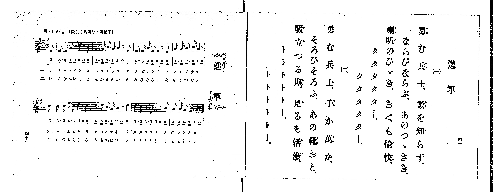

# 進軍

*找不到鋼琴伴奏版 TMD，未產生音訊。*

- 出處：共益商社樂器店《唱歌教科書 生徒用 巻一》第四十～四十一頁（第二十曲）
- NDL Digital Collections PID 854862（https://dl.ndl.go.jp/pid/854862）掃描 P022.jpg

## 說明

原書資訊與歌詞全文（NDL PID 854862《唱歌教科書 生徒用 巻一》第四十～四十一頁，掃描 P022.jpg）：
調性與拍號：と調四分ノ四拍子（G 大調 4/4 拍），♩=132，「勇マシク」，弱起半拍（八分音符）
註記：第三學期第六曲（全卷第二十曲）。分節歌，二節同一旋律。開頭標 f。全曲兩行各以八分音符弱起開始，第一行末以四分音符加八分休止符收尾（與第二行弱起合成完整小節）。第三小節第二拍五線譜為八分音符 A4、E4（2_ 6_.），簡譜「2」下漏印底線。末句右頁歌詞印長音「タタタター、タタタター。」／「トトトトー、トトトトー。」，譜下配字印「タタタタタ タタタタタ」／「ととととと ととととと」。

## 歌詞

```text
一、
勇む兵士、數を知らず、
ならびならぶ、あのつゝさき、
喇叭のひゞき、きくも愉快、
タタタター、タタタター。

二、
勇む兵士、千か萬か、
そろひそろふ、あの靴おと、
蹴立つる塵、見るも活潑、
トトトトー、トトトトー。
```

## ABC

```abc
X:1
T:進軍
M:4/4
L:1/16
Q:1/4=132
K:G
V:V1 name="Piano" snm="Pia"
[V:V1]
!f! z2 z2 z2 z2 z2 z2 z2 D2 | D3 D G2 B2 d4 z2 B2 | G3 G B3 G A4 z2 E2 | E3 E A2 E2 E4 z2 D2 |
G3 G A3 B G4 z2 B2 | B3 B e3 B d4 z2 B2 | d3 d B3 G A4 z2 d2 | d3 d B3 D G4 z2 B2 |
A3 A G3 F G4 z2 z2 | !f! z2 z2 z2 z2 z2 z2 z2 D2 | D3 D G2 B2 d4 z2 B2 | G3 G B3 G A4 z2 E2 |
E3 E A2 E2 E4 z2 D2 | G3 G A3 B G4 z2 B2 | B3 B e3 B d4 z2 B2 | d3 d B3 G A4 z2 d2 |
d3 d B3 D G4 z2 B2 | A3 A G3 F G4 z2 z2 |
```

## TMD 檔案連結

- [主旋律 TMD 檔案](shingun.tmd) [[在 TMD Studio 編輯](https://tmdlang.github.io/Tmd-TS/#tmd=s7IKdvYPcrWy4qpTUCpJTLdSSM7PyUlNLsnMz7PKrsxPzc6ML87Iz05Ugisoy88pzU21yk7MizeMtzA1sTAzQkgW55cWJadaFSdn5OfnxJekVpQk5edno8vHFySmp1oFGBgh6Swoyi9LzUvMA-ouKMrMK0lNAWtHKEgty0xJBUkXJwOtLkstykzLTE1BcldqUTHI1VArSooS84qTizILQF5BqEpPzStKtcpNLErOQAim5RflWhWXFOUXZGQmI4RLMlKBHs3NzMksSSyqVOLS0lJ42bDpxe5eBS0tLkVbBUNjIy57WwV3LhsTfRM7kLan7btezJz6fs-sp60bn8_uejq17fmSfc9WND2dueLprumPG7qeTtn4bG3Ps6kzny-f-Gz2DoXnU-Y_3Tfp-ZQVCk-3736yo-FxQ_fzNWuezp79tLfx_d55EAZQ_OWCxvd7OoBST3b1AEWezd70fk8n2KV-Lj4KLpnpQCfmKDjD465YIcDTRQESO0CNGSUlBcVW-vopOXp5QJyer5dVoF-QmaIPU9H5rK_5WX-_AihOgHLpSlxc-loKttQCXAoKCk_75gN9_GJz-4sVXS862oHB8GLlvKetK55Nawe6EOQNhJMpDakeNO8APQiMFJArXqza_6xhOcj-7t4XM-cDRR83rgAKgvR3tD1u7gMygFJP104AOspd4emS5UBJBWD8KgBFwcb0PJq50hYY9UDW44aep93tj5vnPW7a_rhp_eMGoIqep3s2vti6_WlvF1hDx9PW1UCDX87f_HzNMqB-sBtW7H6xYgbQalB87uh8unbHsznzQZ5pXQuOWKCeFU97t6PF9uOGJqBBz9c3AIMFaA1QCsh-OqEH6Odn07uf7usGKng5rfvlgrXPVsxUSAMpBwbu7E1PW1e-WNjzdELLk91LkR0DcSdQx9Pl3UDzwG5pAKp8Nmc1SCU4PKAquxZAND7ZM_HZ2kVAkWdTtj3dsA_oUmBAQpwJsgLi8QkdzzomPF0HjLotTzf0A90IcTvUr2ARiBZg-DzZNeX59lkv1s553rQL2W0KjiaPGxpdTYA2GMUrmMXrQUL--YaFQLXAUAcmkN4nO7qf7el_2rvh6a6pQEOAVgBd_rR_6dP-zcA0AE1evRteTt0ONBOo53HTfgRq3gM0H0OkCRyD_SDFzR1ICKwYXQSiuAfoIKBLXrYCk8x0oHXoFjXtV0DjI-xoXIGMFND4QHVAS7hACQac3BvBmQiY3JoanrZufbp4NVDo2dQdj5smPZ-_9HFT5-NGYBiAFT1uXAXmb4YxtoHc39j0uHHd48Ylj5vmPm6c-rgRaDrEyGntT_vXguU2PW6aB5EAkY39j5uanrV0Pt0PsgpsMBFBCHHwLmDewObgp73Njxu7X0xYAyThrp37uAlo2yYYYyvctS_nbnnc2AUOC7DSFzu3PF_dDfZD99OFIHUvlnUD2SB3btn9bO9EmJFExB5IHeUFGxQoaOlzcQVnZOall-ZZBWQm5uU71BjUKFSDLFGwMTTTsgOzqtNqwTSwaNWA5BZNYJguUagBkluBrl4AxDPAIsACBYhXg2V2AUU3QUSaV0L5XSAZEK95MpgHYU8Dyi4Cy_QBcQsEg0xuWqugAVTyuLlZE-RUkBtqFAwUdHFi03ggUQOhwDxDIGUMYoIFIIpA_BqwjC6QBPFAtBGSCjOIMWAKzANJgnlQIRTbYCZBTDCG8pHsggXe4-aJUD9OgoQA0H8gDAqt9UCRRUC8DBx-kLDcD5YB50QMjCkDDyCIj4wVzKA0pt8hIqZY_Q6SQ1cBDUhUQyCajKAy5qhKQLiGq5aLS9dOAZrAFFCZylwA)]

## 分析

```text
================================================================================
📊 TMD Song Profile: [ 進軍 ]
================================================================================
⏱  Duration:       0:32 (32.7s), 18 measures total
🎼 Key & Tempo:    首調基準 G, != 132.0 BPM, <4/4>
   - 分析範圍：      由實際發聲的音符與和弦推測調性；播放脈絡另行呈現
🎤 人聲音域:    D4 (MIDI 62) – E5 (MIDI 76) [跨度: 14 個半音 / 1.2 個八度, 難度: moderate]
   - 最低音:  D4 in [Shingun #1 @ m.1, 0:01]
   - 最高音: E5 in [Shingun #1 @ m.6, 0:09]
   - 適合: soprano, mezzo-soprano, contralto, tenor, baritone, bass
🏛  結構:      Shingun (16.4s) -> Shingun (16.4s)
⚡ 編曲密度:        Peak 1 軌道同時演奏
🗝  調性診斷：       G 大調（純淨自然大調，未偵測到可信轉調）
   - 風格氣質:    純淨自然大調（陽光明朗、易唱易記，無明顯調外色彩）
   - 轉調歷程:    全曲維持單一推測調性（未偵測到可信轉調）
   - 核心骨幹音:  D, G, B, A, E
   - 調性數值:    G 大調 [相關度: 0.86, 穩定度: Moderate, 自然音純度: 100.0%]
   - 候選調性 (K-S): G 大調 (0.86), D 大調 (0.74), B 小調 (0.70)
   - 五度圈歷程:   +1 -> +1
   - 各段落調性細節:
     • [Shingun #1]: G 大調 (r: 0.86, 自然音純度: 100.0%)
     • [Shingun #2]: G 大調 (r: 0.86, 自然音純度: 100.0%)

  [ 五度圈游移軌跡 ]
               C  
         F           [G ]*
      Bb               D  
      Eb               A  
         Ab           E  
            Db       B  
               F# 
     (* = active key center)

  [ 十二半音累積音高分佈 ]
     C  :                            0.0%
     C# :                            0.0%
     D  : ████████████████████████  24.1%
     D# :                            0.0%
     E  : █████████████             13.4%
     F  :                            0.0%
     F# : █                          0.9%
     G  : ████████████████████████  24.1%
     G# :                            0.0%
     A  : ███████████████           15.2%
     A# :                            0.0%
     B  : ██████████████████████    22.3%
--------------------------------------------------------------------------------
Assignment 軌道音域：
  - Piano         : D4 – E5 (14 個半音 / 1.2 個八度, 96 個音符)
================================================================================
```


## 原書掃描頁




