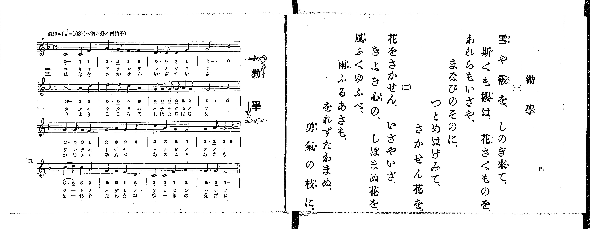

# 勸學

> Re:Shōka 使用 AI 協助辨識與重建樂譜，可能會有錯誤。歡迎回報。

- **NEUTRINO 歌聲合成版**：<br><audio controls src="kangaku_neutrino.mp3"></audio>
- **鋼琴伴奏版**：<br><audio controls src="kangaku.mp3"></audio>


- 出處：共益商社樂器店《唱歌教科書 生徒用 巻一》第四～五頁（第二曲）
- NDL Digital Collections PID 854862（https://dl.ndl.go.jp/pid/854862）掃描 P004.jpg

## 說明

原書資訊與歌詞全文（NDL PID 854862《唱歌教科書 生徒用 巻一》第四～五頁，掃描 P004.jpg）：
調性與拍號：ヘ調四分ノ四拍子（F 大調 4/4 拍），♩=108，「温和ニ」
註記：分節歌，二節同一旋律。第四行第一小節「5・6」有圓滑線（第一節「ツー」、第二節「をー」）。五線譜與簡譜一致。


## 歌詞

```text
一、
雪や霰を、しのぎ來て、
斯くも櫻は、花さくものを、
われらもいざや、
まなびのそのに、
つとめはげみて、
さかせん花を。

二、
花をさかせん、いざやいざ、
きよき心の、しぼまぬ花を、
風ふくゆふべ、
雨ふるあさも、
をれずたわまぬ、
勇氣の枝に。
```

## ABC

```abc
X:1
T:勸學
M:4/4
L:1/16
Q:1/4=108
K:F
V:V1 name="Piano" snm="Pia"
[V:V1]
C8 C4 F4 | A6 G2 F4 F4 | D6 D2 D4 F4 | G12 z4 |
w: 1.~ゆ き や | あ ら れ を | し の ぎ き | て
w: 2.~は な を | さ か せ ん | い ざ や い | ざ
A8 A4 c4 | d6 d2 c4 A4 | G2 G2 G2 G2 A4 G4 | F12 z4 |
w: 1.~か く も | さ く ら は | は な さ く も の | を
w: 2.~き よ き | こ こ ろ の | し ぼ ま ぬ は な | を
G6 G2 G4 F4 | G4 A4 G4 z4 | c4 A4 G4 F4 | G6 A2 G4 z4 |
w: 1.~わ れ ら も | い ざ や | ま な び の | そ の に
w: 2.~か ぜ ふ く | ゆ ふ べ | あ め ふ る | あ さ も
c6 d2 c4 A4 | G4 G4 F4 D4 | C4 C4 F4 A4 | G6 G2 F8 |
w: 1.~つ _ と め | は げ み て | さ か せ ん | は な を
w: 2.~を _ れ ず | た わ ま ぬ | ゆ _ き の | え だ に
```

## TMD 檔案連結

- [主旋律 TMD 檔案](kangaku.tmd) [[在 TMD Studio 編輯](https://tmdlang.github.io/Tmd-TS/#tmd=s7IKdvYPcrWy4qpTUCpJTLdSSM7PyUlNLsnMz7PKrsxPzc6ML87Iz05Ugisoy88pzU21yk7MizeMtzA1sTAzQkgW55cWJadaFSdn5OfnxJekVpQk5edno8vHFySmp1oFGBiYIGQKivLLUvMS84C6C4oy80pSU8DaEQpSyzJTUkHSxclAq8tSizLTMlNTkNyVWlQMcjXUipKixLzi5KLMApBXEKrSU_OKUq2SMzJzUopS8-KL8_PSEZJp-UW5VsUlRfkFGZnJCOGSjFSgh6F-yslMS0WXKshJzENyaX5RZnpmnlVuamZWJlIYaGkpPO3e8XTtDgUtLS5FWwVDAwsue1sFNy4bE30TO5Dup-27Xsyc-n7PrKetG5_P7no6te35kn3PVjQ9nbni6a7pjxu6nk7Z-Gxtz7OpM58vn_hs9g6F51PmP9036fmUFQpPt-9-sqPhcUP38zVrns6e_X7vvCe7prxc0Ph-TwdQ5MmunmezN73f0wl2pJ-Lj4IL0IkliTkKzvDoLlYI8HRRgEQoUFdGSUlBsZW-fkqOXh4Qp-frZRXoF2Sm6MNUdD7ra37W368AikagHDAYufS1FGypBbgUFBSe9s0H-vLF5vYXK7pedLQDvf5i5bynrSueTWsHuhDkDYSTyQydHjRfAP0FDH-Q5S9W7X_WsBxkbXfvi5nzgaKPm2cABYH6n3a0PW7uAzKAUk_XTgC6xU3h6ZLlQEkFYFQqAEXBxvQ8mrnSFhjLQNbjhp5nO1Y-ndTzuLn7cUMv2PwVu1-smAGK7I625-sbgC4HqgNGFJD9dEIP0LnPpnc_3QdU3QRx9IuFPaCY3NHwdEM_UA3QRNPHzbvNgKY9m9P5dM7kZ7snPt8-CxrfOxogSh43tzxu3gNU87ihEZIOoOJNkyDiQIcCbQCGBlDvi7VzgN59vmEhkAE04UX7FqAUF8it4MBrBLFezl71uKnl5ZwNIBMaGh83Tn_cuO5xY9-TfW2PG5dBFT2btv5xY__jpqZnq3c_blwPFH3RtfFx41SIIEgDWDNI6eMmoBDQOZ1giZbHjdOAxsPkGvc9blz1uHEz2Iq5YHI1XG7J48YVj5uALgDaNelx436E9WCbuh83zn7cNBlkMcgyqD92AWMCrAYqjqQS7BuYAyAMmHG9j5s6gOTT_c0gN0B9vQfsvDUwCyChs2jF48atYG8CgwPI2AkPNrBEE9AuoDengjwL8_8kkP8bZz1unA8KC7CZULmn3e3PNiwGWvlsHtDzQJ83gUQpz1pQoKClz8XlnZiXnphdahWQmZiX71BjUFMNskPBxkLLDswAZunHzcuAzlwLpJco1ABZi4CslUC8Bog3gUW2A1l9QHodWB1QpLkNZDhIf42CabyCLhiCGYZAXKNgDBYwAvMgImYQVUAKzIIIGkF1gqABSARspI8hyM42qDgwXkBkUwtYBzB4IaJNnUDcA2ZNgspMh6oHurKxD64TJLMMyR6Q7VB7jEBy6-H2rEIxbSpUtBuIZ4NlJkNlQC4ByUyDugoiApKZhtUeUBA3rQbi9cCAWwQO0K1QHiiY-8EB2g_EXUgyoEjoA8tsQgQ1JFh1wbQpJFghoQrmgURBYQqBIB4ofGvAYY0jlIG-g_m-H-xHUOgi-x7oLGBIg1igcIKEFyikQCogsiAdoDAHy4JDD1dIg2IDEncdKLEDClcQfzJQBhzXMNOAMQrMhqBiAoiBqRHsBkg84bYLnKBBIQhKvqDwhYT4EiDeBkvizfMgod0MtBISyk17IUm8uRsR2pDUCQpL5PQKC1dwSMLDHVUNSAyuBilNg8IY5P8eWKjCwxuSjkDpB5KmwP4B-xyeMhs3o4TNXGiogVL7aiyhDYnZx41zgHgrNC4h4QbKWTCxnUh2gWOyqREh2wQyAynPgeIc7GK00G4BYmA0NXcA8UJYam7aBKTng4sKWIoH5YHdQJHNyCkeOX2DQhM9NSPCFlxwQMsbeFmDUAYrb0AQOYkvgYoBqxO4B2EZH1izgMn9YBJUTMASPyQA0bM-pLAAZwB48kMKdLgYtGhqnAXVNx8sBs5i0ChdgxQZSMUcPHpBWQTEXwCNXohNtVxcunYK0DJdAchU5gIA)]
- [鋼琴伴奏 TMD 檔案](kangaku_piano.tmd) [[在 TMD Studio 編輯](https://tmdlang.github.io/Tmd-TS/#tmd=s7IKdvYPcrWy4tLSUnjavePp2h3v93S87N7zfMKWJ3u2PF3a_7yz4_2eTgUtLS5FWwVDAwsue1sFNy4bE30TO646BaWn7btezJz6fs-sp60bn8_uejq17fmSfc9WND2dueLprumPG7qeTtn4bG3Ps6kzny-f-Gz2DoXnU-Y_3Tfp-ZQVCk-3736yo-FxQ_fzNWuezp79fu-8J7umvFzQCHQAUOTJrp5nszcBrVYCWePn4qPgkpmeWZKYo-Ccn5OTmlySmZ9XrBDg6aJgYWpiYWYE1JVRUlJQbKWvn5KjlwfE6fl6WQX6BZkp-jAVnc_6mp_19ysEGBiYAOXSlbi4vBPz0hOzS60CMhPz8oM8HGoMaqq5FIDAxkLLDszQ11J43LxM4XHTWiC9RKEGyFoEZK0E4jVAvAkssh3I6gPS68DqgCLNbQpa-mD9NQqm8Qq6YAhmGAJxjYIxWMAIzIOImEFUASkwCyJoBNUJggYgEbCRPoYgO9ug4o8be0FkUwtYx-PGJohoUycQ94BZk6Ay06Hqga5s7IPrBMksQ7IHZDvUHiOQ3Hq4PatQTJsKFe0G4tlgmclQGZBLQDLToK6CiIBkpmG1BxTETauBeD0w4BaBA3QrlAcK5n5wgPYDcReSDCgS-sAymxBBDQlWXTBtCglWSKiCeSBRUJhCIIgHCt8acFjjCGWg72C-7wf7ERS6yL4HOgsY0iAWKJwg4QUKKZAKiCxIByjMwbLg0MMV0qDYgMRdB0rsgMIVxJ8MlAHHNcw0YIw-btwDxPuAGJgawW6AxBNuu8AJGhSCoOQLCl9IiC8B4m2wJN48DxLazUArIaHctBeSxJu7EaENSZ2gsEROr7BwBYckPNxR1YDE4GqQ0jQojEH-74GFKjy8IekIlH4gaQrsH7DP4SmzcTNK2MyFhhoota_GEtqQmH3cOAeIt0LjEhJuoJwFE9uJZBc4JpsaEbJNIDOQ8hwozsEuRgvtFiAGRlNzBxAvhKXmpk1Aej64qICleFAe2A0U2Yyc4pHTNyg00VMzImzBBQe0vIGXNQhlsPIGBJGT-BKo2OPGFXAPwjL-40ZQInrcuB9MgooJWOKHBCB61ocUFuAMAE9-SIEOF4MWTY2zoPrmg8XAWQwapWuQIgOpmINHLyiLgPgLoNELsakWrUj3QS7STRBF-ou-rpftvU9bd7yc3Qqp6BCBbBivEG0YC6NqwCEKZJvGI8SgKk2AXJNYGIWiEs6AqcU0FaoNzUwsJmDqxquWoBuIVI3mPmS1MB_j9BtCxAASK7p2CtCIifYBSiBzjcBcZS4A)]

## 分析

```text
================================================================================
📊 TMD Song Profile: [ 勸學 ]
================================================================================
⏱  Duration:       0:35 (35.6s), 16 measures total
🎼 Key & Tempo:    首調基準 F, != 108.0 BPM, <4/4>
   - 分析範圍：      由實際發聲的音符與和弦推測調性；播放脈絡另行呈現
🎤 人聲音域:    C4 (MIDI 60) – D5 (MIDI 74) [跨度: 14 個半音 / 1.2 個八度, 難度: moderate]
   - 最低音:  C4 in [Kangaku #1 @ m.1, 0:00]
   - 最高音: D5 in [Kangaku #1 @ m.6, 0:11]
   - 適合: soprano, mezzo-soprano, contralto, tenor, baritone, bass
🏛  結構:      Kangaku (35.6s)
⚡ 編曲密度:        Peak 1 軌道同時演奏
🗝  調性診斷：       C 大調（純淨自然大調，未偵測到可信轉調）
   - 風格氣質:    純淨自然大調（陽光明朗、易唱易記，無明顯調外色彩）
   - 轉調歷程:    全曲維持單一推測調性（未偵測到可信轉調）
   - 核心骨幹音:  G, F, A, C, D
   - 調性數值:    C 大調 [相關度: 0.74, 穩定度: Moderate, 自然音純度: 100.0%]
   - 候選調性 (K-S): C 大調 (0.74), F 大調 (0.67), G 大調 (0.57)
   - 五度圈歷程:   +0
   - 各段落調性細節:
     • [Kangaku #1]: C 大調 (r: 0.74, 自然音純度: 100.0%)

  [ 五度圈游移軌跡 ]
              [C ]*
         F            G  
      Bb               D  
      Eb               A  
         Ab           E  
            Db       B  
               F# 
     (* = active key center)

  [ 十二半音累積音高分佈 ]
     C  : █████████████             17.5%
     C# :                            0.0%
     D  : ████████                  10.8%
     D# :                            0.0%
     E  :                            0.0%
     F  : ████████████████          21.7%
     F# :                            0.0%
     G  : ████████████████████████  31.7%
     G# :                            0.0%
     A  : ██████████████            18.3%
     A# :                            0.0%
     B  :                            0.0%
--------------------------------------------------------------------------------
Assignment 軌道音域：
  - Piano         : C4 – D5 (14 個半音 / 1.2 個八度, 55 個音符)
================================================================================
```


## 原書掃描頁




