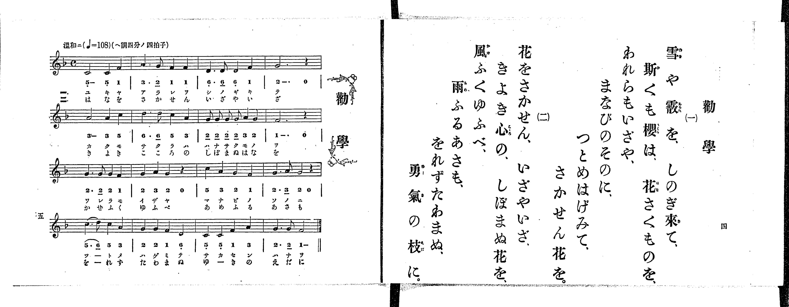

# 勸學

> Re:Shōka 使用 AI 協助辨識與重建樂譜，可能會有錯誤。歡迎[回報](https://github.com/TMDLang/reshoka/issues)。

- **鋼琴伴奏版**：<br><audio controls src="kangaku.mp3"></audio>
- **NEUTRINO 歌聲合成版**：<br><audio controls src="kangaku_neutrino.mp3"></audio>

- 出處：共益商社樂器店《唱歌教科書 生徒用 巻一》第四～五頁（第二曲）
- NDL Digital Collections PID 854862（https://dl.ndl.go.jp/pid/854862）掃描 P004.jpg

## 說明

原書資訊與歌詞全文（NDL PID 854862《唱歌教科書 生徒用 巻一》第四～五頁，掃描 P004.jpg）：
調性與拍號：ヘ調四分ノ四拍子（F 大調 4/4 拍），♩=108，「温和ニ」
註記：分節歌，二節同一旋律。第四行第一小節「5・6」有圓滑線（第一節「ツー」、第二節「をー」）。五線譜與簡譜一致。


## 歌詞

```text
一、
雪や霰を、しのぎ來て、
斯くも櫻は、花さくものを、
われらもいざや、
まなびのそのに、
つとめはげみて、
さかせん花を。

二、
花をさかせん、いざやいざ、
きよき心の、しぼまぬ花を、
風ふくゆふべ、
雨ふるあさも、
をれずたわまぬ、
勇氣の枝に。
```

## ABC

<div class="abc-score" data-abc-src="kangaku.abc" aria-label="五線譜載入中"></div>

[下載 ABC 原始檔](kangaku.abc)

## TMD 檔案連結

- [主旋律 TMD 檔案](kangaku.tmd) [[在 TMD Studio 編輯](https://tmdlang.github.io/Tmd-TS/#tmd=s7IKdvYPcrWy4qpTUCpJTLdSSM7PyUlNLsnMz7PKrsxPzc6ML87Iz05Ugisoy88pzU21yk7MizeMtzA1sTAzQkgW55cWJadaFSdn5OfnxJekVpQk5edno8vHFySmp1oFGBiYIGQKivLLUvMS84C6C4oy80pSU8DaEQpSyzJTUkHSxclAq8tSizLTMlNTkNyVWlQMcjXUipKixLzi5KLMApBXEKrSU_OKUq2SMzJzUopS8-KL8_PSEZJp-UW5VsUlRfkFGZnJCOGSjFSgh6F-yslMS0WXKshJzENyaX5RZnpmnlVuamZWJpYwyC8qychPL0osyKi0ysgsLgEqT07MiQcGKDCUtbQUnnbveLp2h4KWFpeirYKhgQWXva2CG5eNib6JHciMp-27Xsyc-n7PrKetG5_P7no6te35kn3PVjQ9nbni6a7pjxu6nk7Z-Gxtz7OpM58vn_hs9g6F51PmP9036fmUFQpPt-9-sqPhcUP38zVrns6e_X7vvCe7prxc0Ph-TwdQ5MmunmezN73f0wl2qp-Lj4IL0B8liTkKzvA0UawQ4OmiAIl1oK6MkpKCYit9_ZQcvTwgTs_XyyrQL8hM0Yep6HzW1_ysv18BFNdAOWBYc-lrKdhSC3ApKCg87ZsP9OWLze0vVnS96GgHev3FynlPW1c8m9YOdCHIGwgnkxk6PWi-APoLGP4gy1-s2v-sYTnI2u7eFzPnA0UfN88ACgL1P-1oe9zcB2QApZ6unQB0i5vC0yXLgZIKwKhUAIqCjel5NHOlLTCWgazHDT3Pdqx8OqnncXP344ZesPkrdr9YMQMU2R1tz9c3AF0OVAeMKCD76YQeoHOfTe9-ug-ougni6BcLe0AxuaPh6YZ-oBqgiaaPm3ebAU17Nqfz6ZzJz3ZPfL59FjS-dzRAlDxubnncvAeo5nFDIyQdQMWbJkHEgQ4F2gAMDaDeF2vnAL37fMNCIANowov2LUApLpBbwYHXCGK9nL3qcVPLyzkbQCY0ND5unP64cd3jxr4n-9oeNy6DKno2bf3jxv7HTU3PVu9-3LgeKPqia-PjxqkQQZAGsGaQ0sdNQCGgczrBEi2PG6cBjYfJNe573LjqceNmsBVzweRquNySx40rHjcBXQC0a9Ljxv0I68E2dT9unP24aTLIYpBlUH_sAsYEWA1UHEkl2DcwB0AYMON6Hzd1AMmn-5tBboD6eg_YeWtgFkBCZ9GKx41bwd4EBgeQsRMebGCJJqBdQG9OBXkW5v9JIP83znrcOB8UFmAzoXJPu9ufbVgMtPLZPKDngT5vAolSnrWgQEFLn4vLOzEvPTG71CogMzEv36HGoKYaZIeCjYWWHZgBzNKPm5cBnbkWSC9RqAGyFgFZK4F4DRBvAotsB7L6gPQ6sDqgSHMbyHCQ_hoF03gFXTAEMwyBuEbBGCxgBOZBRMwgqoAUmAURNILqBEEDkAjYSB9DkJ1tUHFgvIDIphawDmDwQkSbOoG4B8yaBJWZDlUPdGVjH1wnSGYZkj0g26H2GIHk1sPtWYVi2lSoaDcQzwbLTIbKgFwCkpkGdRVEBCQzDas9oCBuWg3E64EBtwgcoFuhPFAw94MDtB-Iu5BkQJHQB5bZhAhqSLDqgmlTSLBCQhXMA4mCwhQCQTxQ-NaAwxpHKAN9B_N9P9iPoNBF9j3QWcCQBrFA4QQJL1BIgVRAZEE6QGEOlgWHHq6QBsUGJO46UGIHFK4g_mSgDDiuYaYBYxSYDUHFBBADUyPYDZB4wm0XOEGDQhCUfEHhCwnxJUC8DZbEm-dBQrsZaCUklJv2QpJ4czcitCGpExSWyOkVFq7gkISHO6oakBhcDVKaBoUxyP89sFCFhzckHYHSDyRNgf0D9jk8ZTZuRgmbudBQA6X21VhCGxKzjxvnAPFWaFxCwg2Us2BiO5HsAsdkUyNCtglkBlKeA8U52MVood0CxMBoau4A4oWw1Ny0CUjPBxcVsBQPygO7gSKbkVM8cvoGhSZ6akaELbjggJY38LIGoQxW3oAgchJfAhUDVidwD8IyPrBmAZP7wSSomIAlfkgAomd9SGEBzgDw5IcU6HAxaNHUOAuqbz5YDJzFoFG6BikykIo5ePSCsgiIvwAavRCbarm4dO0UoGW6ApCpzAUA)]
- [鋼琴伴奏 TMD 檔案](kangaku_piano.tmd) [[在 TMD Studio 編輯](https://tmdlang.github.io/Tmd-TS/#tmd=s7IKdvYPcrWy4qpTUCpJTLdSyC8qychPL0osyKi0ysgsLskvykxOzInPTsxLVOLS0lJ42r3j6dod7_d0vOze83zClid7tjxd2v-8s-P9nk4FLS0uRVsFQwMLLntbBTcuGxN9EzuQwU_bd72YOfX9nllPWzc-n931dGrb8yX7nq1oejpzxdNd0x83dD2dsvHZ2p5nU2c-Xz7x2ewdCs-nzH-6b9LzKSsUnm7f_WRHw-OG7udr1jydPfv93nlPdk15uaAR6ACgyJNdPc9mbwJarQSyxs_FR8ElMz2zJDFHwTk_Jyc1uSQzP69YIcDTRcHC1MTCzAioK6OkpKDYSl8_JUcvD4jT8_WyCvQLMlP0YSo6n_U1P-vvVwgwMDAByqUrcXF5J-alJ2aXWgVkJublB3k41BjUVHMpAIGNhZYdmKGvpfC4eZnC46a1QHqJQg2QtQjIWgnEa4B4E1hkO5DVB6TXgdUBRZrbFLT0wfprFEzjFXTBEMwwBOIaBWOwgBGYBxExg6gCUmAWRNAIqhMEDUAiYCN9DEF2tkHFHzf2gsimFrCOx41NENGmTiDuAbMmQWWmQ9UDXdnYB9cJklmGZA_Idqg9RiC59XB7VqGYNhUq2g3Es8Eyk6EyIJeAZKZBXQURAclMw2oPKIibVgPxemDALQIH6FYoDxTM_eAA7QfiLiQZUCT0gWU2IYIaEqy6YNoUEqyQUAXzQKKgMIVAEA8UvjXgsMYRykDfwXzfD_YjKHSRfQ90FjCkQSxQOEHCCxRSIBUQWZAOUJiDZcGhhyukQbEBibsOlNgBhSuIPxkoA45rmGnAGH3cuAeI9wExMDWC3QCJJ9x2gRM0KARByRcUvpAQXwLE22BJvHkeJLSbgVZCQrlpLySJN3cjQhuSOkFhiZxeYeEKDkl4uKOqAYnB1SClaVAYg_zfAwtVeHhD0hEo_UDSFNg_YJ_DU2bjZpSwmQsNNVBqX40ltCEx-7hxDhBvhcYlJNxAOQsmthPJLnBMNjUiZJtAZiDlOVCcg12MFtotQAyMpuYOIF4IS81Nm4D0fHBRAUvxoDywGyiyGTnFI6dvUGiip2ZE2IILDmh5Ay9rEMpg5Q0IIifxJVCxx40r4B6EZfzHjaBE9LhxP5gEFROwxA8JQPSsDykswBkAnvyQAh0uBi2aGmdB9c0Hi4GzGDRK1yBFBlIxB49eUBYB8RdAoxdiUy1ake6DXKSbIIr0F31dL9t7n7bueDm7FVLRIQLZMF4h2jAWRtWAQxTINo1HiEFVmgC5JrEwCkUlnAFTi2kqVBuamVhMwNSNVy1BNxCpGs19yGphPsbpN4SIASRWdO0UoBET7QOUQOYagbnKXAA)]

## 分析

```text
================================================================================
📊 TMD Song Profile: [ 勸學 ]
================================================================================
⏱  Duration:       0:35 (35.6s), 16 measures total
🎼 Key & Tempo:    首調基準 F, != 108.0 BPM, <4/4>
   - 分析範圍：      由實際發聲的音符與和弦推測調性；播放脈絡另行呈現
🎤 人聲音域:    C4 (MIDI 60) – D5 (MIDI 74) [跨度: 14 個半音 / 1.2 個八度, 難度: moderate]
   - 最低音:  C4 in [Kangaku #1 @ m.1, 0:00]
   - 最高音: D5 in [Kangaku #1 @ m.6, 0:11]
   - 適合: soprano, mezzo-soprano, contralto, tenor, baritone, bass
🏛  結構:      Kangaku (35.6s)
⚡ 編曲密度:        Peak 1 軌道同時演奏
🗝  調性診斷：       C 大調（純淨自然大調，未偵測到可信轉調）
   - 風格氣質:    純淨自然大調（陽光明朗、易唱易記，無明顯調外色彩）
   - 轉調歷程:    全曲維持單一推測調性（未偵測到可信轉調）
   - 核心骨幹音:  G, F, A, C, D
   - 調性數值:    C 大調 [相關度: 0.74, 穩定度: Moderate, 自然音純度: 100.0%]
   - 候選調性 (K-S): C 大調 (0.74), F 大調 (0.67), G 大調 (0.57)
   - 五度圈歷程:   +0
   - 各段落調性細節:
     • [Kangaku #1]: C 大調 (r: 0.74, 自然音純度: 100.0%)

  [ 五度圈游移軌跡 ]
              [C ]*
         F            G  
      Bb               D  
      Eb               A  
         Ab           E  
            Db       B  
               F# 
     (* = active key center)

  [ 十二半音累積音高分佈 ]
     C  : █████████████             17.5%
     C# :                            0.0%
     D  : ████████                  10.8%
     D# :                            0.0%
     E  :                            0.0%
     F  : ████████████████          21.7%
     F# :                            0.0%
     G  : ████████████████████████  31.7%
     G# :                            0.0%
     A  : ██████████████            18.3%
     A# :                            0.0%
     B  :                            0.0%
--------------------------------------------------------------------------------
Assignment 軌道音域：
  - Piano         : C4 – D5 (14 個半音 / 1.2 個八度, 55 個音符)
================================================================================
```


## 原書掃描頁




