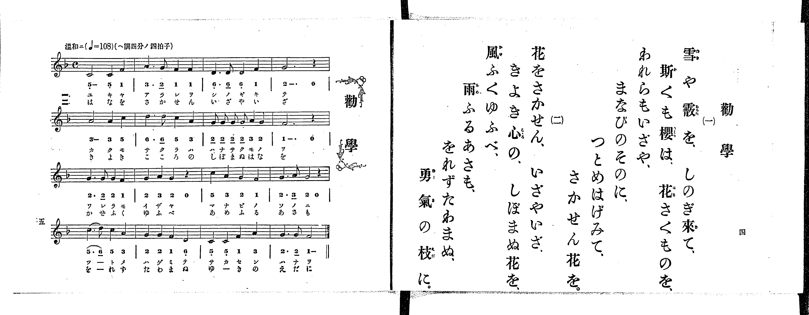

# 勸學

> Re:Shoka 使用 AI 辨識樂譜，可能會有錯誤。歡迎回報。

<audio controls src="kangaku.mp3"></audio>

- 出處：共益商社樂器店《唱歌教科書 生徒用 巻一》第四～五頁（第二曲）
- NDL Digital Collections PID 854862（https://dl.ndl.go.jp/pid/854862）掃描 P004.jpg

## 說明

原書資訊與歌詞全文（NDL PID 854862《唱歌教科書 生徒用 巻一》第四～五頁，掃描 P004.jpg）：
調性與拍號：ヘ調四分ノ四拍子（F 大調 4/4 拍），♩=108，「温和ニ」
註記：分節歌，二節同一旋律。第四行第一小節「5・6」有圓滑線（第一節「ツー」、第二節「をー」）。五線譜與簡譜一致。

## 歌詞

```text
一、
雪や霰を、しのぎ來て、
斯くも櫻は、花さくものを、
われらもいざや、
まなびのそのに、
つとめはげみて、
さかせん花を。

二、
花をさかせん、いざやいざ、
きよき心の、しぼまぬ花を、
風ふくゆふべ、
雨ふるあさも、
をれずたわまぬ、
勇氣の枝に。
```

## ABC

```abc
X:1
T:勸學
M:4/4
L:1/16
Q:1/4=108
K:F
V:V1 name="Piano" snm="Pia"
[V:V1]
C8 C4 F4 | A6 G2 F4 F4 | D6 D2 D4 F4 | G12 z4 |
A8 A4 c4 | d6 d2 c4 A4 | G2 G2 G2 G2 A4 G4 | F12 z4 |
G6 G2 G4 F4 | G4 A4 G4 z4 | c4 A4 G4 F4 | G6 A2 G4 z4 |
c6 d2 c4 A4 | G4 G4 F4 D4 | C4 C4 F4 A4 | G6 G2 F8 |
C8 C4 F4 | A6 G2 F4 F4 | D6 D2 D4 F4 | G12 z4 |
A8 A4 c4 | d6 d2 c4 A4 | G2 G2 G2 G2 A4 G4 | F12 z4 |
G6 G2 G4 F4 | G4 A4 G4 z4 | c4 A4 G4 F4 | G6 A2 G4 z4 |
c6 d2 c4 A4 | G4 G4 F4 D4 | C4 C4 F4 A4 | G6 G2 F8 |
```

## TMD 檔案連結

- [主旋律 TMD 檔案](kangaku.tmd) [[在 TMD Studio 編輯](https://tmdlang.github.io/Tmd-TS/#tmd=s7IKdvYPcrWy4qpTUCpJTLdSSM7PyUlNLsnMz7PKrsxPzc6ML87Iz05Ugisoy88pzU21yk7MizeMtzA1sTAzQkgW55cWJadaFSdn5OfnxJekVpQk5edno8vHFySmp1oFGBiYIGQKivLLUvMS84C6C4oy80pSU8DaEQpSyzJTUkHSxclAq8tSizLTMlNTkNyVWlQMcjXUipKixLzi5KLMApBXEKrSU_OKUq2SMzJzUopS8-KL8_PSEZJp-UW5VsUlRfkFGZnJCOGSjFSgh6F-yslMS0WXKshJzAO6VEtL4Wn3jqdrdyhoaXEp2ioYGlhw2dsquHHZmOib2IH0PG3f9WLm1Pd7Zj1t3fh8dtfTqW3Pl-x7tqLp6cwVT3dNf9zQ9XTKxmdre55Nnfl8-cRns3coPJ8y_-m-Sc-nrFB4un33kx0Njxu6n69Z83T27Pd75z3ZNeXlgsb3ezqAIk929Tybven9nk6w0_xcfBRcMtMzSxJzFJzh8VmsEODpogCJMaCujJKSgmIrff2UHL08IE7P18sq0C_ITNGHqeh81tf8rL9fARRPQDlgOHHpaynYUgtwKSgoPO2bD_Tli83tL1Z0vehoB3r9xcp5T1tXPJvWDnQhyBsIJ5MZOj1ovgD6Cxj-IMtfrNr_rGE5yNru3hcz5wNFHzfPAAoC9T_taHvc3AdkAKWerp0AdIubwtMly4GSCsCoVACKgo3peTRzpS0wloGsxw09z3asfDqp53Fz9-OGXrD5K3a_WDEDFNkdbc_XNwBdDlQHjCgg--mEHqBzn03vfroPqLoJ4ugXC3tAMbmj4emGfqAaoImmj5t3mwFNezan8-mcyc92T3y-fRY0vnc0QJQ8bm553LwHqOZxQyMkHUDFmyZBxIEOBdoADA2g3hdr5wC9-3zDQiADaMKL9i1AKS6QW8GB1whivZy96nFTy8s5G0AmNDQ-bpz-uHHd48a-J_vaHjcugyp6Nm3948b-x01Nz1bvfty4Hij6omvj48apEEGQBrBmkNLHTUAhoHM6wRItjxunAY2HyTXue9y46nHjZrAVc8HkarjckseNKx43AV0AtGvS48b9COvBNnU_bpz9uGkyyGKQZVB_7ALGBFgNVBxJJdg3MAdAGDDjeh83dQDJp_ubQW6A-noP2HlrYBZAQmfRiseNW8HeBAYHkLETHmxgiSagXUBvTgV5Fub_SSD_N8563DgfFBZgM6FyT7vbn21YDLTy2Tyg54E-bwKJUp61oEBBS5-LyzsxLz0xu9QqIDMxL9-hxqBGoRpkiYKNhZYdmAHM04-blwHduRZIL1GoAbIWAVkrgXgNEG8Ci2wHsvqA9DqwOqBIcxvIdJD-GgXTeAVdMAQzDIG4RsEYLGAE5kFEzCCqgBSYBRE0guoEQQOQCNxJTauBeD3QokVgB2yF8kDO6gc7oB-Iu5BkQI7uA8tsQjgN4gxdMG0KcQbEFWAeSBTkBggE8UDuqQG7DburmkE2gYIF5A6Iy5YA8TZY0DXPg7iqeTLMNU17IUHX3I1wFcTXIDuRwwFmP9hGuPtQ1YDE4GoQrmoB4j1A3AHEC2Gh07QJSM8HRxUsBEFhuhsoshk5BJHDC2Qreugg3ACOOGh8w-MaoQwW3yBYw1XLxaVrpwBNfgqoTGUuAA)]

## 分析

```text
================================================================================
📊 TMD Song Profile: [ 勸學 ]
================================================================================
⏱  Duration:       1:11 (71.1s), 32 measures total
🎼 Key & Tempo:    首調基準 F, != 108.0 BPM, <4/4>
   - 分析範圍：      由實際發聲的音符與和弦推測調性；播放脈絡另行呈現
🎤 人聲音域:    C4 (MIDI 60) – D5 (MIDI 74) [跨度: 14 個半音 / 1.2 個八度, 難度: moderate]
   - 最低音:  C4 in [Kangaku #1 @ m.1, 0:00]
   - 最高音: D5 in [Kangaku #1 @ m.6, 0:11]
   - 適合: soprano, mezzo-soprano, contralto, tenor, baritone, bass
🏛  結構:      Kangaku (35.6s) -> Kangaku (35.6s)
⚡ 編曲密度:        Peak 1 軌道同時演奏
🗝  調性診斷：       C 大調（純淨自然大調，未偵測到可信轉調）
   - 風格氣質:    純淨自然大調（陽光明朗、易唱易記，無明顯調外色彩）
   - 轉調歷程:    全曲維持單一推測調性（未偵測到可信轉調）
   - 核心骨幹音:  G, F, A, C, D
   - 調性數值:    C 大調 [相關度: 0.74, 穩定度: Moderate, 自然音純度: 100.0%]
   - 候選調性 (K-S): C 大調 (0.74), F 大調 (0.67), G 大調 (0.57)
   - 五度圈歷程:   +0 -> +0
   - 各段落調性細節:
     • [Kangaku #1]: C 大調 (r: 0.74, 自然音純度: 100.0%)
     • [Kangaku #2]: C 大調 (r: 0.74, 自然音純度: 100.0%)

  [ 五度圈游移軌跡 ]
              [C ]*
         F            G  
      Bb               D  
      Eb               A  
         Ab           E  
            Db       B  
               F# 
     (* = active key center)

  [ 十二半音累積音高分佈 ]
     C  : █████████████             17.5%
     C# :                            0.0%
     D  : ████████                  10.8%
     D# :                            0.0%
     E  :                            0.0%
     F  : ████████████████          21.7%
     F# :                            0.0%
     G  : ████████████████████████  31.7%
     G# :                            0.0%
     A  : ██████████████            18.3%
     A# :                            0.0%
     B  :                            0.0%
--------------------------------------------------------------------------------
Assignment 軌道音域：
  - Piano         : C4 – D5 (14 個半音 / 1.2 個八度, 110 個音符)
================================================================================
```


## 原書掃描頁




