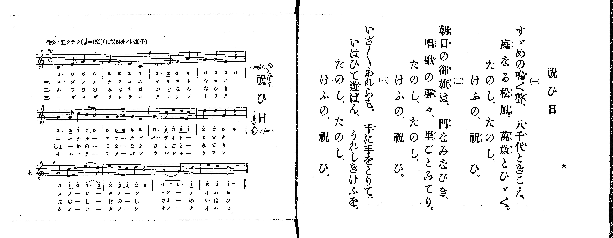

# 祝ひ日

> Re:Shōka 使用 AI 協助辨識與重建樂譜，可能會有錯誤。歡迎回報。

- **NEUTRINO 歌聲合成版**：<br><audio controls src="iwaibi_neutrino.mp3"></audio>
- **鋼琴伴奏版**：<br><audio controls src="iwaibi.mp3"></audio>


- 出處：共益商社樂器店《唱歌教科書 生徒用 巻一》第六～七頁（第三曲）
- NDL Digital Collections PID 854862（https://dl.ndl.go.jp/pid/854862）掃描 P005.jpg

## 說明

原書資訊與歌詞全文（NDL PID 854862《唱歌教科書 生徒用 巻一》第六～七頁，掃描 P005.jpg）：
調性與拍號：は調四分ノ四拍子（C 大調 4/4 拍），♩=152，「愉快ニ遲クナク」
註記：分節歌，三節同一旋律。開頭 mf，第三行（「たのし、たのし」起）f。第三行第一小節「3・2」、第三小節「6－5・」各有圓滑線。第一行與第二行第三小節前印有換氣記號（V）。五線譜與簡譜一致。


## 歌詞

```text
一、
すゞめの鳴く聲、八千代ときこえ、
庭なる松風、萬歳とひゞく。
たのし、たのし、
けふの、祝ひ。

二、
朝日の御旗は、門なみなびき、
唱歌の聲々、里ごとみてり。
たのし、たのし、
けふの、祝ひ。

三、
いざ〳〵われらも、手に手をとりて、
いはひて遊ばん、うれしきけふを。
たのし、たのし、
けふの、祝ひ。
```

## ABC

```abc
X:1
T:祝ひ日
M:4/4
L:1/16
Q:1/4=152
K:C
V:V1 name="Piano" snm="Pia"
[V:V1]
!mf! C6 E2 G4 A4 | G4 G4 E4 C4 | D6 E2 F4 A4 | G4 G4 E4 z4 |
w: 1.~す ず め の | な く こ え | や ち よ と | き こ え
w: 2.~あ さ ひ の | み は た は | か ど な み | な び き
w: 3.~い ざ い ざ | わ れ ら も | て に て を | と り て
G6 G2 c4 B2 A2 | G4 G2 A2 G4 E4 | G6 c2 e4 d2 c2 | d4 d4 G4 z4 |
w: 1.~に は な る _ | ま つ _ か ぜ | ばん ざ い と _ | ひ び く
w: 2.~しょ _ か の _ | こ ゑ _ ご ゑ | さ と ご と _ | み て り
w: 3.~い は ひ て _ | あ そ _ ば ん | う れ し き _ | け ふ を
!f! G4 c2 d2 e6 d2 | e4 d2 c2 d4 z4 | A8 G6 c2 | e4 d4 c8 |
w: 1.~た の _ し _ | た の _ し | けふ _ の | い は ひ
w: 2.~た の _ し _ | た の _ し | けふ _ の | い は ひ
w: 3.~た の _ し _ | た の _ し | けふ _ の | い は ひ
```

## TMD 檔案連結

- [主旋律 TMD 檔案](iwaibi.tmd) [[在 TMD Studio 編輯](https://tmdlang.github.io/Tmd-TS/#tmd=s7IKdvYPcrWy4qpTUCpJTLdSSM7PyUlNLsnMz7PKrsxPzc6ML87Iz05Ugisoy88pzU21yk7MizeMtzA1sTAzQkgW55cWJadaFSdn5OfnxJekVpQk5edno8vHFySmp1oFGBiYImQKivLLUvMS84C6C4oy80pSU8DaEQpSyzJTUkHSxclAq8tSizLTMlNTkNyVWlQMcjXUipKixLzi5KLMApBXEKrSU_OKUq2SMzJzUopS8-KL8_PSEZJp-UW5VsUlRfkFGZnJCOGSjFSgh9NSi0syyxJz0MUzcwuAbkEWzy_KTM_Ms8pNzczKRAoDLS2F50vnPm7c9Gz6UgUtLS5FWwVDUyMue1sFZy4bE30TO5ABT9t3vZg59f2eWU9bNz6f3fV0atvzJfuerWh6OnPF013THzd0PZ2y8dnanmdTZz5fPvHZ7B0Kz6fMf7pv0vMpKxSebt_9ZEfD44bu52vWPG1d-37vvCc7ml8uaHy_pwMo8mRH57PZm97v6QS708_FR8EF6MqSxBwFZ3iMFysEeLooQOIUqCujpKSg2EpfPyVHLw-I0_P1sgr0CzJT9GEqOp_1NT_r71cAxSRQDhiSXPpaCrbUAlwKCgpP--YDfflic_uLFV0vOtqBXn-xct7T1hXPprUDXQjyBsLJZIZOD5ovgP4Chj_I8her9j9rWA6ytrv3xcz5QNHHjeuBgk9nz37a0fa4uQ_IAEo9XTsB6BZnhadLlgMlFYBRqQAUBRvT82jmSltgLANZjxt6nrV0Pt2_-nFz98vGTY-b1j9u7gKRDb1gu1bsfrFiBijiO9qer28A-gKoBxhpQPbTCUBGw7Pp3U_3dT9uaHo5rfvlgrUKuWlABZCIfbEQqLgDaMHjxvmPG9c9bgQmlEYkdu-LrduBzkkDaoZrADManm7oB1oA1Gn8uHk3MAB7gRohSuAyZu_39JoCZYGSTye0PJvT-XTO5Ge7Jz7fPgtmXAPQOGAggdi7emBGQw142tn7tHcDUNez_tnPNiwGehEckB1hQPcA9T_ZNQVo0Iu1c0D6NywEMkDGtW8BSnGBQgUcZY0g1uPGmY-b5j1uAvpr3cvNWx439r8ABmJD49PW1U97m5_sXvy4ccXjxt7HjZMfNwKDAqzn6a61jxtXPW7qfjZ338tFK4CiLyasebZ2M1gpMAbmAU0B2QQ2HmvIQa2e-LhxK0gIGDjgHAx33i5gtILVPJszF5itgWqe7lv4bPp0YDoBSryc1gCyv3E_mARaCwpesMPAyRSoGuyHVpDSdiB3CthhQNXLHjd1UeawHcDQhappedw47XHD5scNWx839T9u6nnc1Pm4qQko_ayz-3HjahDZNAlkM9BOoM1I2taDTGxc9rIRKLHhcdNksBPaQEYAnQAKa7D1QM3kOhUoQXkxAQUKWvpcXJ7liZlJmVYBmYl5-Q41BjXVICsUbCy07MCM6ty0WjADWEw9btoJxLsUHjcvBOI-hRog2QUUWQ_Em4F4BVhkCRA3AvEKIO4AiTSthcsDLQSZVaNgqKALhMYKpkDSDIhrwCwQNgZikGyNghFUjQlWNQYgEbBpPoZASxpnglU_bpwFtKgRzFoH1gNMSGBeP5icDCY7IDJNLVA9QO80gcSAUQrV04umOh5hmxFIvgmqcyoQb0KxbT-Ytx5MzoezQTLdUD0r4W4CqUW4cDOYBNmMZJsxSB7mzmlQNogF8QHYV009YLITTIJcBtKzDKpnNZQNTHRQGZAfgSkXLAuSQdgGiuPmbiDuh8RsM1Bz8x5wrM4D4hYw73ETULQJIjrhcTMoYrcBMSjaO-DKJwHxZHDSgEc5KOJA0WcYB6TMgTEKi08zeJzCFAGVGINUGcWBmMCUAOVAYh895ldDfQpMhpCQbAKFNEhmH1h8CZgEiT1unAOVAeVNjECFRT4kQiHRAQpg9Mif_ripHawZYS4s9sEppmkiWGwKnA2SmQpVD8wWEBm4dZAUA4kjUKzgin2Q_yBOA6mFpcLHjXPB5AawfpD9IJk2iB5gygA6FywPSlcgGYjbtoJlQSkCYVs1ck7fD87hkPjeDotWNFGQyMbHzcA8ABKAFAjgdABKPpNQYx4Yj8AIBMcqOCprkGMYHLXgaAVndEg6gSYEhEIwFyKLHP2QTAaKAIhXwfJYxMEeBQUAxPcICFIEC2dYzgWFM5JF4Ginh0XgCKexRbVcXLp2CpByXwHIUuYCAA)]
- [鋼琴伴奏 TMD 檔案](iwaibi_piano.tmd) [[在 TMD Studio 編輯](https://tmdlang.github.io/Tmd-TS/#tmd=s7IKdvYPcrWy4tLSUni-dO7jxk3Ppi99v6fjZfee5xO2PNmz5enS_uedHe_3dCpoaXEp2ioYmhpx2dsqOHPZmOib2HHVKSg9bd_1YubU93tmPW3d-Hx219Opbc-X7Hu2ounpzBVPd01_3ND1dMrGZ2t7nk2d-Xz5xGezdyg8nzL_6b5Jz6esUHi6ffeTHQ2PG7qfr1nztHXt-73znuxofrmgEegAoMiTHZ3PZm8CWq0EssbPxUfBJTM9syQxR8E5PycnNbkkMz-vWCHA00XBwtTEwswIqCujpKSg2EpfPyVHLw-I0_P1sgr0CzJT9GEqOp_1NT_r71cIMDAwBcqlK3FxeZYnZiZlWgVkJublB3k41BjUVHMpAIGNhZYdmFGdm1YLZuhrKTxu2gnEuxQeNy8E4j6FGiDZBRRZD8SbgXgFWGQJEDcC8Qog7gCJNK2Fy2vpg82qUTBU0AVCYwVTIGkGxDVgFggbAzFItkbBCKrGBKsaA5AI2DQfQ6AljTPBqh83zgJa1AhmrQPredy4CszrB5OTwWQHRKapBaoH6J0mkNjjxhVQPb1oquMRthmB5JugOqcC8SYU2_aDeevB5Hw4GyTTDdWzEu4mkFqECzeDSZDNSLYZg-Rh7pwGZYNYEB-AfdXUAyY7wSTIZSA9y6B6VkPZj5smQWVAfnzc1AWWBckgbAPFcXM3EPdDYrYZqLl5DzhW5wFxC5j3uAko2gQRnfC4GRSx24AYFO0dcOWTgHgyOGnAoxwUcaDoM4wDUubAGIXFpxk8TmGKgEqMQaqM4kBMYEqAciCxjx7zq6E-BSZDSEg2gUIaJLMPLL4ETILEHjfOgcpseNwEilzUQIVFPiRCIdEBCmD0yJ_-uKkdrBlhLiz2wSmmaSJYbAqcDZKZClUPzBYQGbh1kBQDiSNQrOCKfZD_IE4DqYWlwseNc8HkBrB-kP0gmTaIHmDKADoXLA9KVyAZiNu2gmVBKQJhWzVyTt8PzuGQ-N4Oi1Y0UZDIxsfNwDwAEoAUCOB0AEo-k1BjHhiPwAgExyo4KmuQYxgcteBoBWd0SDqBJgSEQjAXIosc_ZBMBooAiFfB8ljEwR4FBQDE9wgIUgQLZ1jOBYUzkkXgaKeHReAIp7FFtajFvg9ysW8CLfaBaeBFX9fL9t6nrTtezm6F1IVIxXe8QrRhrIIJkDKJBfLhIlAK4htgzMcD-abxRKiEcuEakFTC9OJRCecgRMlSDbUK5jYU1xpAgk7XTgESetE-QHEknhEKzxjMU-YCAA)]

## 分析

```text
================================================================================
📊 TMD Song Profile: [ 祝ひ日 ]
================================================================================
⏱  Duration:       0:18 (18.9s), 12 measures total
🎼 Key & Tempo:    首調基準 C, != 152.0 BPM, <4/4>
   - 分析範圍：      由實際發聲的音符與和弦推測調性；播放脈絡另行呈現
🎤 人聲音域:    C4 (MIDI 60) – E5 (MIDI 76) [跨度: 16 個半音 / 1.3 個八度, 難度: moderate]
   - 最低音:  C4 in [Iwaibi #1 @ m.1, 0:00]
   - 最高音: E5 in [Iwaibi #1 @ m.7, 0:10]
   - 適合: soprano, mezzo-soprano, contralto, tenor, baritone, bass
🏛  結構:      Iwaibi (18.9s)
⚡ 編曲密度:        Peak 1 軌道同時演奏
🗝  調性診斷：       G 大調（純淨自然大調，未偵測到可信轉調）
   - 風格氣質:    純淨自然大調（陽光明朗、易唱易記，無明顯調外色彩）
   - 轉調歷程:    全曲維持單一推測調性（未偵測到可信轉調）
   - 核心骨幹音:  G, E, C, D, A
   - 調性數值:    G 大調 [相關度: 0.85, 穩定度: Moderate, 自然音純度: 97.8%]
   - 候選調性 (K-S): G 大調 (0.85), C 大調 (0.80), E 小調 (0.69)
   - 五度圈歷程:   +1
   - 各段落調性細節:
     • [Iwaibi #1]: G 大調 (r: 0.85, 自然音純度: 97.8%, 調外音: F)

  [ 五度圈游移軌跡 ]
               C  
         F           [G ]*
      Bb               D  
      Eb               A  
         Ab           E  
            Db       B  
               F# 
     (* = active key center)

  [ 十二半音累積音高分佈 ]
     C  : █████████████             17.8%
     C# :                            0.0%
     D  : ████████████              16.7%
     D# :                            0.0%
     E  : ██████████████            18.9%
     F  : ██                         2.2%
     F# :                            0.0%
     G  : ████████████████████████  32.2%
     G# :                            0.0%
     A  : ████████                  11.1%
     A# :                            0.0%
     B  : █                          1.1%
--------------------------------------------------------------------------------
Assignment 軌道音域：
  - Piano         : C4 – E5 (16 個半音 / 1.3 個八度, 48 個音符)
================================================================================
```


## 原書掃描頁




