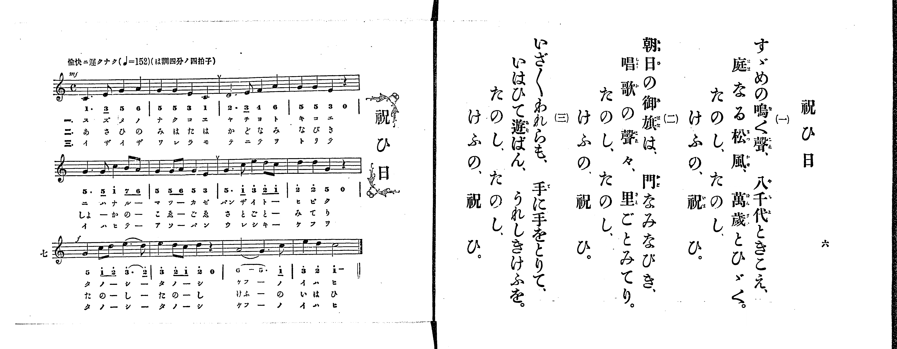

# 祝ひ日

*找不到鋼琴伴奏版 TMD，未產生音訊。*

- 出處：共益商社樂器店《唱歌教科書 生徒用 巻一》第六～七頁（第三曲）
- NDL Digital Collections PID 854862（https://dl.ndl.go.jp/pid/854862）掃描 P005.jpg

## 說明

原書資訊與歌詞全文（NDL PID 854862《唱歌教科書 生徒用 巻一》第六～七頁，掃描 P005.jpg）：
調性與拍號：は調四分ノ四拍子（C 大調 4/4 拍），♩=152，「愉快ニ遲クナク」
註記：分節歌，三節同一旋律。開頭 mf，第三行（「たのし、たのし」起）f。第三行第一小節「3・2」、第三小節「6－5・」各有圓滑線。第一行與第二行第三小節前印有換氣記號（V）。五線譜與簡譜一致。

## 歌詞

```text
一、
すゞめの鳴く聲、八千代ときこえ、
庭なる松風、萬歳とひゞく。
たのし、たのし、
けふの、祝ひ。

二、
朝日の御旗は、門なみなびき、
唱歌の聲々、里ごとみてり。
たのし、たのし、
けふの、祝ひ。

三、
いざ〳〵われらも、手に手をとりて、
いはひて遊ばん、うれしきけふを。
たのし、たのし、
けふの、祝ひ。
```

## ABC

```abc
X:1
T:祝ひ日
M:4/4
L:1/16
Q:1/4=152
K:C
V:V1 name="Piano" snm="Pia"
[V:V1]
!mf! C6 E2 G4 A4 | G4 G4 E4 C4 | D6 E2 F4 A4 | G4 G4 E4 z4 |
G6 G2 c4 B2 A2 | G4 G2 A2 G4 E4 | G6 c2 e4 d2 c2 | d4 d4 G4 z4 |
!f! G4 c2 d2 e6 d2 | e4 d2 c2 d4 z4 | A8 G6 c2 | e4 d4 c8 |
!mf! C6 E2 G4 A4 | G4 G4 E4 C4 | D6 E2 F4 A4 | G4 G4 E4 z4 |
G6 G2 c4 B2 A2 | G4 G2 A2 G4 E4 | G6 c2 e4 d2 c2 | d4 d4 G4 z4 |
!f! G4 c2 d2 e6 d2 | e4 d2 c2 d4 z4 | A8 G6 c2 | e4 d4 c8 |
!mf! C6 E2 G4 A4 | G4 G4 E4 C4 | D6 E2 F4 A4 | G4 G4 E4 z4 |
G6 G2 c4 B2 A2 | G4 G2 A2 G4 E4 | G6 c2 e4 d2 c2 | d4 d4 G4 z4 |
!f! G4 c2 d2 e6 d2 | e4 d2 c2 d4 z4 | A8 G6 c2 | e4 d4 c8 |
```

## TMD 檔案連結

- [主旋律 TMD 檔案](iwaibi.tmd) [[在 TMD Studio 編輯](https://tmdlang.github.io/Tmd-TS/#tmd=s7IKdvYPcrWy4qpTUCpJTLdSSM7PyUlNLsnMz7PKrsxPzc6ML87Iz05Ugisoy88pzU21yk7MizeMtzA1sTAzQkgW55cWJadaFSdn5OfnxJekVpQk5edno8vHFySmp1oFGBiYImQKivLLUvMS84C6C4oy80pSU8DaEQpSyzJTUkHSxclAq8tSizLTMlNTkNyVWlQMcjXUipKixLzi5KLMApBXEKrSU_OKUq2SMzJzUopS8-KL8_PSEZJp-UW5VsUlRfkFGZnJCOGSjFSgh9NSi0syyxJz0MUzcwuAbgGJa2kpPF8693HjpmfTlypoaXEp2ioYmhpx2dsqOHPZmOib2IF0Pm3f9WLm1Pd7Zj1t3fh8dtfTqW3Pl-x7tqLp6cwVT3dNf9zQ9XTKxmdre55Nnfl8-cRns3coPJ8y_-m-Sc-nrFB4un33kx0Njxu6n69Z87R17fu9857saH65oPH9ng6gyJMdnc9mb3q_pxPsQD8XHwWXzPTMksQcBWd4lBYrBHi6KEAiDagro6SkoNhKXz8lRy8PiNPz9bIK9AsyU_RhKjqf9TU_6-9XAEUVUA4YVFz6Wgq21AJcCgoKT_vmA335YnP7ixVdLzragV5_sXLe09YVz6a1A10I8gbCyWSGTg-aL4D-AoY_yPIXq_Y_a1gOsra798XM-UDRx43rgYJPZ89-2tH2uLkPyABKPV07AegWZ4WnS5YDJRWAUakAFAUb0_No5kpbYCwDWY8bep61dD7dv_pxc_fLxk2Pm9Y_bu4CkQ29YLtW7H6xYgYo4jvanq9vAPoCqAcYaUD20wlARsOz6d1P93U_bmh6Oa375YK1CrlpQAWQiH2xEKi4A2jB48b5jxvXPW4EJpRGJHbvi63bgc5JA2qGawAzGp5u6AdaANRp_Lh5NzAAe4EaIUrgMmbv9_SaAmWBkk8ntDyb0_l0zuRnuyc-3z4LZlwD0DhgIIHYu3pgRkMNeNrZ-7R3A1DXs_7ZzzYsBnoRHJAdYUD3APU_2TUFaNCLtXNA-jcsBDJAxrVvAUpxgUIFHGWNINbjxpmPm-Y9bgL6a93LzVseN_a_AAZiQ-PT1tVPe5uf7F78uHHF48bex42THzcCgwKs5-mutY8bVz1u6n42d9_LRSuAoi8mrHm2djNYKTAG5gFNAdkENh5ryEGtnvi4cStICBg44BwMd94uYLSC1TybMxeYrYFqnu5b-Gz6dGA6AUq8nNYAsr9xP5gEWgsKXrDDwMkUqBrsh1aQ0nYgdwrYYUDVyx43dVHmsB3A0IWqaXncOO1xw-bHDVsfN_U_bup53NT5uKkJKP2ss_tx42oQ2TQJZDPQTqDNSNrWg0xsXPayESix4XHTZLAT2kBGAJ0ACmuw9UDN5DoVKEF5MQEFClr6XFye5YmZSZlWAZmJefkONQY1CtUgOxRsLLTswIzq3LRaMANYTj1u2gnEuxQeNy8E4j6FGiDZBRRZD8SbgXgFWGQJEDcC8Qog7gCJNK2FywNtBJlVo2CooAuExgqmQNIMiGvALBA2BmKQbI2CEVSNCVY1BiARuMuau4G4H-Ke5tVAvAfslnlA3ALmPW4CijZBRCc8bgY5ZxsQgxzbAVc-CYgngz0EdyjIOpClhnFAyhzoDpgrzOAugSkCKjEGqTKKAzGB7odyIG5GuLcaOUT3g0MS4sLtMIegiYJENj5ungoRgAQ82OUgD09CdSvQZqCVYHeALa9BdhPYMWCHgAMU4jOo0xEKwVyIbA1XLReXrp0CJJUo4GApcwEA)]

## 分析

```text
================================================================================
📊 TMD Song Profile: [ 祝ひ日 ]
================================================================================
⏱  Duration:       0:56 (56.8s), 36 measures total
🎼 Key & Tempo:    首調基準 C, != 152.0 BPM, <4/4>
   - 分析範圍：      由實際發聲的音符與和弦推測調性；播放脈絡另行呈現
🎤 人聲音域:    C4 (MIDI 60) – E5 (MIDI 76) [跨度: 16 個半音 / 1.3 個八度, 難度: moderate]
   - 最低音:  C4 in [Iwaibi #1 @ m.1, 0:00]
   - 最高音: E5 in [Iwaibi #1 @ m.7, 0:10]
   - 適合: soprano, mezzo-soprano, contralto, tenor, baritone, bass
🏛  結構:      Iwaibi (18.9s) -> Iwaibi (18.9s) -> Iwaibi (18.9s)
⚡ 編曲密度:        Peak 1 軌道同時演奏
🗝  調性診斷：       G 大調（純淨自然大調，未偵測到可信轉調）
   - 風格氣質:    純淨自然大調（陽光明朗、易唱易記，無明顯調外色彩）
   - 轉調歷程:    全曲維持單一推測調性（未偵測到可信轉調）
   - 核心骨幹音:  G, E, C, D, A
   - 調性數值:    G 大調 [相關度: 0.85, 穩定度: Moderate, 自然音純度: 97.8%]
   - 候選調性 (K-S): G 大調 (0.85), C 大調 (0.80), E 小調 (0.69)
   - 五度圈歷程:   +1 -> +1 -> +1
   - 各段落調性細節:
     • [Iwaibi #1]: G 大調 (r: 0.85, 自然音純度: 97.8%, 調外音: F)
     • [Iwaibi #2]: G 大調 (r: 0.85, 自然音純度: 97.8%, 調外音: F)
     • [Iwaibi #3]: G 大調 (r: 0.85, 自然音純度: 97.8%, 調外音: F)

  [ 五度圈游移軌跡 ]
               C  
         F           [G ]*
      Bb               D  
      Eb               A  
         Ab           E  
            Db       B  
               F# 
     (* = active key center)

  [ 十二半音累積音高分佈 ]
     C  : █████████████             17.8%
     C# :                            0.0%
     D  : ████████████              16.7%
     D# :                            0.0%
     E  : ██████████████            18.9%
     F  : ██                         2.2%
     F# :                            0.0%
     G  : ████████████████████████  32.2%
     G# :                            0.0%
     A  : ████████                  11.1%
     A# :                            0.0%
     B  : █                          1.1%
--------------------------------------------------------------------------------
Assignment 軌道音域：
  - Piano         : C4 – E5 (16 個半音 / 1.3 個八度, 144 個音符)
================================================================================
```


## 原書掃描頁




