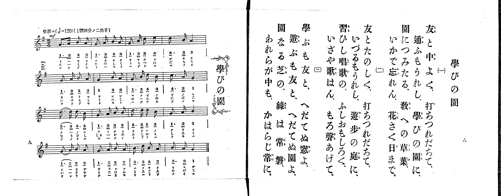

# 學びの園

> Re:Shōka 使用 AI 協助辨識與重建樂譜，可能會有錯誤。歡迎[回報](https://github.com/TMDLang/reshoka/issues)。

- **鋼琴伴奏版**：<br><audio controls src="manabi_no_sono.mp3"></audio>
- **NEUTRINO 歌聲合成版**：<br><audio controls src="manabi_no_sono_neutrino.mp3"></audio>

- 出處：共益商社樂器店《唱歌教科書 生徒用 巻一》第八～九頁（第四曲）
- NDL Digital Collections PID 854862（https://dl.ndl.go.jp/pid/854862）掃描 P006.jpg

## 說明

原書資訊與歌詞全文（NDL PID 854862《唱歌教科書 生徒用 巻一》第八～九頁，掃描 P006.jpg）：
調性與拍號：と調四分ノ二拍子（G 大調 2/4 拍），♩=120，「快活ニ」
註記：分節歌，三節同一旋律。開頭 mf。第三行第一小節「5・5」、第四行第一小節「1・2」各有圓滑線（一字延長）。五線譜與簡譜一致。五線譜下歌詞以直排小字印刷。


## 歌詞

```text
一、
友と中よく、打ちつれだちて、
通ふもうれし、學びの園に、
園につみたる、教への草葉、
いかで忘れん、花さく日まで。

二、
友とたのしく、打ちつれだちて、
いづるもうれし、遊歩の庭に、
習ひし唱歌の、ふしおもしろく、
いざや歌はん、もろ聲あげて。

三、
學ぶも友と、へだてぬ窓よ、
遊ぶも友と、へだてぬ園よ、
園なる芝の、緑は常磐、
われらが中も、かはらじ常に。
```

## ABC

<div class="abc-score" data-abc-src="manabi_no_sono.abc" aria-label="五線譜載入中"></div>

[下載 ABC 原始檔](manabi_no_sono.abc)

## TMD 檔案連結

- [主旋律 TMD 檔案](manabi_no_sono.tmd) [[在 TMD Studio 編輯](https://tmdlang.github.io/Tmd-TS/#tmd=s7IKdvYPcrWy4qpTUCpJTLdSSM7PyUlNLsnMz7PKrsxPzc6ML87Iz05Ugisoy88pzU21yk7MizeMtzA1sTAzQkgW55cWJadaFSdn5OfnxJekVpQk5edno8vHFySmp1oFGBiYIWQKivLLUvMS84C6C4oy80pSU8DaEQpSyzJTUkHSxclAq8tSizLTMlNTkNyVWlQMcjXUipKixLzi5KLMApBXEKrSU_OKUq2SMzJzUopS8-KL8_PSEZJp-UW5VsUlRfkFGZnJCOGSjFSgh6F-yslMS0WXSivKTM1LKc7ILEDI5BdlpmfmWeWmZmZlYgmI_KKSjPz0osSCjEqrjMziEqDy5MSceGCoAoNaS0vh6dodjxs3P25c93TOJAUtLS5FWwVDIwMue1sFdy4bI30TO5BJT9t3vZg59f2eWU9bNz6f3fV0atvzJfuerWh6OnPF013THzd0PZ2y8dnanmdTZz5fPvHZ7B0Kz6fMf7pv0vMpKxSebt_9ZEfD44bu52vWPG1d_X7vvCc7575c0Ph-TwdIZPbsZ7M3vd_TCXawn4uPggvQNyWJOQrO8ORRrBDg6aIASQBAXRklJQXFVvr6KTl6eUCcnq-XVaBfkJmiD1PR-ayv-Vl_vwIo2oFywGDn0tdSsKUW4FJQUHjaNx_oyxeb21-s6HrR0Q70-ouV8562rng2rR3oQpA3EE4mM3R60HwB9Bcw_EGWv1i1_1nDcpC13b0vZs4Hij5uXAEUBIbl0462x819T3b1AKWerp0AdIu7wtMly4GSCsCoVACKgo3peTRzpS0wloGsxw09T_evfrZl9-Pm7scNvWDzV-x-sWIGKLI72p6vbwC6HKjuyY5OIPvpBCCj4dn07qf7gKqbXk7rfrlgrUJuGpAN9ABQzYuFPWBGw9MN_UD1QNNNHzfvNgWa_LihERLfmEoMgUqAwdT7dELLszmdT-dMfrZ74vPts4CuB6laO_3p7m0vp24HuhxozZNdU4BSL9bOAfr_-YaFQAZQzYv2LchST3Z0Q2Lkye6lz2dvedY3CWgVyJzeDU87tgNVcoG8CQ73RnBs9ncDQ_DJjrWPmzoeN_YDRZ91Tn7cuPBx45LHTT2PGxeA2cugql82AMN76-OmpseNbWBpYPpvRM5FjxtXwwyGcIDGNO5_3Dj_cRMw0BqByeBxI1D1uhe9nS8mAv0EVvq4seVxI9AZy5_unwEytWkyUOJF18bHjVOBTno2fenjxn1AWbjjdwFjDsnxINMb14HcQtD9YJuWgtyC6oWXjV3P1q4EeWHXWoQXnu8HemETUAUkDYMsaWgE-R9kVRfYiOmPm3oh1sKNn_a4qQWsej3EIyB1Tb0vQAYBNQBNBDoGFguwEAAH4TagSqiPQNYARYCOX_a4cc3zVZNBsQONAqDNuJWCQh2uFBwFq4C-fdE1F-L459snAt31dMeO54snwNzc1A8O887HjcD0DUwGTWAjgWYD3Q8UnAFUDQ6SJpBqyosQKFDQ0ufi8gUWxEmZfvnB-Xn5VgGZiXn5DjUGNdUgixRsDM207MCs6ty0WjADWJI9bu4A4j1AvAjMrgGSXUA_rAbSK4D0epBI0zIgrxGIW4B4DVhNA1SkDWQvyKwaBUMFXSA0UjAGk7p4RIwVTIGkGVgExAKJgORBsAZsmo8h0JLGFVAxYBiCSDAfJL4KItrYDZTpALP6oTJtUJmFQLwErLMHKrMASWYZql1G-OyaD9W3DoinU26XMUh-H1R-FRBvg9uJzxU7oDoWQE0EpkyoDMysldCwQNgFil1YPDZPBccwLC7XAOnt4HicB4nv5slA3AeW3wtmAUtwwjELijdsMQsSrVEwgeqCqUWO2W6oL4GJr3ErSghAQhUWmpAwRw-zzdAYgcjMRYqh1ah2gWO2BSq_FGgmyF6CdjXBxRt3o9gEMR2YkTFtAscryFyQ_FwqxCuSr7DFKyiWQLkWElOgmATlzflAmf1AejXYG8CgAsby4-YZ8LgFOrxpK5A3ARG3kPxnCs-HqLENiUlkNRARZDXocQtxOSzcQDTYOeA8AuIBHQjOVZDYADlrElRmOjREECEOymsgPjD5Nm5AtQsct9CSoKkTyN4ENwUkA6xI2uEOAUc73FBQgoNZ14USTaAEAOL3wq1GjWBMr60CewCanMEmgpyJsGs_VAaUPcF2ARMPcpJ43AiyCySGFsFLIBEMzsDt4AgGRd5OSOZt3gwW6YcW1sAohRTUzZOgWbqdtGIZEo2mGCLYMy8kQyHCdTnER02wyJoJy1BNk6F-hfgPknmnglmwQhQWafug5mDPvCAV08AmgvjIhS8wxYNNh9sFjktYHE4BsyZC9cCyJzCQsBXLMPcD3Q5KUCCVsAIdkszgPoanF1i8g6IGomMGVAaW2NeCkz_MrlouLl07BeRaWgHIV-YCAA)]
- [鋼琴伴奏 TMD 檔案](manabi_no_sono_piano.tmd) [[在 TMD Studio 編輯](https://tmdlang.github.io/Tmd-TS/#tmd=s7IKdvYPcrWy4qpTUCpJTLdSyC8qychPL0osyKi0ysgsLskvykxOzInPTsxLVOLS0lJ4unbH48bNjxvXPZ0z6f2ejpfde55P2PJkz5anS_ufd3a839OpoKXFpWirYGhkwGVvq-DOZWOkb2IHMv5p-64XM6e-3zPraevG57O7nk5te75k37MVTU9nrni6a_rjhq6nUzY-W9vzbOrM58snPpu9Q-H5lPlP9016PmWFwtPtu5_saHjc0P18zZqnravf7533ZOfclwsagQ4Aicye_Wz2JqDVSiBr_Fx8FFwy0zNLEnMUnPNzclKTSzLz84oVAjxdFCxMTSzMjIC6MkpKCoqt9PVTcvTygDg9Xy-rQL8gM0UfpqLzWV_zs_5-hQADAzOgXLoSF5cvMAiSMv3yg_Pz8q0CMhPz8oM8HGoMaqq5FIDAxtBMyw7Mqs5NqwUz9LUUHjd3APEeIF4EZtcAyS6Fx02rgfQKIL0eJNK0DMhrBOIWIF4DVtMAFWlT0NIHm1WjYKigC4RGCsZgUhePiLGCKZA0A4uAWCARkDwI1oBN8zEEWtK4Air2uKkJRIL5IPFVENHGbqBMB5jVD5Vpg8osBOIlYJ09UJkFSDLLUO0ywmfXfKi-dUA8nXK7jEHy-6Dyq4B4G9xOfK7YAdWxAGri48Y1UBmYWSuhYYGwCxS7sHhsngqOYVhcrgHS28HxOA8S382TgbgPLL8XzHrc3E04ZkHxhi1mQaI1CiZQXTC1yDHbDfUlMPE1bkUJAUiowkITEuboYbYZGiMQmblIMbQa1S5wzLZA5ZcCzQTZS9CuJrh4424UmyCmP25cj2kTOF5B5oLk51IhXpF8hS1eQbEEyrWQmALFJChvzgfK7AfSq8HeAAYVMJYfN8-Axy3Q4U1bgbwJiLiF5D9TeD5EjW1ITCKrgYggq0GPW4jLYeEGosHOAecREA_oQHCugsQGyFmToDLToSGCCHFQXgPxgcm3cQOqXeC4hZYETZ1A9ia4KSCZ6Y-b2uEOAUc73FBQgoNZ14USTaAEAOL3wq1GjWBMr60CewCanMEmgpyJsGs_VAaUPcF2ARMPcpJ43AiyCySGFsFLIBEMzsDt4AgGRd5OSOZt3gwW6YcW1sAohRTUzZOgWbqdtGIZEo2mGCLYMy8kQyHCdTnER02wyJoJy1BNk6F-hfgPknmnglmwQhQWafug5mDPvCAV08AmgvjIhS8wxYNNh9sFjktYHE4BsyZC9cCyJzCQsBXLMPcD3Q5KUCCVsAIdkszgPoanF1i8g6IGomMGVAaW2NeCkz_MrlpslbQPciVtAq2jgWngRV_Xy_bep607Xs5uhbRfkHJtfLxCtGl8LJCJxjEBsk3QxQnqMgSyDXHowipHQA9um9CNMIAEi66dAnLIRPsATcYQM8IiZgwWU-YCAA)]

## 分析

```text
================================================================================
📊 TMD Song Profile: [ 學びの園 ]
================================================================================
⏱  Duration:       0:16 (16.0s), 16 measures total
🎼 Key & Tempo:    首調基準 G, != 120.0 BPM, <2/4>
   - 分析範圍：      由實際發聲的音符與和弦推測調性；播放脈絡另行呈現
🎤 人聲音域:    G4 (MIDI 67) – E5 (MIDI 76) [跨度: 9 個半音 / 0.8 個八度, 難度: easy]
   - 最低音:  G4 in [ManabiNoSono #1 @ m.1, 0:00]
   - 最高音: E5 in [ManabiNoSono #1 @ m.3, 0:02]
   - 適合: soprano, mezzo-soprano, contralto, tenor, baritone, bass
🏛  結構:      ManabiNoSono (16.0s)
⚡ 編曲密度:        Peak 1 軌道同時演奏
🗝  調性診斷：       G 大調（純淨自然大調，未偵測到可信轉調）
   - 風格氣質:    純淨自然大調（陽光明朗、易唱易記，無明顯調外色彩）
   - 轉調歷程:    全曲維持單一推測調性（未偵測到可信轉調）
   - 核心骨幹音:  G, B, A, D, C
   - 調性數值:    G 大調 [相關度: 0.81, 穩定度: High, 自然音純度: 100.0%]
   - 候選調性 (K-S): G 大調 (0.81), B 小調 (0.62), D 大調 (0.59)
   - 五度圈歷程:   +1
   - 各段落調性細節:
     • [ManabiNoSono #1]: G 大調 (r: 0.81, 自然音純度: 100.0%)

  [ 五度圈游移軌跡 ]
               C  
         F           [G ]*
      Bb               D  
      Eb               A  
         Ab           E  
            Db       B  
               F# 
     (* = active key center)

  [ 十二半音累積音高分佈 ]
     C  : ██                         2.3%
     C# :                            0.0%
     D  : █████████████             16.4%
     D# :                            0.0%
     E  : █                          1.6%
     F  :                            0.0%
     F# :                            0.0%
     G  : ████████████████████████  30.5%
     G# :                            0.0%
     A  : █████████████████         21.1%
     A# :                            0.0%
     B  : ██████████████████████    28.1%
--------------------------------------------------------------------------------
Assignment 軌道音域：
  - Piano         : G4 – E5 (9 個半音 / 0.8 個八度, 59 個音符)
================================================================================
```


## 原書掃描頁




