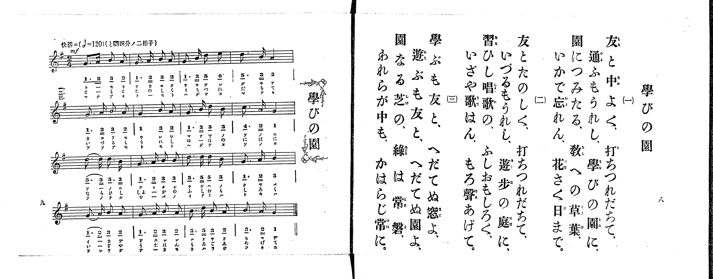

# 學びの園

> Re:Shōka 使用 AI 協助辨識與重建樂譜，可能會有錯誤。歡迎回報。

- **鋼琴伴奏版**：<br><audio controls src="manabi_no_sono.mp3"></audio>
- **NEUTRINO 歌聲合成版**：<br><audio controls src="manabi_no_sono_neutrino.mp3"></audio>

- 出處：共益商社樂器店《唱歌教科書 生徒用 巻一》第八～九頁（第四曲）
- NDL Digital Collections PID 854862（https://dl.ndl.go.jp/pid/854862）掃描 P006.jpg

## 說明

原書資訊與歌詞全文（NDL PID 854862《唱歌教科書 生徒用 巻一》第八～九頁，掃描 P006.jpg）：
調性與拍號：と調四分ノ二拍子（G 大調 2/4 拍），♩=120，「快活ニ」
註記：分節歌，三節同一旋律。開頭 mf。第三行第一小節「5・5」、第四行第一小節「1・2」各有圓滑線（一字延長）。五線譜與簡譜一致。五線譜下歌詞以直排小字印刷。


## 歌詞

```text
一、
友と中よく、打ちつれだちて、
通ふもうれし、學びの園に、
園につみたる、教への草葉、
いかで忘れん、花さく日まで。

二、
友とたのしく、打ちつれだちて、
いづるもうれし、遊歩の庭に、
習ひし唱歌の、ふしおもしろく、
いざや歌はん、もろ聲あげて。

三、
學ぶも友と、へだてぬ窓よ、
遊ぶも友と、へだてぬ園よ、
園なる芝の、緑は常磐、
われらが中も、かはらじ常に。
```

## ABC

<div class="abc-score" data-abc-src="manabi_no_sono.abc" aria-label="五線譜載入中"></div>

[下載 ABC 原始檔](manabi_no_sono.abc)

## TMD 檔案連結

- [主旋律 TMD 檔案](manabi_no_sono.tmd) [[在 TMD Studio 編輯](https://tmdlang.github.io/Tmd-TS/#tmd=s7IKdvYPcrWy4qpTUCpJTLdSSM7PyUlNLsnMz7PKrsxPzc6ML87Iz05Ugisoy88pzU21yk7MizeMtzA1sTAzQkgW55cWJadaFSdn5OfnxJekVpQk5edno8vHFySmp1oFGBiYIWQKivLLUvMS84C6C4oy80pSU8DaEQpSyzJTUkHSxclAq8tSizLTMlNTkNyVWlQMcjXUipKixLzi5KLMApBXEKrSU_OKUq2SMzJzUopS8-KL8_PSEZJp-UW5VsUlRfkFGZnJCOGSjFSgh6F-yslMS0WXSivKTM1LKc7ILEDI5BdlpmfmWeWmZmZlIgWElpbC07U7Hjdufty47umcSQpaWlyKtgqGRgZc9rYK7lw2RvomdiAznrbvejFz6vs9s562bnw-u-vp1LbnS_Y9W9H0dOaKp7umP27oejpl47O1Pc-mzny-fOKz2TsUnk-Z_3TfpOdTVig83b77yY6Gxw3dz9esedq6-v3eeU92zn25oPH9ng6QyOzZz2Zver-nE-xUPxcfBRegQ0sScxSc4TFfrBDg6aIAiVugroySkoJiK339lBy9PCBOz9fLKtAvyEzRh6nofNbX_Ky_XwEUo0A5YIhy6Wsp2FILcCkoKDztmw_05YvN7S9WdL3oaAd6_cXKeU9bVzyb1g50IcgbCCeTGTo9aL4A-gsY_iDLX6za_6xhOcja7t4XM-cDRR83rgAKAsPyaUfb4-a-J7t6gFJP104AusVd4emS5UBJBWBUKgBFwcb0PJq50hYYy0DW44aep_tXP9uy-3Fz9-OGXrD5K3a_WDEDFNkdbc_XNwBdDlT3ZEcnkP10ApDR8Gx699N9QNVNL6d1v1ywViE3DcgGegCo5sXCHjCj4emGfqB6oOmmj5t3mwJNftzQCIlvTCWGQCXAYOp9OqHl2ZzOp3MmP9s98fn2WUDXg1Stnf5097aXU7cDXQ605smuKUCpF2vnAP3_fMNCIAOo5kX7FmSpJzu6ITHyZPfS57O3POubBLQKZE7vhqcd24EquUDeBId7Izg2-7uBIfhkx9rHTR2PG_uBos86Jz9uXPi4ccnjpp7HjQvA7GVQ1S8bgOG99XFT0-PGNrA0MP03Iueix42rYQZDOEBjGvc_bpz_uAkYaI3AZPC4Eah63YvezhcTgX4CK33c2PK4EeiM5U_3zwCZ2jQZKPGia-PjxqlAJz2bvvRx4z6gLNzxu4Axh-R4kOmN60BuIeh-sE1LQW5B9cLLxq5na1eCvLBrLcILz_cDvbAJqAKShkGWNDSC_A-yqgtsxPTHTb0Qa-HGT3vc1AJWvR7iEZC6pt4XIIOAGoAmAh0DiwVYCICDcBtQJdRHIGuAIkDHL3vcuOb5qsmg2IFGAdBm3EpBoQ5XCo6CVUDfvuiaC3H88-0Tge56umPH88UTYG5u6geHeefjRmD6BiaDJrCRQLOB7gcKzgCqBgdJE0g15UUIFCho6XNx-SbmJSZl-uUH5-flWwVkJublO9QY1FSDLFKwMTTTsgOzqnPTasEMYEn2uLkDiPcA8SIwuwZIdgH9sBpIrwDS60EiTcuAvEYgbgHiNWA1DVCRNpC9ILNqFAwVdIHQSMEYTOriETFWMAWSZmAREAskApIHwRqwaT6GQEsaV0DFgGEIIsF8kPgqiGhjN1CmA8zqh8q0QWUWAvESsM4eqMwCJJllqHYZ4bNrPlTfOiCeTrldxiD5fVD5VUC8DW4nPlfsgOpYADURmDKhMjCzVkLDAmEXKHZh8dg8FRzDsLhcA6S3g-NxHiS-mycDcR9Yfi-YBSzBCccsKN6wxSxItEbBBKoLphY5ZruhvgQmvsatKCEACVVYaELCHD3MNkNjBCIzFymGVqPaBY7ZFqj8UqCZIHsJ2tUEF2_cjWITxHRgRsa0CRyvIHNB8nOpEK9IvsIWr6BYAuVaSEyBYhKUN-cDZfYD6dVgbwCDChjLj5tnwOMW6PCmrUDeBETcQvKfKTwfosY2JCaR1UBEkNWgxy3E5bBwA9Fg54DzCIgHdCA4V0FiA-SsSVCZ6dAQQYQ4KK-B-MDk27gB1S5w3EJLgqZOIHsT3BSQDLAiaYc7BBztcENBCQ5mXRdKNIESAIjfC7caNYIxvbYK7AFocgabCHImwq79UBlQ9gTbBUw8yEnicSPILpAYWgQvgUQwOAO3gyMYFHk7IZm3eTNYpB9aWAOjFFJQN0-CZul20oplSDSaYohgz7yQDIUI1-UQHzXBImsmLEM1TYb6FeI_SOadCmbBClFYpO2DmoM984JUTAObCOIjF77AFA82HW4XOC5hcTgFzJoI1QPLnsBAwlYsw9wPdDsoQYFUwgp0SDKD-xieXmDxDooaiI4ZUBlYYl8LTv4wu2q5uHTtFJBraQUgX5kLAA)]
- [鋼琴伴奏 TMD 檔案](manabi_no_sono_piano.tmd) [[在 TMD Studio 編輯](https://tmdlang.github.io/Tmd-TS/#tmd=s7IKdvYPcrWy4tLSUni6dsfjxs2PG9c9nTPp_Z6Ol917nk_Y8mTPlqdL-593drzf06mgpcWlaKtgaGTAZW-r4M5lY6RvYsdVp6D0tH3Xi5lT3--Z9bR14_PZXU-ntj1fsu_ZiqanM1c83TX9cUPX0ykbn63teTZ15vPlE5_N3qHwfMr8p_smPZ-yQuHp9t1PdjQ8buh-vmbN09bV7_fOe7Jz7ssFjUAHgERmz342exPQaiWQNX4uPgoumemZJYk5Cs75OTmpySWZ-XnFCgGeLgoWpiYWZkZAXRklJQXFVvr6KTl6eUCcnq-XVaBfkJmiD1PR-ayv-Vl_v0KAgYEZUC5diYvLNzEvMSnTLz84Py_fKiAzMS8_yMOhxqCmmksBCGwMzbTswKzq3LRaMENfS-FxcwcQ7wHiRWB2DZDsUnjctBpIrwDS60EiTcuAvEYgbgHiNWA1DVCRNgUtfbBZNQqGCrpAaKRgDCZ18YgYK5gCSTOwCIgFEgHJg2AN2DQfQ6AljSugYo-bmkAkmA8SXwURbewGynSAWf1QmTaozEIgXgLW2QOVWYAkswzVLiN8ds2H6lsHxNMpt8sYJL8PKr8KiLfB7cTnih1QHQugJj5uXAOVgZm1EhoWCLtAsQuLx-ap4BiGxeUaIL0dHI_zIPHdPBmI-8Dye8Gsx83dhGMWFG_YYhYkWqNgAtUFU4scs91QXwITX-NWlBCAhCosNCFhjh5mm6ExApGZixRDq1HtAsdsC1R-KdBMkL0E7WqCizfuRrEJYvrjxvWYNoHjFWQuSH4uFeIVyVfY4hUUS6BcC4kpUEyC8uZ8oMx-IL0a7A1gUAFj-XHzDHjcAh3etBXIm4CIW0j-M4XnQ9TYhsQkshqICLIa9LiFuBwWbiAa7BxwHgHxgA4E5ypIbICcNQkqMx0aIogQB-U1EB-YfBs3oNoFjltoSdDUCWRvgpsCkpn-uKkd7hBwtMMNBSU4mHVdKNEESgAgfi_catQIxvTaKrAHoMkZbCLImQi79kNlQNkTbBcw8SAniceNILtAYmgRvAQSweAM3A6OYFDk7YRk3ubNYJF-aGENjFJIQd08CZql20krliHRaIohgj3zQjIUIlyXQ3zUBIusmbAM1TQZ6leI_yCZdyqYBStEYZG2D2oO9swLUjENbCKIj1z4AlM82HS4XeC4hMXhFDBrIlQPLHsCAwlbsQxzP9DtoAQFUgkr0CHJDO5jeHqBxTsoaiA6ZkBlYIl9LTj5w-yqxVZJ-yBX0ibQOhqYBl70db1s733auuPl7FZI-wUp18bHK0SbxscCmWgcEyDbBF2coC5DINsQhy6scgT04LYJ3QgDSLDo2ikgh0y0D9BkDDEjLGLGYDFlLgA)]

## 分析

```text
================================================================================
📊 TMD Song Profile: [ 學びの園 ]
================================================================================
⏱  Duration:       0:16 (16.0s), 16 measures total
🎼 Key & Tempo:    首調基準 G, != 120.0 BPM, <2/4>
   - 分析範圍：      由實際發聲的音符與和弦推測調性；播放脈絡另行呈現
🎤 人聲音域:    G4 (MIDI 67) – E5 (MIDI 76) [跨度: 9 個半音 / 0.8 個八度, 難度: easy]
   - 最低音:  G4 in [ManabiNoSono #1 @ m.1, 0:00]
   - 最高音: E5 in [ManabiNoSono #1 @ m.3, 0:02]
   - 適合: soprano, mezzo-soprano, contralto, tenor, baritone, bass
🏛  結構:      ManabiNoSono (16.0s)
⚡ 編曲密度:        Peak 1 軌道同時演奏
🗝  調性診斷：       G 大調（純淨自然大調，未偵測到可信轉調）
   - 風格氣質:    純淨自然大調（陽光明朗、易唱易記，無明顯調外色彩）
   - 轉調歷程:    全曲維持單一推測調性（未偵測到可信轉調）
   - 核心骨幹音:  G, B, A, D, C
   - 調性數值:    G 大調 [相關度: 0.81, 穩定度: High, 自然音純度: 100.0%]
   - 候選調性 (K-S): G 大調 (0.81), B 小調 (0.62), D 大調 (0.59)
   - 五度圈歷程:   +1
   - 各段落調性細節:
     • [ManabiNoSono #1]: G 大調 (r: 0.81, 自然音純度: 100.0%)

  [ 五度圈游移軌跡 ]
               C  
         F           [G ]*
      Bb               D  
      Eb               A  
         Ab           E  
            Db       B  
               F# 
     (* = active key center)

  [ 十二半音累積音高分佈 ]
     C  : ██                         2.3%
     C# :                            0.0%
     D  : █████████████             16.4%
     D# :                            0.0%
     E  : █                          1.6%
     F  :                            0.0%
     F# :                            0.0%
     G  : ████████████████████████  30.5%
     G# :                            0.0%
     A  : █████████████████         21.1%
     A# :                            0.0%
     B  : ██████████████████████    28.1%
--------------------------------------------------------------------------------
Assignment 軌道音域：
  - Piano         : G4 – E5 (9 個半音 / 0.8 個八度, 59 個音符)
================================================================================
```


## 原書掃描頁




