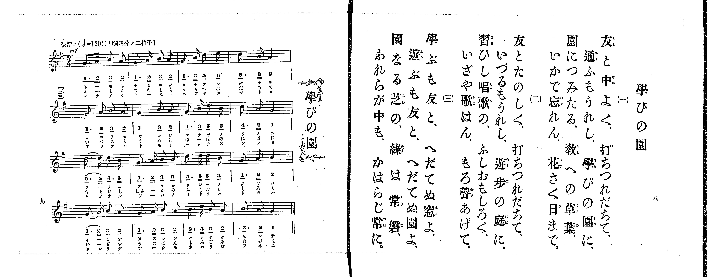

# 學びの園

> Re:Shoka 使用 AI 協助辨識與重建樂譜，可能會有錯誤。歡迎回報。

<audio controls src="manabi_no_sono.mp3"></audio>

- 出處：共益商社樂器店《唱歌教科書 生徒用 巻一》第八～九頁（第四曲）
- NDL Digital Collections PID 854862（https://dl.ndl.go.jp/pid/854862）掃描 P006.jpg

## 說明

原書資訊與歌詞全文（NDL PID 854862《唱歌教科書 生徒用 巻一》第八～九頁，掃描 P006.jpg）：
調性與拍號：と調四分ノ二拍子（G 大調 2/4 拍），♩=120，「快活ニ」
註記：分節歌，三節同一旋律。開頭 mf。第三行第一小節「5・5」、第四行第一小節「1・2」各有圓滑線（一字延長）。五線譜與簡譜一致。五線譜下歌詞以直排小字印刷。

## 歌詞

```text
一、
友と中よく、打ちつれだちて、
通ふもうれし、學びの園に、
園につみたる、教への草葉、
いかで忘れん、花さく日まで。

二、
友とたのしく、打ちつれだちて、
いづるもうれし、遊歩の庭に、
習ひし唱歌の、ふしおもしろく、
いざや歌はん、もろ聲あげて。

三、
學ぶも友と、へだてぬ窓よ、
遊ぶも友と、へだてぬ園よ、
園なる芝の、緑は常磐、
われらが中も、かはらじ常に。
```

## ABC

```abc
X:1
T:學びの園
M:2/4
L:1/16
Q:1/4=120
K:G
V:V1 name="Piano" snm="Pia"
[V:V1]
!mf! G3 A B2 A2 | G3 A B2 A2 | G3 B d2 e2 | d3 B A4 |
G3 A B2 A2 | G4 B2 A2 | G3 B d2 B2 | c3 A G4 |
d3 d d3 B | G3 A B2 B2 | d3 d d2 B2 | G3 A B4 |
G3 A B2 A2 | G3 A B2 A2 | B3 d B2 A2 | B3 A G4 |
!mf! G3 A B2 A2 | G3 A B2 A2 | G3 B d2 e2 | d3 B A4 |
G3 A B2 A2 | G4 B2 A2 | G3 B d2 B2 | c3 A G4 |
d3 d d3 B | G3 A B2 B2 | d3 d d2 B2 | G3 A B4 |
G3 A B2 A2 | G3 A B2 A2 | B3 d B2 A2 | B3 A G4 |
!mf! G3 A B2 A2 | G3 A B2 A2 | G3 B d2 e2 | d3 B A4 |
G3 A B2 A2 | G4 B2 A2 | G3 B d2 B2 | c3 A G4 |
d3 d d3 B | G3 A B2 B2 | d3 d d2 B2 | G3 A B4 |
G3 A B2 A2 | G3 A B2 A2 | B3 d B2 A2 | B3 A G4 |
```

## TMD 檔案連結

- [主旋律 TMD 檔案](manabi_no_sono.tmd) [[在 TMD Studio 編輯](https://tmdlang.github.io/Tmd-TS/#tmd=s7IKdvYPcrWy4qpTUCpJTLdSSM7PyUlNLsnMz7PKrsxPzc6ML87Iz05Ugisoy88pzU21yk7MizeMtzA1sTAzQkgW55cWJadaFSdn5OfnxJekVpQk5edno8vHFySmp1oFGBiYIWQKivLLUvMS84C6C4oy80pSU8DaEQpSyzJTUkHSxclAq8tSizLTMlNTkNyVWlQMcjXUipKixLzi5KLMApBXEKrSU_OKUq2SMzJzUopS8-KL8_PSEZJp-UW5VsUlRfkFGZnJCOGSjFSgh6F-yslMS0WXSivKTM1LKc7ILFDi0tJSeLp2x-PGzY8b1z2dM0lBS4tL0VbB0MiAy95WwZ3LxkjfxA6k_Wn7rhczp77fM-tp68bns7ueTm17vmTfsxVNT2eueLpr-uOGrqdTNj5b2_Ns6sznyyc-m71D4fmU-U_3TXo-ZYXC0-27n-xoeNzQ_XzNmqetq9_vnfdk59yXCxrf7-kAicye_Wz2pvd7OsGu9HPxUXDJTM8sScxRcIZHbbFCgKeLAiTygLoySkoKiq309VNy9PKAOD1fL6tAvyAzRR-movNZX_Oz_n4FUJQB5YBBxqWvpWBLLcCloKDwtG8-0JcvNre_WNH1oqMd6PUXK-c9bV3xbFo70IUgbyCcTGbo9KD5AugvYPiDLH-xav-zhuUga7t7X8ycDxR93LgCKAgMy6cdbY-b-57s6gFKPV07AegWd4WnS5YDJRWAUakAFAUb0_No5kpbYCwDWY8bep7uX_1sy-7Hzd2PG3rB5q_Y_WLFDFBkd7Q9X98AdDlQ3ZMdnUD20wlARsOz6d1P9wFVN72c1v1ywVqF3DQgG-gBoJoXC3vAjIanG_qB6oGmmz5u3m0KNPlxQyMkvjGVGAKVAIOp9-mElmdzOp_Omfxs98Tn22cBXQ9StXb6093bXk7dDnQ50Jonu6YApV6snQP0__MNC4EMoJoX7VuQpZ7s6IbEyJPdS5_P3vKsbxLQKpA5vRuedmwHquQCeRMc7o3g2OzvBobgkx1rHzd1PG7sB4o-65z8uHHh48Ylj5t6HjcuALOXQVW_bACG99bHTU2PG9vA0sD034icix43roYZDOEAjWnc_7hx_uMmYKA1ApPB40ag6nUvejtfTAT6Caz0cWPL40agM5Y_3T8DZGrTZKDEi66NjxunAp30bPrSx437gLJwx-8CxhyS40GmN64DuYWg-8E2LQW5BdULLxu7nq1dCfLCrrUILzzfD_TCJqAKSBoGWdLQCPI_yKousBHTHzf1QqyFGz_tcVMLWPV6iEdA6pp6X4AMAmoAmgh0DCwWYCEADsJtQJVQH4GsAYoAHb_sceOa56smg2IHGgVAm3ErBYU6XCk4ClYBffuiay7E8c-3TwS66-mOHc8XT4C5uakfHOadjxuB6RuYDJrARgLNBrofKDgDqBocJE0g1ZQXIVCgoKXPxeWbmJeYlOmXH5yfl28VkJmYl-9QY1CjUA2yScHG0EzLDsyqzk2rBTOARdnj5g4g3gPEi8DsGiDZBfTEaiC9AkivB4k0LQPyGoG4BYjXgNU0QEXaQBaDzKpRMFTQBUIjBWMwqYtHxFjBFEiagUVALJAISB4Ea-Aug7mheSrYdTB3rAHS28FumAdxa_NkIO4Dy-8Fs4DFD2FXgezE5iqQaI2CCVQXTC2Sq0B2gMILYg_IHaBQmQ-U2Q-kV4PdsQrsxsfNM-AuWw_EW4G8CQiXQXxuCg8BVLdC3IGsBiKCrAbNZUsgLgOHWzvYZSBbd0LCrHkzWKQfGr9At0DitnkSNCTbSYtJiP2mGCLIYVbLxaVrp4CcKhWI4CtzAQA)]

## 分析

```text
================================================================================
📊 TMD Song Profile: [ 學びの園 ]
================================================================================
⏱  Duration:       0:48 (48.0s), 48 measures total
🎼 Key & Tempo:    首調基準 G, != 120.0 BPM, <2/4>
   - 分析範圍：      由實際發聲的音符與和弦推測調性；播放脈絡另行呈現
🎤 人聲音域:    G4 (MIDI 67) – E5 (MIDI 76) [跨度: 9 個半音 / 0.8 個八度, 難度: easy]
   - 最低音:  G4 in [ManabiNoSono #1 @ m.1, 0:00]
   - 最高音: E5 in [ManabiNoSono #1 @ m.3, 0:02]
   - 適合: soprano, mezzo-soprano, contralto, tenor, baritone, bass
🏛  結構:      ManabiNoSono (16.0s) -> ManabiNoSono (16.0s) -> ManabiNoSono (16.0s)
⚡ 編曲密度:        Peak 1 軌道同時演奏
🗝  調性診斷：       G 大調（純淨自然大調，未偵測到可信轉調）
   - 風格氣質:    純淨自然大調（陽光明朗、易唱易記，無明顯調外色彩）
   - 轉調歷程:    全曲維持單一推測調性（未偵測到可信轉調）
   - 核心骨幹音:  G, B, A, D, C
   - 調性數值:    G 大調 [相關度: 0.81, 穩定度: High, 自然音純度: 100.0%]
   - 候選調性 (K-S): G 大調 (0.81), B 小調 (0.62), D 大調 (0.59)
   - 五度圈歷程:   +1 -> +1 -> +1
   - 各段落調性細節:
     • [ManabiNoSono #1]: G 大調 (r: 0.81, 自然音純度: 100.0%)
     • [ManabiNoSono #2]: G 大調 (r: 0.81, 自然音純度: 100.0%)
     • [ManabiNoSono #3]: G 大調 (r: 0.81, 自然音純度: 100.0%)

  [ 五度圈游移軌跡 ]
               C  
         F           [G ]*
      Bb               D  
      Eb               A  
         Ab           E  
            Db       B  
               F# 
     (* = active key center)

  [ 十二半音累積音高分佈 ]
     C  : ██                         2.3%
     C# :                            0.0%
     D  : █████████████             16.4%
     D# :                            0.0%
     E  : █                          1.6%
     F  :                            0.0%
     F# :                            0.0%
     G  : ████████████████████████  30.5%
     G# :                            0.0%
     A  : █████████████████         21.1%
     A# :                            0.0%
     B  : ██████████████████████    28.1%
--------------------------------------------------------------------------------
Assignment 軌道音域：
  - Piano         : G4 – E5 (9 個半音 / 0.8 個八度, 177 個音符)
================================================================================
```


## 原書掃描頁




