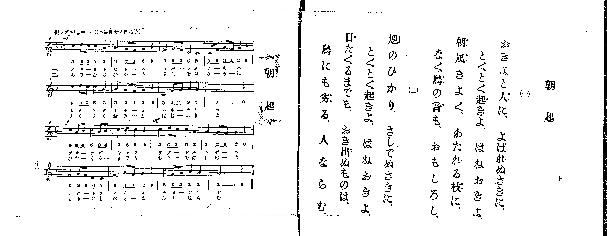

# 朝起

> Re:Shōka 使用 AI 協助辨識與重建樂譜，可能會有錯誤。歡迎[回報](https://github.com/TMDLang/reshoka/issues)。

- **鋼琴伴奏版**：<br><audio controls src="asaoki.mp3"></audio>
- **NEUTRINO 歌聲合成版**：<br><audio controls src="asaoki_neutrino.mp3"></audio>

- 出處：共益商社樂器店《唱歌教科書 生徒用 巻一》第十～十一頁（第五曲）
- NDL Digital Collections PID 854862（https://dl.ndl.go.jp/pid/854862）掃描 P007.jpg

## 說明

原書資訊與歌詞全文（NDL PID 854862《唱歌教科書 生徒用 巻一》第十～十一頁，掃描 P007.jpg）：
調性與拍號：ヘ調四分ノ四拍子（F 大調 4/4 拍），♩=144，「樂シゲニ」
註記：第一學期第五曲。分節歌，二節同一旋律。開頭標 mf，第三行第一小節（「あさかぜ」／「ひたくる」起）標 f，第三行第三小節（「わたれる」／「おきでぬ」起）標 mf。五線譜與簡譜一致。


## 歌詞

```text
一、
おきよと人に、よばれぬさきに、
とくとく起きよ、はねおきよ、
朝風きよく、わたれる枝に、
なく鳥の音も、おもしろし。

二、
旭のひかり、さしでぬさきに、
とくとく起きよ、はねおきよ、
日たくるまでも、おき出ぬものは、
鳥にも劣る、人ならむ。
```

## ABC

<div class="abc-score" data-abc-src="asaoki.abc" aria-label="五線譜載入中"></div>

[下載 ABC 原始檔](asaoki.abc)

## TMD 檔案連結

- [主旋律 TMD 檔案](asaoki.tmd) [[在 TMD Studio 編輯](https://tmdlang.github.io/Tmd-TS/#tmd=s7IKdvYPcrWy4qpTUCpJTLdSSM7PyUlNLsnMz7PKrsxPzc6ML87Iz05Ugisoy88pzU21yk7MizeMtzA1sTAzQkgW55cWJadaFSdn5OfnxJekVpQk5edno8vHFySmp1oFGBiYI2QKivLLUvMS84C6C4oy80pSU8DaEQpSyzJTUkHSxclAq8tSizLTMlNTkNyVWlQMcjXUipKixLzi5KLMApBXEKrSU_OKUq2SMzJzUopS8-KL8_PSEZJp-UW5VsUlRfkFGZnJCOGSjFSgh0syc1Pj89PiUxIr0aUS8zJzE3MQovlFmemZeVa5qZlZmVgCIb-oJCM_vSixIKPSKiOzuASoPDkxJx4YosBg1tJSeDZn7out2xW0tLgUbRUMTUy47G0V3LhsTPRN7EBmPG3f9WLm1Pd7Zj1t3fh8dtfTqW3Pl-x7tqLp6cwVT3dNf9zQ9XTKxmdre55Nnfl8-cRns3coPJ8y_-m-Sc-nrFB4un33kx0Njxu6n69Z87S38f3eeUASKPJyQeP7PR1AwSe7pjybven9nk6wa_1cfBRcgF4pScxRcIani2KFAE8XBUjMA3VllJQUFFvp66fk6OUBcXq-XlaBfkFmij5MReezvuZn_f0KoPgGygHDm0tfS8GWWoBLQUHhad98oEdfbG5_saLrRUc70PcvVs572rri2bR2oAtB3kA4mfwA6kHzCNBrwFgA2f9i1f5nDctBNnf3vpg5Hyj6uHkGUPDp7NlPO9oeN_cBGUCpp2snAJ3jpvB0yXKgpAIwQhWAomBjeh7NXGkLjGsg63FDDzA2Hzdtf9y06XFz9-OGXrAVK3a_WDEDaDIolnY0PF2749mc-fAYe9zQBLTo-foGoL-ARjzZ1QNkP53QA1T5bHr3031AU5peTut-uWDtsxUzFXLTgGrA5nS-WAhhNDzd0A_UAnQe0PrHjU2PG6c-bux-3DgHaP37Pf1gwU2PG-c_bux_3ARyEzCFgqIWaBqmYZ0ohjX1g_Q1ARkgfTDDuh439j5uXP64cQ2KYblpQJcC_fR8-6wXa-cAQ_T5hoVABtCBL9q3AKW4QGEBjqJGEAtqTlPH48YVT3btety4GigB5m4A2Qg0HOQPoEUgcYiGFSAvgEmgrVDNQD2N6x83rkUYB1ENzIkvFwGVQmwAOhxoNsI3z-bNRTZ4FVDFy81LHzeuezl_8-OmJrCpXSBG4_THTUA3APMm1P27gJEMsWA60M514KDtftzUBdYCdPB0aMhQ5vjpQLfAIqxxH8hIuKMae4GlCMgGkOuA9q-H6gG7fzVQ9GnXYnB8NYJDddXjps7HTcBAbwIpojzPQoGClj4Xl2NxYn52plVAZmJevkONQU01yAoFGwstOzCjOjetFswAlhmPm1YB8VqFx817gHgFEHco1ADJSWAWRLQbLAKSmwAVWQPEPSDRpq0QEbgJ3SAHgMyuUTBV0FUwA5Ig2hiIa8CkkYIhEOsqGIBFDKEiZvFAhimIAOqLBwoYIysDG-hjCLSvsQvIBwY1iGzqALNXgDUB4xvOAwY3kIQYBlO1AayjB8xeA9UxFWEWQgfELiOQfBNYBqIKYvo6FLu6wWaCXAS1C6p2OphcTqRdoEgABXXTemgQQtggp6NGDSgS-oG4FxrkEFlI1JAU6OBwBglApGDxAIPoQQ4J0n6k4AWxsUUGLBjWg8XXgkmEGlhkwCB6cNPenmrkdL8IKfWuBmJQIO8BawYFOTC1QyKhGRgtTfuR0v1qsBpQbmjAnuaNFUzgNCxCgIkbHvyg7EdMPCFFAXJKBKe6xjnQIEDOCaDggqV6SDDOB8uCU30TSB9IB0TtAjCJLdVD0jZYJyQy4Dr3gcXA6boJ5CJYNCBFD2qqB6uC5BpIZKGl-i7UVN-8ChzgfYg03rwIlg-ALEhUbQfS4FQPZMGDHVsxAhJDKUXAYU18sl-FCAFIcgTndJAMxD_gZIcZDlA_g8uAJmhyBPPwJnuw2ZD4gJiACFeIPCgOYPYgl3RgVzZ1QsO7AcOeWi4uXTsFSIWgAGQpcwEA)]
- [鋼琴伴奏 TMD 檔案](asaoki_piano.tmd) [[在 TMD Studio 編輯](https://tmdlang.github.io/Tmd-TS/#tmd=s7IKdvYPcrWy4qpTUCpJTLdSyC8qychPL0osyKi0ysgsLskvykxOzInPTsxLVOLS0lJ4Nmfui63b3-_peNm95_mELU_2bHm6tP95Z8f7PZ0KWlpcirYKhiYmXPa2Cm5cNib6JnYgg5-273oxc-r7PbOetm58Prvr6dS250v2PVvR9HTmiqe7pj9u6Ho6ZeOztT3Pps58vnzis9k7FJ5Pmf9036TnU1YoPN2--8mOhscN3c_XrHna2_h-7zwgCRR5uaAR6Aag4JNdU57N3gS0XQlkk5-Lj4JLZnpmSWKOgnN-Tk5qcklmfl6xQoCni4KFqYmFmRFQV0ZJSUGxlb5-So5eHhCn5-tlFegXZKbow1R0PutrftbfrxBgYGAOlEtX4uJyLE7Mz860CshMzMsP8nCoMaip5lIAAhsLLTswozo3rRbM0NdSeNy0CojXKjxu3gPEK4C4Q6EGSE4CsyCi3WARkNwEqMgaIO4BiTZthYjATehW0NIHm12jYKqgq2AGJEG0MRDXgEkjBUMg1lUwAIsYQkXM4oEMUxAB1BcPFDBGVgY20McQaF9jF5D_uLEXRDZ1gNkrwJoeN26C8x43rgaSEMNgqjaAdfSA2WugOqYizELogNhlBJJvAstAVEFMX4diVzfYTJCLoHZB1U4Hk8uJtAsUCaCgbloPDUIIG-R01KgBRUI_EPdCgxwiC4kakgIdHM4gAYgULB5gED3IIUHajxS8IDa2yIAFw3qw-FowiVADiwwYRA9u2ttTjZzuFyGl3tVADArkPWDNoCAHpnZIJDQDo6VpP1K6Xw1WA8oNDdjTvLGCCZyGRQgwccODH5T9iIknpChATongVNc4BxoEyDkBFFywVA8JxvlgWXCqbwLpA-mAqF0AJrGlekjaBuuERAZc5z6wGDhdN4FcBIsGpOhBTfVgVZBcA4kstFTfhZrqm1eBA7wPkcabF8HyAZAFiartQBqc6oEseLBjK0ZAYiilCDisiU_2qxAhAEmO4JwOkoH4B5zsMMMB6mdwGdAETY5gHt5kDzYbEh8QExDhCpEHxQHMHuSSDuzKpk5oeDdg2FOLWh_4INcHJtD6ABgXL_q6Xrb3Pm3d8XJ2K6SeRASuSbxCtEmsgiGQMowF8kEFCJBtGh-LYEA8hCQD1QRSDdWIoZYUczHMQIjB9KOaimk_TITGvsLvUgNIlOjaKUBiJdoHKI7EMwLzlLkA)]

## 分析

```text
================================================================================
📊 TMD Song Profile: [ 朝起 ]
================================================================================
⏱  Duration:       0:26 (26.7s), 16 measures total
🎼 Key & Tempo:    首調基準 F, != 144.0 BPM, <4/4>
   - 分析範圍：      由實際發聲的音符與和弦推測調性；播放脈絡另行呈現
🎤 人聲音域:    C4 (MIDI 60) – D5 (MIDI 74) [跨度: 14 個半音 / 1.2 個八度, 難度: moderate]
   - 最低音:  C4 in [Asaoki #1 @ m.3, 0:04]
   - 最高音: D5 in [Asaoki #1 @ m.1, 0:00]
   - 適合: soprano, mezzo-soprano, contralto, tenor, baritone, bass
🏛  結構:      Asaoki (26.7s)
⚡ 編曲密度:        Peak 1 軌道同時演奏
🗝  調性診斷：       F 大調（純淨自然大調，未偵測到可信轉調）
   - 風格氣質:    純淨自然大調（陽光明朗、易唱易記，無明顯調外色彩）
   - 轉調歷程:    全曲維持單一推測調性（未偵測到可信轉調）
   - 核心骨幹音:  C, F, G, A, D
   - 調性數值:    F 大調 [相關度: 0.87, 穩定度: Moderate, 自然音純度: 100.0%]
   - 候選調性 (K-S): F 大調 (0.87), C 大調 (0.81), A 小調 (0.62)
   - 五度圈歷程:   -1
   - 各段落調性細節:
     • [Asaoki #1]: F 大調 (r: 0.87, 自然音純度: 100.0%)

  [ 五度圈游移軌跡 ]
               C  
        [F ]*          G  
      Bb               D  
      Eb               A  
         Ab           E  
            Db       B  
               F# 
     (* = active key center)

  [ 十二半音累積音高分佈 ]
     C  : ████████████████████████  28.6%
     C# :                            0.0%
     D  : ███████                    8.0%
     D# :                            0.0%
     E  :                            0.0%
     F  : █████████████████████     25.0%
     F# :                            0.0%
     G  : ████████████████          18.7%
     G# :                            0.0%
     A  : ███████████████           17.9%
     A# : ██                         1.8%
     B  :                            0.0%
--------------------------------------------------------------------------------
Assignment 軌道音域：
  - Piano         : C4 – D5 (14 個半音 / 1.2 個八度, 67 個音符)
================================================================================
```


## 原書掃描頁




