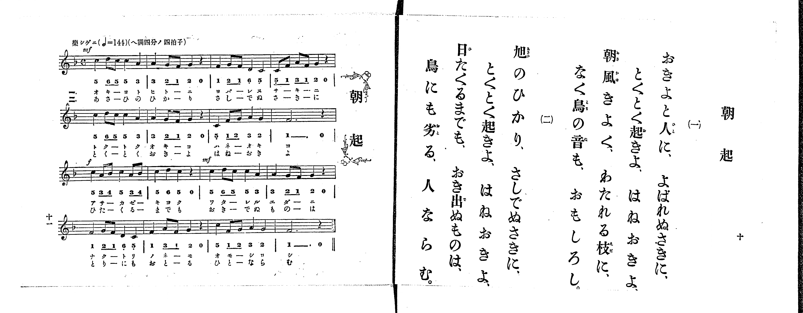

# 朝起

<audio controls src="asaoki.mp3"></audio>

- 出處：共益商社樂器店《唱歌教科書 生徒用 巻一》第十～十一頁（第五曲）
- NDL Digital Collections PID 854862（https://dl.ndl.go.jp/pid/854862）掃描 P007.jpg

## 說明

原書資訊與歌詞全文（NDL PID 854862《唱歌教科書 生徒用 巻一》第十～十一頁，掃描 P007.jpg）：
調性與拍號：ヘ調四分ノ四拍子（F 大調 4/4 拍），♩=144，「樂シゲニ」
註記：第一學期第五曲。分節歌，二節同一旋律。開頭標 mf，第三行第一小節（「あさかぜ」／「ひたくる」起）標 f，第三行第三小節（「わたれる」／「おきでぬ」起）標 mf。五線譜與簡譜一致。

## 歌詞

```text
一、
おきよと人に、よばれぬさきに、
とくとく起きよ、はねおきよ、
朝風きよく、わたれる枝に、
なく鳥の音も、おもしろし。

二、
旭のひかり、さしでぬさきに、
とくとく起きよ、はねおきよ、
日たくるまでも、おき出ぬものは、
鳥にも劣る、人ならむ。
```

## ABC

```abc
X:1
T:朝起
M:4/4
L:1/16
Q:1/4=144
K:F
V:V1 name="Piano" snm="Pia"
[V:V1]
!mf! c4 d2 c2 c4 A4 | A4 G2 F2 G4 z4 | F4 G2 F2 D4 C4 | C2 F2 A2 F2 G4 z4 |
c4 d2 c2 c4 A4 | A4 G2 F2 G4 z4 | C4 F2 G2 A4 G4 | F12 z4 |
!f! c4 A2 B2 c4 A2 B2 | c4 d4 c4 z4 | !mf! c4 d2 c2 c4 A4 | A4 G2 F2 G4 z4 |
F4 G2 F2 D4 C4 | F4 A2 F2 G4 z4 | C4 F2 G2 A4 G4 | F12 z4 |
!mf! c4 d2 c2 c4 A4 | A4 G2 F2 G4 z4 | F4 G2 F2 D4 C4 | C2 F2 A2 F2 G4 z4 |
c4 d2 c2 c4 A4 | A4 G2 F2 G4 z4 | C4 F2 G2 A4 G4 | F12 z4 |
!f! c4 A2 B2 c4 A2 B2 | c4 d4 c4 z4 | !mf! c4 d2 c2 c4 A4 | A4 G2 F2 G4 z4 |
F4 G2 F2 D4 C4 | F4 A2 F2 G4 z4 | C4 F2 G2 A4 G4 | F12 z4 |
```

## TMD 檔案連結

- [主旋律 TMD 檔案](asaoki.tmd) [[在 TMD Studio 編輯](https://tmdlang.github.io/Tmd-TS/#tmd=s7IKdvYPcrWy4qpTUCpJTLdSSM7PyUlNLsnMz7PKrsxPzc6ML87Iz05Ugisoy88pzU21yk7MizeMtzA1sTAzQkgW55cWJadaFSdn5OfnxJekVpQk5edno8vHFySmp1oFGBiYI2QKivLLUvMS84C6C4oy80pSU8DaEQpSyzJTUkHSxclAq8tSizLTMlNTkNyVWlQMcjXUipKixLzi5KLMApBXEKrSU_OKUq2SMzJzUopS8-KL8_PSEZJp-UW5VsUlRfkFGZnJCOGSjFSgh0syc1Pj89PiUxIr0aUS8zJzE3OUuLS0FJ7Nmfti63YFLS0uRVsFQxMTLntbBTcuGxN9EzuQpqftu17MnPp-z6ynrRufz-56OrXt-ZJ9z1Y0PZ254umu6Y8bup5O2fhsbc-zqTOfL5_4bPYOhedT5j_dN-n5lBUKT7fvfrKj4XFD9_M1a572Nr7fOw9IAkVeLmh8v6cDKPhk15Rnsze939MJdp6fi4-CS2Z6ZklijoIzPE6LFQI8XRQgsQbUlVFSUlBspa-fkqOXB8Tp-XpZBfoFmSn6MBWdz_qan_X3K4DiCigHDCsufS0FW2oBLgUFhad984EefbG5_cWKrhcd7UDfv1g572nrimfT2oEuBHkD4WTyA6gHzSNArwFjAWT_i1X7nzUsB9nc3fti5nyg6OPmGUDBp7NnP-1oe9zcB2QApZ6unQB0jpvC0yXLgZIKwAhVAIqCjel5NHOlLTCugazHDT3A2HzctP1x06bHzd2PG3rBVqzY_WLFDKDJoFja0fB07Y5nc-bDY-xxQxPQoufrG4D-AhrxZFcPkP10Qg9Q5bPp3U_3AU1pejmt--WCtc9WzFTITQOqAZvT-WIhhNHwdEM_UAvQeUDrHzc2PW6c-rix-3HjHKD17_f0gwU3PW6c_7ix_3ETyE3AFAqKWqBpmIZ1ohjW1A_S1wRkgPTBDOt63Nj7uHH548Y1KIblpgFdCvTT8-2zXqydAwzR5xsWAhlAB75o3wKU4gKFBTiKGkEsqDlNHY8bVzzZtetx42qgBJi7AWQj0HCQP4AWgcQhGlaAvAAmgbZCNQP1NK5_3LgWYRxENTAnvlwEVAqxAehwoNkI3zybNxfZ4FVAFS83L33cuO7l_M2Pm5rApnaBGI3THzcB3QDMm1D37wJGMsSC6UA714GDtvtxUxdYC9DB06EhQ5njpwPdAouwxn0gI-GOauwFliIgG0CuA9q_HqoH7P7VQNGnXYvB8dUIDtVVj5s6HzcBA70JpIjyPAsFClr6XFyOxYn52ZlWAZmJefkONQY1CtUgOxRsLLTswIzq3LRaMANYaDxuWgXEaxUeN-8B4hVA3KFQAyQngVkQ0W6wCEhuAlRkDRD3gESbtkJE4CZ0g1wAMrtGwVRBV8EMSIJoYyCuAZNGCoZArKtgABYxhIqYxQMZpiACqC8eKGCMrAzuWJCTmtZDrYKwQY5A9QLIsf1A3At1GkQW4gWSHAd2D0gAIgVzLwwinFaNHJ6LkEJlNRCDHLUH7EyQE4GhCHF0M9AbTfuRwnM1WA0olBuwh6WxggmchnkAGGhw54KilRh_IUKzCzU0m1eBHdaHCLvmRbDwBbIgXtoOpMGhCWTBnYctGkFiKLFIXHjWcnHp2ilAkrACCkuZCwA)]

## 分析

```text
================================================================================
📊 TMD Song Profile: [ 朝起 ]
================================================================================
⏱  Duration:       0:53 (53.3s), 32 measures total
🎼 Key & Tempo:    首調基準 F, != 144.0 BPM, <4/4>
   - 分析範圍：      由實際發聲的音符與和弦推測調性；播放脈絡另行呈現
🎤 人聲音域:    C4 (MIDI 60) – D5 (MIDI 74) [跨度: 14 個半音 / 1.2 個八度, 難度: moderate]
   - 最低音:  C4 in [Asaoki #1 @ m.3, 0:04]
   - 最高音: D5 in [Asaoki #1 @ m.1, 0:00]
   - 適合: soprano, mezzo-soprano, contralto, tenor, baritone, bass
🏛  結構:      Asaoki (26.7s) -> Asaoki (26.7s)
⚡ 編曲密度:        Peak 1 軌道同時演奏
🗝  調性診斷：       F 大調（純淨自然大調，未偵測到可信轉調）
   - 風格氣質:    純淨自然大調（陽光明朗、易唱易記，無明顯調外色彩）
   - 轉調歷程:    全曲維持單一推測調性（未偵測到可信轉調）
   - 核心骨幹音:  C, F, G, A, D
   - 調性數值:    F 大調 [相關度: 0.87, 穩定度: Moderate, 自然音純度: 100.0%]
   - 候選調性 (K-S): F 大調 (0.87), C 大調 (0.81), A 小調 (0.62)
   - 五度圈歷程:   -1 -> -1
   - 各段落調性細節:
     • [Asaoki #1]: F 大調 (r: 0.87, 自然音純度: 100.0%)
     • [Asaoki #2]: F 大調 (r: 0.87, 自然音純度: 100.0%)

  [ 五度圈游移軌跡 ]
               C  
        [F ]*          G  
      Bb               D  
      Eb               A  
         Ab           E  
            Db       B  
               F# 
     (* = active key center)

  [ 十二半音累積音高分佈 ]
     C  : ████████████████████████  28.6%
     C# :                            0.0%
     D  : ███████                    8.0%
     D# :                            0.0%
     E  :                            0.0%
     F  : █████████████████████     25.0%
     F# :                            0.0%
     G  : ████████████████          18.7%
     G# :                            0.0%
     A  : ███████████████           17.9%
     A# : ██                         1.8%
     B  :                            0.0%
--------------------------------------------------------------------------------
Assignment 軌道音域：
  - Piano         : C4 – D5 (14 個半音 / 1.2 個八度, 134 個音符)
================================================================================
```


## 原書掃描頁




