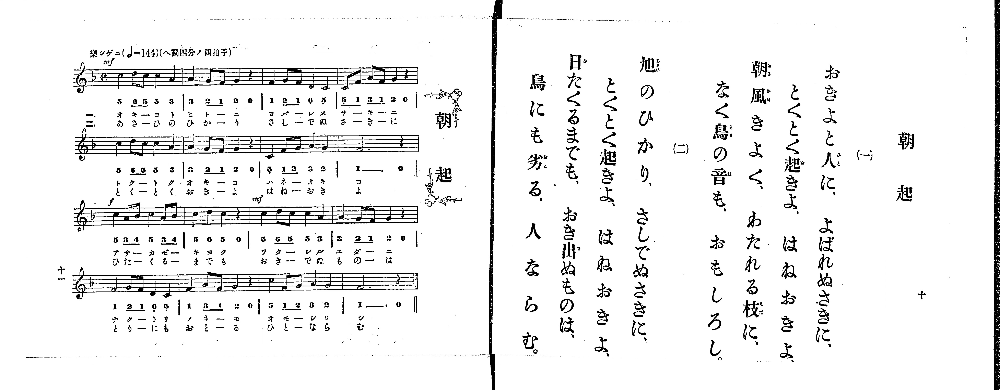

# 朝起

> Re:Shōka 使用 AI 協助辨識與重建樂譜，可能會有錯誤。歡迎回報。

- **鋼琴伴奏版**：<br><audio controls src="asaoki.mp3"></audio>
- **NEUTRINO 歌聲合成版**：<br><audio controls src="asaoki_neutrino.mp3"></audio>

- 出處：共益商社樂器店《唱歌教科書 生徒用 巻一》第十～十一頁（第五曲）
- NDL Digital Collections PID 854862（https://dl.ndl.go.jp/pid/854862）掃描 P007.jpg

## 說明

原書資訊與歌詞全文（NDL PID 854862《唱歌教科書 生徒用 巻一》第十～十一頁，掃描 P007.jpg）：
調性與拍號：ヘ調四分ノ四拍子（F 大調 4/4 拍），♩=144，「樂シゲニ」
註記：第一學期第五曲。分節歌，二節同一旋律。開頭標 mf，第三行第一小節（「あさかぜ」／「ひたくる」起）標 f，第三行第三小節（「わたれる」／「おきでぬ」起）標 mf。五線譜與簡譜一致。


## 歌詞

```text
一、
おきよと人に、よばれぬさきに、
とくとく起きよ、はねおきよ、
朝風きよく、わたれる枝に、
なく鳥の音も、おもしろし。

二、
旭のひかり、さしでぬさきに、
とくとく起きよ、はねおきよ、
日たくるまでも、おき出ぬものは、
鳥にも劣る、人ならむ。
```

## ABC

```abc
X:1
T:朝起
M:4/4
L:1/16
Q:1/4=144
K:F
V:V1 name="Piano" snm="Pia"
[V:V1]
!mf! c4 d2 c2 c4 A4 | A4 G2 F2 G4 z4 | F4 G2 F2 D4 C4 | C2 F2 A2 F2 G4 z4 |
w: 1.~お き _ よ と | ひ と _ に | よ ば _ れ ぬ | さ _ き _ に
w: 2.~あ さ _ ひ の | ひ か _ り | さ し _ で ぬ | さ _ き _ に
c4 d2 c2 c4 A4 | A4 G2 F2 G4 z4 | C4 F2 G2 A4 G4 | F12 z4 |
w: 1.~と く _ と く | お き _ よ | は ね _ お き | よ
w: 2.~と く _ と く | お き _ よ | は ね _ お き | よ
!f! c4 A2 B2 c4 A2 B2 | c4 d4 c4 z4 | !mf! c4 d2 c2 c4 A4 | A4 G2 F2 G4 z4 |
w: 1.~あ さ _ か ぜ _ | き よ く | わ た _ れ る | え だ _ に
w: 2.~ひ た _ く る _ | ま で も | お き _ で ぬ | も の _ は
F4 G2 F2 D4 C4 | F4 A2 F2 G4 z4 | c4 F2 G2 A4 G4 | F12 z4 |
w: 1.~な く _ と り | の ね _ も | お も _ し ろ | し
w: 2.~と り _ に も | お と _ る | ひ と _ な ら | む
```

## TMD 檔案連結

- [主旋律 TMD 檔案](asaoki.tmd) [[在 TMD Studio 編輯](https://tmdlang.github.io/Tmd-TS/#tmd=s7IKdvYPcrWy4qpTUCpJTLdSSM7PyUlNLsnMz7PKrsxPzc6ML87Iz05Ugisoy88pzU21yk7MizeMtzA1sTAzQkgW55cWJadaFSdn5OfnxJekVpQk5edno8vHFySmp1oFGBiYI2QKivLLUvMS84C6C4oy80pSU8DaEQpSyzJTUkHSxclAq8tSizLTMlNTkNyVWlQMcjXUipKixLzi5KLMApBXEKrSU_OKUq2SMzJzUopS8-KL8_PSEZJp-UW5VsUlRfkFGZnJCOGSjFSgh0syc1Pj89PiUxIr0aUS8zJzE3MQovlFmemZeVa5qZlZmUiBoKWl8GzO3BdbtytoaXEp2ioYmphw2dsquHHZmOib2IF0P23f9WLm1Pd7Zj1t3fh8dtfTqW3Pl-x7tqLp6cwVT3dNf9zQ9XTKxmdre55Nnfl8-cRns3coPJ8y_-m-Sc-nrFB4un33kx0Njxu6n69Z87S38f3eeUASKPJyQeP7PR1AwSe7pjybven9nk6wO_1cfBRcgK4sScxRcIZHebFCgKeLAiRSgboySkoKiq309VNy9PKAOD1fL6tAvyAzRR-movNZX_Oz_n4FUFQC5YBByaWvpWBLLcCloKDwtG8-0KMvNre_WNH1oqMd6PsXK-c9bV3xbFo70IUgbyCcTH4A9aB5BOg1YCyA7H-xav-zhuUgm7t7X8ycDxR93DwDKPh09uynHW2Pm_uADKDU07UTgM5xU3i6ZDlQUgEYoQpAUbAxPY9mrrQFxjWQ9bihBxibj5u2P27a9Li5-3FDL9iKFbtfrJgBNBkUSzsanq7d8WzOfHiMPW5oAlr0fH0D0F9AI57s6gGyn07oAap8Nr376T6gKU0vp3W_XLD22YqZCrlpQDVgczpfLIQwGp5u6AdqAToPaP3jxqbHjVMfN3Y_bpwDtP79nn6w4KbHjfMfN_Y_bgK5CZhCQVELNA3TsE4Uw5r6QfqagAyQPphhXY8bex83Ln_cuAbFsNw0oEuBfnq-fdaLtXOAIfp8w0IgA-jAF-1bgFJcoLAAR1EjiAU1p6njceOKJ7t2PW5cDZQAczeAbAQaDvIH0CKQOETDCpAXwCTQVqhmoJ7G9Y8b1yKMg6gG5sSXi4BKITYAHQ40G-GbZ_PmIhu8Cqji5ealjxvXvZy_-XFTE9jULhCjcfrjJqAbgHkT6v5dwEiGWDAdaOc6cNB2P27qAmsBOng6NGQoc_x0oFtgEda4D2Qk3FGNvcBSBGQDyHVA-9dD9YDdvxoo-rRrMTi-GsGhuupxU-fjJmCgN4EUUZ5noUBBS5-Ly7E4MT870yogMzEv36HGoKYaZIWCjYWWHZhRnZtWC2YAy4zHTauAeK3C4-Y9QLwCiDsUaoDkJDALItoNFgHJTYCKrAHiHpBo01aICNyEbpADQGbXKJgq6CqYAUkQbQzENWDSSMEQiHUVDMAihlARs3ggwxREAPXFAwWMkZWBDfQxBNrX2AXkA4MaRDZ1gNkrwJqA8Q3nAYMbSEIMg6naANbRA2avgeqYijALoQNilxFIvgksA1EFMX0dil3dYDNBLoLaBVU7HUwuJ9IuUCSAgrppPTQIIWyQ01GjBhQJ_UDcCw1yiCwkakgKdHA4gwQgUrB4gEH0IIcEaT9S8ILY2CIDFgzrweJrwSRCDSwyYBA9uGlvTzVyul-ElHpXAzEokPeANYOCHJjaIZHQDIyWpv1I6X41WA0oNzRgT_PGCiZwGhYhwMQND35Q9iMmnpCiADklglNd4xxoECDnBFBwwVI9JBjng2XBqb4JpA-kA6J2AZjEluohaRusExIZcJ37wGLgdN0EchEsGpCiBzXVg1VBcg0kstBSfRdqqm9eBQ7wPkQab14EywdAFiSqtgNpcKoHsuDBjq0YAYmhlCLgsCY-2a9ChAAkOYJzOkgG4h9wssMMB6ifwWVAEzQ5gnl4kz3YbEh8QExAhCtEHhQHMHuQSzqwK5s6oeHdgGFPLReXrp0CpEJQALKUuQA)]
- [鋼琴伴奏 TMD 檔案](asaoki_piano.tmd) [[在 TMD Studio 編輯](https://tmdlang.github.io/Tmd-TS/#tmd=s7IKdvYPcrWy4tLSUng2Z-6Lrdvf7-l42b3n-YQtT_Zsebq0_3lnx_s9nQpaWlyKtgqGJiZc9rYKblw2Jvomdlx1CkpP23e9mDn1_Z5ZT1s3Pp_d9XRq2_Ml-56taHo6c8XTXdMfN3Q9nbLx2dqeZ1NnPl8-8dnsHQrPp8x_um_S8ykrFJ5u3_1kR8Pjhu7na9Y87W18v3cekASKvFzQCHQDUPDJrinPZm8C2q4EssnPxUfBJTM9syQxR8E5PycnNbkkMz-vWCHA00XBwtTEwswIqCujpKSg2EpfPyVHLw-I0_P1sgr0CzJT9GEqOp_1NT_r71cIMDAwB8qlK3FxORYn5mdnWgVkJublB3k41BjUVHMpAIGNhZYdmFGdm1YLZuhrKTxuWgXEaxUeN-8B4hVA3KFQAyQngVkQ0W6wCEhuAlRkDRD3gESbtkJE4CZ0K2jpg82uUTBV0FUwA5Ig2hiIa8CkkYIhEOsqGIBFDKEiZvFAhimIAOqLBwoYIysDG-hjCLSvsQvIf9zYCyKbOsDsFWBNjxs3wXmPG1cDSYhhMFUbwDp6wOw1UB1TEWYhdEDsMgLJN4FlIKogpq9DsasbbCbIRVC7oGqng8nlRNoFigRQUDethwYhhA1yOmrUgCKhH4h7oUEOkYVEDUmBDg5nkABEChYPMIge5JAg7UcKXhAbW2TAgmE9WHwtmESogUUGDKIHN-3tqUZO94uQUu9qIAYF8h6wZlCQA1M7JBKagdHStB8p3a8GqwHlhgbsad5YwQROwyIEmLjhwQ_KfsTEE1IUIKdEcKprnAMNAuScAAouWKqHBON8sCw41TeB9IF0QNQuAJPYUj0kbYN1QiIDrnMfWAycrptALoJFA1L0oKZ6sCpIroFEFlqq70JN9c2rwAHeh0jjzYtg-QDIgkTVdiANTvVAFjzYsRUjIDGUUgQc1sQn-1WIEIAkR3BOB8lA_ANOdpjhAPUzuAxogiZHMA9vsgebDYkPiAmIcIXIg-IAZg9ySQd2ZVMnNLwbMOypRa0PfJDrAxNofQCMixd9XS_be5-27ng5uxVSTyIC1yReIdokVsEQSBnGAvmgAgTINo2PRTAgHkKSgWoCqYZqxFBLirkYZiDEYPpRTcW0HyZCY1_hd6kBJEp07RQgsRLtAxRH4hmBecpcAA)]

## 分析

```text
================================================================================
📊 TMD Song Profile: [ 朝起 ]
================================================================================
⏱  Duration:       0:26 (26.7s), 16 measures total
🎼 Key & Tempo:    首調基準 F, != 144.0 BPM, <4/4>
   - 分析範圍：      由實際發聲的音符與和弦推測調性；播放脈絡另行呈現
🎤 人聲音域:    C4 (MIDI 60) – D5 (MIDI 74) [跨度: 14 個半音 / 1.2 個八度, 難度: moderate]
   - 最低音:  C4 in [Asaoki #1 @ m.3, 0:04]
   - 最高音: D5 in [Asaoki #1 @ m.1, 0:00]
   - 適合: soprano, mezzo-soprano, contralto, tenor, baritone, bass
🏛  結構:      Asaoki (26.7s)
⚡ 編曲密度:        Peak 1 軌道同時演奏
🗝  調性診斷：       F 大調（純淨自然大調，未偵測到可信轉調）
   - 風格氣質:    純淨自然大調（陽光明朗、易唱易記，無明顯調外色彩）
   - 轉調歷程:    全曲維持單一推測調性（未偵測到可信轉調）
   - 核心骨幹音:  C, F, G, A, D
   - 調性數值:    F 大調 [相關度: 0.87, 穩定度: Moderate, 自然音純度: 100.0%]
   - 候選調性 (K-S): F 大調 (0.87), C 大調 (0.81), A 小調 (0.62)
   - 五度圈歷程:   -1
   - 各段落調性細節:
     • [Asaoki #1]: F 大調 (r: 0.87, 自然音純度: 100.0%)

  [ 五度圈游移軌跡 ]
               C  
        [F ]*          G  
      Bb               D  
      Eb               A  
         Ab           E  
            Db       B  
               F# 
     (* = active key center)

  [ 十二半音累積音高分佈 ]
     C  : ████████████████████████  28.6%
     C# :                            0.0%
     D  : ███████                    8.0%
     D# :                            0.0%
     E  :                            0.0%
     F  : █████████████████████     25.0%
     F# :                            0.0%
     G  : ████████████████          18.7%
     G# :                            0.0%
     A  : ███████████████           17.9%
     A# : ██                         1.8%
     B  :                            0.0%
--------------------------------------------------------------------------------
Assignment 軌道音域：
  - Piano         : C4 – D5 (14 個半音 / 1.2 個八度, 67 個音符)
================================================================================
```


## 原書掃描頁




