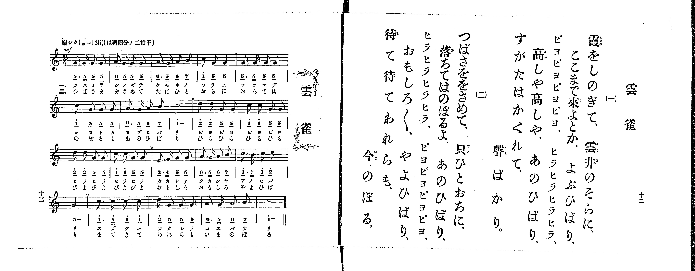

# 雲雀

> Re:Shōka 使用 AI 協助辨識與重建樂譜，可能會有錯誤。歡迎回報。

- **NEUTRINO 歌聲合成版**：<br><audio controls src="hibari_neutrino.mp3"></audio>
- **鋼琴伴奏版**：<br><audio controls src="hibari.mp3"></audio>


- 出處：共益商社樂器店《唱歌教科書 生徒用 巻一》第十二～十三頁（第六曲）
- NDL Digital Collections PID 854862（https://dl.ndl.go.jp/pid/854862）掃描 P008.jpg

## 說明

原書資訊與歌詞全文（NDL PID 854862《唱歌教科書 生徒用 巻一》第十二～十三頁，掃描 P008.jpg）：
調性與拍號：は調四分ノ二拍子（C 大調 2/4 拍），♩=126，「樂シク」
註記：第一學期第六曲。全曲二十小節（每行五小節），分節歌，二節同一旋律。開頭標 mf。第八、十二、十六小節末印有換氣記號（V）。五線譜與簡譜一致。第四行第十九小節第二節譜下配字誤植為「いまのば｜る」，右頁歌詞作「今のぼる。」；第二節「ヒラヒラヒラヒラ、ピヨピヨピヨピヨ、」右頁印片假名，譜下配字印平假名。


## 歌詞

```text
一、
霞をしのぎて、雲井のそらに、
ここまで來よとか、よぶひばり、
ピヨピヨピヨピヨ、ヒラヒラヒラヒラ、
高しや高しや、あのひばり、
すがたはかくれて、聲ばかり。

二、
つばさををさめて、只ひとおちに、
落ちてはのぼるよ、あのひばり、
ヒラヒラヒラヒラ、ピヨピヨピヨピヨ、
おもしろ〳〵、やよひばり、
待て待てわれらも、今のぼる。
```

## ABC

```abc
X:1
T:雲雀
M:2/4
L:1/16
Q:1/4=126
K:C
V:V1 name="Piano" snm="Pia"
[V:V1]
!mf! G3 G G2 G2 | A2 G2 G2 G2 | A3 G A2 B2 | c2 G2 G4 |
w: 1.~か す み を | し の ぎ て | く も ゐ の | そ ら に
w: 2.~つ ば さ を | を さ め て | た だ ひ と | お ち に
G3 G G2 G2 | c2 G2 G2 G2 | A3 G A2 B2 | c8 |
w: 1.~こ こ ま で | こ よ と か | よ ぶ ひ ば | り
w: 2.~お ち て は | の ぼ る よ | あ の ひ ば | り
d2 d2 G2 G2 | c2 c2 G2 G2 | d2 d2 G2 G2 | c2 c2 G2 G2 |
w: 1.~ぴ よ ぴ よ | ぴ よ ぴ よ | ひ ら ひ ら | ひ ら ひ ら
w: 2.~ひ ら ひ ら | ひ ら ひ ら | ぴ よ ぴ よ | ぴ よ ぴ よ
E3 F G2 G2 | A3 G A2 B2 | c3 B c2 d2 | G8 |
w: 1.~た か し や | た か し や | あ の ひ ば | り
w: 2.~お も し ろ | お も し ろ | や よ ひ ば | り
c3 c c2 c2 | d2 G2 G2 G2 | A3 G A2 B2 | c8 |
w: 1.~す が た は | か く れ て | こ え ば か | り
w: 2.~ま て ま て | わ れ ら も | い ま の ぼ | る
```

## TMD 檔案連結

- [主旋律 TMD 檔案](hibari.tmd) [[在 TMD Studio 編輯](https://tmdlang.github.io/Tmd-TS/#tmd=s7IKdvYPcrWy4qpTUCpJTLdSSM7PyUlNLsnMz7PKrsxPzc6ML87Iz05Ugisoy88pzU21yk7MizeMtzA1sTAzQkgW55cWJadaFSdn5OfnxJekVpQk5edno8vHFySmp1oFGBhYIGQKivLLUvMS84C6C4oy80pSU8DaEQpSyzJTUkHSxclAq8tSizLTMlNTkNyVWlQMcjXUipKixLzi5KLMApBXEKrSU_OKUq2SMzJzUopS8-KL8_PSEZJp-UW5VsUlRfkFGZnJCOGSjFSghxPzMnMTc9BF8xJLSotSEaL5RZnpmXlWuamZWZlI_tfSUng5e9PL2Q0KWlpcirYKhkZmXPa2Cs5cNkb6JnYg3U_bd72YOfX9nllPWzc-n931dGrb8yX7nq1oejpzxdNd0x83dD2dsvHZ2p5nU2c-Xz7x2ewdCs-nzH-6b9LzKSsUnm7f_WRHw-OG7udr1jztbXyyq-f93nkgxo7Olwsa3-_pAIm3rn02e9P7PZ1gp_q5-Ci4AB1akpij4AyP8GKFAE8XBUiUAnVllJQUFFvp66fk6OUBcXq-XlaBfkFmij5MReezvuZn_f0KoIgEygEDkktfS8GWWoBLQUHhad98oF9fbG5_saLrRUc7MABerJz3tHXFs2ntQBeCvIFwMkVh1IPmF6DvgHEBcsKLVfufNSwHWd7d-2LmfKDo48b1QMGns2c_7Wh73NwHNAso9XTtBKCLnBWeLlkOlFQARqsCUBRsTM-jmSttgTEOZD1u6AHG6eOm7Y-b1j9u6AWbv2L3ixUzgMYCXQZ04tO1O57NmQ-PsccNTSDvzt4EtAXo3Kcb-p-vbwBa9Gx9_4uFPU92TYGJgOwBugfIBoYAkA1UD2Q_ndADNPPZ9O6n-7qBRr2c1v1ywdpnK2Yq5KYBuWBbVj9uaISECIQBtBdi5rM5q5_2bng2p_NZ_-xnGxYDHQn2fkcY0DKgZqDdz7fPerF2DjBonm9YCGQAbXrRvgVq7uzZQPdBA3vnXIiJIB-CnQVW3P2yFRhq01-sWvJsSe_zpl3AsHnc2PK4cd_jxnWPGze83zvncRPQ0cAw7HnavxkYS5DYfwIUb-h5srsLrGwPWE0TWNlsuPkgo5onPW5eiYVsaHzcPOVx8wosJFCqoRdiF9Dnzzvbnza2P50AcgCyg4FST3duhkgBreYCRSI4bTWCWC_nzHvcNOlx43Sw8_oeNy4DSgDz_pNdU8Eicx83dT5uBAU6SPXjxslgBPTz8if72h43dTxuXPG4EeilRjB72-PGTcCweNzUBdOAx-24fQx22OoZIFc1tcAZID2NTWBXoVnSOPNxIzAy5gNTOsgxjf2Pm4BckE9eQJQCBUGqoZ4HJx2IxiVg2amgIACFApABtAOk8Wn_KrA1QN8BY24hIgheTNgL5i8DWwaLUqDncbqOrJiFOK_rcRPQSKDngTG3-XHDVnA4t4CDGtWSp_tagU6CkI-bwP4HxhtQc0MjWtIDqaa8sIMCBS19Li6PzKTEokyrgMzEvHyHGoOaapAVCjaGZlp2YFZ1blotmAEsbR83rQbincBAmQ_EmxRqgLztQFYfkF4HpNvAIuuBrEVAvAEsAxLZC2StBOJuMG8zBDfPA-J2kBtAptcomCroAqEpmAbhGgUzKAtVBMQG0eZgEcM4JAUgiMUgsAU-hkC7G7vBcsAkB8T7QaymSWA9wGgCi68Dk31gchlUph-ip6kJiCfAVYFk5oLFO8Fiq-H2A_MY1JbJQLwPzFqOcIcRSMUSqApgGDVORXYHmIaJNaK4Yz5UzwIg3gRmrYDKdIF5CzHcARKHyEBMASZ6uDvA0QmKhhVA3AGOWqAWMG8aKNUD8QSwyCowOQUqB6ExReDRiBIheGMNGdYoGIGEwARCI1gZioHIcQkKZWBmgocEJHZBYQgSA_G3wUNqA1QGEiLI9j5u3IJkDoKNRwYpHiHpZQ9YDmQ7Qm8T1A3AfEGEG8AqoCkJwcYjA49DcEyBMheEBsUMhkjTfmjWBWXWJThEQFkWmJGhMQ-PTyLjRcEY7BcTYqLdHMIAG4ocoSQHAlKm6IZl4aYWgjI4ogYpWklOEojMBiomoPb1EpIBuwhiBqZLwJELznygErdpDSTSmvvBIqCoA5WzQFFoqQsqVUHZcQI8K69CL1uRkxw0KoAUIjKhkU165kXEIdbEPRMa3j3QWIEWQ9AMCylggXUemA0r7GBFKChkQGGCyNwYNiDiDavtoAIYYjKsMIba0YRkLyRtAWMIogcaL0D1yFkcpAdSgSDbXsvFpWunAKlGFYAsZS4A)]
- [鋼琴伴奏 TMD 檔案](hibari_piano.tmd) [[在 TMD Studio 編輯](https://tmdlang.github.io/Tmd-TS/#tmd=s7IKdvYPcrWy4tLSUng5e9PL2Q3v93S87N7zfMKWJ3u2PF3a_7yz4_2eTgUtLS5FWwVDIzMue1sFZy4bI30TO646BaWn7btezJz6fs-sp60bn8_uejq17fmSfc9WND2dueLprumPG7qeTtn4bG3Ps6kzny-f-Gz2DoXnU-Y_3Tfp-ZQVCk-3736yo-FxQ_fzNWue9jY-2dXzfu88EGNH58sFjUBngMRb1z6bvQnoACWQZX4uPgoumemZJYk5Cs75OTmpySWZ-XnFCgGeLgoWpiYWZkZAXRklJQXFVvr6KTl6eUCcnq-XVaBfkJmiD1PR-ayv-Vl_v0KAgYEFUC5diYvLIzMpsSjTKiAzMS8_yMOhxqCmmksBCGwMzbTswKzq3LRaMENfS-Fx02og3qnwuHk-EG9SqAHytgNZfUB6HZBuA4usB7IWAfEGsAxIZC-QtRKIu8G8zRDcPA-I2xW09MGm1yiYKugCoSmYBuEaBTMoC1UExAbR5mARwzgkBSCIxSCwBT6GQLsbu8FyjxtnAvF-EKtpEljP48bpYPF1YLIPTC6DyvRD9DQ1AfEEuCqQzFyweCdYbDXc_seNk6G2TAbifWDWcoQ7jEAqlkBVAMOocSqyO8A0TKwRxR3zoXoWAPEmMGsFVKYLzFuI4Q6QOEQGYsrjxvVwd4CjExQNK4C4Axy1QC1g3jQgngTEE8Aiq8DkFKgchMYUgUcjSoTgjTVkWKNgBBICEwiNYGUoBiLHJSiUHzd1wEMCErugMASJgfjb4CG1ASoDCRFkex83bkEyB8HGI4MUj5D0sgcsB7IdobcJ6gZgviDCDWAV0JSEYOORgcchOKZAmQtCg2IGQ6RpPzTrgjLrEhwioCwLzMjQmIfHJ5HxomAM9osJMdFuDmGADUWOUJIDASlTdMOycFMLQRkcUYMUrSQnCURmAxUTUPt6CcmAXQQxA9Ml4MgFZz5Qidu0BhJpzf1gEVDUgcpZoCi01AWVqqDsOAGelVehl63ISQ4aFUAKEZnQyCY98yLiEGvingkN7x5orECLIWiGhRSwj5t6wGxYYQcrQkEhAwoTRObGsAERb1htBxXAEJNhhTHUjiYkeyFpCxhDED3QeAGqR87iID2QCgTZ9lrUWtQHuRY1gVaiwLh80df1sr33aeuOl7NbIQ0MpDIzXiHaMBbIqFEwATJNIEzTeCDbNB7CgSnB1IHExKcDqxwBPbgcQ6TL8OoxgASdrp0CJPSifYC6kHhGYJ4yFwA)]

## 分析

```text
================================================================================
📊 TMD Song Profile: [ 雲雀 ]
================================================================================
⏱  Duration:       0:19 (19.0s), 20 measures total
🎼 Key & Tempo:    首調基準 C, != 126.0 BPM, <2/4>
   - 分析範圍：      由實際發聲的音符與和弦推測調性；播放脈絡另行呈現
🎤 人聲音域:    E4 (MIDI 64) – D5 (MIDI 74) [跨度: 10 個半音 / 0.8 個八度, 難度: easy]
   - 最低音:  E4 in [Hibari #1 @ m.13, 0:11]
   - 最高音: D5 in [Hibari #1 @ m.9, 0:07]
   - 適合: soprano, mezzo-soprano, contralto, tenor, baritone, bass
🏛  結構:      Hibari (19.0s)
⚡ 編曲密度:        Peak 1 軌道同時演奏
🗝  調性診斷：       G 大調（純淨自然大調，未偵測到可信轉調）
   - 風格氣質:    純淨自然大調（陽光明朗、易唱易記，無明顯調外色彩）
   - 轉調歷程:    全曲維持單一推測調性（未偵測到可信轉調）
   - 核心骨幹音:  G, C, A, D, B
   - 調性數值:    G 大調 [相關度: 0.80, 穩定度: Moderate, 自然音純度: 99.4%]
   - 候選調性 (K-S): G 大調 (0.80), C 大調 (0.75), G 小調 (0.60)
   - 五度圈歷程:   +1
   - 各段落調性細節:
     • [Hibari #1]: G 大調 (r: 0.80, 自然音純度: 99.4%, 調外音: F)

  [ 五度圈游移軌跡 ]
               C  
         F           [G ]*
      Bb               D  
      Eb               A  
         Ab           E  
            Db       B  
               F# 
     (* = active key center)

  [ 十二半音累積音高分佈 ]
     C  : ██████████████            25.6%
     C# :                            0.0%
     D  : ████                       7.5%
     D# :                            0.0%
     E  : █                          1.9%
     F  :                            0.6%
     F# :                            0.0%
     G  : ████████████████████████  45.0%
     G# :                            0.0%
     A  : ███████                   13.7%
     A# :                            0.0%
     B  : ███                        5.6%
--------------------------------------------------------------------------------
Assignment 軌道音域：
  - Piano         : E4 – D5 (10 個半音 / 0.8 個八度, 70 個音符)
================================================================================
```


## 原書掃描頁




