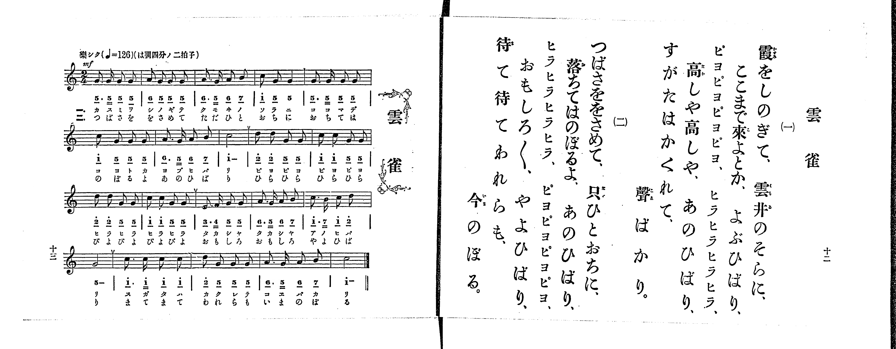

# 雲雀

> Re:Shōka 使用 AI 協助辨識與重建樂譜，可能會有錯誤。歡迎回報。

- **鋼琴伴奏版**：<br><audio controls src="hibari.mp3"></audio>
- **NEUTRINO 歌聲合成版**：<br><audio controls src="hibari_neutrino.mp3"></audio>

- 出處：共益商社樂器店《唱歌教科書 生徒用 巻一》第十二～十三頁（第六曲）
- NDL Digital Collections PID 854862（https://dl.ndl.go.jp/pid/854862）掃描 P008.jpg

## 說明

原書資訊與歌詞全文（NDL PID 854862《唱歌教科書 生徒用 巻一》第十二～十三頁，掃描 P008.jpg）：
調性與拍號：は調四分ノ二拍子（C 大調 2/4 拍），♩=126，「樂シク」
註記：第一學期第六曲。全曲二十小節（每行五小節），分節歌，二節同一旋律。開頭標 mf。第八、十二、十六小節末印有換氣記號（V）。五線譜與簡譜一致。第四行第十九小節第二節譜下配字誤植為「いまのば｜る」，右頁歌詞作「今のぼる。」；第二節「ヒラヒラヒラヒラ、ピヨピヨピヨピヨ、」右頁印片假名，譜下配字印平假名。


## 歌詞

```text
一、
霞をしのぎて、雲井のそらに、
ここまで來よとか、よぶひばり、
ピヨピヨピヨピヨ、ヒラヒラヒラヒラ、
高しや高しや、あのひばり、
すがたはかくれて、聲ばかり。

二、
つばさををさめて、只ひとおちに、
落ちてはのぼるよ、あのひばり、
ヒラヒラヒラヒラ、ピヨピヨピヨピヨ、
おもしろ〳〵、やよひばり、
待て待てわれらも、今のぼる。
```

## ABC

<div class="abc-score" data-abc-src="hibari.abc" aria-label="五線譜載入中"></div>

[下載 ABC 原始檔](hibari.abc)

## TMD 檔案連結

- [主旋律 TMD 檔案](hibari.tmd) [[在 TMD Studio 編輯](https://tmdlang.github.io/Tmd-TS/#tmd=s7IKdvYPcrWy4qpTUCpJTLdSSM7PyUlNLsnMz7PKrsxPzc6ML87Iz05Ugisoy88pzU21yk7MizeMtzA1sTAzQkgW55cWJadaFSdn5OfnxJekVpQk5edno8vHFySmp1oFGBhYIGQKivLLUvMS84C6C4oy80pSU8DaEQpSyzJTUkHSxclAq8tSizLTMlNTkNyVWlQMcjXUipKixLzi5KLMApBXEKrSU_OKUq2SMzJzUopS8-KL8_PSEZJp-UW5VsUlRfkFGZnJCOGSjFSghxPzMnMTc9BF8xJLSotSEaL5RZnpmXlWuamZWZlY_J9fVJKRn16UWJBRaZWRWVwCVJ6cmBMPDExgCGtpKbycvenl7AYFLS0uRVsFQyMzLntbBWcuGyN9EzuQGU_bd72YOfX9nllPWzc-n931dGrb8yX7nq1oejpzxdNd0x83dD2dsvHZ2p5nU2c-Xz7x2ewdCs-nzH-6b9LzKSsUnm7f_WRHw-OG7udr1jztbXyyq-f93nkgxo7Olwsa3-_pAIm3rn02e9P7PZ1gB_u5-Ci4AH1Tkpij4AxPFcUKAZ4uCpB4B-rKKCkpKLbS10_J0csD4vR8vawC_YLMFH2Yis5nfc3P-vsVQLENlAOGNpe-loIttQCXgoLC0775QL--2Nz-YkXXi452YAC8WDnvaeuKZ9PagS4EeQPhZIrCqAfNL0DfAeMC5IQXq_Y_a1gOsry798XM-UDRx43rgYJPZ89-2tH2uLkPaBZQ6unaCUAXOSs8XbIcKKkAjFYFoCjYmJ5HM1faAmMcyHrc0AOM08dN2x83rX_c0As2f8XuFytmAI0FugzoxKdrdzybMx8eY48bmkDenb0JaAvQuU839D9f3wC06Nn6_hcLe57smgITAdkDdA-QDQwBIBuoHsh-OqEHaOaz6d1P93UDjXo5rfvlgrXPVsxUyE0DcsG2rH7c0AgJEQgDaC_EzGdzVj_t3fBsTuez_tnPNiwGOhLs_Y4woGVAzUC7n2-f9WLtHGDQPN-wEMgA2vSifQvU3Nmzge6DBvbOuRATQT4EOwusuPtlKzDUpr9YteTZkt7nTbuAYfO4seVx477HjeseN254v3fO4yago4Fh2PO0fzMwliCx_wQo3tDzZHcXWNkesJomsLLZcPNBRjVPety8EgvZ0Pi4ecrj5hVYSKBUQy_ELqDPn3e2P21sfzoB5ABkBwOlnu7cDJECWs0FikRw2moEsV7Omfe4adLjxulg5_U9blwGlADm_Se7poJF5j5u6nzcCAp0kOrHjZPBCOjn5U_2tT1u6njcuOJxI9BLjWD2tseNm4Bh8bipC6YBj9tx-xjssNUzQK5qaoEzQHoam8CuQrOkcebjRmBkzAemdJBjGvsfNwG5IJ-8gCgFCoJUQz0PTjoQjUvAslNBQQAKBSADaAdI49P-VWBrgL4DxtxCRBC8mLAXzF8GtgwWpUDP43QdWTELcV7X4yagkUDPA2Nu8-OGreBwbgEHNaolT_e1Ap0EIR83gf0PjDeg5oZGtKQHUk15YQcFClr6XFwemUmJRZlWAZmJefkONQY11SArFGwMzbTswKzq3LRaMANY2j5uWg3EO4GBMh-INynUAHnbgaw-IL0OSLeBRdYDWYuAeANYBiSyF8haCcTdYN5mCG6eB8TtIDeATK9RMFXQBUJTMA3CNQpmUBaqCIgNos3BIoZxSApAEItBYAt8DIF2N3aD5YBJDoj3g1hNk8B6gNEEFl8HJvvA5DKoTD9ET1MTEE-AqwLJzAWLd4LFVsPtB-YxqC2TgXgfmLUc4Q4jkIolUBXAMGqciuwOMA0Ta0Rxx3yongVAvAnMWgGV6QLzFmK4AyQOkYGYAkz0cHeAoxMUDSuAuAMctUAtYN40UKoH4glgkVVgcgpUDkJjisCjESVC8MYaMqxRMAIJgQmERrAyFAOR4xIUysDMBA8JSOyCwhAkBuJvg4fUBqgMJESQ7X3cuAXJHAQbjwxSPELSyx6wHMh2hN4mqBuA-YIIN4BVQFMSgo1HBh6H4JgCZS4IDYoZDJGm_dCsC8qsS3CIgLIsMCNDYx4en0TGi4Ix2C8mxES7OYQBNhQ5QkkOBKRM0Q3Lwk0tBGVwRA1StJKcJBCZDVRMQO3rJSQDdhHEDEyXgCMXnPlAJW7TGkikNfeDRUBRBypngaLQUhdUqoKy4wR4Vl6FXrYiJzloVAApRGRCI5v0zIuIQ6yJeyY0vHugsQIthqAZFlLAAus8MBtW2MGKUFDIgMIEkbkxbEDEG1bbQQUwxGRYYQy1ownJXkjaAsYQRA80XoDqkbM4SA-kAkG2vZaLS9dOAVKNKgBZylwA)]
- [鋼琴伴奏 TMD 檔案](hibari_piano.tmd) [[在 TMD Studio 編輯](https://tmdlang.github.io/Tmd-TS/#tmd=s7IKdvYPcrWy4qpTUCpJTLdSyC8qychPL0osyKi0ysgsLskvykxOzInPTsxLVOLS0lJ4OXvTy9kN7_d0vOze83zClid7tjxd2v-8s-P9nk4FLS0uRVsFQyMzLntbBWcuGyN9EzuQwU_bd72YOfX9nllPWzc-n931dGrb8yX7nq1oejpzxdNd0x83dD2dsvHZ2p5nU2c-Xz7x2ewdCs-nzH-6b9LzKSsUnm7f_WRHw-OG7udr1jztbXyyq-f93nkgxo7Olwsagc4AibeufTZ7E9ABSiDL_Fx8FFwy0zNLEnMUnPNzclKTSzLz84oVAjxdFCxMTSzMjIC6MkpKCoqt9PVTcvTygDg9Xy-rQL8gM0UfpqLzWV_zs_5-hQADAwugXLoSF5dHZlJiUaZVQGZiXn6Qh0ONQU01lwIQ2BiaadmBWdW5abVghr6WwuOm1UC8U-Fx83wg3qRQA-RtB7L6gPQ6IN0GFlkPZC0C4g1gGZDIXiBrJRB3g3mbIbh5HhC3K2jpg02vUTBV0AVCUzANwjUKZlAWqgiIDaLNwSKGcUgKQBCLQWALfAyBdjd2g-UeN84E4v0gVtMksJ7HjdPB4uvAZB-YXAaV6YfoaWoC4glwVSCZuWDxTrDYarj9jxsnQ22ZDMT7wKzlCHcYgVQsgaoAhlHjVGR3gGmYWCOKO-ZD9SwA4k1g1gqoTBeYtxDDHSBxiAzElMeN6-HuAEcnKBpWAHEHOGqBWsC8aUA8CYgngEVWgckpUDkIjSkCj0aUCMEba8iwRsEIJAQmEBrBylAMRI5LUCg_buqAhwQkdkFhCBID8bfBQ2oDVAYSIsj2Pm7cgmQOgo1HBikeIellD1gOZDtCbxPUDcB8QYQbwCqgKQnBxiMDj0NwTIEyF4QGxQyGSNN-aNYFZdYlOERAWRaYkaExD49PIuNFwRjsFxNiot0cwgAbihyhJAcCUqbohmXhphaCMjiiBilaSU4SiMwGKiag9vUSkgG7CGIGpkvAkQvOfKASt2kNJNKa-8EioKgDlbNAUWipCypVQdlxAjwrr0IvW5GTHDQqgBQiMqGRTXrmRcQh1sQ9ExrePdBYgRZD0AwLKWAfN_WA2bDCDlaEgkIGFCaIzI1hAyLesNoOKoAhJsMKY6gdTUj2QtIWMIYgeqDxAlSPnMVBeiAVCLLttai1qA9yLWoCrUSBcfmir-tle-_T1h0vZ7dCGhhIZWa8QrRhLJBRo2ACZJpAmKbxQLZpPIQDU4KpA4mJTwdWOQJ6cDmGSJfh1WMACTpdOwVI6EX7AHUh8YzAPGUuAA)]

## 分析

```text
================================================================================
📊 TMD Song Profile: [ 雲雀 ]
================================================================================
⏱  Duration:       0:19 (19.0s), 20 measures total
🎼 Key & Tempo:    首調基準 C, != 126.0 BPM, <2/4>
   - 分析範圍：      由實際發聲的音符與和弦推測調性；播放脈絡另行呈現
🎤 人聲音域:    E4 (MIDI 64) – D5 (MIDI 74) [跨度: 10 個半音 / 0.8 個八度, 難度: easy]
   - 最低音:  E4 in [Hibari #1 @ m.13, 0:11]
   - 最高音: D5 in [Hibari #1 @ m.9, 0:07]
   - 適合: soprano, mezzo-soprano, contralto, tenor, baritone, bass
🏛  結構:      Hibari (19.0s)
⚡ 編曲密度:        Peak 1 軌道同時演奏
🗝  調性診斷：       G 大調（純淨自然大調，未偵測到可信轉調）
   - 風格氣質:    純淨自然大調（陽光明朗、易唱易記，無明顯調外色彩）
   - 轉調歷程:    全曲維持單一推測調性（未偵測到可信轉調）
   - 核心骨幹音:  G, C, A, D, B
   - 調性數值:    G 大調 [相關度: 0.80, 穩定度: Moderate, 自然音純度: 99.4%]
   - 候選調性 (K-S): G 大調 (0.80), C 大調 (0.75), G 小調 (0.60)
   - 五度圈歷程:   +1
   - 各段落調性細節:
     • [Hibari #1]: G 大調 (r: 0.80, 自然音純度: 99.4%, 調外音: F)

  [ 五度圈游移軌跡 ]
               C  
         F           [G ]*
      Bb               D  
      Eb               A  
         Ab           E  
            Db       B  
               F# 
     (* = active key center)

  [ 十二半音累積音高分佈 ]
     C  : ██████████████            25.6%
     C# :                            0.0%
     D  : ████                       7.5%
     D# :                            0.0%
     E  : █                          1.9%
     F  :                            0.6%
     F# :                            0.0%
     G  : ████████████████████████  45.0%
     G# :                            0.0%
     A  : ███████                   13.7%
     A# :                            0.0%
     B  : ███                        5.6%
--------------------------------------------------------------------------------
Assignment 軌道音域：
  - Piano         : E4 – D5 (10 個半音 / 0.8 個八度, 70 個音符)
================================================================================
```


## 原書掃描頁




