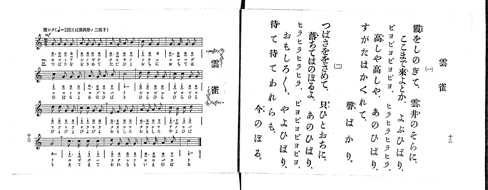

# 雲雀

> Re:Shoka 使用 AI 協助辨識與重建樂譜，可能會有錯誤。歡迎回報。

<audio controls src="hibari.mp3"></audio>

- 出處：共益商社樂器店《唱歌教科書 生徒用 巻一》第十二～十三頁（第六曲）
- NDL Digital Collections PID 854862（https://dl.ndl.go.jp/pid/854862）掃描 P008.jpg

## 說明

原書資訊與歌詞全文（NDL PID 854862《唱歌教科書 生徒用 巻一》第十二～十三頁，掃描 P008.jpg）：
調性與拍號：は調四分ノ二拍子（C 大調 2/4 拍），♩=126，「樂シク」
註記：第一學期第六曲。全曲二十小節（每行五小節），分節歌，二節同一旋律。開頭標 mf。第八、十二、十六小節末印有換氣記號（V）。五線譜與簡譜一致。第四行第十九小節第二節譜下配字誤植為「いまのば｜る」，右頁歌詞作「今のぼる。」；第二節「ヒラヒラヒラヒラ、ピヨピヨピヨピヨ、」右頁印片假名，譜下配字印平假名。

## 歌詞

```text
一、
霞をしのぎて、雲井のそらに、
ここまで來よとか、よぶひばり、
ピヨピヨピヨピヨ、ヒラヒラヒラヒラ、
高しや高しや、あのひばり、
すがたはかくれて、聲ばかり。

二、
つばさををさめて、只ひとおちに、
落ちてはのぼるよ、あのひばり、
ヒラヒラヒラヒラ、ピヨピヨピヨピヨ、
おもしろ〳〵、やよひばり、
待て待てわれらも、今のぼる。
```

## ABC

```abc
X:1
T:雲雀
M:2/4
L:1/16
Q:1/4=126
K:C
V:V1 name="Piano" snm="Pia"
[V:V1]
!mf! G3 G G2 G2 | A2 G2 G2 G2 | A3 G A2 B2 | c2 G2 G4 |
G3 G G2 G2 | c2 G2 G2 G2 | A3 G A2 B2 | c8 |
d2 d2 G2 G2 | c2 c2 G2 G2 | d2 d2 G2 G2 | c2 c2 G2 G2 |
E3 F G2 G2 | A3 G A2 B2 | c3 B c2 d2 | G8 |
c3 c c2 c2 | d2 G2 G2 G2 | A3 G A2 B2 | c8 |
```

## TMD 檔案連結

- [主旋律 TMD 檔案](hibari.tmd) [[在 TMD Studio 編輯](https://tmdlang.github.io/Tmd-TS/#tmd=s7IKdvYPcrWy4qpTUCpJTLdSSM7PyUlNLsnMz7PKrsxPzc6ML87Iz05Ugisoy88pzU21yk7MizeMtzA1sTAzQkgW55cWJadaFSdn5OfnxJekVpQk5edno8vHFySmp1oFGBhYIGQKivLLUvMS84C6C4oy80pSU8DaEQpSyzJTUkHSxclAq8tSizLTMlNTkNyVWlQMcjXUipKixLzi5KLMApBXEKrSU_OKUq2SMzJzUopS8-KL8_PSEZJp-UW5VsUlRfkFGZnJCOGSjFSghxPzMnMTc9BF8xJLSotSlbi0tBRezt70cnaDgpYWl6KtgqGRGZe9rYIzl42RvokdSNPT9l0vZk59v2fW09aNz2d3PZ3a9nzJvmcrmp7OXPF01_THDV1Pp2x8trbn2dSZz5dPfDZ7h8LzKfOf7pv0fMoKhafbdz_Z0fC4ofv5mjVPexuf7Op5v3ceiLGj8-WCxvd7OkDirWufzd70fk8n2IV-Lj4KLpnpmSWJOQrO8BgtVgjwdFGAxBlQV0ZJSUGxlb5-So5eHhCn5-tlFegXZKbow1R0PutrftbfrwCKKaAcMKS49LUUbKkFuBQUFJ72zQf69cXm9hcrul50tAMD4MXKeU9bVzyb1g50IcgbCCdTFEY9aH4B-g4YFyAnvFi1_1nDcpDl3b0vZs4Hij5uXA8UfDp79tOOtsfNfUCzgFJP104AushZ4emS5UBJBWC0KgBFwcb0PJq50hYY40DW44YeYJw-btr-uGn944ZesPkrdr9YMQNoLNBlQCc-Xbvj2Zz58Bh73NAE8u7sTUBbgM59uqH_-foGoEXP1ve_WNjzZNcUmAjIHqB7gGxgCADZQPVA9tMJPUAzn03vfrqvG2jUy2ndLxesfbZipkJuGpALtmX144ZGSIhAGEB7IWY-m7P6ae-GZ3M6n_XPfrZhMdCRYO93hAEtA2oG2v18-6wXa-cAg-b5hoVABtCmF-1boObOng10HzSwd86FmAjyIdhZYMXdL1uBoTb9xaolz5b0Pm_aBQybx40tjxv3PW5c97hxw_u9cx43AR0NDMOep_2bgbEEif0nQPGGnie7u8DK9oDVNIGVzYabDzKqedLj5pVYyIbGx81THjevwEICpRp6IXYBff68s_1pY_vTCSAHIDsYKPV052aIFNBqLlAkgtNWI4j1cs68x02THjdOBzuv73HjMqAEMO8_2TUVLDL3cVPn40ZQoINUP26cDEZAPy9_sq_tcVPH48YVjxuBXmoEs7c9btwEDIvHTV0wDXjcjtvHYIetngFyVVMLnAHS09gEdhWaJY0zHzcCI2M-MKWDHNPY_7gJyAX55AVEKVAQpBrqeXDSgWhcApadCgoCUCgAGUA7QBqf9q8CWwP0HTDmFiKC4MWEvWD-MrBlsCgFeh6n68iKWYjzuh43AY0Eeh4Yc5sfN2wFh3MLOKhRLXm6rxXoJAj5uAnsf2C8ATU3NKIlPZBqygs7KFDQ0ufi8shMSizKtArITMzLd6gxqFGoBtmhYGNopmUHZlXnptWCGcDi9nHTaiDeCQyV-UC8SaEGyNsOZPUB6XVAug0ssh7IWgTEG8AyIJG9QNZKIO4G8zZDcPM8IG4HOQJkeo2CqYIuEJqCaRCuUTCDslBFQGwQbQ4WMYxDUgCCWAxCOB9k7Qog7gB7BegYMG8aKJqBeAJYZBWYnAKVg9CYInBnozgAryuRYY2CEUgITCA0gpWhGIhwO9iFoECE0CAXYYg07YdGEShSluAQAUUNMMKgPob7g0j3KBiD3W9CjHfNIQywoUgeAQcwKBU1rYE4sLkfLAJyJijtAEWhKQmUUkBBPgEeXavQ0wtykEKtBVIIh0M9RnoEcdVycenaKUDyhwKQpcwFAA)]
- [鋼琴伴奏 TMD 檔案](hibari_piano.tmd) [[在 TMD Studio 編輯](https://tmdlang.github.io/Tmd-TS/#tmd=s7IKdvYPcrWy4tLSUng5e9PL2Q3v93S87N7zfMKWJ3u2PF3a_7yz4_2eTgUtLS5FWwVDIzMue1sFZy4bI30TO646BaWn7btezJz6fs-sp60bn8_uejq17fmSfc9WND2dueLprumPG7qeTtn4bG3Ps6kzny-f-Gz2DoXnU-Y_3Tfp-ZQVCk-3736yo-FxQ_fzNWue9jY-2dXzfu88EGNH58sFjUBngMRb1z6bvQnoACWQZX4uPgoumemZJYk5Cs75OTmpySWZ-XnFCgGeLgoWpiYWZkZAXRklJQXFVvr6KTl6eUCcnq-XVaBfkJmiD1PR-ayv-Vl_v0KAgYEFUC5diYvLIzMpsSjTKiAzMS8_yMOhxqBGoZrLxtBMy45LAQiqc9NqwQx9LYXHTauBeKfC4-b5QLxJoQbI2w5k9QHpdUC6DSyyHshaBMQbwDIgkb1A1kog7gbzNkNw8zwgblfQ0gebXqNgqqALhKZgGoRrFMygLFQREBtEm4NFDOOQFIAgFoMQzgdZuwKIO8BeAToGzJsGxJOAeAJYZBWYnAKVg9CYInBnozgAryuRYY2CEUgITCA0gpWhGIhwO9iFoECE0CAXYYg07YdGEShSluAQAUUNMMKgPob7g0j3KBiD3W9CjHfNIQywoUgeAQcwKBU1rYE4sLkfLAJyJijtAEWhKQmUUkBBPgEeXavQ0wtykEKtBVIIh0M9RnoEcdWiZg0fWNYA2W5jAs0dQA-96Ot62d77tHXHy9mtkGIDKXHEK0QbxgIZNQomQKYJhGkaD2SbxkM4MCWYOpCY-HRglSOgB5djiHQZXj0GkLDTtVOABJ8CkKXMBQA)]

## 分析

```text
================================================================================
📊 TMD Song Profile: [ 雲雀 ]
================================================================================
⏱  Duration:       0:19 (19.0s), 20 measures total
🎼 Key & Tempo:    首調基準 C, != 126.0 BPM, <2/4>
   - 分析範圍：      由實際發聲的音符與和弦推測調性；播放脈絡另行呈現
🎤 人聲音域:    E4 (MIDI 64) – D5 (MIDI 74) [跨度: 10 個半音 / 0.8 個八度, 難度: easy]
   - 最低音:  E4 in [Hibari #1 @ m.13, 0:11]
   - 最高音: D5 in [Hibari #1 @ m.9, 0:07]
   - 適合: soprano, mezzo-soprano, contralto, tenor, baritone, bass
🏛  結構:      Hibari (19.0s)
⚡ 編曲密度:        Peak 1 軌道同時演奏
🗝  調性診斷：       G 大調（純淨自然大調，未偵測到可信轉調）
   - 風格氣質:    純淨自然大調（陽光明朗、易唱易記，無明顯調外色彩）
   - 轉調歷程:    全曲維持單一推測調性（未偵測到可信轉調）
   - 核心骨幹音:  G, C, A, D, B
   - 調性數值:    G 大調 [相關度: 0.80, 穩定度: Moderate, 自然音純度: 99.4%]
   - 候選調性 (K-S): G 大調 (0.80), C 大調 (0.75), G 小調 (0.60)
   - 五度圈歷程:   +1
   - 各段落調性細節:
     • [Hibari #1]: G 大調 (r: 0.80, 自然音純度: 99.4%, 調外音: F)

  [ 五度圈游移軌跡 ]
               C  
         F           [G ]*
      Bb               D  
      Eb               A  
         Ab           E  
            Db       B  
               F# 
     (* = active key center)

  [ 十二半音累積音高分佈 ]
     C  : ██████████████            25.6%
     C# :                            0.0%
     D  : ████                       7.5%
     D# :                            0.0%
     E  : █                          1.9%
     F  :                            0.6%
     F# :                            0.0%
     G  : ████████████████████████  45.0%
     G# :                            0.0%
     A  : ███████                   13.7%
     A# :                            0.0%
     B  : ███                        5.6%
--------------------------------------------------------------------------------
Assignment 軌道音域：
  - Piano         : E4 – D5 (10 個半音 / 0.8 個八度, 70 個音符)
================================================================================
```


## 原書掃描頁




