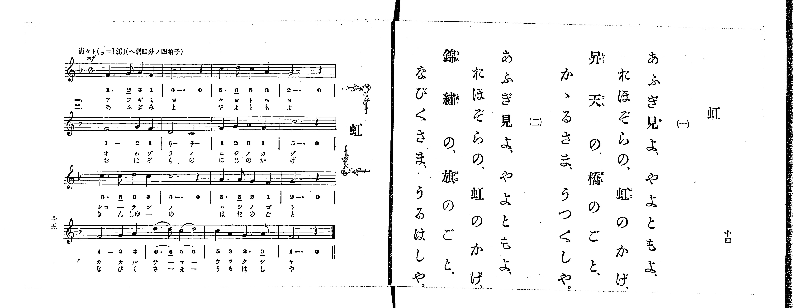

# 虹

> Re:Shōka 使用 AI 協助辨識與重建樂譜，可能會有錯誤。歡迎回報。

- **鋼琴伴奏版**：<br><audio controls src="niji.mp3"></audio>
- **NEUTRINO 歌聲合成版**：<br><audio controls src="niji_neutrino.mp3"></audio>

- 出處：共益商社樂器店《唱歌教科書 生徒用 巻一》第十四～十五頁（第七曲）
- NDL Digital Collections PID 854862（https://dl.ndl.go.jp/pid/854862）掃描 P009.jpg

## 說明

原書資訊與歌詞全文（NDL PID 854862《唱歌教科書 生徒用 巻一》第十四～十五頁，掃描 P009.jpg）：
調性與拍號：ヘ調四分ノ四拍子（F 大調 4/4 拍），♩=120，「清々ト」
註記：第一學期第七曲。分節歌，二節同一旋律。開頭標 mf。第四行第二小節（第十四小節）「6. 6_」與「5 6」各有圓滑線（配字「サーマー」／「さーまー」）。右頁「おほぞらの」之「お」以變體假名（𛀙）排印。五線譜與簡譜一致。


## 歌詞

```text
一、
あふぎ見よ、やよともよ、
おほぞらの、虹のかげ、
昇天の、橋のごと、
かゝるさま、うつくしや。

二、
あふぎ見よ、やよともよ、
おほぞらの、虹のかげ、
錦繡の、旗のごと、
なびくさま、うるはしや。
```

## ABC

<div class="abc-score" data-abc-src="niji.abc" aria-label="五線譜載入中"></div>

[下載 ABC 原始檔](niji.abc)

## TMD 檔案連結

- [主旋律 TMD 檔案](niji.tmd) [[在 TMD Studio 編輯](https://tmdlang.github.io/Tmd-TS/#tmd=s7IKdvYPcrWy4qpTUCpJTLdSSM7PyUlNLsnMz7PKrsxPzc6ML87Iz05Ugisoy88pzU21yk7MizeMtzA1sTAzQkgW55cWJadaFSdn5OfnxJekVpQk5edno8vHFySmp1oFGBhYImQKivLLUvMS84C6C4oy80pSU8DaEQpSyzJTUkHSxclAq8tSizLTMlNTkNyVWlQMcjXUipKixLzi5KLMApBXEKrSU_OKUq2SMzJzUopS8-KL8_PSEZJp-UW5VsUlRfkFGZnJCOGSjFSgh8tTE4GMInThvMSS0qJUdNGcxLwUoDsLkCTyizLTM_OsclMzszKxhEx-UUlGfnpRYkFGpVVGZnEJUHlyYk48MJiBYa-lpfBi5k4FLS0uRVsFQyMDLntbBTcuGxN9EzuQAU_bd72YOfX9nllPWzc-n931dGrb8yX7nq1oejpzxdNd0x83dD2dsvHZ2p5nU2c-Xz7x2ewdCs-nzH-6b9LzKSsUnm7f_WRHw-OG7udr1jztbXw6e_b7vfOAjCe7prxc0Ph-TwdQ_MmO5mezN73f0wl2rZ-Lj4IL0CsliTkKzvDEUqwQ4OmiAEkOQF0ZJSUFxVb6-ik5enlAnJ6vl1WgX5CZog9T0fmsr_lZf78CKBEA5YCRwKWvpWBLLcCloKDwtG8-0K8vNre_WNH1oqMdGAAvVs572rri2bR2oAtB3kA4maIw6kHzC9B3wLgAOeHFqv3PGpaDLO_ufTFzPlD0cfMMoCDQiKcdbY-b-4AMoNTTtROALnJTeLpkOVBSARitCkBRsDE9j2autAXGOJD1uKHn2Y7Wxw2tj5s7Hjf0gs1fsfvFihlAY8Gx1PB07Y5nc-bDY-xxQxPQlufrG4D-Aup_sqsHyH46oQeo8tn07qf7uoEKXk7rfrlg7bMVMxVy04BckA9nz36xsAdkyK6epxv6gVogqQDic5hIJ9A1ZnoKZvFAlwD9B-SZKpgB2U8ntDyb0_l0zuRnuyc-3z4LqPVlK9B_wETY87hp6-PmPY-b54HIBqD3-kGCjVNB3MZ9MEGgwU1P-zcDAxYs2_W4cffjxnmPmzofN64DKniyE-hqsDiQvXvpi3VdL1dPedrY_nQCUG_Hh9kNM8Fpa9LT3g1Ag4AxBHTEi7VzgE58vmEhkAH0-4v2LUApLlD4gaO1EcR63Nj0uHHr48a-F8u6HzcBw7fxcVMLiNG44nFTE0QEog7NRY3AjAliNHY_bpwEVfRsRvvTJSsh0s9WAiWA0lNAJsHMAFox93ETUGIqyOdAuxrbHjcuedzY_7hxOshemPN2ASOd-s572bPs-c6FUOdNn47pvFWPGzeDHYPkPJBr1yOcB1RHeS6FAgUtfS4uP2CxaBWQmZiX71BjUFMNskDBxkLLDsyozk2rBTOAZcTjpkUKj5unAul1QHq-Qg2QXAEml4BZwNwBxIug4kCjQfpqFAwVdIHQSMEYSILYNQqmYBEINEASMQPTIHU1QPVoasCm-RgCDW9sAosCowWI-8Cs_WA9wNhA0hUPFWuBqAbKAUMazALpx6oaYocR7e0Ah-YqYDjNBtL7wCG2Eoj7wKxuoNgOMO9x02qwIZvQQxMUnrDQNAMZC4KmMAZEFUgFnjBHCs8uqDgwAYPJeVC3d8LF18FNfty4GiwyAy4OTOFQmUl4wpO2doDDc_vj5uXAYNsDxG1AvBkcmJAg7QdJQ4N0C1ikAxGkkKABlqJgEnsCBQUkKDgRwY4vgQLzajvcX8tAZNNkqPthvkRKPY3roSqnw307BSoDSku4QrQXogtoMtjCVqTgw2fJfCItAQfpaghuhiRDYF4Ah-48MA0SWQZktQDp9eDwhRQFWJMqJFODQhiWzUFsSEiD5CChaYykC1u4ghIBxBcgFrBkhPpgKlx8H1IotIFFloDJfngQI7Ir9mBdBTdrM1wnATvA7kCORux21HJx6dopgIpbBSCtzAUA)]
- [鋼琴伴奏 TMD 檔案](niji_piano.tmd) [[在 TMD Studio 編輯](https://tmdlang.github.io/Tmd-TS/#tmd=s7IKdvYPcrWy4qpTUCpJTLdSyC8qychPL0osyKi0ysgsLskvykxOzInPTsxLVOLS0lJ4MXPn-z0dL7v3PJ-w5cmeLU-X9j_v7Hi_p1NBS4tL0VbB0MiAy95WwY3LxkTfxA5k6tP2XS9mTn2_Z9bT1o3PZ3c9ndr2fMm-Zyuans5c8XTX9McNXU-nbHy2tufZ1JnPl098NnuHwvMp85_um_R8ygqFp9t3P9nR8Lih-_maNU97G5_Onv1-7zwg48muKS8XNAKdARR_sqP52exNQAcogSzzc_FRcMlMzyxJzFFwzs_JSU0uyczPK1YI8HRRsDA1sTAzAurKKCkpKLbS10_J0csD4vR8vawC_YLMFH2Yis5nfc3P-vsVAgwMLIFy6UpcXH6ZWZlWAZmJeflBHg41BjXVXApAYGOhZQdmVOem1YIZ-loKj5sWKTxungqk1wHp-Qo1QHIFmFwCZj1u7gDiRVBxLX2wvhoFQwVdIDRSMAaSIHaNgilYBAINkETMwDRIXQ1QPZoasGk-hkDDG5vAoo8btwJxH5i1H6zncVMHkq54qFgLRDVQ7nHjCjALpB-raogdRrS3Axyaq4DhNBtI7wOH2Eog7gOzuoFiO8C8x02rwYZsQg9NUHjCQtMMZCwImsIYEFUgFXjCHCk8u6Dijxt3g8l5ULd3wsXXwU1-3LgaLDIDLv64sRsqMwlPeNLWDnB4bn_cvBwYbHuAuA2IN4MDExKk_SBpaJBuAYt0IIIUEjSmwOQHIrEnUFBAgoITEez4Euj0x03tcH8tA5FNk6Huh_kSKfU0roeqnA737RSoDCgt4QrRXoguoMlgC1uRgg-fJfOJtAQcpKshuBmSDIF5ARy688A0SGQZkNUCpNeDwxdSFGBNqpBMDQphWDYHsSEhDZKDhKYxki5s4QpKBBBfgFiPm2CJYipcfB9SKLSBRZaAyX54ECOyK_ZgXQU3azNcJwE7wO5AjkbsdtQil7Y-yKWtCbS0BYb5i76ul-29T1t3vJzdCqmGkBJqfLxCtGl8rIIhkDaMBYoAgwvChIlAVZoAuSYo6uB64QyYWqgihDimfpLth3KhxhBUh2I3WS6F2YRHJcIFBpDI0LVTAMVHtA9QFM42ArOVuQA)]

## 分析

```text
================================================================================
📊 TMD Song Profile: [ 虹 ]
================================================================================
⏱  Duration:       0:32 (32.0s), 16 measures total
🎼 Key & Tempo:    首調基準 F, != 120.0 BPM, <4/4>
   - 分析範圍：      由實際發聲的音符與和弦推測調性；播放脈絡另行呈現
🎤 人聲音域:    C4 (MIDI 60) – D5 (MIDI 74) [跨度: 14 個半音 / 1.2 個八度, 難度: moderate]
   - 最低音:  C4 in [Niji #1 @ m.6, 0:11]
   - 最高音: D5 in [Niji #1 @ m.3, 0:04]
   - 適合: soprano, mezzo-soprano, contralto, tenor, baritone, bass
🏛  結構:      Niji (32.0s)
⚡ 編曲密度:        Peak 1 軌道同時演奏
🗝  調性診斷：       C 大調（純淨自然大調，未偵測到可信轉調）
   - 風格氣質:    純淨自然大調（陽光明朗、易唱易記，無明顯調外色彩）
   - 轉調歷程:    全曲維持單一推測調性（未偵測到可信轉調）
   - 核心骨幹音:  C, F, G, A, D
   - 調性數值:    C 大調 [相關度: 0.86, 穩定度: Moderate, 自然音純度: 100.0%]
   - 候選調性 (K-S): C 大調 (0.86), F 大調 (0.81), C 小調 (0.56)
   - 五度圈歷程:   +0
   - 各段落調性細節:
     • [Niji #1]: C 大調 (r: 0.86, 自然音純度: 100.0%)

  [ 五度圈游移軌跡 ]
              [C ]*
         F            G  
      Bb               D  
      Eb               A  
         Ab           E  
            Db       B  
               F# 
     (* = active key center)

  [ 十二半音累積音高分佈 ]
     C  : ████████████████████████  31.9%
     C# :                            0.0%
     D  : ████████                  11.2%
     D# :                            0.0%
     E  :                            0.0%
     F  : ██████████████████        23.3%
     F# :                            0.0%
     G  : ████████████████          20.7%
     G# :                            0.0%
     A  : ██████████                12.9%
     A# :                            0.0%
     B  :                            0.0%
--------------------------------------------------------------------------------
Assignment 軌道音域：
  - Piano         : C4 – D5 (14 個半音 / 1.2 個八度, 42 個音符)
================================================================================
```


## 原書掃描頁




