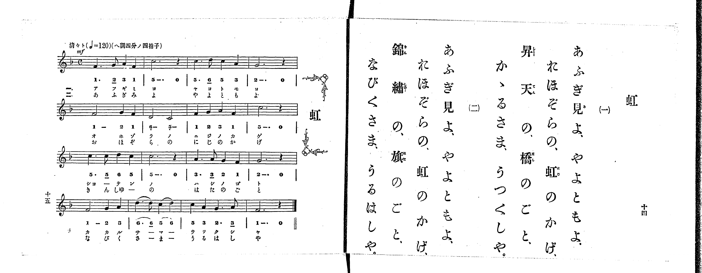

# 虹

> Re:Shoka 使用 AI 協助辨識與重建樂譜，可能會有錯誤。歡迎回報。

<audio controls src="niji.mp3"></audio>

- 出處：共益商社樂器店《唱歌教科書 生徒用 巻一》第十四～十五頁（第七曲）
- NDL Digital Collections PID 854862（https://dl.ndl.go.jp/pid/854862）掃描 P009.jpg

## 說明

原書資訊與歌詞全文（NDL PID 854862《唱歌教科書 生徒用 巻一》第十四～十五頁，掃描 P009.jpg）：
調性與拍號：ヘ調四分ノ四拍子（F 大調 4/4 拍），♩=120，「清々ト」
註記：第一學期第七曲。分節歌，二節同一旋律。開頭標 mf。第四行第二小節（第十四小節）「6. 6_」與「5 6」各有圓滑線（配字「サーマー」／「さーまー」）。右頁「おほぞらの」之「お」以變體假名（𛀙）排印。五線譜與簡譜一致。

## 歌詞

```text
一、
あふぎ見よ、やよともよ、
おほぞらの、虹のかげ、
昇天の、橋のごと、
かゝるさま、うつくしや。

二、
あふぎ見よ、やよともよ、
おほぞらの、虹のかげ、
錦繡の、旗のごと、
なびくさま、うるはしや。
```

## ABC

```abc
X:1
T:虹
M:4/4
L:1/16
Q:1/4=120
K:F
V:V1 name="Piano" snm="Pia"
[V:V1]
!mf! F6 G2 A4 F4 | c12 z4 | c6 d2 c4 A4 | G12 z4 |
F8 G4 F4 | D8 C8 | F4 G4 A4 F4 | c12 z4 |
c6 c2 d4 c4 | c12 z4 | A6 A2 G4 F4 | G12 z4 |
F8 G4 A4 | d6 d2 c4 d4 | c4 A4 G6 A2 | F12 z4 |
!mf! F6 G2 A4 F4 | c12 z4 | c6 d2 c4 A4 | G12 z4 |
F8 G4 F4 | D8 C8 | F4 G4 A4 F4 | c12 z4 |
c6 c2 d4 c4 | c12 z4 | A6 A2 G4 F4 | G12 z4 |
F8 G4 A4 | d6 d2 c4 d4 | c4 A4 G6 A2 | F12 z4 |
```

## TMD 檔案連結

- [主旋律 TMD 檔案](niji.tmd) [[在 TMD Studio 編輯](https://tmdlang.github.io/Tmd-TS/#tmd=s7IKdvYPcrWy4qpTUCpJTLdSSM7PyUlNLsnMz7PKrsxPzc6ML87Iz05Ugisoy88pzU21yk7MizeMtzA1sTAzQkgW55cWJadaFSdn5OfnxJekVpQk5edno8vHFySmp1oFGBhYImQKivLLUvMS84C6C4oy80pSU8DaEQpSyzJTUkHSxclAq8tSizLTMlNTkNyVWlQMcjXUipKixLzi5KLMApBXEKrSU_OKUq2SMzJzUopS8-KL8_PSEZJp-UW5VsUlRfkFGZnJCOGSjFSgh8tTE4GMInThvMSS0qJUdNGcxLwUoDsLgBJaWgovZu5U0NLiUrRVMDQy4LK3VXDjsjHRN7EDaXravuvFzKnv98x62rrx-eyup1Pbni_Z92xF09OZK57umv64oevplI3P1vY8mzrz-fKJz2bvUHg-Zf7TfZOeT1mh8HT77ic7Gh43dD9fs-Zpb-PT2bPf750HZDzZNeXlgsb3ezqA4k92ND-bven9nk6wC_1cfBRcMtMzSxJzFJzhEV2sEODpogCJSqCujJKSgmIrff2UHL08IE7P18sq0C_ITNGHqeh81tf8rL9fARSBQDlgAHLpaynYUgtwKSgoPO2bD_Tri83tL1Z0vehoBwbAi5XznraueDatHehCkDcQTqYojHrQ_AL0HTAuQE54sWr_s4blIMu7e1_MnA8Ufdw8AygINOJpR9vj5j4gAyj1dO0EoIvcFJ4uWQ6UVABGqwJQFGxMz6OZK22BMQ5kPW7oebaj9XFD6-PmjscNvWDzV-x-sWIG0FhwLDU8Xbvj2Zz58Bh73NAEtOX5-gagv4D6n-zqAbKfTugBqnw2vfvpvm6ggpfTul8uWPtsxUyF3DQgF-TD2bNfLOwBGbKr5-mGfqAWSCqA-Bwm0gl0jZmeglk80CVA_wF5pgpmQPbTCS3P5nQ-nTP52e6Jz7fPAmp92Qr0HzAR9jxu2vq4ec_j5nkgsgHovX6QYONUELdxH0wQaHDT0_7NwIAFy3Y9btz9uHHe46bOx43rgAqe7AS6GiwOZO9e-mJd18vVU542tj-dANTb8WF2w0xw2pr0tHcD0CBgDAEd8WLtHKATn29YCGQA_f6ifQtQigsUfuBobQSxHjc2PW7c-rix78Wy7sdNwPBtfNzUAmI0rnjc1AQRgahDc1EjMGOCGI3djxsnQRU9m9H-dMlKiPSzlUAJoPQUkEkwM4BWzH3cBJSYCvI50K7GtseNSx439j9unA6yF-a8XcBIp77zXvYse75zIdR506djOm_V48bNYMcgOQ_k2vUI5wHVUZ5LoUBBS5-Lyy8zK9MqIDMxL9-hxqBGoRpkg4KNhZYdmFGdm1YLZgALicdNixQeN08F0uuA9HyFGiC5AkwuAbOA2QOIF0HFgWaD9NUoGCroAqGRgjGQBLFrFEzBIhBogCRiBqZB6mqA6tHUIFyxCmj-bCC9D2zTSiDuA7O6gWI7wLzHTatBIk2b0F0BcgfMFWbxUCFTGAOiCqQCj1sR7tj-uHk50Lo9QNwGxJvBjoA4pR8kDXXKFrBIB8IpECOB2RZMYg8QkANAzkA4F0-ArIbgZoint0LdNA9Mg0SWAVktQHo92FWQCMMaMJCgB7kLFhkgNsR9IDmIG4yRdCFcU8vFpWunAEpNCki0MhcA)]

## 分析

```text
================================================================================
📊 TMD Song Profile: [ 虹 ]
================================================================================
⏱  Duration:       1:04 (64.0s), 32 measures total
🎼 Key & Tempo:    首調基準 F, != 120.0 BPM, <4/4>
   - 分析範圍：      由實際發聲的音符與和弦推測調性；播放脈絡另行呈現
🎤 人聲音域:    C4 (MIDI 60) – D5 (MIDI 74) [跨度: 14 個半音 / 1.2 個八度, 難度: moderate]
   - 最低音:  C4 in [Niji #1 @ m.6, 0:11]
   - 最高音: D5 in [Niji #1 @ m.3, 0:04]
   - 適合: soprano, mezzo-soprano, contralto, tenor, baritone, bass
🏛  結構:      Niji (32.0s) -> Niji (32.0s)
⚡ 編曲密度:        Peak 1 軌道同時演奏
🗝  調性診斷：       C 大調（純淨自然大調，未偵測到可信轉調）
   - 風格氣質:    純淨自然大調（陽光明朗、易唱易記，無明顯調外色彩）
   - 轉調歷程:    全曲維持單一推測調性（未偵測到可信轉調）
   - 核心骨幹音:  C, F, G, A, D
   - 調性數值:    C 大調 [相關度: 0.86, 穩定度: Moderate, 自然音純度: 100.0%]
   - 候選調性 (K-S): C 大調 (0.86), F 大調 (0.81), C 小調 (0.56)
   - 五度圈歷程:   +0 -> +0
   - 各段落調性細節:
     • [Niji #1]: C 大調 (r: 0.86, 自然音純度: 100.0%)
     • [Niji #2]: C 大調 (r: 0.86, 自然音純度: 100.0%)

  [ 五度圈游移軌跡 ]
              [C ]*
         F            G  
      Bb               D  
      Eb               A  
         Ab           E  
            Db       B  
               F# 
     (* = active key center)

  [ 十二半音累積音高分佈 ]
     C  : ████████████████████████  31.9%
     C# :                            0.0%
     D  : ████████                  11.2%
     D# :                            0.0%
     E  :                            0.0%
     F  : ██████████████████        23.3%
     F# :                            0.0%
     G  : ████████████████          20.7%
     G# :                            0.0%
     A  : ██████████                12.9%
     A# :                            0.0%
     B  :                            0.0%
--------------------------------------------------------------------------------
Assignment 軌道音域：
  - Piano         : C4 – D5 (14 個半音 / 1.2 個八度, 84 個音符)
================================================================================
```


## 原書掃描頁




