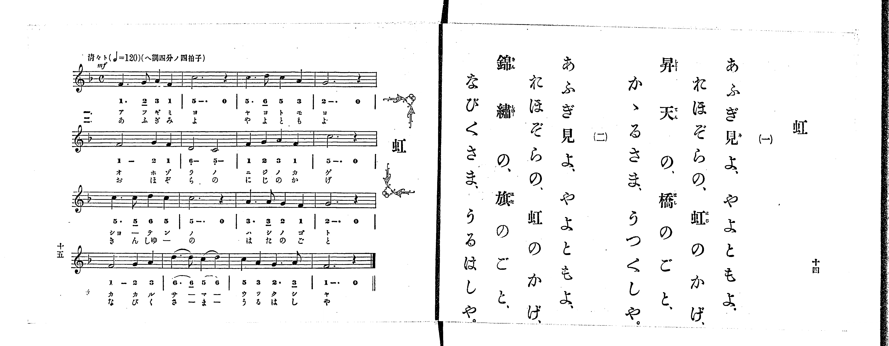

# 虹

> Re:Shōka 使用 AI 協助辨識與重建樂譜，可能會有錯誤。歡迎回報。

- **NEUTRINO 歌聲合成版**：<br><audio controls src="niji_neutrino.mp3"></audio>
- **鋼琴伴奏版**：<br><audio controls src="niji.mp3"></audio>


- 出處：共益商社樂器店《唱歌教科書 生徒用 巻一》第十四～十五頁（第七曲）
- NDL Digital Collections PID 854862（https://dl.ndl.go.jp/pid/854862）掃描 P009.jpg

## 說明

原書資訊與歌詞全文（NDL PID 854862《唱歌教科書 生徒用 巻一》第十四～十五頁，掃描 P009.jpg）：
調性與拍號：ヘ調四分ノ四拍子（F 大調 4/4 拍），♩=120，「清々ト」
註記：第一學期第七曲。分節歌，二節同一旋律。開頭標 mf。第四行第二小節（第十四小節）「6. 6_」與「5 6」各有圓滑線（配字「サーマー」／「さーまー」）。右頁「おほぞらの」之「お」以變體假名（𛀙）排印。五線譜與簡譜一致。


## 歌詞

```text
一、
あふぎ見よ、やよともよ、
おほぞらの、虹のかげ、
昇天の、橋のごと、
かゝるさま、うつくしや。

二、
あふぎ見よ、やよともよ、
おほぞらの、虹のかげ、
錦繡の、旗のごと、
なびくさま、うるはしや。
```

## ABC

```abc
X:1
T:虹
M:4/4
L:1/16
Q:1/4=120
K:F
V:V1 name="Piano" snm="Pia"
[V:V1]
!mf! F6 G2 A4 F4 | c12 z4 | c6 d2 c4 A4 | G12 z4 |
w: 1.~あ ふ ぎ み | よ | や よ と も | よ
w: 2.~あ ふ ぎ み | よ | や よ と も | よ
F8 G4 F4 | D8 C8 | F4 G4 A4 F4 | c12 z4 |
w: 1.~お ほ ぞ | ら の | に じ の か | げ
w: 2.~お ほ ぞ | ら の | に じ の か | げ
c6 c2 d4 c4 | c12 z4 | A6 A2 G4 F4 | G12 z4 |
w: 1.~しょ _ て ん | の | は し の ご | と
w: 2.~き ん しゅ _ | の | は た の ご | と
F8 G4 A4 | d6 d2 c4 d4 | c4 A4 G6 A2 | F12 z4 |
w: 1.~か か る | さ _ ま _ | う つ く し | や
w: 2.~な び く | さ _ ま _ | う る は し | や
```

## TMD 檔案連結

- [主旋律 TMD 檔案](niji.tmd) [[在 TMD Studio 編輯](https://tmdlang.github.io/Tmd-TS/#tmd=s7IKdvYPcrWy4qpTUCpJTLdSSM7PyUlNLsnMz7PKrsxPzc6ML87Iz05Ugisoy88pzU21yk7MizeMtzA1sTAzQkgW55cWJadaFSdn5OfnxJekVpQk5edno8vHFySmp1oFGBhYImQKivLLUvMS84C6C4oy80pSU8DaEQpSyzJTUkHSxclAq8tSizLTMlNTkNyVWlQMcjXUipKixLzi5KLMApBXEKrSU_OKUq2SMzJzUopS8-KL8_PSEZJp-UW5VsUlRfkFGZnJCOGSjFSgh8tTE4GMInThvMSS0qJUdNGcxLwUoDsLkCTyizLTM_OsclMzszKRQkZLS-HFzJ0KWlpcirYKhkYGXPa2Cm5cNib6JnYgrU_bd72YOfX9nllPWzc-n931dGrb8yX7nq1oejpzxdNd0x83dD2dsvHZ2p5nU2c-Xz7x2ewdCs-nzH-6b9LzKSsUnm7f_WRHw-OG7udr1jztbXw6e_b7vfOAjCe7prxc0Ph-TwdQ_MmO5mezN73f0wl2p5-Lj4IL0JUliTkKzvB0UKwQ4OmiAIlpoK6MkpKCYit9_ZQcvTwgTs_XyyrQL8hM0Yep6HzW1_ysv18BFL9AOWD4culrKdhSC3ApKCg87ZsP9OuLze0vVnS96GgHBsCLlfOetq54Nq0d6EKQNxBOpiiMetD8AvQdMC5ATnixav-zhuUgy7t7X8ycDxR93DwDKAg04mlH2-PmPiADKPV07QSgi9wUni5ZDpRUAEarAlAUbEzPo5krbYExDmQ9buh5tqP1cUPr4-aOxw29YPNX7H6xYgbQWHAsNTxdu-PZnPnwGHvc0AS05fn6BqC_gPqf7OoBsp9O6AGqfDa9--m-bqCCl9O6Xy5Y-2zFTIXcNCAX5MPZs18s7AEZsqvn6YZ-oBZIKoD4HCbSCXSNmZ6CWTzQJUD_AXmmCmZA9tMJLc_mdD6dM_nZ7onPt88Can3ZCvQfMBH2PG7a-rh5z-PmeSCyAei9fpBg41QQt3EfTBBocNPT_s3AgAXLdj1u3P24cd7jps7HjeuACp7sBLoaLA5k7176Yl3Xy9VTnja2P50A1NvxYXbDTHDamvS0dwPQIGAMAR3xYu0coBOfb1gIZAD9_qJ9C1CKCxR-4GhtBLEeNzY9btz6uLHvxbLux03A8G183NQCYjSueNzUBBGBqENzUSMwY4IYjd2PGydBFT2b0f50yUqI9LOVQAmg9BSQSTAzgFbMfdwElJgK8jnQrsa2x41LHjf2P26cDrIX5rxdwEinvvNe9ix7vnMh1HnTp2M6b9Xjxs1gxyA5D-Ta9QjnAdVRnkuhQEFLn4vLD1jiWQVkJublO9QY1FSDLFCwsdCyAzOqc9NqwQxgGfG4aZHC4-apQHodkJ6vUAMkV4DJJWAWMHcA8SKoONBokL4aBUMFXSA0UjAGkiB2jYIpWAQCDZBEzMA0SF0NUD2aGrBpPoZAwxubwKLAaAHiPjBrP1gPMDaQdMVDxVogqoFywJAGs0D6saqG2GFEezvAobkKGE6zgfQ-cIitBOI-MKsbKLYDzHvctBpsyCb00ASFJyw0zUDGgqApjAFRBVKBJ8yRwrMLKg5MwGByHtTtnXDxdXCTHzeuBovMgIsDUzhUZhKe8KStHeDw3P64eTkw2PYAcRsQbwYHJiRI-0HS0CDdAhbpQAQpJGiApSiYxJ5AQQEJCk5EsONLoMC82g731zIQ2TQZ6n6YL5FST-N6qMrpcN9OgcqA0hKuEO2F6AKaDLawFSn48Fkyn0hLwEG6GoKbIckQmBfAoTsPTINElgFZLUB6PTh8IUUB1qQKydSgEIZlcxAbEtIgOUhoGiPpwhauoEQA8QWIBSwZoT6YChffhxQKbWCRJWCyHx7EiOyKPVhXwc3aDNdJwA6wO5CjEbsdtVxcunYKoOJWAUgrcwEA)]
- [鋼琴伴奏 TMD 檔案](niji_piano.tmd) [[在 TMD Studio 編輯](https://tmdlang.github.io/Tmd-TS/#tmd=s7IKdvYPcrWy4tLSUngxc-f7PR0vu_c8n7DlyZ4tT5f2P-_seL-nU0FLi0vRVsHQyIDL3lbBjcvGRN_EjqtOQelp-64XM6e-3zPraevG57O7nk5te75k37MVTU9nrni6a_rjhq6nUzY-W9vzbOrM58snPpu9Q-H5lPlP9016PmWFwtPtu5_saHjc0P18zZqnvY1PZ89-v3cekPFk15SXCxqBzgCKP9nR_Gz2JqADlECW-bn4KLhkpmeWJOYoOOfn5KQml2Tm5xUrBHi6KFiYmliYGQF1ZZSUFBRb6eun5OjlAXF6vl5WgX5BZoo-TEXns77mZ_39CgEGBpZAuXQlLi6_zKxMq4DMxLz8IA-HGoOaai4FILCx0LIDM6pz02rBDH0thcdNixQeN08F0uuA9HyFGiC5AkwuAbMeN3cA8SKouJY-WF-NgqGCLhAaKRgDSRC7RsEULAKBBkgiZmAapK4GqB5NDdg0H0Og4Y1NYNHHjVuBuA_M2g_W87ipA0lXPFSsBaIaKPe4cQWYBdKPVTXEDiPa2wEOzVXAcJoNpPeBQ2wlEPeBWd1AsR1g3uOm1WBDNqGHJig8YaFpBjIWBE1hDIgqkAo8YY4Unl1Q8ceNu8HkPKjbO-Hi6-AmP25cDRaZARd_3NgNlZmEJzxpawc4PLc_bl4ODLY9QNwGxJvBgQkJ0n6QNDRIt4BFOhBBCgkaU2DyA5HYEygoIEHBiQh2fAl0-uOmdri_loHIpslQ98N8iZR6GtdDVU6H-3YKVAaUlnCFaC9EF9BksIWtSMGHz5L5RFoCDtLVENwMSYbAvAAO3XlgGiSyDMhqAdLrweELKQqwJlVIpgaFMCybg9iQkAbJQULTGEkXtnAFJQKIL0Csx02wRDEVLr4PKRTawCJLwGQ_PIgR2RV7sK6Cm7UZrpOAHWB3IEcjdjtqkUtbH-TS1gRa2gLD_EVf18v23qetO17OboVUQ0gJNT5eIdo0PlbBEEgbxgJFgMEFYcJEoCpNgFwTFHVwvXAGTC1UEUIcUz_J9kO5UGMIqkOxmyyXwmzCoxLhAgNIZOjaKYDiI9oHKApnG4HZylwA)]

## 分析

```text
================================================================================
📊 TMD Song Profile: [ 虹 ]
================================================================================
⏱  Duration:       0:32 (32.0s), 16 measures total
🎼 Key & Tempo:    首調基準 F, != 120.0 BPM, <4/4>
   - 分析範圍：      由實際發聲的音符與和弦推測調性；播放脈絡另行呈現
🎤 人聲音域:    C4 (MIDI 60) – D5 (MIDI 74) [跨度: 14 個半音 / 1.2 個八度, 難度: moderate]
   - 最低音:  C4 in [Niji #1 @ m.6, 0:11]
   - 最高音: D5 in [Niji #1 @ m.3, 0:04]
   - 適合: soprano, mezzo-soprano, contralto, tenor, baritone, bass
🏛  結構:      Niji (32.0s)
⚡ 編曲密度:        Peak 1 軌道同時演奏
🗝  調性診斷：       C 大調（純淨自然大調，未偵測到可信轉調）
   - 風格氣質:    純淨自然大調（陽光明朗、易唱易記，無明顯調外色彩）
   - 轉調歷程:    全曲維持單一推測調性（未偵測到可信轉調）
   - 核心骨幹音:  C, F, G, A, D
   - 調性數值:    C 大調 [相關度: 0.86, 穩定度: Moderate, 自然音純度: 100.0%]
   - 候選調性 (K-S): C 大調 (0.86), F 大調 (0.81), C 小調 (0.56)
   - 五度圈歷程:   +0
   - 各段落調性細節:
     • [Niji #1]: C 大調 (r: 0.86, 自然音純度: 100.0%)

  [ 五度圈游移軌跡 ]
              [C ]*
         F            G  
      Bb               D  
      Eb               A  
         Ab           E  
            Db       B  
               F# 
     (* = active key center)

  [ 十二半音累積音高分佈 ]
     C  : ████████████████████████  31.9%
     C# :                            0.0%
     D  : ████████                  11.2%
     D# :                            0.0%
     E  :                            0.0%
     F  : ██████████████████        23.3%
     F# :                            0.0%
     G  : ████████████████          20.7%
     G# :                            0.0%
     A  : ██████████                12.9%
     A# :                            0.0%
     B  :                            0.0%
--------------------------------------------------------------------------------
Assignment 軌道音域：
  - Piano         : C4 – D5 (14 個半音 / 1.2 個八度, 42 個音符)
================================================================================
```


## 原書掃描頁




