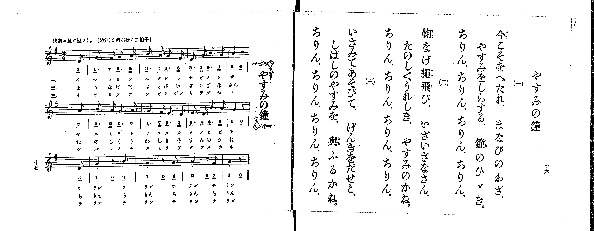

# やすみの鐘

> Re:Shoka 使用 AI 辨識樂譜，可能會有錯誤。歡迎回報。

<audio controls src="yasumi_no_kane.mp3"></audio>

- 出處：共益商社樂器店《唱歌教科書 生徒用 巻一》第十六～十七頁（第八曲）
- NDL Digital Collections PID 854862（https://dl.ndl.go.jp/pid/854862）掃描 P010.jpg

## 說明

原書資訊與歌詞全文（NDL PID 854862《唱歌教科書 生徒用 巻一》第十六～十七頁，掃描 P010.jpg）：
調性與拍號：と調四分ノ二拍子（G 大調 2/4 拍），♩=126，「快活ニ且ツ輕ク」，弱起半拍（八分音符）
註記：第二學期第一曲（全卷第八曲）。樂譜頁與歌詞頁標題皆作「やすみの鐘」，卷首目次作「休みの鐘」。分節歌，三節同一旋律（譜下配字一、三節印片假名，二節印平假名）。全曲三行各以八分音符弱起開始，以四分音符加八分休止符收尾（與次行弱起合成完整小節）；第三行「リン」之四分音符五線譜附斷音記號（staccato dot）。五線譜與簡譜一致。

## 歌詞

```text
一、
今こそをへたれ、まなびのわざ、
やすみをしらする、鐘のひゞき。
ちりん、ちりん、ちりん、ちりん。

二、
鞠なげ繩飛び、いざいざなさん、
たのしくうれしき、やすみのかね。
ちりん、ちりん、ちりん、ちりん。

三、
いさみてあそびて、げんきをだせと、
しばしのやすみを、與ふるかね。
ちりん、ちりん、ちりん、ちりん。
```

## ABC

```abc
X:1
T:やすみの鐘
M:2/4
L:1/16
Q:1/4=126
K:G
V:V1 name="Piano" snm="Pia"
[V:V1]
z2 z2 z2 D2 | G3 F G3 A | B3 A G3 E | D3 G B3 G |
A4 z2 A2 | B3 A G3 A | G3 F E3 D | E3 D B3 A |
G4 z2 D2 | G4 z2 B2 | G4 z2 G2 | A4 z2 F2 |
G4 z2 z2 | z2 z2 z2 D2 | G3 F G3 A | B3 A G3 E |
D3 G B3 G | A4 z2 A2 | B3 A G3 A | G3 F E3 D |
E3 D B3 A | G4 z2 D2 | G4 z2 B2 | G4 z2 G2 |
A4 z2 F2 | G4 z2 z2 | z2 z2 z2 D2 | G3 F G3 A |
B3 A G3 E | D3 G B3 G | A4 z2 A2 | B3 A G3 A |
G3 F E3 D | E3 D B3 A | G4 z2 D2 | G4 z2 B2 |
G4 z2 G2 | A4 z2 F2 | G4 z2 z2 |
```

## TMD 檔案連結

- [主旋律 TMD 檔案](yasumi_no_kane.tmd) [[在 TMD Studio 編輯](https://tmdlang.github.io/Tmd-TS/#tmd=s7IKdvYPcrWy4qpTUCpJTLdSSM7PyUlNLsnMz7PKrsxPzc6ML87Iz05Ugisoy88pzU21yk7MizeMtzA1sTAzQkgW55cWJadaFSdn5OfnxJekVpQk5edno8vHFySmp1oFGBgaIGQKivLLUvMS84C6C4oy80pSU8DaEQpSyzJTUkHSxclAq8tSizLTMlNTkNyVWlQMcjXUipKixLzi5KLMApBXEKrSU_OKUq2SMzJzUopS8-KL8_PSEZJp-UW5VsUlRfkFGZnJCOGSjFSgh6F-yslMS8WQKsgvArpUS0vhcVPL48aZjxv3P25c93LCDAUtLS5FWwVDIzMue1sFdy4bI30TO5Dmp-27Xsyc-n7PrKetG5_P7no6te35kn3PVjQ9nbni6a7pjxu6nk7Z-Gxtz7OpM58vn_hs9g6F51PmP9036fmUFQpPt-9-sqPhcUP38zVrnvY2Pm1d-37vPCDjyY7mlwsa3-_pAIm3rn42e9P7PZ1gl_q5-Ci4ZKZnliTmKDjDo7dYIcDTRQESgUBdGSUlBcVW-vopOXp5QJyer5dVoF-QmaIPU9H5rK_5WX-_AijagHLAYOPS11KwpRbgUlBQeNo3H-jXF5vbX6zoetHRDgyAFyvnPW1d8WxaO9CFIG8gnExRGPWg-QXoO2BcgJzwYtX-Zw3LQZZ3976YOR8o-rhxBVDw6ezZTzvaHjf3PdnVA5R6unYC0EXuCk-XLAdKKgCjVQEoCjam59HMlbbAGAeyHjf0PN2_-tmW3Y-bu5_smPK4ueXFnqmPm9Y_bgAq7Xm6Z-OLrduf9naBdXYA4wxow8v5m5-vWQY0COyYFbtfrJgBdAPQG0B7n67d8WzOfBB7RwM4eoF6Vjzt3Y4c4Y8bmoDJ6MXaOUB_woMQyH62YubLhT3PZ7U92TsH6Cy0dAp1UO_2l8umPZ-97tmahRBlT_ZMRFYDNBzoxOfrG4DGAtU_2dEJZD-dAGQ0PJve_XRfN9BJQKuf7Oh-2QoMoungOAAGOlhZ74bnne1PG9ufTgDZBfQORPDpzs0wQZDjQbE9exNQy4uFPU8ntDzZvRQ5XCBB9nJa99PlQLt6QLLgeIHKdi2AKAY6-9naRUCRZ1O2Pd2wD-QqYFCsWQgyExLoEzqedUx4ug6YeLY83dAPdAk46maDwxZkNSiImlc9bt4M9PWTnd3ItjzZNeX59lmgEJ7Z8mzadqAgMI7ASaWjuCQxOTmxJF8hJb8E4h24YqADnm9YCA6chhftW4BSXKAYhoQQmLW763Hj5MeNcx83TXrcuONx4_zHTUBnND5u3Pe4cdXjxs3AWHjc1P-4cRpUAyIKQRqmP27qBHGbuoHSoNgCqm7c9Lhp3uNGULSBNTQufNzU9bhpMthUgmyoA3eBHAFivZy3AOyQSc93rny5eDbIRSD1QEdMg5FAWWDyBpkDsW8-2BXTHzcCnd0G8g6IDXROI3Lye9zY_bhxLUVu3AEMaqiVQHOngs1d9rixCRSaoIBbBtY1CaQFaD0ouIBeAfpgBVwb0F0bwCQwjJGCtQGUhx43bgUFK0XOBOqhvIiEAgUtfS6uyMTi0txMv3zvxDxgTZqZmJfvUGNQo1ANsknBxtBMyw7MApbQGpAkrwlMMEsUahQeN88DsjYD8V4gexNYZAaQtx9IrwHLgkS6gHgyEPcB8XqQSNM2BY3HzUs0QZaDDK5RMFDQhWPTeCBRo2AIJHUVzOOhDCOgkDGUBRExiwcKgRXrAkUgcoZAISMwC2IWiF0Dc_zjpp1AF8wHu_Rx03aw21ZCRVcD6dVgkV6oSyeBXQ1y7VqQaxuRXIvqDpDL4I4FOgrEAjqrBokN0wBTiOxRuOvARQSQagQ7gwAH7hZkA0HWoIqA2KghAnQjuiIQruGq5eLStVNATgoKRPCVuQA)]

## 分析

```text
================================================================================
📊 TMD Song Profile: [ やすみの鐘 ]
================================================================================
⏱  Duration:       0:37 (37.1s), 39 measures total
🎼 Key & Tempo:    首調基準 G, != 126.0 BPM, <2/4>
   - 分析範圍：      由實際發聲的音符與和弦推測調性；播放脈絡另行呈現
🎤 人聲音域:    D4 (MIDI 62) – B4 (MIDI 71) [跨度: 9 個半音 / 0.8 個八度, 難度: easy]
   - 最低音:  D4 in [YasumiNoKane #1 @ m.1, 0:00]
   - 最高音: B4 in [YasumiNoKane #1 @ m.3, 0:01]
   - 適合: soprano, mezzo-soprano, contralto, tenor, baritone, bass
🏛  結構:      YasumiNoKane (12.4s) -> YasumiNoKane (12.4s) -> YasumiNoKane (12.4s)
⚡ 編曲密度:        Peak 1 軌道同時演奏
🗝  調性診斷：       G 大調（純淨自然大調，未偵測到可信轉調）
   - 風格氣質:    純淨自然大調（陽光明朗、易唱易記，無明顯調外色彩）
   - 轉調歷程:    全曲維持單一推測調性（未偵測到可信轉調）
   - 核心骨幹音:  G, A, B, D, E
   - 調性數值:    G 大調 [相關度: 0.84, 穩定度: High, 自然音純度: 100.0%]
   - 候選調性 (K-S): G 大調 (0.84), E 小調 (0.61), G 小調 (0.53)
   - 五度圈歷程:   +1 -> +1 -> +1
   - 各段落調性細節:
     • [YasumiNoKane #1]: G 大調 (r: 0.84, 自然音純度: 100.0%)
     • [YasumiNoKane #2]: G 大調 (r: 0.84, 自然音純度: 100.0%)
     • [YasumiNoKane #3]: G 大調 (r: 0.84, 自然音純度: 100.0%)

  [ 五度圈游移軌跡 ]
               C  
         F           [G ]*
      Bb               D  
      Eb               A  
         Ab           E  
            Db       B  
               F# 
     (* = active key center)

  [ 十二半音累積音高分佈 ]
     C  :                            0.0%
     C# :                            0.0%
     D  : ██████                    10.7%
     D# :                            0.0%
     E  : █████                      8.3%
     F  :                            0.0%
     F# : ███                        4.8%
     G  : ████████████████████████  41.7%
     G# :                            0.0%
     A  : ██████████                17.9%
     A# :                            0.0%
     B  : ██████████                16.7%
--------------------------------------------------------------------------------
Assignment 軌道音域：
  - Piano         : D4 – B4 (9 個半音 / 0.8 個八度, 108 個音符)
================================================================================
```


## 原書掃描頁




