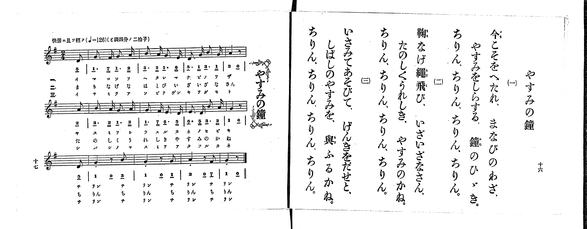

# やすみの鐘

> Re:Shōka 使用 AI 協助辨識與重建樂譜，可能會有錯誤。歡迎[回報](https://github.com/TMDLang/reshoka/issues)。

- **鋼琴伴奏版**：<br><audio controls src="yasumi_no_kane.mp3"></audio>
- **NEUTRINO 歌聲合成版**：<br><audio controls src="yasumi_no_kane_neutrino.mp3"></audio>

- 出處：共益商社樂器店《唱歌教科書 生徒用 巻一》第十六～十七頁（第八曲）
- NDL Digital Collections PID 854862（https://dl.ndl.go.jp/pid/854862）掃描 P010.jpg

## 說明

原書資訊與歌詞全文（NDL PID 854862《唱歌教科書 生徒用 巻一》第十六～十七頁，掃描 P010.jpg）：
調性與拍號：と調四分ノ二拍子（G 大調 2/4 拍），♩=126，「快活ニ且ツ輕ク」，弱起半拍（八分音符）
註記：第二學期第一曲（全卷第八曲）。樂譜頁與歌詞頁標題皆作「やすみの鐘」，卷首目次作「休みの鐘」。分節歌，三節同一旋律（譜下配字一、三節印片假名，二節印平假名）。全曲三行各以八分音符弱起開始，以四分音符加八分休止符收尾（與次行弱起合成完整小節）；第三行「リン」之四分音符五線譜附斷音記號（staccato dot）。五線譜與簡譜一致。


## 歌詞

```text
一、
今こそをへたれ、まなびのわざ、
やすみをしらする、鐘のひゞき。
ちりん、ちりん、ちりん、ちりん。

二、
鞠なげ繩飛び、いざいざなさん、
たのしくうれしき、やすみのかね。
ちりん、ちりん、ちりん、ちりん。

三、
いさみてあそびて、げんきをだせと、
しばしのやすみを、與ふるかね。
ちりん、ちりん、ちりん、ちりん。
```

## ABC

<div class="abc-score" data-abc-src="yasumi_no_kane.abc" aria-label="五線譜載入中"></div>

[下載 ABC 原始檔](yasumi_no_kane.abc)

## TMD 檔案連結

- [主旋律 TMD 檔案](yasumi_no_kane.tmd) [[在 TMD Studio 編輯](https://tmdlang.github.io/Tmd-TS/#tmd=s7IKdvYPcrWy4qpTUCpJTLdSSM7PyUlNLsnMz7PKrsxPzc6ML87Iz05Ugisoy88pzU21yk7MizeMtzA1sTAzQkgW55cWJadaFSdn5OfnxJekVpQk5edno8vHFySmp1oFGBgaIGQKivLLUvMS84C6C4oy80pSU8DaEQpSyzJTUkHSxclAq8tSizLTMlNTkNyVWlQMcjXUipKixLzi5KLMApBXEKrSU_OKUq2SMzJzUopS8-KL8_PSEZJp-UW5VsUlRfkFGZnJCOGSjFSgh6F-yslMS8WQKsgvQnJpflFmemaeVW5qZlYmljAAqs3ITy9KLMiotMrILC4BKk9OzIkHBigwlLW0FB43tTxunPm4cf_jxnUvJ8xQ0NLiUrRVMDQy47K3VXDnsjHSN7EDGfa0fdeLmVPf75n1tHXj89ldT6e2PV-y79mKpqczVzzdNf1xQ9fTKRufre15NnXm8-UTn83eofB8yvyn-yY9n7JC4en23U92NDxu6H6-Zs3T3sanrWvf750HZDzZ0fxyQeP7PR0g8dbVz2Zver-nE-xyPxcfBRegt0oScxSc4UmkWCHA00UBkgiAujJKSgqKrfT1U3L08oA4PV8vq0C_IDNFH6ai81lf87P-fgVQ1APlgEHPpa-lYEstwKWgoPC0bz7Qry82t79Y0fWiox0YAC9WznvauuLZtHagC0HeQDiZojDqQfML0HfAuAA54cWq_c8aloMs7-59MXM-UPRx4wqg4NPZs592tD1u7nuyqwco9XTtBKCL3BWeLlkOlFQARqsCUBRsTM-jmSttgTEOZD1u6Hm6f_WzLbsfN3c_2THlcXPLiz1THzetf9wAVNrzdM_GF1u3P-3tAuvsAMYZ0IaX8zc_X7MMaBDYMSt2v1gxA-gGoDeA9j5du-PZnPkg9o4GcPQC9ax42rsdOcIfNzQBk9GLtXOA_oQHIZD9bMXMlwt7ns9qe7J3DtBZaOkU6qDe7S-XTXs-e92zNQshyp7smYisBmg40InP1zcAjQWqf7KjE8h-OgHIaHg2vfvpvm6gk4BWP9nR_bIVGETTwXEADHSwst4Nzzvbnza2P50AsgvoHYjg052bYYIgx4Nie_YmoJYXC3ueTmh5snspcrhAguzltO6ny4F29YBkwfECle1aAFEMdPaztYuAIs-mbHu6YR_IVcCgWLMQZCYk0Cd0POuY8HQdMPFsebqhH-gScNTNBoctyGpQEDWvety8GejrJzu7kW15smvK8-2zQCE8s-XZtO1AQWAcgZNKR3FJYnJyYkm-Qkp-CcQ7cMVABzzfsBAcOA0v2rcApbhAMQwJITBrd9fjxsmPG-c-bpr0uHHH48b5j5uAzmh83LjvceOqx42bgbHwuKn_ceM0qAZEFII0TH_c1AniNnUDpUGxBVTduOlx07zHjaBoA2toXPi4qetx02SwqQTZUAfuAjkCxHo5bwHYIZOe71z5cvFskItA6oGOmAYjgbLA5A0yB2LffLArpj9uBDq7DeQdEBvonEbk5Pe4sftx41qK3LgDGNRQK4HmTgWbu-xxYxMoNEEBtwysaxJIC9B6UHABvQL0wQq4NqC7NoBJYBgjBWsDKA89btwKClaKnAnUQ3kRCQUKWvpcXJGJxaW5mX753ol5wNo4MzEv36FG17CmGmSTgo2hmZYdmAUsoTUgSV4TmGCWKNQoPG6eB2RtBuK9QPYmsMgMIG8_kF4DlgWJdAHxZCDuA-L1IJGmbQoaj5uXaIIsBxlco2CgoAvHpvFAokbBEEjqKpjHQxlGQCFjKAsiYhYPFAIr1gWKQOQMgUJGYBbELBC7BmyHj2GNAkgtDANjF2wNMEuAVQPzCxDPhbCbJoFldkBl5gNFeqDsfWCZVVAe0OuN66B6-sEy06C2g-1oAtsBsd8I3X6QvaDA6IKatQqIJ8HZILPWQ3krwDZB2C1ItoB4CDZEDyjPIDsB6Hi4E4xxBcFUqBHAeGtcBmU3gWWgAQL2KEwGlPbBkr3w0AJmAqjkbLDMChQnTIc7AZiEHjftBKYDYJAC08vjpu3gFLISKroaSK8Gi_RC0wvQaGDaAQXTWlCaaURKM6ipAZQ-4EkGmDRALGDiqEFiwzTAFCInN3gaAeZXRGAAfQZhTwc7oRPKmwlkd0PZ3WD_roXy1gHxJniQIcIIFhILEXYB0wM87QDNB5ZrUHYb2C5YegPJwMIZEvdI7oPrR3YFFruAEQ8sk5BMhKVZDBPhPoZEPyjxgHhbcfgY0y5QDIMrOyDVCI5KAhx4fCJHCiiqUEVAbNS8DYxndEUgjBSV4BIT053UkEBKNKCIpI9NoGikuU21XFy6dgrIVYICkK_MBQA)]
- [鋼琴伴奏 TMD 檔案](yasumi_no_kane_piano.tmd) [[在 TMD Studio 編輯](https://tmdlang.github.io/Tmd-TS/#tmd=s7IKdvYPcrWy4qpTUCpJTLdSyC8qychPL0osyKi0ysgsLskvykxOzInPTsxLVOLS0lJ43NTyuHHm48b9jxvXvZww4_2ejpfde55P2PJkz5anS_ufd3a839OpoKXFpWirYGhkxmVvq-DOZWOkb2IHsuFp-64XM6e-3zPraevG57O7nk5te75k37MVTU9nrni6a_rjhq6nUzY-W9vzbOrM58snPpu9Q-H5lPlP9016PmWFwtPtu5_saHjc0P18zZqnvY1PW9e-3zsPyHiyo_nlgkagM0Diraufzd4EdIASyDI_Fx8Fl8z0zJLEHAXn_Jyc1OSSzPy8YoUATxcFC1MTCzMjoK6MkpKCYit9_ZQcvTwgTs_XyyrQL8hM0Yep6HzW1_ysv18hwMDQACiXrsTFFZlYXJqb6ZfvnZiXahWQmZiXH-ThUKNrWFPNpQAENoZmWnZglr6WgsbTPRtfbN2uCQy3JQo1Co-b5wFZm4F4L5C9CSwyA8jbD6TXgGVBIl1APBmI-4B4PUikaZuCxuPmJZoKWvpgg2sUDBR04dg0HkjUKBgCSV0F83gowwgoZAxlQUTM4oFCYMW6QBGInCFQyAjMgpgFYteA7fAxrFEAqYXhx40tYGseN-4Dq37cCHRi41wIu2kSWGYHVGY-UKQHyt4HllkF5QG93rgOqqcfLDMNajvYjiawHRD7jdDtB9kLCowuqFmrgHgSnA0yaz2UtwJsE4TdgmQLiIdgQ_RMfdw0GdkJQMfDnWCMKwimQo0AxlvjMii7CSwDDRCwR2Eyk0BWgCR74aH1uHEBVHI2WGYFihOmw50ATEKPm3YC0wEwSIHp5XHTdnAKWQkVXQ2kV4NFeqHpBWg0MO2AgmktKM00IqUZ1NQASh_wJANMGiAWMHHUILFhGmAKkZMbPI0ASwNEYAB9BmFPBzuhE8qbCWR3Q9ndYP-uhfLWAfEmeJAhwggWEgsRdgHTAzztAM1_3NgPZbeB7YKlN5AMLJwhcY_kPrh-ZFdgsQsY8Y8bNyCZCEuzGCbCfQyJflDiAfG24vAxpl2gGG5e9bgZmGCaG8FRSYADj0_kSAFFFaoIiI2at4HxjK4IhJGisqkLPTOA3UkNCaREA4pI-tgEikaa21SLrUbwQakRTBAVwou-rpftvU9bd7yc3QqpM5EiNF4h2jAWyAAV00C2aTwWDkwRVA9uhTg4mHZhZ2LTYQDxrq6dArKPo32AWjDEjLCIGYPFlLkA)]

## 分析

```text
================================================================================
📊 TMD Song Profile: [ やすみの鐘 ]
================================================================================
⏱  Duration:       0:11 (11.4s), 12 measures total
🎼 Key & Tempo:    首調基準 G, != 126.0 BPM, <2/4>
   - 分析範圍：      由實際發聲的音符與和弦推測調性；播放脈絡另行呈現
🎤 人聲音域:    D4 (MIDI 62) – B4 (MIDI 71) [跨度: 9 個半音 / 0.8 個八度, 難度: easy]
   - 最低音:  D4 in [YasumiNoKane #1 @ m.1, 0:00]
   - 最高音: B4 in [YasumiNoKane #1 @ m.3, 0:01]
   - 適合: soprano, mezzo-soprano, contralto, tenor, baritone, bass
🏛  結構:      YasumiNoKane (11.4s)
⚡ 編曲密度:        Peak 1 軌道同時演奏
🗝  調性診斷：       G 大調（純淨自然大調，未偵測到可信轉調）
   - 風格氣質:    純淨自然大調（陽光明朗、易唱易記，無明顯調外色彩）
   - 轉調歷程:    全曲維持單一推測調性（未偵測到可信轉調）
   - 核心骨幹音:  G, A, B, D, E
   - 調性數值:    G 大調 [相關度: 0.84, 穩定度: High, 自然音純度: 100.0%]
   - 候選調性 (K-S): G 大調 (0.84), E 小調 (0.61), G 小調 (0.53)
   - 五度圈歷程:   +1
   - 各段落調性細節:
     • [YasumiNoKane #1]: G 大調 (r: 0.84, 自然音純度: 100.0%)

  [ 五度圈游移軌跡 ]
               C  
         F           [G ]*
      Bb               D  
      Eb               A  
         Ab           E  
            Db       B  
               F# 
     (* = active key center)

  [ 十二半音累積音高分佈 ]
     C  :                            0.0%
     C# :                            0.0%
     D  : ██████                    10.7%
     D# :                            0.0%
     E  : █████                      8.3%
     F  :                            0.0%
     F# : ███                        4.8%
     G  : ████████████████████████  41.7%
     G# :                            0.0%
     A  : ██████████                17.9%
     A# :                            0.0%
     B  : ██████████                16.7%
--------------------------------------------------------------------------------
Assignment 軌道音域：
  - Piano         : D4 – B4 (9 個半音 / 0.8 個八度, 36 個音符)
================================================================================
```


## 原書掃描頁




