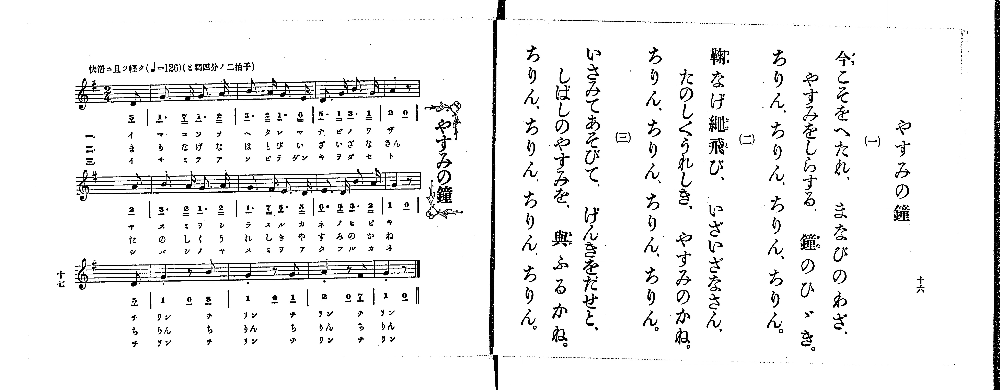

# やすみの鐘

> Re:Shōka 使用 AI 協助辨識與重建樂譜，可能會有錯誤。歡迎回報。

- **鋼琴伴奏版**：<br><audio controls src="yasumi_no_kane.mp3"></audio>
- **NEUTRINO 歌聲合成版**：<br><audio controls src="yasumi_no_kane_neutrino.mp3"></audio>

- 出處：共益商社樂器店《唱歌教科書 生徒用 巻一》第十六～十七頁（第八曲）
- NDL Digital Collections PID 854862（https://dl.ndl.go.jp/pid/854862）掃描 P010.jpg

## 說明

原書資訊與歌詞全文（NDL PID 854862《唱歌教科書 生徒用 巻一》第十六～十七頁，掃描 P010.jpg）：
調性與拍號：と調四分ノ二拍子（G 大調 2/4 拍），♩=126，「快活ニ且ツ輕ク」，弱起半拍（八分音符）
註記：第二學期第一曲（全卷第八曲）。樂譜頁與歌詞頁標題皆作「やすみの鐘」，卷首目次作「休みの鐘」。分節歌，三節同一旋律（譜下配字一、三節印片假名，二節印平假名）。全曲三行各以八分音符弱起開始，以四分音符加八分休止符收尾（與次行弱起合成完整小節）；第三行「リン」之四分音符五線譜附斷音記號（staccato dot）。五線譜與簡譜一致。


## 歌詞

```text
一、
今こそをへたれ、まなびのわざ、
やすみをしらする、鐘のひゞき。
ちりん、ちりん、ちりん、ちりん。

二、
鞠なげ繩飛び、いざいざなさん、
たのしくうれしき、やすみのかね。
ちりん、ちりん、ちりん、ちりん。

三、
いさみてあそびて、げんきをだせと、
しばしのやすみを、與ふるかね。
ちりん、ちりん、ちりん、ちりん。
```

## ABC

```abc
X:1
T:やすみの鐘
M:2/4
L:1/16
Q:1/4=126
K:G
V:V1 name="Piano" snm="Pia"
[V:V1]
z2 z2 z2 D2 | G3 F G3 A | B3 A G3 E | D3 G B3 G |
w: 1.~い | ま こ そ を | へ た れ ま | な び の わ
w: 2.~ま | り な げ な | は と び い | ざ い ざ な
w: 3.~い | さ み て あ | そ び て げん | き を だ せ
A4 z2 A2 | B3 A G3 A | G3 F E3 D | E3 D B3 A |
w: 1.~ざ や | す み を し | ら す る か | ね の ひ び
w: 2.~さん た | の し く う | れ し き や | す み の か
w: 3.~と し | ば し の や | す み を あ | た ふ る か
G4 z2 D2 | G4 z2 B2 | G4 z2 G2 | A4 z2 F2 |
w: 1.~き ち | りん ち | りん ち | りん ち
w: 2.~ね ち | りん ち | りん ち | りん ち
w: 3.~ね ち | りん ち | りん ち | りん ち
G4 z2 z2 |
w: 1.~りん
w: 2.~りん
w: 3.~りん
```

## TMD 檔案連結

- [主旋律 TMD 檔案](yasumi_no_kane.tmd) [[在 TMD Studio 編輯](https://tmdlang.github.io/Tmd-TS/#tmd=s7IKdvYPcrWy4qpTUCpJTLdSSM7PyUlNLsnMz7PKrsxPzc6ML87Iz05Ugisoy88pzU21yk7MizeMtzA1sTAzQkgW55cWJadaFSdn5OfnxJekVpQk5edno8vHFySmp1oFGBgaIGQKivLLUvMS84C6C4oy80pSU8DaEQpSyzJTUkHSxclAq8tSizLTMlNTkNyVWlQMcjXUipKixLzi5KLMApBXEKrSU_OKUq2SMzJzUopS8-KL8_PSEZJp-UW5VsUlRfkFGZnJCOGSjFSgh6F-yslMS8WQKsgvQnJpflFmemaeVW5qZlYmUhhoaSk8bmp53DjzceP-x43rXk6YoaClxaVoq2BoZMZlb6vgzmVjpG9iBzLmafuuFzOnvt8z62nrxuezu55ObXu-ZN-zFU1PZ654umv644aup1M2Plvb82zqzOfLJz6bvUPh-ZT5T_dNej5lhcLT7buf7Gh43ND9fM2ap72NT1vXvt87D8h4sqP55YLG93s6QOKtq5_N3vR-TyfYzX4uPgouQBeXJOYoOMNjv1ghwNNFARK_QF0ZJSUFxVb6-ik5enlAnJ6vl1WgX5CZog9T0fmsr_lZf78CKFaBcsBQ5dLXUrClFuBSUFB42jcf6NcXm9tfrOh60dEODIAXK-c9bV3xbFo70IUgbyCcTFEY9aD5Beg7YFyAnPBi1f5nDctBlnf3vpg5Hyj6uHEFUPDp7NlPO9oeN_c92dUDlHq6dgLQRe4KT5csB0oqAKNVASgKNqbn0cyVtsAYB7IeN_Q83b_62Zbdj5u7n-yY8ri55cWeqY-b1j9uACrtebpn44ut25_2doF1dgDjDGjDy_mbn69ZBjQI7JgVu1-smAF0A9AbQHufrt3xbM58EHtHAzh6gXpWPO3djhzhjxuagMnoxdo5QH_CgxDIfrZi5suFPc9ntT3ZOwfoLLR0CnVQ7_aXy6Y9n73u2ZqFEGVP9kxEVgM0HOjE5-sbgMYC1T_Z0QlkP50AZDQ8m979dF830ElAq5_s6H7ZCgyi6eA4AAY6WFnvhued7U8b259OANkF9A5E8OnOzTBBkONBsT17E1DLi4U9Tye0PNm9FDlcIEH2clr30-VAu3pAsuB4gcp2LYAoBjr72dpFQJFnU7Y93bAP5CpgUKxZCDITEugTOp51THi6Dph4tjzd0A90CTjqZoPDFmQ1KIiaVz1u3gz09ZOd3ci2PNk15fn2WaAQntnybNp2oCAwjsBJpaO4JDE5ObEkXyElvwTiHbhioAOeb1gIDpyGF-1bgFJcoBiGhBCYtbvrcePkx41zHzdNety443Hj_MdNQGc0Pm7c97hx1ePGzcBYeNzU_7hxGlQDIgpBGqY_buoEcZu6gdKg2AKqbtz0uGne40ZQtIE1NC583NT1uGky2FSCbKgDd4EcAWK9nLcA7JBJz3eufLl4NshFIPVAR0yDkUBZYPIGmQOxbz7YFdMfNwKd3QbyDogNdE4jcvJ73Nj9uHEtRW7cAQxqqJVAc6eCzV32uLEJFJqggFsG1jUJpAVoPSi4gF4B-mAFXBvQXRvAJDCMkYK1AZSHHjduBQUrRc4E6qG8iIQCBS19Lq7IxOLS3Ey_fO_EPGBFm5mYl-9Qo2tYUw2yScHG0EzLDswCltAakCSvCUwwSxRqFB43zwOyNgPxXiB7E1hkBpC3H0ivAcuCRLqAeDIQ9wHxepBI0zYFjcfNSzRBloMMrlEwUNCFY9N4IFGjYAgkdRXM46EMI6CQMZQFETGLBwqBFesCRSByhkAhIzALYhaIXQO2w8ewRgGkFoaBsQu2BpglwKqB-QWI50LYTZPAMjugMvOBIj1Q9j6wzCooD-j1xnVQPf1gmWlQ28F2NIHtgNhvhG4_yF5QYHRBzVoFxJPgbJBZ66G8FWCbIOwWJFtAPAQbogeUZ5CdAHQ83AnGuIJgKtQIYLw1LoOym8Ay0AABexQmA0r7YMleeGgBMwFUcjZYZgWKE6bDnQBMQo-bdgLTATBIgenlcdN2cApZCRVdDaRXg0V6oekFaDQw7YCCaS0ozTQipRnU1ABKH_AkA0waIBYwcdQgsWEaYAqRkxs8jQDzKyIwgD6DsKeDndAJ5c0Esruh7G6wf9dCeeuAeBM8yBBhBAuJhQi7gOkBnnaA5gPLNSi7DWwXLL2BZGDhDIl7JPfB9SO7AotdwIgHlklIJsLSLIaJcB9Doh-UeEC8rTh8jGkXKIbBlR2QagRHJQEOPD6RIwUUVagiIDZq3gbGM7oiEEaKSnCJielOakggJRpQRNLHJlA00tymWi4uXTsF5CpBAchX5gIA)]
- [鋼琴伴奏 TMD 檔案](yasumi_no_kane_piano.tmd) [[在 TMD Studio 編輯](https://tmdlang.github.io/Tmd-TS/#tmd=s7IKdvYPcrWy4tLSUnjc1PK4cebjxv2PG9e9nDDj_Z6Ol917nk_Y8mTPlqdL-593drzf06mgpcWlaKtgaGTGZW-r4M5lY6RvYsdVp6D0tH3Xi5lT3--Z9bR14_PZXU-ntj1fsu_ZiqanM1c83TX9cUPX0ykbn63teTZ15vPlE5_N3qHwfMr8p_smPZ-yQuHp9t1PdjQ8buh-vmbN097Gp61r3--dB2Q82dH8ckEj0Bkg8dbVz2ZvAjpACWSZn4uPgktmemZJYo6Cc35OTmpySWZ-XrFCgKeLgoWpiYWZEVBXRklJQbGVvn5Kjl4eEKfn62UV6BdkpujDVHQ-62t-1t-vEGBgaACUS1fi4opMLC7NzfTL907MS7UKyEzMyw_ycKjRNayp5lIAAhtDMy07MEtfS0Hj6Z6NL7Zu1wSG2xKFGoXHzfOArM1AvBfI3gQWmQHk7QfSa8CyIJEuIJ4MxH1AvB4k0rRNQeNx8xJNBS19sME1CgYKunBsGg8kahQMgaSugnk8lGEEFDKGsiAiZvFAIbBiXaAIRM4QKGQEZkHMArFrwHb4GNYogNTC8OPGFrA1jxv3gVU_bgQ6sXEuhN00CSyzAyozHyjSA2XvA8usgvKAXm9cB9XTD5aZBrUdbEcT2A6I_Ubo9oPsBQVGF9SsVUA8Cc4GmbUeylsBtgnCbkGyBcRDsCF6pj5umozsBKDj4U4wxhUEU6FGAOOtcRmU3QSWgQYI2KMwmUkgK0CSvfDQety4ACo5GyyzAsUJ0-FOACahx007gekAGKTA9PK4aTs4hayEiq4G0qvBIr3Q9AI0Gph2QMG0FpRmGpHSDGpqAKUPeJIBJg0QC5g4apDYMA0whcjJDZ5GgKUBIjCAPoOwp4Od0AnlzQSyu6HsbrB_10J564B4EzzIEGEEC4mFCLuA6QGedoDmP27sh7LbwHbB0htIBhbOkLhHch9cP7IrsNgFjPjHjRuQTISlWQwT4T6GRD8o8YB4W3H4GNMuUAw3r3rcDEwwzY3gqCTAgccncqSAogpVBMRGzdvAeEZXBMJIUdnUhZ4ZwO6khgRSogFFJH1sAkUjzW2qxVYj-KDUCCaICuFFX9fL9t6nrTtezm6F1JlIERqvEG0YC2SAimkg2zQeCwemCKoHt0IcHEy7sDOx6TCAeFfXTgHZx9E-QC0YYkZYxIzBYspcAA)]

## 分析

```text
================================================================================
📊 TMD Song Profile: [ やすみの鐘 ]
================================================================================
⏱  Duration:       0:11 (11.4s), 12 measures total
🎼 Key & Tempo:    首調基準 G, != 126.0 BPM, <2/4>
   - 分析範圍：      由實際發聲的音符與和弦推測調性；播放脈絡另行呈現
🎤 人聲音域:    D4 (MIDI 62) – B4 (MIDI 71) [跨度: 9 個半音 / 0.8 個八度, 難度: easy]
   - 最低音:  D4 in [YasumiNoKane #1 @ m.1, 0:00]
   - 最高音: B4 in [YasumiNoKane #1 @ m.3, 0:01]
   - 適合: soprano, mezzo-soprano, contralto, tenor, baritone, bass
🏛  結構:      YasumiNoKane (11.4s)
⚡ 編曲密度:        Peak 1 軌道同時演奏
🗝  調性診斷：       G 大調（純淨自然大調，未偵測到可信轉調）
   - 風格氣質:    純淨自然大調（陽光明朗、易唱易記，無明顯調外色彩）
   - 轉調歷程:    全曲維持單一推測調性（未偵測到可信轉調）
   - 核心骨幹音:  G, A, B, D, E
   - 調性數值:    G 大調 [相關度: 0.84, 穩定度: High, 自然音純度: 100.0%]
   - 候選調性 (K-S): G 大調 (0.84), E 小調 (0.61), G 小調 (0.53)
   - 五度圈歷程:   +1
   - 各段落調性細節:
     • [YasumiNoKane #1]: G 大調 (r: 0.84, 自然音純度: 100.0%)

  [ 五度圈游移軌跡 ]
               C  
         F           [G ]*
      Bb               D  
      Eb               A  
         Ab           E  
            Db       B  
               F# 
     (* = active key center)

  [ 十二半音累積音高分佈 ]
     C  :                            0.0%
     C# :                            0.0%
     D  : ██████                    10.7%
     D# :                            0.0%
     E  : █████                      8.3%
     F  :                            0.0%
     F# : ███                        4.8%
     G  : ████████████████████████  41.7%
     G# :                            0.0%
     A  : ██████████                17.9%
     A# :                            0.0%
     B  : ██████████                16.7%
--------------------------------------------------------------------------------
Assignment 軌道音域：
  - Piano         : D4 – B4 (9 個半音 / 0.8 個八度, 36 個音符)
================================================================================
```


## 原書掃描頁




