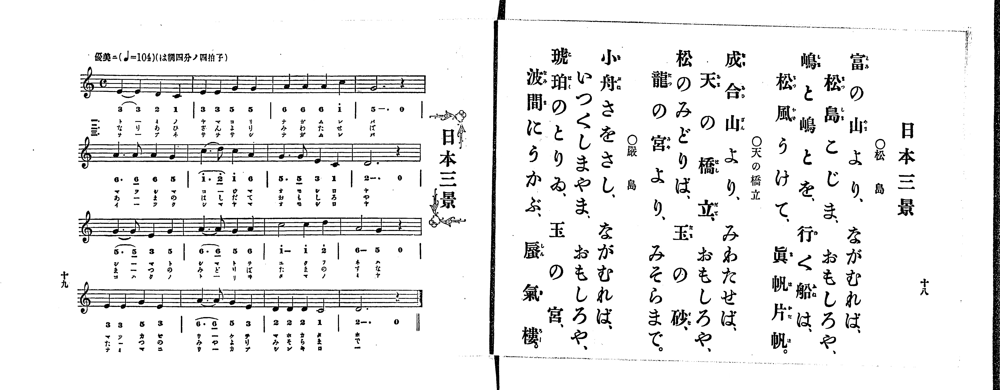

# 日本三景

> Re:Shoka 使用 AI 協助辨識與重建樂譜，可能會有錯誤。歡迎回報。

<audio controls src="nihon_sankei.mp3"></audio>

- 出處：共益商社樂器店《唱歌教科書 生徒用 巻一》第十八～十九頁（第九曲）
- NDL Digital Collections PID 854862（https://dl.ndl.go.jp/pid/854862）掃描 P011.jpg

## 說明

原書資訊與歌詞全文（NDL PID 854862《唱歌教科書 生徒用 巻一》第十八～十九頁，掃描 P011.jpg）：
調性與拍號：は調四分ノ四拍子（C 大調 4/4 拍），♩=104，「優美ニ」
註記：第二學期第二曲（全卷第九曲）。分節歌，三節同一旋律，右頁各節標題分別標為「○松島」「○天の橋立」「○嚴島」（譜下配字標一、二、三）。第一、六、九、十、十四小節首二音印有圓滑線（供七音字句一字唱二音，八音字句如第二節「なりあひざんより」「あまのはしだて」「みどりのまつば」則一音一字）。全曲採五聲音階（1、2、3、5、6），第二樂句（第八小節）與末樂句（第十六小節）均收於「2」（D4），五線譜與簡譜完全一致。

## 歌詞

```text
○松島
富の山より、ながむれば、
松島こじま、おもしろや、
嶋と嶋とを、行く船は、
松風うけて、眞帆片帆。

○天の橋立
成合山より、みわたせば、
天の橋立、おもしろや、
松のみどりば、玉の砂、
龍の宮より、みそらまで。

○嚴島
小舟さをさし、ながむれば、
いつくしまやま、おもしろや、
琥珀のとりゐ、玉の宮、
波間にうかぶ、蜃氣樓。
```

## ABC

```abc
X:1
T:日本三景
M:4/4
L:1/16
Q:1/4=104
K:C
V:V1 name="Piano" snm="Pia"
[V:V1]
E4 E4 D4 C4 | E4 E4 G4 G4 | A4 A4 A4 c4 | G12 z4 |
A6 A2 A4 G4 | c6 d2 c4 A4 | G6 G2 E4 C4 | D12 z4 |
G6 G2 E4 G4 | A6 A2 G4 A4 | c8 c4 d4 | A8 G4 z4 |
E4 E4 G4 E4 | A6 A2 G4 E4 | D4 D4 D4 C4 | D12 z4 |
```

## TMD 檔案連結

- [主旋律 TMD 檔案](nihon_sankei.tmd) [[在 TMD Studio 編輯](https://tmdlang.github.io/Tmd-TS/#tmd=s7IKdvYPcrWy4qpTUCpJTLdSSM7PyUlNLsnMz7PKrsxPzc6ML87Iz05Ugisoy88pzU21yk7MizeMtzA1sTAzQkgW55cWJadaFSdn5OfnxJekVpQk5edno8vHFySmp1oFGBgaImQKivLLUvMS84C6C4oy80pSU8DaEQpSyzJTUkHSxclAq8tSizLTMlNTkNyVWlQMcjXUipKixLzi5KLMApBXEKrSU_OKUq2SMzJzUopS8-KL8_PSEZJp-UW5VsUlRfkFGZnJCOGSjFSgh3MS81KAVhekoksU5CQmYwjmJZaUFmGIlieWpBYpcWlpKTybvvTZnDVPdnQ-m7leQUuLS9FWwdDAhMveVsGZy8ZE38QOpPNp-64XM6e-3zPraevG57O7nk5te75k37MVTU9nrni6a_rjhq6nUzY-W9vzbOrM58snPpu9Q-H5lPlP9016PmWFwtPtu5_saHjc0P18zZqnvY1PW1e_3zsPyHiyc-7LBY3v93QAxYHsZ7M3vd_TCXamn4uPgktmemZJYo6CMzwRFCsEeLooQKIZqCujpKSg2EpfPyVHLw-I0_P1sgr0CzJT9GEqOp_1NT_r71cARS5QDhi4XPpaCrbUAlwKCgpP--YD_fpic_uLFV0vOtqBAfBi5bynrSueTWsHuhDkDYSTKQqjHjS_AH0HjAuQE16s2v-sYTnI8u7eFzPnA0UfN64HCj6dPftpR9vj5j4gAyj1dO0EoIucFZ4uWQ6UVABGqwJQFGxMz6OZK22BMQ5kPW7oedqy6vm-vsfN3Y8besHmr9j9YsUMoLGgWNrV83Ttjmdz5kPY4BjrAHr3ae925Dh83NAEtPr5-gagZ4GGAlMWkP10ApDR8Gx699N93UDBp_2bgR57OqEFpGzFzJcLe4BannYsBbKfN-0CuuPR9O5nc_c93bwN6A4I9-mSlY8b1z1b2f18NchxUMFZWyBqgC55sXbOkx3dL1uBnp0ONAccoI1Ad4LIHUCPghwGcidY_GnrWpD4zrkgdm8jhAQF2oZ-oJNeLpsG1Phy_uanvRuezel8Omfys90Tn2-fBbTlyb7ZT3Y0g6TWTn_avxRoGogxZSNEPchrravhsk-XgW3c1QM0E-jgx42rHjd1PW5sety46XHjtMdNkx83dYBEwN4Bi-8D-hEYg48bpz9uXPC4cRlMav_jxpVgvUBZoJoljxs3AKWedrYDHQC0DuIMaOADE-DsTc_6Fj7ZNeVF4yag7MtZfUCXGwI9CUyGjcZAbArEZpDoh0YmMC_3L4XkRqAPIMEAVABKWXNWo8iC0udauIKnc9ufTdn2bNoeoDOBpoMiwgWYlkAmA-0HhhkwWoCGPN-wEMh4ug4YPCuAjn3RvgXoUi5QCoPHNDhHrQf6dd3TjRthAdMICrPGnsdNDY-bgFJATzeC1EHTRuPkx40zQAECUtf1uAkYgNMfN_U-bmqBqnu6rftx4woI-bhpElD0xUKgMf0vOnaCQhlu2MtFKx43tj1unAgO8sbnc-Y93dH2vLMdSCK5EzkJgjV2THg6oQPVtfsfN_U_bpz_uHE2wrWoSReHU4GuAMcuPKZBup_3dQIFny9ogip6ua8XFD7r1qHY2Dj3cRNQHVD_cmTXgvMG2P4NQA8DnTQVFARAEmgzroB93NgCTl1APwBT4D6Q8_AE7_MJS5_3N4CdDQxeoIoJcDeD3Aj12OZFL6cBI2o1OISBMQHMr40v5jQ_27D42YrJIAcDFVFeIEOBgpY-F5dfZkZ-XnBiXnZqplVAZmJevkONQY1CNcgiBRsLLTswA1gbPG7uAOI9QDwfiPsUaoDkEiCeB8QrgHgVWKRL4XHTGiC9AIjXgEUmgGwBmVGjYKygC8ZGQGwIxAgRUyiuUTADkjBsGAcWAknAoAFIBOEkkOUtEGc1bQdbBxRp2gwV2QEXWQWkF8HVrAU7He4skFUgC0E0xBFgi4HujIOwQBIwZ5iC3QtxPcgf2B0GtAgSViAHdoAsBYuAeCBRsEjzJiBeBpRZD6SngkV6gbgf4TBkGxGhA3IPiAdxFdSp0MACuhihDKIJe4g1rQbiPWCHAZ0ADq2NQLoNFmLNs6Fq9oNFZmNGIshsEI3qKIgIKGBgGFdQ1XJx6dopIKU-BSBXmQsA)]
- [鋼琴伴奏 TMD 檔案](nihon_sankei_piano.tmd) [[在 TMD Studio 編輯](https://tmdlang.github.io/Tmd-TS/#tmd=s7IKdvYPcrWy4tLSUng2femzOWue7Oh8NnP9-z0dL7v3PJ-w5cmeLU-X9j_v7Hi_p1NBS4tL0VbB0MCEy95WwZnLxkTfxI6rTkHpafuuFzOnvt8z62nrxuezu55ObXu-ZN-zFU1PZ654umv644aup1M2Plvb82zqzOfLJz6bvUPh-ZT5T_dNej5lhcLT7buf7Gh43ND9fM2ap72NT1tXv987D8h4snPuywWNQGcAxYHsZ7M3AR2gBLLMz8VHwSUzPbMkMUfBOT8nJzW5JDM_r1ghwNNFwcLUxMLMCKgro6SkoNhKXz8lRy8PiNPz9bIK9AsyU_RhKjqf9TU_6-9XCDAwNATKpStxcfllZuTnBSfmZadmWgVkJublB3k41BjUKFRz2Vho2XEpAIG-lsLj5g4g3gPE84G4T6EGSC4B4nlAvAKIV4FFuhQeN60B0guAeA1YZIKClj7YjBoFYwVdMDYCYkMgRoiYQnGNghmQhGHDOLAQSAIGDUAiCCeBLG-BOKtpO9g6oEjTZqjIDrjIKiC9CK5mLdjpcGeBrAJZCKIhjgBbDHRnHIQFkoA5wxTsXojrQf7A7jCgRZCwAjmwA2QpWATEA4mCRZo3AfEyoMx6ID0VLNILxP0IhyHbiAgdkHtAPIiroE6FBhbQxQhlEE3YQ6xpNRDvATsM6ARwaG0E0m2wEGueDVWzHywyGzMSQWaDaFRHQURAAQPDuIKqFkvC84ElPJBVNiaIxPeir-tle-_T1h0vZ7dCcibCQYbxCtGGsQqm8UDaND4WKAIXg1IQ79comAC5JrEwihR1cMNhYqh2w_Qjq0S4B6daNHvw-AeqBM2dOE1EU4fFTSi6DSDRoWungBQjCkCuMhcA)]

## 分析

```text
================================================================================
📊 TMD Song Profile: [ 日本三景 ]
================================================================================
⏱  Duration:       0:36 (36.9s), 16 measures total
🎼 Key & Tempo:    首調基準 C, != 104.0 BPM, <4/4>
   - 分析範圍：      由實際發聲的音符與和弦推測調性；播放脈絡另行呈現
🎤 人聲音域:    C4 (MIDI 60) – D5 (MIDI 74) [跨度: 14 個半音 / 1.2 個八度, 難度: moderate]
   - 最低音:  C4 in [NihonSankei #1 @ m.1, 0:01]
   - 最高音: D5 in [NihonSankei #1 @ m.6, 0:12]
   - 適合: soprano, mezzo-soprano, contralto, tenor, baritone, bass
🏛  結構:      NihonSankei (36.9s)
⚡ 編曲密度:        Peak 1 軌道同時演奏
🗝  調性診斷：       G 大調（純淨自然大調，未偵測到可信轉調）
   - 風格氣質:    純淨自然大調（陽光明朗、易唱易記，無明顯調外色彩）
   - 轉調歷程:    全曲維持單一推測調性（未偵測到可信轉調）
   - 核心骨幹音:  G, A, D, E, C
   - 調性數值:    G 大調 [相關度: 0.76, 穩定度: Moderate, 自然音純度: 100.0%]
   - 候選調性 (K-S): G 大調 (0.76), C 大調 (0.70), A 小調 (0.66)
   - 五度圈歷程:   +1
   - 各段落調性細節:
     • [NihonSankei #1]: G 大調 (r: 0.76, 自然音純度: 100.0%)

  [ 五度圈游移軌跡 ]
               C  
         F           [G ]*
      Bb               D  
      Eb               A  
         Ab           E  
            Db       B  
               F# 
     (* = active key center)

  [ 十二半音累積音高分佈 ]
     C  : ███████████████           15.8%
     C# :                            0.0%
     D  : ██████████████████        19.2%
     D# :                            0.0%
     E  : ████████████████          16.7%
     F  :                            0.0%
     F# :                            0.0%
     G  : ████████████████████████  25.0%
     G# :                            0.0%
     A  : ██████████████████████    23.3%
     A# :                            0.0%
     B  :                            0.0%
--------------------------------------------------------------------------------
Assignment 軌道音域：
  - Piano         : C4 – D5 (14 個半音 / 1.2 個八度, 52 個音符)
================================================================================
```


## 原書掃描頁




