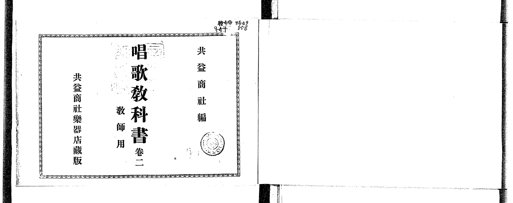
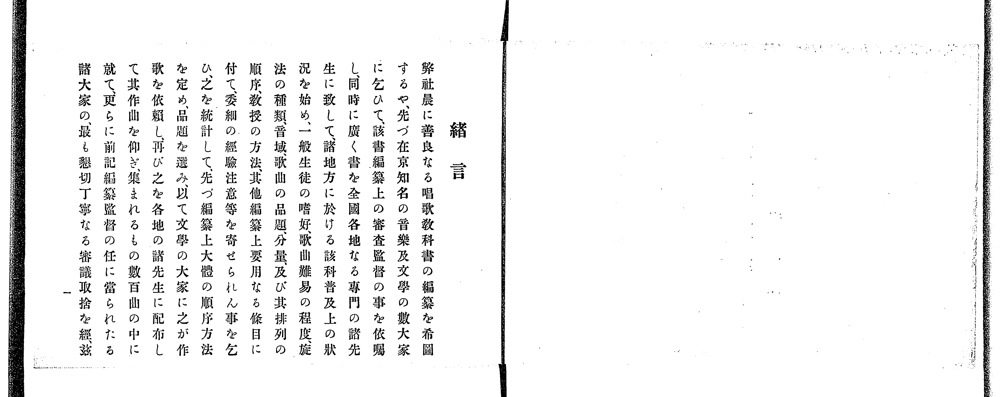
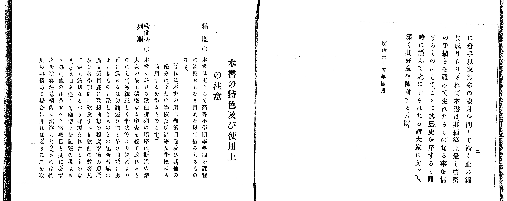
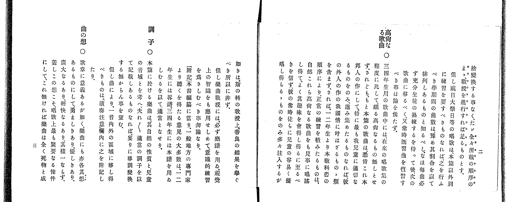
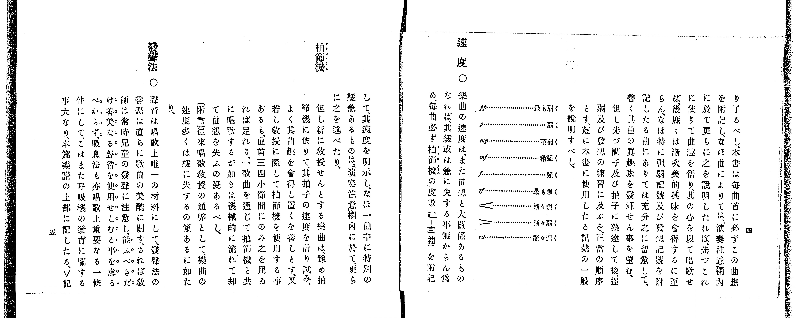
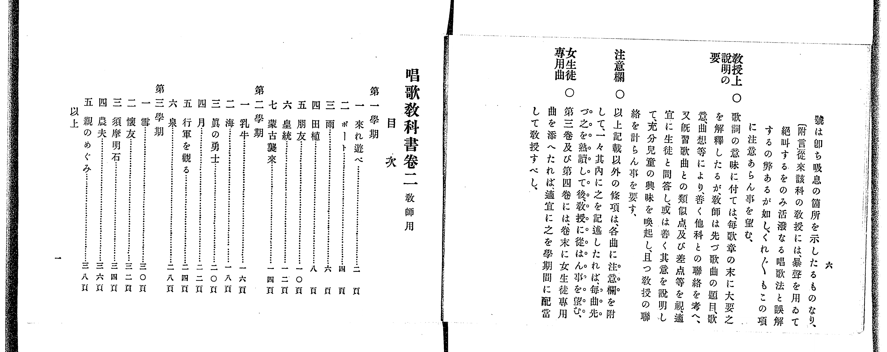
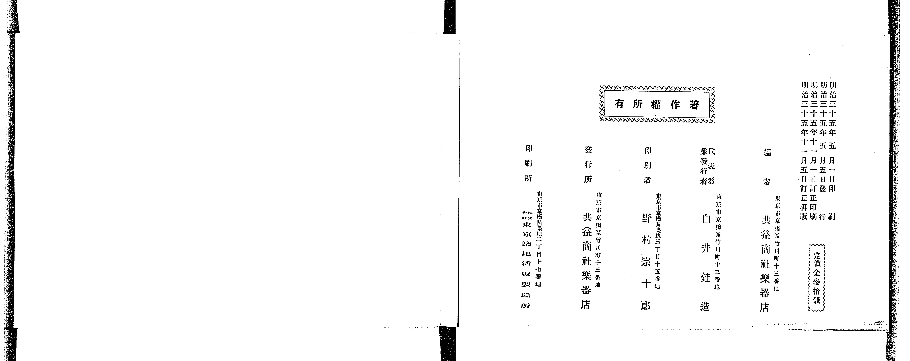
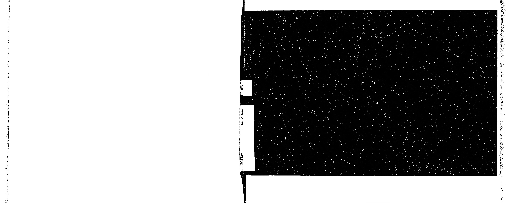
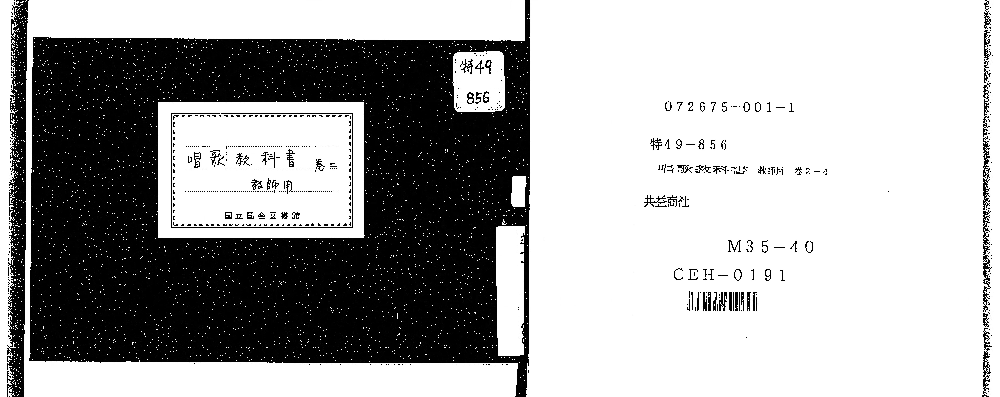

# 書訊與卷首／卷末掃描頁 — 《共益商社唱歌教科書》 巻二・教師用（NDL PID 854863）

本頁收錄本冊之封面、扉頁、目次（もくろく）、樂典大要、版權頁與封底等原書掃描圖檔（共 9 頁）。

### P001.jpg

本冊封面（左頁），題「共益商社編 唱歌教科書 卷二 教師用 共益商社樂器店出版」。

### P002.jpg

「緒言」（第 1 頁）與「本書の特色及び使用上の注意」（第 2 頁，說明五線譜與數字簡譜並列、選曲、拍子與發音指導原則）。

### P003.jpg

「本書の特色及び使用上の注意」續頁（第 3–4 頁，說明調子、音程及明治三十五年四月編者識語）。

### P004.jpg

「發音圖解」（第 5 頁，圖示ア、イ、ウ、エ、オ五母音口形與「頭聲」「胸聲」發聲解說）與「速度」（第 6 頁，說明 Maelzel 拍節機度數與垂錘繩長簡易代用法）。

### P005.jpg

「速度」續頁與「唱歌教科書卷二（教師用）目次」（列出第一～三學期共 18 首曲名與頁碼）。

### P006.jpg

「演奏上一般の注意」（第 1 頁，說明教師範唱、發聲呼吸、姿勢、伴奏樂器與節奏指導原則）。

### P026.jpg

版權頁（右頁）：標明「明治三十五年五月一日印刷、明治三十五年五月五日發行、明治三十五年十一月一日訂正印刷、明治三十五年十一月五日訂正再版」、「編者 共益商社樂器店」、「代表兼發行者 白井銈造」、「印刷者 野村宗十郎」、「定價金參拾錢」。

### P027.jpg

封底裏留白與封底外頁。

### P028.jpg

日本國立國會圖書館（NDL）書標與微縮數位化資訊卡（書號 特48-941）。

