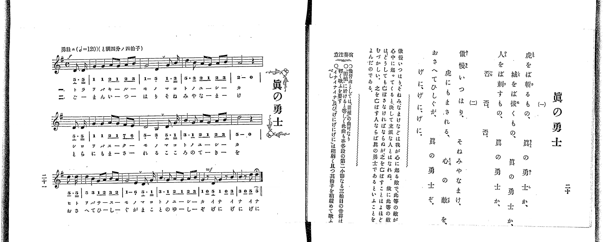

# 眞の勇士

> Re:Shoka 使用 AI 協助辨識與重建樂譜，可能會有錯誤。歡迎回報。

<audio controls src="makoto_no_yushi.mp3"></audio>

- 出處：共益商社樂器店《唱歌教科書 教師用 巻二》第二十～二十一頁（第十曲）
- NDL Digital Collections PID 854863（https://dl.ndl.go.jp/pid/854863）掃描 P016.jpg

## 說明

原書資訊與歌詞全文（NDL PID 854863《唱歌教科書 教師用 巻二》第二十～二十一頁，掃描 P016.jpg）：
調性與拍號：ト調四分ノ四拍子（G 大調 4/4 拍，譜上記 C），♩=120，「勇壯ニ」，弱起一拍（附點八分音符加十六分音符）
註記：單聲部，分節歌二節（譜下配字二行：一＝片假名、二＝平假名）。原書右頁「眞」字振假名確作「まこと」，譜下亦作「マコト／まこと」。全曲三段共十三小節（含首尾不完全小節），開頭標 f，各段第二小節第三拍後有換氣記號（v），末二小節（「イナ、イナ、イナ／げに、げに、げに」）標 mf，末音（D5）附延長記號（fermata）。五線譜與簡譜逐音核對一致。
原典演奏注意：〇豫習曲としては「田植」の曲可なり。〇「田植」に於けると等しく此曲も亦各段の第二小節なる三拍目の音符は軽く歌ふを要す。〇「イナイナイナ」及び「げにげにげに」は稍弱く且つ其拍子を稍緩めて歌ふべし。
原典曲意：「傲慢、いつはり、そねみ、なまけなどは我が心に起る敵で、此等の敵が心中に起ってくると、決して立派な人とはなれぬ。故に此等の敵は、どうしても亡ぼさなければならぬが、之を亡ぼすことはよほどむづかしい。之を亡ぼす人ならば眞の勇士であるといふことをよんだのである。」

## 歌詞

```text
一、
虎をば斬るもの、眞の勇士か、
城をば拔くもの、眞の勇士か、
人をば刺すもの、眞の勇士か、
否、否、否。

二、
傲慢いつはり、そねみやなまけ、
虎にもまされる、心の敵を、
おさへてひしぐが、眞の勇士ぞ。
げに、げに、げに。
```

## ABC

```abc
X:1
T:眞の勇士
M:4/4
L:1/16
Q:1/4=120
K:G
V:V1 name="Piano" snm="Pia"
[V:V1]
!f! z4 z4 z4 D3 D | G4 G4 A2 G2 A2 B2 | G8 D4 G3 B | d6 B2 A2 G2 A2 B2 |
A8 z4 D3 D | G4 G4 A2 G2 F2 E2 | D8 B,4 D3 G | B6 G2 A2 G2 A2 B2 |
d8 z4 d3 d | d4 B4 G2 A2 B2 A2 | G8 E4 D3 G | B6 G2 A2 G2 A2 B2 |
!mf! G4 z2 D2 G4 z2 B2 | B4 z2 d2 d4 z4 | !f! z4 z4 z4 D3 D | G4 G4 A2 G2 A2 B2 |
G8 D4 G3 B | d6 B2 A2 G2 A2 B2 | A8 z4 D3 D | G4 G4 A2 G2 F2 E2 |
D8 B,4 D3 G | B6 G2 A2 G2 A2 B2 | d8 z4 d3 d | d4 B4 G2 A2 B2 A2 |
G8 E4 D3 G | B6 G2 A2 G2 A2 B2 | !mf! G4 z2 D2 G4 z2 B2 | B4 z2 d2 d4 z4 |
```

## TMD 檔案連結

- [主旋律 TMD 檔案](makoto_no_yushi.tmd) [[在 TMD Studio 編輯](https://tmdlang.github.io/Tmd-TS/#tmd=s7IKdvYPcrWy4qpTUCpJTLdSSM7PyUlNLsnMz7PKrsxPzc6ML87Iz05Ugisoy88pzU21yk7MizeKtzA1sTAzRkgW55cWJadaFSdn5OfnxJekVpQk5edno8vHFySmp1oFGBiaIWQKivLLUvMS84C6C4oy80pSU8DaEQpSyzJTUkHSxclAq8tSizLTMlNTkNyVWlQMcjXUipKixLzi5KLMApBXEKrSU_OKUq2SMzJzUopS8-KL8_PSEZJp-UW5VsUlRfkFGZnJCOGSjFSgh1Nz8yFGaWkpPJ8z73Hjuqfd7U8Xr1bQ0uJStFUwNDLgsrdVcOeyMdE3sQPpfdq-68XMqe_3zHrauvH57K6nU9ueL9n3bEXT05krnu6a_rih6-mUjc_W9jybOvP58onPZu9QALKe7lj9fMoKhafbdz_Z1fO4ofv5mjVAxtPexvd750EYT3Y0vFzQ-H5PB1AKyH02e9P7PZ1gt_q5-Ci4ZKZnliTmKDjDY7FYIcDTRQEST0BdGSUlBcVW-vopOXp5QJyer5dVoF-QmaIPU9H5rK_5WX-_Aih2gHLA0OHS11KwpRbgUlBQeNo3H-jdF5vbX6zoetHRDgyDFyvnPW1d8WxaO9CFIG8gnExpMPWgeQfoQWCMgFzxYtX-Zw3LQfZ3976YOR8o-ri5Ayj4dPbspx1tj5v7gAyg1NO1E4COcld4umQ5UFIBGLkKQFGgwS_Wznmyo-vFihkKzmBDex7NXGkLTAVA1uOGHnDaWP-4uftxA0jx0z0bX2zdDnQUWG_Hy5ktL3cDvbwaaNPL-Zufr1n2tGsB0NVPW9fCRYCGgp25YjfQDlAqmrbuReOml80rQMZ1tD1f3wAMFaBngQygiWDXdL9sBbp3OlDwxcIeoBagfe_3zH3e2f60sf3phN7HDY1AKaDI052bISJAOx43NEHi42n_ZmCIAZ0OStwNIHOe9ayHKHu-aNeTvXOAUo8b9z1unPy4cQXEVxBLn-xaBpVtnve4aTMwFN_v6UdWCbICGLuzNz3Z0fls3VZgdgBHUOfTDf0Qxz-dsPrlsmlPN-x7sqP36boeoGKYFChcX07rfrlg7bMVMxXSQF6f0AI0AxrhYFUgNtBgYFTt63k2p_NZ_-xnGxYDwwwcqR1lEEOezVkN1wAUBbm2acnj5i5gmKAxwI6f9LhxNUgEnQEKMZBLckFOAZoJjCqgaS6mQGFgnD7dve3l1O1wq9NSi3ITSxIhgfxk15Tn22cBQwyY4p5vWAhkvGyYANT-bMGOpxt6gTH1on0LUBk0fzxt3fFsz5SnS_ufbV7xrKUflDgb2l9sXP18_yRgOIKCtXH648ZljxvXgyJsyoZnS4Ch3Assk4CyT_vXP25c9bgJ6KUmoC5UBaufTdvzuHHi46ZuoCHP13aCzel_tnYJyNgmoCuXQQIYaBRyGIMN7IYE8_PZ64CykEQKdMCL3XvBJgATx9bHTZNeLAMG1ky41dDARSaBaau_63HjZnB6AgcrMgly5PrnK3qBOQZo7JMdUx43Lnnaug2SE4HmA6Web1_5uAloyzKopY07Qb5ACbvZm2Ch1vO0adOz1kXgOGwBmgUKMlDQALlzHzeufdy4H8xeBU6wE8GMlUA1zzqA7J6n-5uBbgLmXKDnn00F2rQcqBgYWOCAWwcWAal5sgNoDlhZ42JwrPRDwhekeOMuSFQ9X939bAvQilVPdgFFgPEHiSSgB9YAnf5saisoblBMBkYt0GFAx7RBIxsUPQsfNwLjbyrYncBYBGrfADYHqGsN0DGgLL6zGxhMMJUzobkQ5OuOx427QQY2AaNz6eNGoAuBxraA0iaqFrALIWZuQK7pQN5vbIJ6DRSYQEeCDW-aBDK8CcheAFSMUAZKBL1coGgBpm-g08Dl2cw-kPrGDc-mrQGpaWoCaWloRLUIqBes-ul8mOpuYEIABite1SCHg1U_7QD6YCYhsycsA7KQyCaIU0E1CkQBJOXgSjZNQHFYskH4DZiEQdYCRaeCogcUCo3gZASOVKDrIEofNwKzADAad4DTCzBHA6NiAiQCUV0LLIvBCRt3mQSWprxmhgIFLX0uLt_E7PySfL_8yNLijEyrgMzEvHyHGoMahWqQVQo2hmZadmBWdVotmAa2EDSA5b7C4-aVmgo1QGoTEE9QeNy0FkjvAeLVYBokswiI-4B4HlB2M1gEpA0ksgyitmk7TG3TaqCpYO5aTZCzQDbVKBgo6IIhOm0aD6NqFAyhYjDaCMoG0cZAjFABg1DdMC3GQCWmSNIgTZiGgFjIEItTYMEDD5LmHqg315MdJM2TQEqQggSXd81B7jADEUDfwDwI9xJMACpjCFQE8hYMwryK6mXkQEHxMpTE9HDTVqgndpLpYWC1AeR1gWmQWggLRMMDAOYqmPuR3QyiMeMbHCok-x5mSnVuWi3Y62DdMFGQAEQdzCSwEnjoIEKrhquWi0vXTgElnylgE1DmAgA)]

## 分析

```text
================================================================================
📊 TMD Song Profile: [ 眞の勇士 ]
================================================================================
⏱  Duration:       0:56 (56.0s), 28 measures total
🎼 Key & Tempo:    首調基準 G, != 120.0 BPM, <4/4>
   - 分析範圍：      由實際發聲的音符與和弦推測調性；播放脈絡另行呈現
🎤 人聲音域:    B3 (MIDI 59) – D5 (MIDI 74) [跨度: 15 個半音 / 1.2 個八度, 難度: moderate]
   - 最低音:  B3 in [MakotoNoYushi #1 @ m.7, 0:13]
   - 最高音: D5 in [MakotoNoYushi #1 @ m.4, 0:06]
   - 適合: soprano, mezzo-soprano, contralto, tenor, baritone, bass
🏛  結構:      MakotoNoYushi (28.0s) -> MakotoNoYushi (28.0s)
⚡ 編曲密度:        Peak 1 軌道同時演奏
🗝  調性診斷：       G 大調（純淨自然大調，未偵測到可信轉調）
   - 風格氣質:    純淨自然大調（陽光明朗、易唱易記，無明顯調外色彩）
   - 轉調歷程:    全曲維持單一推測調性（未偵測到可信轉調）
   - 核心骨幹音:  G, D, B, A, E
   - 調性數值:    G 大調 [相關度: 0.89, 穩定度: High, 自然音純度: 100.0%]
   - 候選調性 (K-S): G 大調 (0.89), D 大調 (0.75), B 小調 (0.64)
   - 五度圈歷程:   +1 -> +1
   - 各段落調性細節:
     • [MakotoNoYushi #1]: G 大調 (r: 0.89, 自然音純度: 100.0%)
     • [MakotoNoYushi #2]: G 大調 (r: 0.89, 自然音純度: 100.0%)

  [ 五度圈游移軌跡 ]
               C  
         F           [G ]*
      Bb               D  
      Eb               A  
         Ab           E  
            Db       B  
               F# 
     (* = active key center)

  [ 十二半音累積音高分佈 ]
     C  :                            0.0%
     C# :                            0.0%
     D  : ██████████████████████    28.9%
     D# :                            0.0%
     E  : ██                         3.1%
     F  :                            0.0%
     F# : █                          1.0%
     G  : ████████████████████████  31.4%
     G# :                            0.0%
     A  : ████████████              15.5%
     A# :                            0.0%
     B  : ███████████████           20.1%
--------------------------------------------------------------------------------
Assignment 軌道音域：
  - Piano         : B3 – D5 (15 個半音 / 1.2 個八度, 126 個音符)
================================================================================
```


## 原書掃描頁




