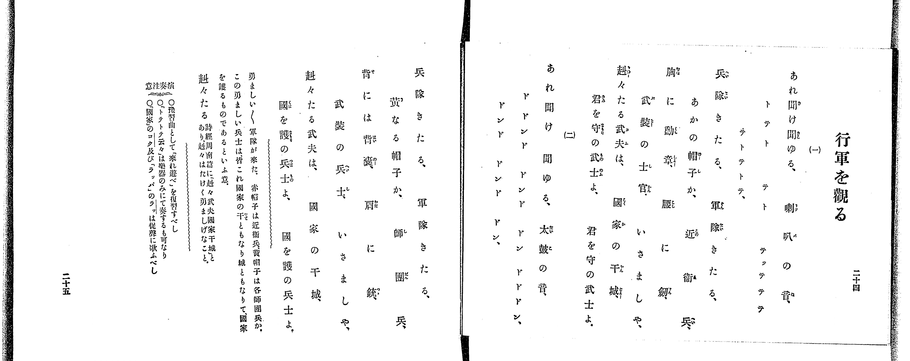
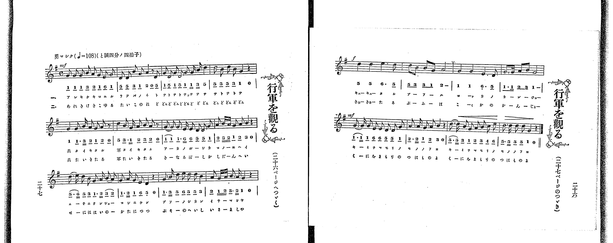

# 行軍を觀る

> Re:Shōka 使用 AI 協助辨識與重建樂譜，可能會有錯誤。歡迎回報。

- **鋼琴伴奏版**：<br><audio controls src="kogun_o_miru.mp3"></audio>
- **NEUTRINO 歌聲合成版**：<br><audio controls src="kogun_o_miru_neutrino.mp3"></audio>

- 出處：共益商社樂器店《唱歌教科書 教師用 巻二》第二十四～二十七頁（第十二曲）
- NDL Digital Collections PID 854863（https://dl.ndl.go.jp/pid/854863）掃描 P018.jpg、P019.jpg

## 說明

原書資訊與歌詞全文（NDL PID 854863《唱歌教科書 教師用 巻二》第二十四～二十七頁，掃描 P018.jpg、P019.jpg）：
調性與拍號：ト調四分ノ四拍子（G 大調 4/4 拍，譜上記 C），♩=108，「勇マシク」
註記：單聲部，分節歌二節（譜下配字二行：一＝片假名、二＝平假名，惟「兵」「軍」二字於譜下直印漢字）。本曲橫跨兩個跨頁：第二十四～二十五頁（P018.jpg）為歌詞、曲意、語釋與演奏注意；第二十六～二十七頁（P019.jpg）為樂譜，由於五線譜採橫排左起，故自左頁（第二十七頁，註明「二十六ページへつゞく」）第一至三段（第一至十二小節）唱至右頁（第二十六頁，註明「二十七ページのつゞき」）第四至五段（第十三至二十小節），全曲共二十小節。力度於第一段標 mf、第四段標 f、第五段標 mf。五線譜與簡譜逐音核對一致。
原典演奏注意：〇豫習曲として「來れ遊べ」を復習すべし。〇「トテトテ云々」は樂器のみにて奏するも可なり。〇「國家」のコク及び「ラッパ」のラッは促聲に歌ふべし。
原典曲意：「勇ましい〳〵軍隊が來た。赤帽子は近衞兵、黃帽子は各師團兵か。この勇ましい兵士は、皆これ國家の干ともなり城ともなりて、國家を護るものであるといふ意。」
原典語釋：「赳々たる」＝詩經周南篇に「赳々武夫國家干城」とあり、赳々はたけく勇ましげなこと。


## 歌詞

```text
一、
あれ聞け聞ゆる、喇叭の音、
トテトテトテトテ、テッテテテ、テトテトテ、
兵隊きたる、軍隊きたる、
あかの帽子か、近衞兵、
胸に勳章、腰に劍、
武裝の士官、いさましや、
赳々たる武夫は、國家の干城、
君を守の武士よ、君を守の武士よ。

二、
あれ聞け聞ゆる、太鼓の音、
ドドンドドンドドンド、ドドン、ドンドドンドドン、
兵隊きたる、軍隊きたる、
黃なる帽子か、師團兵、
背には背嚢、肩に銃、
武裝の兵士、いさましや、
赳々たる武夫は、國家の干城、
國を護の兵士よ、國を護の兵士よ。
```

## ABC

<div class="abc-score" data-abc-src="kogun_o_miru.abc" aria-label="五線譜載入中"></div>

[下載 ABC 原始檔](kogun_o_miru.abc)

## TMD 檔案連結

- [主旋律 TMD 檔案](kogun_o_miru.tmd) [[在 TMD Studio 編輯](https://tmdlang.github.io/Tmd-TS/#tmd=s7IKdvYPcrWy4qpTUCpJTLdSSM7PyUlNLsnMz7PKrsxPzc6ML87Iz05Ugisoy88pzU21yk7MizeKtzA1sTAzRkgW55cWJadaFSdn5OfnxJekVpQk5edno8vHFySmp1oFGBhaIGQKivLLUvMS84C6C4oy80pSU8DaEQpSyzJTUkHSxclAq8tSizLTMlNTkNyVWlQMcjXUipKixLzi5KLMApBXEKrSU_OKUq1yE4uSM9AFkzMyc1KKUvPii_Pz0hGSaflFuVbFJUX5BRmZyQjhkoxUYCjkZuZkliQWVSLE84sy0zPzrHJTM7MysQRAflFJRn56UWJBRqVVRmZxCVB5cmJOPDA0gUGspaXwYmHPi929j5smvVje8LipW0FLi0vRVsHQwILL3lbBncvGRN_EDmTY0_ZdL2ZOfb9n1tPWjc9ndz2d2vZ8yb5nK5qezlzxdNf0xw1dT6dsfLa259nUmc-XT3w2e4cCkPV0x-rnU1YoPN2--8munscN3c_XrAEynvY2Pp09-_3eeRD2kx3NLxc0vt_TAZQFcXf1PJu96f2eTrAX_Fx8FFyA_itJzFFwhieUYoUATxcFSFIAaswoKSkottLXT8nRywPi9Hy9rAL9gswUfZiKzmd9zc_6-xVACQAol_64oRHItAQxlbi49LUUbKkFuBQUFJ72zQf6_8Xm9hcrul50tAMD5cXKeU9bVzyb1g50LMhHCNdTIdx6cHsO6HNghIHc9GLV_mcNy0Gu6e59MXM-UPRxcwdQEGjg0462x819QAZQ6unaCUAnuis8XbIcKKkAjHsFoCjQjhdr5zzZ0fVixQwFZ7ChPY9mrrQFJhIg63FDz9Pu9sfN8x43bX_ctP5xQy_YwhW7gapByWXauheNm142rwAqBVr1fH0D0LdAHwAZQKvA5na_bAXaPB0oCEyMQC1PdgCl5j7vbH_a2P50Qi_QQ0ApoMjTnZshIiBPN88HWdy6FWgfkAFKwg29oIBZO_3ZtD0QY5_P3vK0d8OzPYuAgkBXP25oejZnDTBxPVu5-sX2FU9bVz5t6AYywKE4C3sY75oCSZuwwAUa87xpFyRKge4CGdbSD2S8WDXvZXs3KHz3THm6tP_Z5hVA8fd7ZiNMbV2LmeKR4glk6oomoLuBfnsOTBHT9gDtfr59FlDkWd9CoIuf9U16un3Zi63bQZ6f2vqifRWQC884aEkCGPrPZvQBwwVu-eNmYIzvedy043EjEC153DTvcSPQ4cCg7ARp39Hwon3zkx2dz9ZthRoIFoHkx6cb-sGx1QlMqiDB_s1o9gLNx2ov0D1I9q6D2QuKKoi9wLAG2btrCtxesK5OsCDYZJjVoNQDzEKzNwGLH2QpYKQ-7Zr9dNcyYIhBnA006tmKmQq5acBogVgBFYEKQGyDKWmCBzMw8p5vWAhkvGyY8HL-5mcLdjzd0AsOhi1AZdCM_bR1B2oMz3rc0P5i4-rn-ycB3fa4ccXjxumPG5eBQmBf2-OmnpeNXY8bd4LSaNOkp_tWApU9bpwJEgEqa2gC6gWqBObEx83APAgin-ya-LihFaS-cT2kcAWH2_7HjauBxgLtBWlv6n7c1PS0f_3jxlWPm7rg5jyd0_103Taw3nWPmzYD8-LTfqDtm8FWrHzcDIwLoOFgWQi3cf2T_c3AzAk0HJiiHzduhTsMybfgFA72JzibN-4D-7DlcQPQ3K3AbPdyFtAOsG8bgTmy6cXWJU937AWWI0DTX-yf-GIhsOQD5tHGl7ub4eJPJ7QAS7inc2aApBq7QR5onAx0FrL5QKmni4F-BpYnjc9nAQ2fDAxNqA-BKneCw7oJqBEUBE_n9yFzwRHQCFUMrNjWAsslUJCBg3L548YmEBcUVS1AP4PzLzAEwaUWxM-QzAzx84utQH-2gvwG1ANKtnNfrFz5fNvkpxNXPO2d_nw90MWr4cqerV32dAnQYyCLgU4EOQsU3kCbgFYCI6oRZhow6uY_bpwIzIJIfgYmjVXggFgBigGQc4CpD6gJxAKb0POiEZh7JoLIJmDiArqn8em09qf9a4EeA6ZYmFKk5IRCNjSC2cBkACTBCCqCogYcDK1bwdEKdDvE342wiEaIwFwFjD9gfECjFqwUKdbBNUEzMO-vftq9-fnqBSDp1g0gbheoWAdJA8PsxeK5IDMWr366bgbITaB4mQoNlSZgSoMYgxQRkHCGJA7kNAEOcIgPJswG5bh1HUAJkGpgUmrqAKnGLg4NblBliz-4l6x6uQeUVJGDuxOMNmNngIIYxoWysakkLdyBmQmc0ruRwx2RpWDhDszSoEACMp7OWgQyrGklUORlVzNG0EMyG5WCfg4wr4EzHdxgSNBjFweXNZQ3vKBAQUufi8s7P700z983s6jUKiAzMS_focagphpkjYKNoZmWHZhVnZtWC2YAW3-PmxYBo3ENkF4LxBuh9Gag2DIgXq1QAyRXAnEzEE8E4j4g7gXlM7BMG5iFSoNUgug2HCqArgTZXaNgqKALx8ZAbARlm8VDGTUKpiAmmAApAImBFIGgAUwCYg6YicIwBGoxhSoGGgQ1AkaDVMCMAasAu8nHEOjkxiYgH5gDQGRjL5iciMSeDJZtA5PdYLMfN3WCZRaDyY1gch2YXAs1HeQmYNEGUd24DM5DY8OMAIY8FMOcj0cTkhVIHjEiyyON88EyLQh5rB5ZCVW98nETRBFIAB8XiiECMB8RpRvTa8A0C8xBQDfvB-Il0PQKZIPTKrDIwCEDSed7gPRqaCqeA-VvB4uBVIBSPUgGJLoCSM8Am4OSXkEQQhvD0yuIBqUjSCqDyEHUgWRgKRuiAjnNg1M6OLEjkjkk2UP0GcFNh5iHPbUCKxhQfIEgJP4gMQiLZXCMguMXklkeN05AhCxxGkDJCKIKJApJFI8b98BFp8PlQKqRkk0TJLntgNqAO6HS3g8gcYiqVRAaKIvbDxDeArA6iH_w-QFUijYvgKQbcNkINLppPZAGpidgt7B5OVgKmsBAyQ2sAFjUAhWAishpQN5eqHZg8oMmSKgsOCEDkztYdh5UP1KihCQ5M7SCzQie7GDJFpKYEKkNJTnBkzQsAZuBlEExyCRIkgQlaEhShJiGI0k2NcCDdS2YXA0m-6EBPxkUwI-b2uGWQ9IMJBZgisEpB7MEAMpsg6qdCxVDFFKIOIToBKmGFGVTweQ-hC1N-FLjbLi5ELesh5OwVAayD-YeWJ6YD1e_BE4S73ZE-oL4g3S3VyPX6cAu71JIOYZgwUtCUIIDJ6epULofXvoB625o-QgSAbFA8iAZkAk7gGkZxEJLfJBkAks2MAgSQ9S76NU3DKKXqtAkCjcEUcMjl6cwtXBTkMpDYG-zFR64KBxIOQHlwas8SJyA5LfCWZC4RnYlLI2CZEGVNIQFiXvkmESkCOT0-7hxBiLBozkanOSGmKNRG5BrockEmAOaN0FKqWZQZbsKlpDAPFDFCsKgRLcCnLzI0YdWGRsiSjWcFSmstMJakUKTrilKAgWxTUBGoqiAlYf4mo698LDbDw7LSWA2KPMCu-Bgsgs51MFiED6sIADFJ7BvADUHufCgmdlI6RBSRsOLPkJ2QAs5UNqDykMrfmzup5nZXLVcXLp2CoiejwKQp8wFAA)]
- [鋼琴伴奏 TMD 檔案](kogun_o_miru_piano.tmd) [[在 TMD Studio 編輯](https://tmdlang.github.io/Tmd-TS/#tmd=s7IKdvYPcrWy4qpTUCpJTLdSyC8qychPL0osyKi0ysgsLskvykxOzInPTsxLVOLS0lJ4sbDnxe7ex02TXixveNzU_X5Px8vuPc8nbHmyZ8vTpf3POzve7-lU0NLiUrRVMDSw4LK3VXDnsjHRN7ED2fC0fdeLmVPf75n1tHXj89ldT6e2PV-y79mKpqczVzzdNf1xQ9fTKRufre15NnXm8-UTn83eoQBkPd2x-vmUFQpPt-9-sqvncUP38zVrgIynvY1PZ89-v3cehP1kR_PLBY1AxwBlQdxdPc9mbwK6RAlkq5-Lj4JLZnpmSWKOgnN-Tk5qcklmfl6xQoCni4KFqYmFmTFQY0ZJSUGxlb5-So5eHhCn5-tlFegXZKbow1R0PutrftbfrxBgYGgBlEt_3NAIZFqCmEpcXN756aV5_r6ZRaVWAZmJeflBHg41BjXVXApAYGNopmUHZlXnptWCGfpaCo-bFik8bl4DpNcC8UYovRkotgyIVyvUAMmVQNwMxBOBuA-Ie4G4AyzTBmah0iCVILoNhwotfbDdNQqGCrpwbAzERlC2WTyUUaNgCmKCCZACkBhIEQgawCQg5oCZKAxDoBZTqGKgQVAjYDRIBcwYsAqwm3wMgU5ubALyHzf1gMjGXjA5EYk9GSzbBia7wWY_buoEyywGkxvB5DowuRZqOshNjxtXQFQ3LoPz0NgwI4AhD8Uw5-PRhGQFkkeMyPJI43ywTAtCHqtHVkJVr3zcBFEEEsDHhWKIAMxHROnG9BowzT5t3Qp0834gXgJNr0A2OK0CywQcMpB0vgdIr4am4jlQ_nawGEgFKNWDZECiK4D0DLA5KOkVBCG0MTy9gmhQOoKkMogcRB1IBpayISqQ0zw4pYMTOyKZQ5I9RJ8R3HSIedhT6w5IfIEgJP4gMQiLZXCMguMXklkeN05AhCxxGkDJCKIKJApJFI8b98BFp8PlQKqRkk0TJLntgNqAO6HS3g8gcYiqVRAaKIvbDxDeArA6iH_w-QFUijYvgKQbcNkINLppPZAGpqem7Y-bl4OloAkMlNzACoBFLVABqIicBuTthWoHJj9ogoTKghMyMLmDZedB9SMlSkiSM0Mr2IzgyQ6WbCGJCZHaUJITPEnDErAZSBkUg0yCJElQgoYkRYhpOJJkUwM8WNeCydVgsh8a8JNBAfy4qR1uOSTNQGIBphiccjBLAKDMNqjauVAxRCGFiEOITpBqSFE2FUzuQ9jShC81zoabC3HLejgJS2Ug-2DugeWJ-XD1S-Ak8W5HpC-IP0h3ezVynb72cfNSSDmGYMFLQlCCAyenqVC6H176AetuaPkIEgGxQPIgGZAJO4BpGcRCS3yQZAJLNjAIEkPUu-jVNwyil6rQJAo3BFHDI5enMLVwU5DKQ2CjsBUeuCgcSDkB5cGrPEicgOS3wlmQuEZ2JSyNgmRBlTSEBYl75JhEpAjk9Pu4cQYiwaM5GpzkhpijURuQa6HJBJgDmjdBSqlmUGW7CpaQwDxQxQrCoES3Apy8yNGHVhkbIko1nBUprLTCWpFCk64pSgIFsU1ARqKogJWH-JqOvfCw2w8Oy0lgNijzPm6CtMa6kEMdLAbhwwoCUHw-buqAmoNceNDMbKR0CCmj4UUfITughRwo7UHloRU_NvfTzGyuWsyOjw9yx8cE2u8BptYXfV0v23uftu54ObsV0ldESlLxCtGGscDkA6RN42OBIljEUNVCKSSVMBEyzDQB8k1iYRRIJVwJLrUo5sI5MBNQ3UCUuZhqCYQAESpJ8Ree8AJSBpDI1rVTQMR3tA9QDk3ECCyizAUA)]

## 分析

```text
================================================================================
📊 TMD Song Profile: [ 行軍を觀る ]
================================================================================
⏱  Duration:       0:44 (44.4s), 20 measures total
🎼 Key & Tempo:    首調基準 G, != 108.0 BPM, <4/4>
   - 分析範圍：      由實際發聲的音符與和弦推測調性；播放脈絡另行呈現
🎤 人聲音域:    D4 (MIDI 62) – E5 (MIDI 76) [跨度: 14 個半音 / 1.2 個八度, 難度: moderate]
   - 最低音:  D4 in [KogunOMiru #1 @ m.2, 0:02]
   - 最高音: E5 in [KogunOMiru #1 @ m.9, 0:18]
   - 適合: soprano, mezzo-soprano, contralto, tenor, baritone, bass
🏛  結構:      KogunOMiru (44.4s)
⚡ 編曲密度:        Peak 1 軌道同時演奏
🗝  調性診斷：       G 大調（純淨自然大調，未偵測到可信轉調）
   - 風格氣質:    純淨自然大調（陽光明朗、易唱易記，無明顯調外色彩）
   - 轉調歷程:    全曲維持單一推測調性（未偵測到可信轉調）
   - 核心骨幹音:  G, D, A, B, E
   - 調性數值:    G 大調 [相關度: 0.92, 穩定度: High, 自然音純度: 100.0%]
   - 候選調性 (K-S): G 大調 (0.92), D 大調 (0.71), E 小調 (0.55)
   - 五度圈歷程:   +1
   - 各段落調性細節:
     • [KogunOMiru #1]: G 大調 (r: 0.92, 自然音純度: 100.0%)

  [ 五度圈游移軌跡 ]
               C  
         F           [G ]*
      Bb               D  
      Eb               A  
         Ab           E  
            Db       B  
               F# 
     (* = active key center)

  [ 十二半音累積音高分佈 ]
     C  :                            0.7%
     C# :                            0.0%
     D  : ██████████████████        25.2%
     D# :                            0.0%
     E  : ███████                    9.7%
     F  :                            0.0%
     F# :                            0.0%
     G  : ████████████████████████  33.8%
     G# :                            0.0%
     A  : ███████████               15.5%
     A# :                            0.0%
     B  : ███████████               15.2%
--------------------------------------------------------------------------------
Assignment 軌道音域：
  - Piano         : D4 – E5 (14 個半音 / 1.2 個八度, 123 個音符)
================================================================================
```


## 原書掃描頁






