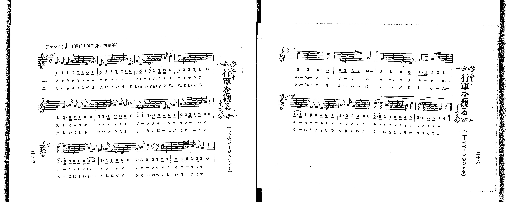

# 行軍を觀る

> Re:Shoka 使用 AI 協助辨識與重建樂譜，可能會有錯誤。歡迎回報。

<audio controls src="kogun_o_miru.mp3"></audio>

- 出處：共益商社樂器店《唱歌教科書 教師用 巻二》第二十四～二十七頁（第十二曲）
- NDL Digital Collections PID 854863（https://dl.ndl.go.jp/pid/854863）掃描 P018.jpg、P019.jpg

## 說明

原書資訊與歌詞全文（NDL PID 854863《唱歌教科書 教師用 巻二》第二十四～二十七頁，掃描 P018.jpg、P019.jpg）：
調性與拍號：ト調四分ノ四拍子（G 大調 4/4 拍，譜上記 C），♩=108，「勇マシク」
註記：單聲部，分節歌二節（譜下配字二行：一＝片假名、二＝平假名，惟「兵」「軍」二字於譜下直印漢字）。本曲橫跨兩個跨頁：第二十四～二十五頁（P018.jpg）為歌詞、曲意、語釋與演奏注意；第二十六～二十七頁（P019.jpg）為樂譜，由於五線譜採橫排左起，故自左頁（第二十七頁，註明「二十六ページへつゞく」）第一至三段（第一至十二小節）唱至右頁（第二十六頁，註明「二十七ページのつゞき」）第四至五段（第十三至二十小節），全曲共二十小節。力度於第一段標 mf、第四段標 f、第五段標 mf。五線譜與簡譜逐音核對一致。
原典演奏注意：〇豫習曲として「來れ遊べ」を復習すべし。〇「トテトテ云々」は樂器のみにて奏するも可なり。〇「國家」のコク及び「ラッパ」のラッは促聲に歌ふべし。
原典曲意：「勇ましい〳〵軍隊が來た。赤帽子は近衞兵、黃帽子は各師團兵か。この勇ましい兵士は、皆これ國家の干ともなり城ともなりて、國家を護るものであるといふ意。」
原典語釋：「赳々たる」＝詩經周南篇に「赳々武夫國家干城」とあり、赳々はたけく勇ましげなこと。

## 歌詞

```text
一、
あれ聞け聞ゆる、喇叭の音、
トテトテトテトテ、テッテテテ、テトテトテ、
兵隊きたる、軍隊きたる、
あかの帽子か、近衞兵、
胸に勳章、腰に劍、
武裝の士官、いさましや、
赳々たる武夫は、國家の干城、
君を守の武士よ、君を守の武士よ。

二、
あれ聞け聞ゆる、太鼓の音、
ドドンドドンドドンド、ドドン、ドンドドンドドン、
兵隊きたる、軍隊きたる、
黃なる帽子か、師團兵、
背には背嚢、肩に銃、
武裝の兵士、いさましや、
赳々たる武夫は、國家の干城、
國を護の兵士よ、國を護の兵士よ。
```

## ABC

```abc
X:1
T:行軍を觀る
M:4/4
L:1/16
Q:1/4=108
K:G
V:V1 name="Piano" snm="Pia"
[V:V1]
!mf! G2 G2 G2 B2 A2 G2 E2 G2 | D2 D2 B2 G2 A4 z2 D2 | G2 D2 G2 D2 G2 G B d4 | d2 B2 d2 B2 G4 z4 |
G4 G3 B A2 G2 A2 z2 | d4 B3 G A2 B2 A2 z2 | G2 G2 G3 E E2 D2 D2 G2 | A2 B A G2 A2 B4 z4 |
d3 e d2 B2 G3 A B2 A2 | G3 A G2 E2 D4 z4 | G3 B d4 e2 d2 d2 B2 | A2 G A B3 A G4 z4 |
!f! d4 d4 e6 d2 | d2 B2 B2 G2 A8 | G4 G4 E6 D2 | G3 G A2 B2 G8 |
!mf! G3 G G2 E2 E2 D2 D2 G2 | A3 A G2 A2 B4 z4 | d3 d B2 G2 A2 B2 c2 e2 | d3 d d2 d2 G4 z4 |
```

## TMD 檔案連結

- [主旋律 TMD 檔案](kogun_o_miru.tmd) [[在 TMD Studio 編輯](https://tmdlang.github.io/Tmd-TS/#tmd=s7IKdvYPcrWy4qpTUCpJTLdSSM7PyUlNLsnMz7PKrsxPzc6ML87Iz05Ugisoy88pzU21yk7MizeKtzA1sTAzRkgW55cWJadaFSdn5OfnxJekVpQk5edno8vHFySmp1oFGBhaIGQKivLLUvMS84C6C4oy80pSU8DaEQpSyzJTUkHSxclAq8tSizLTMlNTkNyVWlQMcjXUipKixLzi5KLMApBXEKrSU_OKUq1yE4uSM9AFkzMyc1KKUvPii_Pz0hGSaflFuVbFJUX5BRmZyQjhkoxUYCjkZuZkliQWVSpxaWkpvFjY82J37-OmSS-WNzxu6lbQ0uJStFUwNLDgsrdVcOeyMdE3sQPpf9q-68XMqe_3zHrauvH57K6nU9ueL9n3bEXT05krnu6a_rih6-mUjc_W9jybOvP58onPZu9QALKe7lj9fMoKhafbdz_Z1fO4ofv5mjVAxtPexqezZ7_fOw_CfrKj-eWCxvd7OoCyIO6unmezN73f0wl2tZ-Lj4JLZjrQuTkKzvBILlYI8HRRgEQjUGNGSUlBsZW-fkqOXh4Qp-frZRXoF2Sm6MNUdD7ra37W368AijygXPrjhkYg0xLEVOLi0tdSsKUW4FJQUHjaNx_o_xeb21-s6HrR0Q4MlBcr5z1tXfFsWjvQsSAfIVxPhXDrwe05oM-BEQZy04tV-581LAe5prv3xcz5QNHHzR1AQaCBTzvaHjf3ARlAqadrJwCd6K7wdMlyoKQCMO4VgKJAO16snfNkR9eLFTMUnMGG9jyaudIWmEiArMcNPU-72x83z3vctP1x0_rHDb1gC1fsBqoGJZdp6140bnrZvAKoFGjV8_UNQN8CfQBkAK0Cm9v9shVo83SgIDAxArU82QGUmvu8s_1pY_vTCb1ADwGlgCJPd26GiIA83TwfZHHrVqB9QAYoCTf0ggJm7fRn0_ZAjH0-e8vT3g3P9iwCCgJd_bih6dmcNcDE9Wzl6hfbVzxtXfm0oRvIAIfiLOxhvGsKJG3CAhdozPOmXZAoBboLZFhLP5DxYtW8l-3doPDdM-Xp0v5nm1cAxd_vmY0wtXUtZopHiieQqSuagO4G-u05MEVM2wO0-_n2WUCRZ30LgS5-1jfp6fZlL7ZuB3l-auuL9lVALjzjoCUJYOg_m9EHDBe45Y-bgTG-53HTjseNQLTkcdO8x41AhwODshOkfUfDi_bNT3Z0Plu3FWogWASSH59u6AfHVicwqYIE-zej2Qs0H6u9QPcg2bsOZi8oqiD2AsMaZO-uKXB7wbo6wYJgk2FWg1IPMAvN3gQsfpClgJH6tGv2013LgCEGcTbQqGcrZirkpgGjBWIFVAQqALENpqQJHszAyHu-YSGQ8bJhwsv5m58t2PF0Qy84GLYAlUEz9tPWHagxPOtxQ_uLjauf758EdNvjxhWPG6c_blwGCoF9bY-bel42dj1u3AlKo02Tnu5bCVT2uHEmSASorKEJqBeoEpgTHzcD8yCIfLJr4uOGVpD6xvWQwhUcbvsfN64GGgu0F6S9qftxU9PT_vWPG1c9buqCm_N0TvfTddvAetc9btoMzItP-4G2bwZbsfJxMzAugIaDZSHcxvVP9jcDMyfQcGCKfty4Fe4wJN-CUzjYn-Bs3rgP7MOWxw1Ac7cCs93LWUA7wL5tBObIphdblzzdsRdYjgBNf7F_4ouFwJIPmEcbX-5uhos_ndACLOGezpkBkmrsBnmgcTLQWcjmA6WeLgb6GVieND6fBTR8MjA0oT4EqtwJDusmoEZQEDyd34fMBUdAI1QxsGJbCyyXQEEGDsrljxubQFxQVLUA_QzOv8AQBJdaED9DMjPEzy-2Av3ZCvIbUA8o2c59sXLl822Tn05c8bR3-vP1QBevhit7tnbZ0yVAj4EsBjoR5CxQeANtAloJjKhGmGnAqJv_uHEiMAsi-RmYNFaBA2IFKAZAzgGmPqAmEAtsQs-LRmDumQgim4CJC-iexqfT2p_2rwV6DJhiYUqRkhMK2dAIZgOTAZAEI6gIihpwMLRuBUcr0O0QfzfCIhohAnMVMP6A8QGNWrBSpFgH1wTNwLy_-mn35uerF4CkWzeAuF2gYh0kDQyzF4vngsxYvPrpuhkgN4HiZSo0VJqAKQ1iDFJEQMIZkjiQ0wQ4wCE-mDAblOPWdQAlQKqBSampA6Qauzg0uEGVLf7gXrLq5R5QUkUO7k4w2oydAQpiGBfKxqaStHAHZiZwSu9GDndEloKFOzBLgwIJyHg6axHIsKaVQJGXXc0YQQ_JbFQK-jnAvAbOdHCDIUGPXRxc1lDe8IICBS19Li7v_PTSPH_fzKJSq4DMxLx8hxqDGoVqkD0KNoZmWnZgVnVuWi2YAWz-PW5aBIzHNUB6LRBvhNKbgWLLgHi1Qg2QXAnEzUA8EYj7gLgXlNHAMm1gFioNUgmi23CoADoTZHeNgqGCLhwbA7ERlG0WD2XUKJiCmGACpAAkBlIEggYwCYg5YCYKwxCoxRSqGGgQ1AgYDVIBMwasAhYewOgB-n8_EC-BhgWQDQ4HYHrEIQMJwz1AejU0hOZA-dvBYiAVoBAFyYBEVwDpGWBzUMICBCG0MTwsQDTIjRAfQOQg6kAysFCDqEAOT3AoggMSEYSQIIXoM4KbDjEPS0g8bl4AcS84vruB7l0PpIH-ALZ1m5eDpaAeA3kTrACYfIAKQNE-DcjbC9UO9DY0IKCy4AAEBjNYdh5UP1JgQLxqhhZZRnDvwoIL4gmEL1G8AQ9KWMCZgZRBMcgkSFCAAhISBBDTMIOiGjmzABuTSyGRiGDBkwHI12A_TYXS_fCoB2YKaOIAiYBYIHmQDMiEHcAABbHQQgDiVpjbYRAkhkjQ6PkCBtGTFDSc4IYgsg5yYoKphZuCpbwApnyw4-cD8SZIBDaD0v8qmPfAPFBaB2FQUKwAe5ocfWj5wxAR4TjTNiwisaZtaICaogQbiG0CMhJFBSypYCaKWi4uXTsFREmrAOQpcwEA)]
- [鋼琴伴奏 TMD 檔案](kogun_o_miru_piano.tmd) [[在 TMD Studio 編輯](https://tmdlang.github.io/Tmd-TS/#tmd=s7IKdvYPcrWy4tLSUnixsOfF7t7HTZNeLG943NT9fk_Hy-49zydsebJny9Ol_c87O97v6VTQ0uJStFUwNLDgsrdVcOeyMdE3seOqU1B62r7rxcyp7_fMetq68fnsrqdT254v2fdsRdPTmSue7pr-uKHr6ZSNz9b2PJs68_nyic9m71AAsp7uWP18ygqFp9t3P9nV87ih-_maNUDG097Gp7Nnv987D8J-sqP55YJGoGOAsiDurp5nszcBXaIEstXPxUfBJTM9syQxR8E5PycnNbkkMz-vWCHA00XBwtTEwswYqDGjpKSg2EpfPyVHLw-I0_P1sgr0CzJT9GEqOp_1NT_r71cIMDC0AMqlP25oBDItQUwlLi7v_PTSPH_fzKJSq4DMxLz8IA-HGoMahWouG0MzLTsuBSCozk2rBTP0tRQeNy1SeNy8BkivBeKNUHozUGwZEK9WqAGSK4G4GYgnAnEfEPcCcQdYpg3MQqVBKkF0Gw4VWvpgu2sUDBV04dgYiI2gbLN4KKNGwRTEBBMgBSAxkCIQNIBJQMwBM1EYhkAtplDFQIOgRsBokAqYMWAVsPB42roV6P_9QLwEGhZANjgcgIkNhwwkDPcA6dXQEJoD5W8Hi4FUgEIUJAMSXQGkZ4DNQQkLEITQxvCwANEgN0J8AJGDqAPJwEINogI5PMGhCA5IRBBCghSizwhuOsQ8LCHxuHkBxL3g-O4Gunc9kAb6o2n74-blYCmox0DeBCsAJh-gAlC0TwPy9kK1A70NDQioLDgAgcEMlp0H1Y8UGBCvmqFFlhHcu7DggngC4UsUb8CDEhZwZiBlUAwyCRIUoICEBAHENMygqEbOLGsfNy-FRCKCBU8GIF-D_TQVSvfDox6YKaCJAyQCYoHkQTIgE3YAAxTEQgsBiFthbodBkBgiQaPnCxhET1LQcIIbgsg6yIkJphZuCpbyApjywY6fD8SbIBHYDEr_q2DeA_NAaR2EQUGxAuxpcvSh5Q9DRITjTNuwiMSatqEBaooSbCC2CchIFBWwpIKZKGoxC1kfWCELcq2NCbScBQbXi76ul-29T1t3vJzdCqmYkPwUrxBtGAt0P5A2jY8FimARQ1ULpZBUwkTIMNMEyDeJhVEglXAluNSimAvnwExAdQNR5mKqJRACRKgkxV94wgtIGUBiW9dOARHhCkCeMhcA)]

## 分析

```text
================================================================================
📊 TMD Song Profile: [ 行軍を觀る ]
================================================================================
⏱  Duration:       0:44 (44.4s), 20 measures total
🎼 Key & Tempo:    首調基準 G, != 108.0 BPM, <4/4>
   - 分析範圍：      由實際發聲的音符與和弦推測調性；播放脈絡另行呈現
🎤 人聲音域:    D4 (MIDI 62) – E5 (MIDI 76) [跨度: 14 個半音 / 1.2 個八度, 難度: moderate]
   - 最低音:  D4 in [KogunOMiru #1 @ m.2, 0:02]
   - 最高音: E5 in [KogunOMiru #1 @ m.9, 0:18]
   - 適合: soprano, mezzo-soprano, contralto, tenor, baritone, bass
🏛  結構:      KogunOMiru (44.4s)
⚡ 編曲密度:        Peak 1 軌道同時演奏
🗝  調性診斷：       G 大調（純淨自然大調，未偵測到可信轉調）
   - 風格氣質:    純淨自然大調（陽光明朗、易唱易記，無明顯調外色彩）
   - 轉調歷程:    全曲維持單一推測調性（未偵測到可信轉調）
   - 核心骨幹音:  G, D, A, B, E
   - 調性數值:    G 大調 [相關度: 0.92, 穩定度: High, 自然音純度: 100.0%]
   - 候選調性 (K-S): G 大調 (0.92), D 大調 (0.71), E 小調 (0.55)
   - 五度圈歷程:   +1
   - 各段落調性細節:
     • [KogunOMiru #1]: G 大調 (r: 0.92, 自然音純度: 100.0%)

  [ 五度圈游移軌跡 ]
               C  
         F           [G ]*
      Bb               D  
      Eb               A  
         Ab           E  
            Db       B  
               F# 
     (* = active key center)

  [ 十二半音累積音高分佈 ]
     C  :                            0.7%
     C# :                            0.0%
     D  : ██████████████████        25.2%
     D# :                            0.0%
     E  : ███████                    9.7%
     F  :                            0.0%
     F# :                            0.0%
     G  : ████████████████████████  33.8%
     G# :                            0.0%
     A  : ███████████               15.5%
     A# :                            0.0%
     B  : ███████████               15.2%
--------------------------------------------------------------------------------
Assignment 軌道音域：
  - Piano         : D4 – E5 (14 個半音 / 1.2 個八度, 123 個音符)
================================================================================
```


## 原書掃描頁





