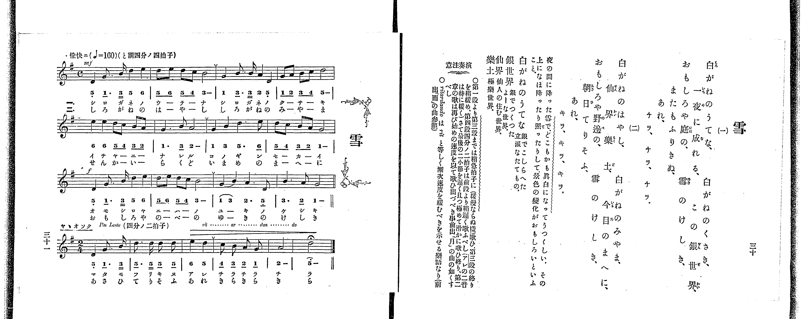

# 雪

> Re:Shōka 使用 AI 協助辨識與重建樂譜，可能會有錯誤。歡迎回報。

- **鋼琴伴奏版**：<br><audio controls src="yuki.mp3"></audio>
- **NEUTRINO 歌聲合成版**：<br><audio controls src="yuki_neutrino.mp3"></audio>

- 出處：共益商社樂器店《唱歌教科書 教師用 巻二》第三十～三十一頁（第十四曲）
- NDL Digital Collections PID 854863（https://dl.ndl.go.jp/pid/854863）掃描 P021.jpg

## 說明

原書資訊與歌詞全文（NDL PID 854863《唱歌教科書 教師用 巻二》第三十～三十一頁，掃描 P021.jpg）：
調性與拍號：ト調四分ノ四拍子（G 大調 4/4 拍），♩=160，「愉快ニ」；末段改四分ノ二拍子，「ヤヽオソク Piu Lento」，末三小節 ritardando，末音延長記號
註記：全曲十八小節，分節歌兩節；譜下配字第一節以片假名、第二節以平假名印刷。前三段（十二小節）為四分ノ四拍子，第一、二段 mf、第三段 f；第三段末為複縱線，第四段改四分ノ二拍子並放慢（原書未標新速度數字，本檔播放沿用 ♩=160），自第三小節起 rit…ar…dan…do，末小節 D 音附延長記號（fermata，TMD 未記）。各段第三小節前印有換氣記號「V」。速度標記之音符字形略似空心，判讀為四分音符。右頁歌詞每節前兩行為上下兩段排印（如「白がねのうてな、」下接「白がねのくさき、」），依譜下配字之演唱順序錄為一行。第一節末句右頁作「チラ、チラ、チラ」，譜下配字作「アレ チラチラ チ ラ」（末二音各一字）；第二節同（キラ）。
原典演奏注意：「第一段より第三段までは稍急拍子に（緩漫ならぬ樣）歌ひ、第三段の終りを稍緩め、第四段四分ノ二拍子は前段より稍遲く歌ふべし（アレの二音は特に緩く）さて最後の二小節を遲く且つ極めて滑かに歌ひ終り、第二章の歌は再び始めの速度を以て歌ひ出づべき事前出「月」の曲の如くすべし」；「ritardando は rit と等しく漸次速度を緩むべきを示せる樂語なり（前出「雨」の曲參照）」。
原典曲意：「夜の間に降った雪で、どこもかも眞白になってうつくしい。その上になほ降ったり照ったりして、景色の變化がおもしろいといふこと。」
原典語釋：「白がねのうてな」銀でこしらへた立派なたてもの。「銀世界」銀でつくつたよーな世界。「仙界」仙人の住む世界。「樂土」極樂世界。


## 歌詞

```text
一、
白がねのうてな、白がねのくさき、
一夜に成れる、この銀世界、
おもしろや庭の、雪のけしき、
またもふりきぬ、
あれ、
チラ、チラ、チラ。

二、
白がねのはやし、白がねのみやま、
仙界樂土、今目のまへに、
おもしろや野邊の、雪のけしき、
朝日てりそふ、
あれ、
キラ、キラ、キラ。
```

## ABC

```abc
X:1
T:雪
M:4/4
L:1/16
Q:1/4=160
K:G
V:V1 name="Piano" snm="Pia"
[V:V1]
[Q:1/4=160] !mf! D4 G3 B d4 e4 | d2 e2 d2 c2 B8 | G4 B3 B A4 D4 | G2 A2 B2 c2 d8 |
w: 1.~し ろ が ね の | う _ て _ な | し ろ が ね の | く _ さ _ き
w: 2.~し ろ が ね の | は _ や _ し | し ろ が ね の | み _ や _ ま
e4 e4 d2 c2 B2 A2 | G6 B2 A8 | G4 B4 d6 e2 | d2 c2 B2 A2 G8 |
w: 1.~い ち や _ に _ | な れ る | こ の ぎ ん | せ _ か _ い
w: 2.~せ ん か _ い _ | ら く ど | い ま め の | ま _ へ _ に
!f! D4 G3 B d4 e4 | d2 e2 d2 c2 B8 | G4 B4 A6 D2 | B6 A2 G8 |
w: 1.~お も し ろ や | に _ は _ の | ゆ _ き の | け し き
w: 2.~お も し ろ や | の _ べ _ の | ゆ _ き の | け し き
[M:2/4] D4 G3 B | d3 d d2 d2 | e4 d4 | c2 B2 A2 G2 |
w: 1.~ま た も | ふ り き ぬ | あ れ | ち ら ち ら
w: 2.~あ さ ひ | て り そ ふ | あ れ | き ら き ら
A8 | d8 |
w: 1.~ち | ら
w: 2.~き | ら
```

## TMD 檔案連結

- [主旋律 TMD 檔案](yuki.tmd) [[在 TMD Studio 編輯](https://tmdlang.github.io/Tmd-TS/#tmd=s7IKdvYPcrWy4qpTUCpJTLdSSM7PyUlNLsnMz7PKrsxPzc6ML87Iz05Ugisoy88pzU21yk7MizeKtzA1sTAzRkgW55cWJadaFSdn5OfnxJekVpQk5edno8vHFySmp1oFGBgZImQKivLLUvMS84C6C4oy80pSU8DaEQpSyzJTUkHSxclAq8tSizLTMlNTkNyVWlQMcjXUipKixLzi5KLMApBXEKrSU_OKUq2SMzJzUopS8-KL8_PSEZJp-UW5VsUlRfkFGZnJCOGSjFSgh8tTE4GMInTh4tREoCHF6MI5iXkpQIcWpCIk8osy0zPzrHJTM7MykYJGS0vh5exVClpaXIq2CoZmBlz2tgruXDYm-iZ2IK1P23e9mDn1_Z5ZT1s3Pp_d9XRq2_Ml-56taHo6c8XTXdMfN3Q9nbLx2dqeZ1NnPl8-8dnsHQpA1tMdq59PWaHwdPvuJ7t6Hjd0P1-z5smOzqe9je_3zoMwnuxoeLmg8f2eDqAUkPt09uxnsze939MJdq2fi4-CC9CtJYk5Cs7w5FCsEODpogCJcKDGjJKSgmIrff2UHL08IE7P18sq0C_ITNGHqeh81tf8rL9fARTNQDlgMHPpaynYUgtwKSgoPO2bD_Txi83tL1Z0vehoBwbDi5XznraueDatHehCkDcQTqY0pHrQvAP0IDBSQK54sWr_s4blIPu7e1_MnA8UfdzcARQEBurTjrbHzX2g0O3ufbp2AtBR7gpPlywHSioA41cBKAo2pufRzJW2wKgHsh439Dxr6Xy6f_Xj5u7HDUDp2c_mrH62buuzKTvh5gGdCjMPpP5x85LHzXsfN6163AQk1ysEZJYq-KTmleSD9fcA9YN8sqH_-foGhSJgpBalANNmPkTm5fzNT3dvezl1-4sVM4BuB3tnxW4gB5zgVgATBSh1tK6GaAfqAboAyAAG49PWlWCR2S_Wznmyo_tlK9BB08HB1wAUf7J76fPO9qeN7U8n9D5uaASJ7-qBiD_duRki_rR3w9OO7Y8bmp529gJdCPQkMHxAIb6rB2Zd5_OmXdiCsQdiEdBkUFis26qQmwa1BWyOQhrQXXAe0JtAY14saX--Y-Pz7bMgukGG4QjVJzuWPZuy71nrIpBzwCns2ZxVz1bMfDZtw8uG-U93LXs2dQfQr-AAXPNs1ZRnk9aC1G_aD0pJ8JgEReuL9lXQBAX2z4ut20ER8KhhWWIRkABGA4iExgQ0glwUgFHycmYLcqwA3ZGWWpSbWJIIVBri66IAdA84ijpBgTehBegRZGuAwQkM2mdzOp_1z362YTHEDGA6CQOmB6AGqB9WzARKPNnZDbTu-ZplQP883bvo-dSlT_bseb5y19P9zeC4XvJiXQM8CiAqQVb2bwZmCUhue7YeZmXryhcLe4CKn-zoAqYHIBcUvn2TgE4BheOyJqALns_c-7ix53Hj2seN6x43tj1uXPa4cRUw4oAOA2p51rcUQ03_48apjxtBSQicmEGB-mTfXOQkB_TCsz1TgFn75YK2p7v6X_a0gN3QAHQM0KnwBAkK4f6lEJc_2TsHnG0aHzevBJmMzgDlGhQrIOqbFj1uXqMAVQQmQRwghmjpAGW0XT2gHDWhBWgpOIkAHQxOiODE_3RCD1DZ46a1QC2QyIMWYk9bd4D8sLT_2eYVz1r6QSUIMCDATgcG4uMmoJ4ueHJ-3LjvcePyx43rn6_ofdawFJJmHzeuBhXm21c-27MaFKZNnY8b1zxbsRhUDK8FhuYm5OwBDNnnW5uAZj5umgQ0BKjrcRMwfEEKINkCM08ArQPGMcIxK3pfAs1s7AcbDjRw5-NGoG-BUqAwApoPCQiQIzuBUqtBVjQC_QV0FTA6lz2b0_B0H1AjSBkkzQJdAjHwyY4pjxuXPFsKtKgRpHL3xMeN3UATIL6AOhteoKxeADQELLX-aVvv48bNT5d3gzWug6RyoLHAEgdkDlg7sC593AjkAp3U-2RXNyjVAkWAJe6cDlDeABo1G-iGdaDECkp5MyH-ghTDQGWIwlMBaCEoKwPpFc_XAn01HRQWe3Y8W7MQbjE4WBsgloG4S4B2z37c1A2su1-smgeOpC5QzoA54uXsFXBHPO1vft66HJxGQFkWKZnM3gRPIE-XzAF5dNpkYPC8nAnUufhx43xgUwKUOoCJuREY5JMfNwG9AgySpudz5oFzFjh1gFQCsx4wAy4BexTo-hagNY8b54LiZEcXTNluuLGgOG8FJjooG6wFWBQ0Ppu5_kUnKMxerOt62jMNnHOByQpo1PTHTUC9LcAAApPANAJ0J9CHwHKgF-EfYEi8bO-GJnjspUPvyy5gKALtBuoHGgoM7B1ARzxf3f1sCzAjAF05H6QSZOU6sOk9QPVPdkx7PhWY_-F6If4EkkDXdzxu3gPUCFMD0vJk90yIeiDjyS5gRK17srcfGHvIakBtrjnAcrQXmDiBbLgUF8g3kMoIxMJVxuEq16C6wZG5-lnHhMdNwJIGWPUDIxDo4XVIngErRQneppanu8DmNTSC4x1oMDC7AKMGZjC4rAB6GagBmKGA0QaMkjVwOWBeghuLszCE-g_UOsLiv_VAN4CzCJr_9oPF98H8Bw5eWAA2Ptnd9Xw2UBEQAZ0HjM3V2D33sr3vJcjRuP33bM7cZ9NB-RvsOWDq3YrVc-ASF-QndAY4Z1HeFoUCBS19Lq7I0uxMR6uAzMS8fIcag5pqkA0KNoZmWnZgVjW4YV8LYSuCmgpQdm4ahAFsIz9u2g6MkLVAGlTd9AJxn0INkLcMmHCBHGDBDKK6wGLYVa4HK2naCqHWghwGMrtGwTReQRcMDcGksYIplG8GpYFKoDwQbQJWA5GBwRqoXpiMsYIRlA83HKIEJAxSAjIEZg3cELB7fAyBjm2cDhUDRjqEbuwB4rUw0cZ1cFOB-QkuugzOWoXhQNLM7IeLToWzILow3GtEqtnr4Wpb4PIw_eS6dz8WM_dhdS84LS2BtlKAnQRQsukGUUBjgOkH0pxZDU4xm8Fp53HTOiC9GSyyG5J4gB0RELUEkYZgSQVGIycUUJwjEggIwkRRfYyahFDTB8hcSDJENhXZTIQPISkIEQ4LsYTNaritqGkFWECAyW4M1wGLXrhuWMg_buxD0QtSAVI5Gy4PMwfhHjS3glMPXD3YBFw6QRHQiWwfOJUC63QsbsVMBcAmEIpekB9AKuHyjTvgLFjooLq1Grk0WgVME4sQZU3zEnD6ASekx839EApc7jRDSihggQMriDZCtNG4CEJNYWALalA0EUpAXbDgaGqCBst0eFZETkwgtbAAQ8rc8ESCcODjJlhRBYOohQoiUiaiiIIKAvzFDyluRSTenXR0ay2kFnTCVwsawWtBUBJrngd0xH5wMgMlo6lADEx04HTUA3YgMPkBCyuQHLjDBac1gI1wPU2oBIgECkH7ypp4khwkiYESGIgGYUSxBkuONRjFTw2WggxfxYbIbvMhNDDGQOJboTxgCQwOPWCbDBq-kBiFFU2wWAQVapDiAJkNk0GPS-RiA8lF4LQDNx9a1QH7RGBzIJUpxEVzweIgN-J2EdjVUBch2DAZwi4CphBdOwVwU0kBynACMZS5AA)]
- [鋼琴伴奏 TMD 檔案](yuki_piano.tmd) [[在 TMD Studio 編輯](https://tmdlang.github.io/Tmd-TS/#tmd=s7IKdvYPcrWy4tLSUng5e9X7PR0vu_c8n7DlyZ4tT5f2P-_seL-nU0FLi0vRVsHQzIDL3lbBncvGRN_EjqtOQelp-64XM6e-3zPraevG57O7nk5te75k37MVTU9nrni6a_rjhq6nUzY-W9vzbOrM58snPpu9QwHIerpj9fMpKxSebt_9ZFfP44bu52vWPNnR-bS38f3eeRDGkx0NLxc0Al0ClAJyn86e_Wz2JqAzlEBW-rn4KLhkpmeWJOYoOOfn5KQml2Tm5xUrBHi6KFiYmliYGQM1ZpSUFBRb6eun5OjlAXF6vl5WgX5BZoo-TEXns77mZ_39CgEGRoZAuXQlLq7I0uxMR6uAzMS8_CAPhxqDmmouBSCwMTTTsgOzqsHeroWwFW2BoQFl56ZBGPpaCo-btis8bl4LpNcA6V4g7lOoAfKWPW7eA-S0QagusBh2levBSpq2Qqi1Clr6YLNrFEzjFXTB0BBMGiuYQvlmUBqoBMoD0SZgNRAZGKyB6oXJGCsYQflwwyFKQMIgJSBDYNbADQG7x8cQ6NjG6VCxx029ELqxB4jXwkQb18FNfdzYBhddBmetwnAgaWb2w0WnwlkQXRjuNSLV7PVwtS1weZh-ct27H4uZ-7C6F5yWlgBTRSMQL4Ekm24QBTQGmH4eN4NSzWpwitkMTjuPm9YB6c1gkd2QxLMaQi1BpCFYUoHRyAkFFOeIBAKCMFFUH6MmIdT0ATIXkgyRTUU2E-FDSApChMNCLGGzGm4ralp53NQDJrsxXPe4cTJcNyzkHzf2oegFqQCpnA2Xh5mDcA-aW8GpB64ebAIunaAI6ES2D5xKHzeuxOJWzFTwuKkRRS_IDyCVcPnGHXAWLHRQ3VqNXBqtAqaJRYiypnkJOP2AE9Lj5n4IBS53miElFLDAgRVEGyHaaFwEoaYwsAU1KJoIJaAuWHA0NUGDZTo8KyInJpBaWIAhZW54IkE48HETrKiCQdRCBREpE1FEQQUB_uKHFLciEu9OOrq1FqUe9EGuB02wVIPANPair-tle-_T1h0vZ7dC2gyI9GIYrxBtGAujahAiJkDKBCgCVQflwkQR6kzjgbRpPEIlXABJLZSJoRbDDEL2U6YSSBkgQtAJf0vCCDkIHzfPA0bkfnBWBWXFqUAMzLjgvNgDjmRgFgYW-CA5UHWwEk5rFGWW6GlCJUAkUCgttSg3sSRRE0-2hWRTUCYF0SCMqBpgWRroV7BaRA6swVIZ4GscIIqs-RAamOpB4luhPGAtBk6BjxvXQNMoJFfAindYTgBVDJAiFZkNk0HPD8hFL5KLwPkPbj60ufC4cRPYHEiDBOKiuWBxkBtxuwjsaqiLEGyYDGEXoaYRHLkMJYkQkcuQkiJaagXJ4M5JMFlo4tW1UwCXANE-QIOgHCdkDlDGCFkGwlHmAgA)]

## 分析

```text
================================================================================
📊 TMD Song Profile: [ 雪 ]
================================================================================
⏱  Duration:       0:22 (22.5s), 18 measures total
🎼 Key & Tempo:    首調基準 G, != 160.0 BPM, <4/4>
   - 分析範圍：      由實際發聲的音符與和弦推測調性；播放脈絡另行呈現
🎤 人聲音域:    D4 (MIDI 62) – E5 (MIDI 76) [跨度: 14 個半音 / 1.2 個八度, 難度: moderate]
   - 最低音:  D4 in [YukiA #1 @ m.1, 0:00]
   - 最高音: E5 in [YukiA #1 @ m.1, 0:01]
   - 適合: soprano, mezzo-soprano, contralto, tenor, baritone, bass
🏛  結構:      YukiA (18.0s) -> YukiB (4.5s)
⚡ 編曲密度:        Peak 1 軌道同時演奏
🗝  調性診斷：       G 大調（推測轉調經歷 1 次）
   - 風格氣質:    純淨自然大調（陽光明朗、易唱易記，無明顯調外色彩）
   - 轉調歷程:    G 大調起奏 ➔ [YukiB] 轉至 D 大調 (-5 半音 / 五度圈 +1 步)
   - 核心骨幹音:  D, G, B, A, E
   - 調性數值:    G 大調 [相關度: 0.86, 穩定度: Moderate, 自然音純度: 100.0%]
   - 候選調性 (K-S): G 大調 (0.86), D 大調 (0.80), B 小調 (0.68)
   - 五度圈歷程:   +1 -> +2
   - 各段落調性細節:
     • [YukiA #1]: G 大調 (r: 0.89, 自然音純度: 100.0%)
     • [YukiB #1]: D 大調 (r: 0.86, 自然音純度: 95.8%, 調外音: C)

  [ 五度圈游移軌跡 ]
               C  
         F           [G ]*
      Bb              [D ]*
      Eb               A  
         Ab           E  
            Db       B  
               F# 
     (* = active key center)

  [ 十二半音累積音高分佈 ]
     C  : ████                       5.0%
     C# :                            0.0%
     D  : ████████████████████████  30.0%
     D# :                            0.0%
     E  : █████████                 10.8%
     F  :                            0.0%
     F# :                            0.0%
     G  : ████████████████          19.6%
     G# :                            0.0%
     A  : ████████████              15.0%
     A# :                            0.0%
     B  : ████████████████          19.6%
--------------------------------------------------------------------------------
Assignment 軌道音域：
  - Piano         : D4 – E5 (14 個半音 / 1.2 個八度, 70 個音符)
================================================================================
```


## 原書掃描頁




