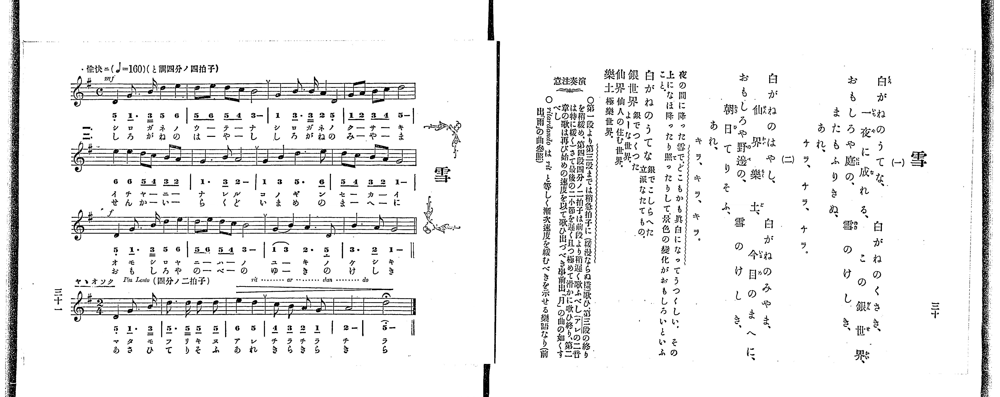

# 雪

> Re:Shoka 使用 AI 協助辨識與重建樂譜，可能會有錯誤。歡迎回報。

<audio controls src="yuki.mp3"></audio>

- 出處：共益商社樂器店《唱歌教科書 教師用 巻二》第三十～三十一頁（第十四曲）
- NDL Digital Collections PID 854863（https://dl.ndl.go.jp/pid/854863）掃描 P021.jpg

## 說明

原書資訊與歌詞全文（NDL PID 854863《唱歌教科書 教師用 巻二》第三十～三十一頁，掃描 P021.jpg）：
調性與拍號：ト調四分ノ四拍子（G 大調 4/4 拍），♩=160，「愉快ニ」；末段改四分ノ二拍子，「ヤヽオソク Piu Lento」，末三小節 ritardando，末音延長記號
註記：全曲十八小節，分節歌兩節；譜下配字第一節以片假名、第二節以平假名印刷。前三段（十二小節）為四分ノ四拍子，第一、二段 mf、第三段 f；第三段末為複縱線，第四段改四分ノ二拍子並放慢（原書未標新速度數字，本檔播放沿用 ♩=160），自第三小節起 rit…ar…dan…do，末小節 D 音附延長記號（fermata，TMD 未記）。各段第三小節前印有換氣記號「V」。速度標記之音符字形略似空心，判讀為四分音符。右頁歌詞每節前兩行為上下兩段排印（如「白がねのうてな、」下接「白がねのくさき、」），依譜下配字之演唱順序錄為一行。第一節末句右頁作「チラ、チラ、チラ」，譜下配字作「アレ チラチラ チ ラ」（末二音各一字）；第二節同（キラ）。
原典演奏注意：「第一段より第三段までは稍急拍子に（緩漫ならぬ樣）歌ひ、第三段の終りを稍緩め、第四段四分ノ二拍子は前段より稍遲く歌ふべし（アレの二音は特に緩く）さて最後の二小節を遲く且つ極めて滑かに歌ひ終り、第二章の歌は再び始めの速度を以て歌ひ出づべき事前出「月」の曲の如くすべし」；「ritardando は rit と等しく漸次速度を緩むべきを示せる樂語なり（前出「雨」の曲參照）」。
原典曲意：「夜の間に降った雪で、どこもかも眞白になってうつくしい。その上になほ降ったり照ったりして、景色の變化がおもしろいといふこと。」
原典語釋：「白がねのうてな」銀でこしらへた立派なたてもの。「銀世界」銀でつくつたよーな世界。「仙界」仙人の住む世界。「樂土」極樂世界。

## 歌詞

```text
一、
白がねのうてな、白がねのくさき、
一夜に成れる、この銀世界、
おもしろや庭の、雪のけしき、
またもふりきぬ、
あれ、
チラ、チラ、チラ。

二、
白がねのはやし、白がねのみやま、
仙界樂土、今目のまへに、
おもしろや野邊の、雪のけしき、
朝日てりそふ、
あれ、
キラ、キラ、キラ。
```

## ABC

```abc
X:1
T:雪
M:4/4
L:1/16
Q:1/4=160
K:G
V:V1 name="Piano" snm="Pia"
[V:V1]
[Q:1/4=160] !mf! D4 G3 B d4 e4 | d2 e2 d2 c2 B8 | G4 B3 B A4 D4 | G2 A2 B2 c2 d8 |
e4 e4 d2 c2 B2 A2 | G6 B2 A8 | G4 B4 d6 e2 | d2 c2 B2 A2 G8 |
!f! D4 G3 B d4 e4 | d2 e2 d2 c2 B8 | G4 B4 A6 D2 | B6 A2 G8 |
[M:2/4] D4 G3 B | d3 d d2 d2 | e4 d4 | c2 B2 A2 G2 |
A8 | d8 |
```

## TMD 檔案連結

- [主旋律 TMD 檔案](yuki.tmd) [[在 TMD Studio 編輯](https://tmdlang.github.io/Tmd-TS/#tmd=s7IKdvYPcrWy4qpTUCpJTLdSSM7PyUlNLsnMz7PKrsxPzc6ML87Iz05Ugisoy88pzU21yk7MizeKtzA1sTAzRkgW55cWJadaFSdn5OfnxJekVpQk5edno8vHFySmp1oFGBgZImQKivLLUvMS84C6C4oy80pSU8DaEQpSyzJTUkHSxclAq8tSizLTMlNTkNyVWlQMcjXUipKixLzi5KLMApBXEKrSU_OKUq2SMzJzUopS8-KL8_PSEZJp-UW5VsUlRfkFGZnJCOGSjFSgh8tTE4GMInTh4tREoCHF6MI5iXkpQIcWpCpxaWkpvJy9SkFLi0vRVsHQzIDL3lbBncvGRN_EDqTpafuuFzOnvt8z62nrxuezu55ObXu-ZN-zFU1PZ654umv644aup1M2Plvb82zqzOfLJz6bvUMByHq6Y_XzKSsUnm7f_WRXz-OG7udr1jzZ0fm0t_H93nkQxpMdDS8XNL7f0wGUAnKfzp79bPam93s6we70c_FRcMlMzyxJzFFwhsd3sUKAp4sCJEaBGjNKSgqKrfT1U3L08oA4PV8vq0C_IDNFH6ai81lf87P-fgVQPALlgOHIpa-lYEstwKWgoPC0bz7Qxy82t79Y0fWiox0YDC9WznvauuLZtHagC0HeQDiZ0pDqQfMO0IPASAG54sWq_c8aloPs7-59MXM-UPRxcwdQEBioTzvaHjf3gUK3u_fp2glAR7krPF2yHCipAIxfBaAo2JieRzNX2gKjHsh63NDzrKXz6f7Vj5u7HzcApWc_m7P62bqtz6bshJsHdCrMPJD6x81LHjfvfdy06nETkFyvEJBZquCTmleSD9bfA9QP8smG_ufrGxSKgJFalAJMfPkQmZfzNz_dve3l1O0vVswAuh3snRW7gRxwglsBTBSg1NG6GqIdqAfoAiADGIxPW1eCRWa_WDvnyY7ul61AB00HB18DUPzJ7qXPO9ufNrY_ndD7uKERJL6rByL-dOdmiPjT3g1PO7Y_bmh62tkLdCHQk8DwAYX4rh6YdZ3Pm3ZhC8YeiEVAk0FhsW6rQm4a1BawOQppQHfBeUBvAo15saT9-Y6Nz7fPgugGGYYjVJ_sWPZsyr5nrYtAzgGnsGdzVj1bMfPZtA0vG-Y_3bXs2dQdQL-CA3DNs1VTnk1aC1K_aT8oJcFjEhStL9pXQRMU2D8vtm4HRcCjhmWJRUACGA0gEhoT0AhyUQBGycuZLcixAnRHWmpRbmJJIlBpiK-LAtA94CjqBAXehBagR5CtAQYnMGifzel81j_72YbFEDOA6SQMmB6AGqB-WDETKPFkZzfQuudrlgH983TvoudTlz7Zs-f5yl1P9zeD43rJi3UN8CiAqARZ2b8ZmCUgue3ZepiVrStfLOwBKn6yowuYHoBcUPj2TQI6BRSOy5qALng-c-_jxp7HjWsfN6573Nj2uHHZ48ZVwIgDOgyo5VnfUgw1_Y8bpz5uBCUhcGIGBeqTfXORkxzQC8_2TAFm7ZcL2p7u6n_Z0wJ2QwPQMUCnwhMkKIT7l0Jc_mTvHHC2aXzcvBJkMjoDlGtQrICob1r0uHmNAlQRmARxgBiipQOU0Xb1gHLUhBagpeAkAnQwOCGCE__TCT1AZY-b1gK1QCIPWog9bd0B8sPS_mebVzxr6QeVIMCAADsdGIiPm4B6uuDJ-XHjvseNyx83rn--ovdZw1JImn3cuBpUmG9f-WzPalCYNnU-blzzbMViUDG8Fhiam5CzBzBkn29tApr5uGkS0BCgrsdNwPAFKYBkC8w8AbQOGMcIx6zofQk0s7EfbDjQwJ2PG4G-BUqBwghoPiQgQI7sBEqtBlnRCPQX0FXA6Fz2bE7D031AjSBlkDQLdAnEwCc7pjxuXPJsKdCiRpDK3RMfN3YDTYD4AupseIGyegHQELDU-qdtvY8bNz9d3g3WuA6SyoHGAksckDlg7cC69HEjkAt0Uu-TXd2gVAsUAZa4czpAeQNo1GygG9aBEiso5c2E-AtSDAOVIQpPBaCFoKwMpFc8Xwv01XRQWOzZ8WzNQrjF4GBtgFgG4i4B2j37cVM3sO5-sWoeOJK6QDkD5oiXs1fAHfG0v_l563JwGgFlWaRkMnsTPIE8XTIH5NFpk4HB83ImUOfix43zgU0JUOoAJuZGYJBPftwE9AowSJqez5kHzlng1AFSCcx6wAy4BOxRoOtbgNY8bpwLipMdXTBlu-HGguK8FZjooGywFmBR0Phs5voXnaAwe7Gu62nPNHDOBSYroFHTHzcB9bYAAwhMAtMI0J1AHwLLgV6Ef4Ah8bK9G5rgsZcOvS-7gKEItBuoH2goMLB3AB3xfHX3sy3AjAB05XyQSpCV68Cm9wDVP9kx7flUYP6H64X4E0gCXd_xuHkPUCNMDUjLk90zIeqBjCe7gBG17snefmDsIasBtbnmAMvRXmDiBLLhUlwg30AqIxALVxmHq1yD6gZH5upnHRMeNwFLGmDVD4xAoIfXIXkGrBQleJtanu4Cm9fQCI53oMHA7AKMGpjB4LIC6GWgBmCGAkYbMErWwOWAeQluLM7CEOo_UOsIi__WA90AziJo_tsPFt8H8x84eGEB2Phkd9fz2UBFQAR0HjA2V2P33Mv2vpcgR-P237M5c59NB-VvsOeAqXcrVs-BS1yQn9AZ4JxFeVsUChS09Lm4IkuzMx2tAjIT8_IdagxqFKpBVijYGJpp2YFZ1eCWfS2EDWnxQzm5aRAGsJX8uGk7MErWAmlQhdMLxH0KNUDeMmDSBXKARTOI6gKLYVe5HqykaSuEWgtyGsjsGgXTeAVdMDQEk8YKplC-GZQGKoHyQLQJWA1EBgZroHphMsYKRlA-3HCIEpAwSAnIEJg1cEMQfl0CrUeBzViQt7pBFNAPQP9BKtzVYB9tBvvtcdM6IL0ZLLIb4jlgUxlELUH4EeYVGI3sEZCbEB6AeQLmAVxeRHU_yFxIMCGbimwmwofVyLG6Cuj2RYg4a14C9ifYw4-b-yEUOP6aITENjDhYhG6EaKNxVKKGBNiCGhRN2D1aC0n3TnjTvRE83YPConke0DP7weEB8u9UIAaGDtjDPWAPA8MJGPsgOXAbC05rAOtdPU2oBIgECkGbx5p4wgYSFqCQANEgjEgnsHCrwYjPGiwpAzMlA72va6cAzvkKUIYTiKHMBQA)]

## 分析

```text
================================================================================
📊 TMD Song Profile: [ 雪 ]
================================================================================
⏱  Duration:       0:22 (22.5s), 18 measures total
🎼 Key & Tempo:    首調基準 G, != 160.0 BPM, <4/4>
   - 分析範圍：      由實際發聲的音符與和弦推測調性；播放脈絡另行呈現
🎤 人聲音域:    D4 (MIDI 62) – E5 (MIDI 76) [跨度: 14 個半音 / 1.2 個八度, 難度: moderate]
   - 最低音:  D4 in [YukiA #1 @ m.1, 0:00]
   - 最高音: E5 in [YukiA #1 @ m.1, 0:01]
   - 適合: soprano, mezzo-soprano, contralto, tenor, baritone, bass
🏛  結構:      YukiA (18.0s) -> YukiB (4.5s)
⚡ 編曲密度:        Peak 1 軌道同時演奏
🗝  調性診斷：       G 大調（推測轉調經歷 1 次）
   - 風格氣質:    純淨自然大調（陽光明朗、易唱易記，無明顯調外色彩）
   - 轉調歷程:    G 大調起奏 ➔ [YukiB] 轉至 D 大調 (-5 半音 / 五度圈 +1 步)
   - 核心骨幹音:  D, G, B, A, E
   - 調性數值:    G 大調 [相關度: 0.86, 穩定度: Moderate, 自然音純度: 100.0%]
   - 候選調性 (K-S): G 大調 (0.86), D 大調 (0.80), B 小調 (0.68)
   - 五度圈歷程:   +1 -> +2
   - 各段落調性細節:
     • [YukiA #1]: G 大調 (r: 0.89, 自然音純度: 100.0%)
     • [YukiB #1]: D 大調 (r: 0.86, 自然音純度: 95.8%, 調外音: C)

  [ 五度圈游移軌跡 ]
               C  
         F           [G ]*
      Bb              [D ]*
      Eb               A  
         Ab           E  
            Db       B  
               F# 
     (* = active key center)

  [ 十二半音累積音高分佈 ]
     C  : ████                       5.0%
     C# :                            0.0%
     D  : ████████████████████████  30.0%
     D# :                            0.0%
     E  : █████████                 10.8%
     F  :                            0.0%
     F# :                            0.0%
     G  : ████████████████          19.6%
     G# :                            0.0%
     A  : ████████████              15.0%
     A# :                            0.0%
     B  : ████████████████          19.6%
--------------------------------------------------------------------------------
Assignment 軌道音域：
  - Piano         : D4 – E5 (14 個半音 / 1.2 個八度, 70 個音符)
================================================================================
```


## 原書掃描頁




