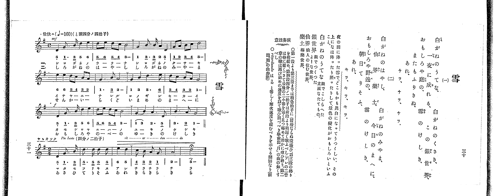

# 雪

> Re:Shōka 使用 AI 協助辨識與重建樂譜，可能會有錯誤。歡迎[回報](https://github.com/TMDLang/reshoka/issues)。

- **鋼琴伴奏版**：<br><audio controls src="yuki.mp3"></audio>
- **NEUTRINO 歌聲合成版**：<br><audio controls src="yuki_neutrino.mp3"></audio>

- 出處：共益商社樂器店《唱歌教科書 教師用 巻二》第三十～三十一頁（第十四曲）
- NDL Digital Collections PID 854863（https://dl.ndl.go.jp/pid/854863）掃描 P021.jpg

## 說明

原書資訊與歌詞全文（NDL PID 854863《唱歌教科書 教師用 巻二》第三十～三十一頁，掃描 P021.jpg）：
調性與拍號：ト調四分ノ四拍子（G 大調 4/4 拍），♩=160，「愉快ニ」；末段改四分ノ二拍子，「ヤヽオソク Piu Lento」，末三小節 ritardando，末音延長記號
註記：全曲十八小節，分節歌兩節；譜下配字第一節以片假名、第二節以平假名印刷。前三段（十二小節）為四分ノ四拍子，第一、二段 mf、第三段 f；第三段末為複縱線，第四段改四分ノ二拍子並放慢（原書未標新速度數字，本檔播放沿用 ♩=160），自第三小節起 rit…ar…dan…do，末小節 D 音附延長記號（fermata，TMD 未記）。各段第三小節前印有換氣記號「V」。速度標記之音符字形略似空心，判讀為四分音符。右頁歌詞每節前兩行為上下兩段排印（如「白がねのうてな、」下接「白がねのくさき、」），依譜下配字之演唱順序錄為一行。第一節末句右頁作「チラ、チラ、チラ」，譜下配字作「アレ チラチラ チ ラ」（末二音各一字）；第二節同（キラ）。
原典演奏注意：「第一段より第三段までは稍急拍子に（緩漫ならぬ樣）歌ひ、第三段の終りを稍緩め、第四段四分ノ二拍子は前段より稍遲く歌ふべし（アレの二音は特に緩く）さて最後の二小節を遲く且つ極めて滑かに歌ひ終り、第二章の歌は再び始めの速度を以て歌ひ出づべき事前出「月」の曲の如くすべし」；「ritardando は rit と等しく漸次速度を緩むべきを示せる樂語なり（前出「雨」の曲參照）」。
原典曲意：「夜の間に降った雪で、どこもかも眞白になってうつくしい。その上になほ降ったり照ったりして、景色の變化がおもしろいといふこと。」
原典語釋：「白がねのうてな」銀でこしらへた立派なたてもの。「銀世界」銀でつくつたよーな世界。「仙界」仙人の住む世界。「樂土」極樂世界。


## 歌詞

```text
一、
白がねのうてな、白がねのくさき、
一夜に成れる、この銀世界、
おもしろや庭の、雪のけしき、
またもふりきぬ、
あれ、
チラ、チラ、チラ。

二、
白がねのはやし、白がねのみやま、
仙界樂土、今目のまへに、
おもしろや野邊の、雪のけしき、
朝日てりそふ、
あれ、
キラ、キラ、キラ。
```

## ABC

<div class="abc-score" data-abc-src="yuki.abc" aria-label="五線譜載入中"></div>

[下載 ABC 原始檔](yuki.abc)

## TMD 檔案連結

- [主旋律 TMD 檔案](yuki.tmd) [[在 TMD Studio 編輯](https://tmdlang.github.io/Tmd-TS/#tmd=s7IKdvYPcrWy4qpTUCpJTLdSSM7PyUlNLsnMz7PKrsxPzc6ML87Iz05Ugisoy88pzU21yk7MizeKtzA1sTAzRkgW55cWJadaFSdn5OfnxJekVpQk5edno8vHFySmp1oFGBgZImQKivLLUvMS84C6C4oy80pSU8DaEQpSyzJTUkHSxclAq8tSizLTMlNTkNyVWlQMcjXUipKixLzi5KLMApBXEKrSU_OKUq2SMzJzUopS8-KL8_PSEZJp-UW5VsUlRfkFGZnJCOGSjFSgh8tTE4GMInTh4tREoCHF6MI5iXkpQIcWpCIk8osy0zPzrHJTM7MysQRNflFJRn56UWJBRqVVRmZxCVB5cmJOPDCcgYGvpaXwcvYqBS0tLkVbBUMzAy57WwV3LhsTfRM7kAFP23e9mDn1_Z5ZT1s3Pp_d9XRq2_Ml-56taHo6c8XTXdMfN3Q9nbLx2dqeZ1NnPl8-8dnsHQpA1tMdq59PWaHwdPvuJ7t6Hjd0P1-z5smOzqe9je_3zoMwnuxoeLmg8f2eDqAUkPt09uxnsze939MJdrOfi4-CC9BDJYk5Cs7wNFOsEODpogBJFUCNGSUlBcVW-vopOXp5QJyer5dVoF-QmaIPU9H5rK_5WX-_AigtAOWAccGlr6VgSy3ApaCg8LRvPtDHLza3v1jR9aKjHRgML1bOe9q64tm0dqALQd5AOJnSkOpB8w7Qg8BIAbnixar9zxqWg-zv7n0xcz5Q9HFzB1AQGKhPO9oeN_eBQre79-naCUBHuSs8XbIcKKkAjF8FoCjYmJ5HM1faAqMeyHrc0POspfPp_tWPm7sfNwClZz-bs_rZuq3PpuyEmwd0Ksw8kPrHzUseN-993LTqcROQXK8QkFmq4JOaV5IP1t8D1A_yyYb-5-sbFIqAkVqUAkzA-RCZl_M3P9297eXU7S9WzAC6HeydFbuBHHCCWwFMFKDU0boaoh2oB-gCIAMYjE9bV4JFZr9YO-fJju6XrUAHTQcHXwNQ_Mnupc872582tj-d0Pu4oREkvqsHIv5052aI-NPeDU87tj9uaHra2Qt0IdCTwPABhfiuHph1nc-bdmELxh6IRUCTQWGxbqtCbhrUFrA5CmlAd8F5QG8CjXmxpP35jo3Pt8-C6AYZhiNUn-xY9mzKvmeti0DOAaewZ3NWPVsx89m0DS8b5j_dtezZ1B1Av4IDcM2zVVOeTVoLUr9pPyglwWMSFK0v2ldBExTYPy-2bgdFwKOGZYlFQAIYDSASGhPQCHJRAEbJy5ktyLECdEdaalFuYkkiUGmIr4sC0D3gKOoEBd6EFqBHkK0BBicwaJ_N6XzWP_vZhsUQM4DpJAyYHoAaoH5YMRMo8WRnN9C652uWAf3zdO-i51OXPtmz5_nKXU_3N4PjesmLdQ3wKICoBFnZvxmYJSC57dl6mJWtK18s7AEqfrKjC5gegFxQ-PZNAjoFFI7LmoAueD5z7-PGnseNax83rnvc2Pa4cdnjxlXAiAM6DKjlWd9SDDX9jxunPm4EJSFwYgYF6pN9c5GTHNALz_ZMAWbtlwvanu7qf9nTAnZDA9AxQKfCEyQohPuXQlz-ZO8ccLZpfNy8EmQyOgOUa1CsgKhvWvS4eY0CVBGYBHGAGKKlA5TRdvWActSEFqCl4CQCdDA4IYIT_9MJPUBlj5vWArVAIg9aiD1t3QHyw9L-Z5tXPGvpB5UgwIAAOx0YiI-bgHq64Mn5ceO-x43LHzeuf76i91nDUkiafdy4GlSYb1_5bM9qUJg2dT5uXPNsxWJQMbwWGJqbkLMHMGSfb20Cmvm4aRLQEKCux03A8AUpgGQLzDwBtA4YxwjHrOh9CTSzsR9sONDAnY8bgb4FSoHCCGg-JCBAjuwESq0GWdEI9BfQVcDoXPZsTsPTfUCNIGWQNAt0CcTAJzumPG5c8mwp0KJGkMrdEx83dgNNgPgC6mx4gbJ6AdAQsNT6p229jxs3P13eDda4DpLKgcYCSxyQOWDtwLr0cSOQC3RS75Nd3aBUCxQBlrhzOkB5A2jUbKAb1oESKyjlzYT4C1IMA5UhCk8FoIWgrAykVzxfC_TVdFBY7NnxbM1CuMXgYG2AWAbiLgHaPftxUzew7n6xah44krpAOQPmiJezV8Ad8bS_-XnrcnAaAWVZpGQyexM8gTxdMgfk0WmTgcHzciZQ5-LHjfOBTQlQ6gAm5kZgkE9-3AT0CjBImp7PmQfOWeDUAVIJzHrADLgE7FGg61uA1jxunAuKkx1dMGW74caC4rwVmOigbLAWYFHQ-Gzm-hedoDB7sa7rac80cM4FJiugUdMfNwH1tgADCEwC0wjQnUAfAsuBXoR_gCHxsr0bmuCxlw69L7uAoQi0G6gfaCgwsHcAHfF8dfezLcCMAHTlfJBKkJXrwKb3ANU_2THt-VRg_ofrhfgTSAJd3_G4eQ9QI0wNSMuT3TMh6oGMJ7uAEbXuyd5-YOwhqwG1ueYAy9FeYOIEsuFSXCDfQCojEAtXGYerXIPqBkfm6mcdEx43AUsaYNUPjECgh9cheQasFCV4m1qe7gKb19AIjnegwcDsAowamMHgsgLoZaAGYIYCRhswStbA5YB5CW4szsIQ6j9Q6wiL_9YD3QDOImj-2w8W3wfzHzh4YQHY-GR31_PZQEVABHQeMDZXY_fcy_a-lyBH4_bfszlzn00H5W-w54CpdytWz4FLXJCf0BngnEV5WxQKFLT0ubgiS7MzHa0CMhPz8h1qDGqqQTYo2BiaadmBWdXghn0thK0IaipA2blpEAawjfy4aTswQtYCaVB10wvEfQo1QN4yYMIFcoAFM4jqAothV7kerKRpK4RaC3IYyOwaBdN4BV0wNASTxgqmUL4ZlAYqgfJAtAlYDUQGBmugemEyxgpGUD7ccIgSkDBICcgQmDVwQ8Du8TEEOrZxOlQMGOkQurEHiNfCRBvXwU0F5ie46DI4axWGA0kzsx8uOhXOgujCcK8RqWavh6ttgcvD9JPr3v1YzNyH1b3gtLQE2koBdhJAyaYbRAGNAaYfSHNmNTjFbAanncdN64D0ZrDIbkjiAXZEQNQSRBqCJRUYjZxQQHGOSCAgCBNF9TFqEkJNHyBzIckQ2VRkMxE-hKQgRDgsxBI2q-G2oqYVYAEBJrsxXAcseuG6YSH_uLEPRS9IBUjlbLg8zByEe9DcCk49cPVgE3DpBEVAJ7J94FQKrNOxuBUzFQCbQCh6QX4AqYTLN-6As2Chg-rWauTSaBUwTSxClDXNS8DpB5yQHjf3QyhwudMMKaGABQ6sINoI0UbjIgg1hYEtqEHRRCgBdcGCo6kJGizT4VkROTGB1MICDClzwxMJwoGPm2BFFQyiFiqISJmIIgoqCPAXP6S4FZF4d9LRrbWQWtAJXy1oBK8FQUmseR7QEfvByQyUjKYCMTDRgdNRD9iBwOQHLKxAcuAOF5zWADbC9TShEiASKATtK2viSXKQJAZKYCAahBHFGiw51mAUPzVYCjJ8FRsiu82H0MAYA4lvhfKAJTA49IBtMmj4QmIUVjTBYhFUqEGKA2Q2TAY9LpGLDSQXgdMO3HxoVQfsE4HNgVSmEBfNBYuD3IjbRWBXQ12EYMNkCLsImEJ07RTATSUFKMMJxFDmAgA)]
- [鋼琴伴奏 TMD 檔案](yuki_piano.tmd) [[在 TMD Studio 編輯](https://tmdlang.github.io/Tmd-TS/#tmd=s7IKdvYPcrWy4qpTUCpJTLdSyC8qychPL0osyKi0ysgsLskvykxOzInPTsxLVOLS0lJ4OXvV-z0dL7v3PJ-w5cmeLU-X9j_v7Hi_p1NBS4tL0VbB0MyAy95WwZ3LxkTfxA5k6tP2XS9mTn2_Z9bT1o3PZ3c9ndr2fMm-Zyuans5c8XTX9McNXU-nbHy2tufZ1JnPl098NnuHApD1dMfq51NWKDzdvvvJrp7HDd3P16x5sqPzaW_j-73zIIwnOxpeLmgEugQoBeQ-nT372exNQGcogaz0c_FRcMlMzyxJzFFwzs_JSU0uyczPK1YI8HRRsDA1sTAzBmrMKCkpKLbS10_J0csD4vR8vawC_YLMFH2Yis5nfc3P-vsVAgyMDIFy6UpcXJGl2ZmOVgGZiXn5QR4ONQY11VwKQGBjaKZlB2ZVg71dC2Er2gJDA8rOTYMw9LUUHjdtV3jcvBZIrwHSvUDcp1AD5C173LwHyGmDUF1gMewq14OVNG2FUGsVtPTBZtcomMYr6IKhIZg0VjCF8s2gNFAJlAeiTcBqIDIwWAPVC5MxVjCC8uGGQ5SAhEFKQIbArIEbAnaPjyHQsY3ToWKPm3ohdGMPEK-FiTaug5v6uLENLroMzlqF4UDSzOyHi06FsyC6MNxrRKrZ6-FqW-DyMP3kunc_FjP3YXUvOC0tAaaKRiBeAkk23SAKaAww_TxuBqWa1eAUsxmcdh43rQPSm8EiuyGJZzWEWoJIQ7CkAqOREwoozhEJBARhoqg-Rk1CqOkDZC4kGSKbimwmwoeQFIQIh4VYwmY13FbUtPK4qQdMdmO47nHjZLhuWMg_buxD0QtSAVI5Gy4PMwfhHjS3glMPXD3YBFw6QRHQiWwfOJU-blyJxa2YqeBxUyOKXpAfQCrh8o074CxY6KC6tRq5NFoFTBOLEGVN8xJw-gEnpMfN_RAKXO40Q0ooYIEDK4g2QrTRuAhCTWFgC2pQNBFKQF2w4GhqggbLdHhWRE5MILWwAEPK3PBEgnDg4yZYUQWDqIUKIlImooiCCgL8xQ8pbkUk3p10dGstSj3og1wPmmCpBoFp7EVf18v23qetO17OboW0GRDpxTBeIdowFkbVIERMgJQJUASqDsqFiSLUmcYDadN4hEq4AJJaKBNDLYYZhOynTCWQMkCEoBP-loQRchA-bp4HjMj94KwKyopTgRiYccF5sQccycAsDCzwQXKg6mAlnNYoyizR04RKgEigUFpqUW5iSaImnmwLyaagTAqiQRhRNcCyNNCvYLWIHFiDpTLA1zhAFFnzITQw1YPEt0J5wFoMnAIfN66BplFIroAV77CcAKoYIEUqMhsmg54fkIteJBeB8x_cfGhz4XHjJrA5kAYJxEVzweIgN-J2EdjVUBch2DAZwi5CTSM4chlKEiEilyElRbTUCpLBnZNgstDEq2unAC4Bon2ABkE5TsgcoIwRsgyEo8wFAA)]

## 分析

```text
================================================================================
📊 TMD Song Profile: [ 雪 ]
================================================================================
⏱  Duration:       0:22 (22.5s), 18 measures total
🎼 Key & Tempo:    首調基準 G, != 160.0 BPM, <4/4>
   - 分析範圍：      由實際發聲的音符與和弦推測調性；播放脈絡另行呈現
🎤 人聲音域:    D4 (MIDI 62) – E5 (MIDI 76) [跨度: 14 個半音 / 1.2 個八度, 難度: moderate]
   - 最低音:  D4 in [YukiA #1 @ m.1, 0:00]
   - 最高音: E5 in [YukiA #1 @ m.1, 0:01]
   - 適合: soprano, mezzo-soprano, contralto, tenor, baritone, bass
🏛  結構:      YukiA (18.0s) -> YukiB (4.5s)
⚡ 編曲密度:        Peak 1 軌道同時演奏
🗝  調性診斷：       G 大調（推測轉調經歷 1 次）
   - 風格氣質:    純淨自然大調（陽光明朗、易唱易記，無明顯調外色彩）
   - 轉調歷程:    G 大調起奏 ➔ [YukiB] 轉至 D 大調 (-5 半音 / 五度圈 +1 步)
   - 核心骨幹音:  D, G, B, A, E
   - 調性數值:    G 大調 [相關度: 0.86, 穩定度: Moderate, 自然音純度: 100.0%]
   - 候選調性 (K-S): G 大調 (0.86), D 大調 (0.80), B 小調 (0.68)
   - 五度圈歷程:   +1 -> +2
   - 各段落調性細節:
     • [YukiA #1]: G 大調 (r: 0.89, 自然音純度: 100.0%)
     • [YukiB #1]: D 大調 (r: 0.86, 自然音純度: 95.8%, 調外音: C)

  [ 五度圈游移軌跡 ]
               C  
         F           [G ]*
      Bb              [D ]*
      Eb               A  
         Ab           E  
            Db       B  
               F# 
     (* = active key center)

  [ 十二半音累積音高分佈 ]
     C  : ████                       5.0%
     C# :                            0.0%
     D  : ████████████████████████  30.0%
     D# :                            0.0%
     E  : █████████                 10.8%
     F  :                            0.0%
     F# :                            0.0%
     G  : ████████████████          19.6%
     G# :                            0.0%
     A  : ████████████              15.0%
     A# :                            0.0%
     B  : ████████████████          19.6%
--------------------------------------------------------------------------------
Assignment 軌道音域：
  - Piano         : D4 – E5 (14 個半音 / 1.2 個八度, 70 個音符)
================================================================================
```


## 原書掃描頁




