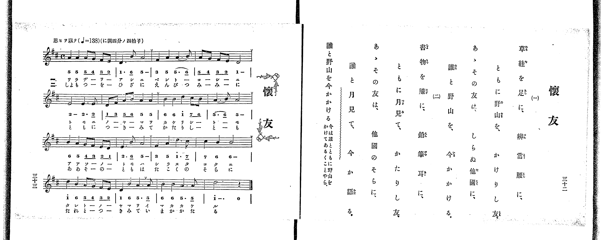

# 懐友

> Re:Shōka 使用 AI 協助辨識與重建樂譜，可能會有錯誤。歡迎回報。

- **鋼琴伴奏版**：<br><audio controls src="kaiyu.mp3"></audio>
- **NEUTRINO 歌聲合成版**：<br><audio controls src="kaiyu_neutrino.mp3"></audio>

- 出處：共益商社樂器店《唱歌教科書 教師用 巻二》第三十二～三十三頁（第十五曲）
- NDL Digital Collections PID 854863（https://dl.ndl.go.jp/pid/854863）掃描 P022.jpg

## 說明

原書資訊與歌詞全文（NDL PID 854863《唱歌教科書 教師用 巻二》第三十二～三十三頁，掃描 P022.jpg）：
調性與拍號：ニ調四分ノ四拍子（D 大調 4/4 拍，譜上記 C），♩=138，「思ヒヲ以テ」
註記：單聲部，分節歌二節（譜下配字二行：一＝片假名、二＝平假名）。全曲四段共十六小節，第一至三段第二、四小節末有換氣記號（v），第四段第二小節第三拍後有換氣記號（v），末小節為附點二分音符加四分休止符。右頁未印「演奏注意」欄。五線譜與簡譜逐音核對一致。
原典語釋：「誰と野山を今かかける」＝今は誰とともに野山をかけてあるくことやら。


## 歌詞

```text
一、
草鞋を足に、辨當腰に、
ともに野山を、かけりし友、
あゝその友は、しらぬ他國に、
誰と野山を、今かかける。

二、
書物を膝に、鉛筆耳に、
ともに月見て、かたりし友、
あゝその友は、他國のそらに、
誰と月見て、今か語る。
```

## ABC

<div class="abc-score" data-abc-src="kaiyu.abc" aria-label="五線譜載入中"></div>

[下載 ABC 原始檔](kaiyu.abc)

## TMD 檔案連結

- [主旋律 TMD 檔案](kaiyu.tmd) [[在 TMD Studio 編輯](https://tmdlang.github.io/Tmd-TS/#tmd=s7IKdvYPcrWy4qpTUCpJTLdSSM7PyUlNLsnMz7PKrsxPzc6ML87Iz05Ugisoy88pzU21yk7MizeKtzA1sTAzRkgW55cWJadaFSdn5OfnxJekVpQk5edno8vHFySmp1oFGBgZIWQKivLLUvMS84C6C4oy80pSU8DaEQpSyzJTUkHSxclAq8tSizLTMlNTkNyVWlQMcjXUipKixLzi5KLMApBXEKrSU_OKUq2SMzJzUopS8-KL8_PSEZJp-UW5VsUlRfkFGZnJCOGSjFSgh9OKMlPzUoozMgvQZVJz81EtyS_KTM_Ms8pNzczKxBII-UUlGfnpRYkFGZVWGZnFJUDlyYk58cAQBQazlpbCs_YJT_u7FbS0uBRtFQyNLbjsbRVcuGxM9E3sQGY8bd_1YubU93tmPW3d-Hx219Opbc-X7Hu2ounpzBVPd01_3ND1dMrGZ2t7nk2d-Xz5xGezdygAWU93rH4-ZYXC0-27n-zqedzQ_XzNmic7Op_2NgK57_fOg7J3dL5c0Ph-TwdQFiw15dnsTe_3dIJd7ufio-AC9FZJYo6CMzyNFCsEeLooQFIBUGNGSUlBsZW-fkqOXh4Qp-frZRXoF2Sm6MNUdD7ra37W368AinugHDDsufS1FGypBbgUFBSe9s0HevrF5vYXK7pedLQDQ-LFynlPW1c8m9YOdCHIGwgnUyGwetB8BPQjMGpADnmxav-zhuUgJ3T3vpg5Hyj6uLkbKPh09uynHW2Pm_uADKDU07UTgO5yUXi6ZDlQUgEYywpAUaDBL9bOebKj68WKGQrOYEN7Hs1caQtMDkDW44aeZw1zHzdPety86cnupY-b2x439ILtXLEbqAGUNqate9G46WXzCqBqoG3P1zcAfQl0P5ABtA1sdPfLVqDl04GCLxb2ALU82QGUmvu8s_1pY_vTCb2PG8D-3TP36c7NEBGgKx43NIGCcvYmkNvXbQWmQGBQPG1d-3RDP9jkHnBYNbxo3wwMH6ACEBcUho0gT4PVPJuz-tmczmf9s59tWAx0KjhgOsogHgSlO7C5EG0QDZDQBwXUvh6cOoGmQlU37Xo5s-Xl7nkg_R1tL-dvfr5m2dOuBZBAf7Jn4rO1i4AiIH_0bwZG4LM5q572bgCF554pT5f2P9u84llLPzAwn61pAaoBZoHn22cBQwsYi883LAQyXjZMAJr5bMGOpxt6wR7dAlQGTXZPW3e8WDXvZXs3KKobel6s2vC4ccXL9r6nGzc-bpr0ZHfX48ZuMJr4uKkbaAcwbMGC6yEqQaip6XHjargWqOLGZY8bm0BaGvsfN04GK2t53ASKCy6QzUBnAAMYHPu9nS_ndQM1vti2GWgOUPTFvhXPp2570Qo0H8QFKcJiTUMjzFlA10wHlj1wpUBr5z5uBKJ1INHG9WCl00GWN655snva0zlAQZjBaP4FpR90L0MdDE4RIBYwwz3vXAlycBvQDpBBLztnP1_b9qIB6n4UBz-b0_FiGdAsYOxBHDyfKAfD3LkOJA5yOaqDkU2FOBgYiVDXAhVRXihBgYKWPheXd2JmZalVQGZiXr5DjUFNNcgGBRsLLTswA1gUPm5eD8QrgbgJiPcA8SYwXaPwuGkREG8H8rpBvOaZQLwZiDvg8iAeUAdYDUgnsArRB5tbo2CqoAvFJgrGCkZAEUMgT1fBDCwKgjVAcZgaiAxIF0Q1RC1QDdg0H0OQZf1APjA0QWTjIjB7EtgUYBSA1QLjBYhXw01_3LgTrGoyWG4FkjhEZDqYhKuH2GQEkgcmt3awVpDBjxuXoFi2CWrZNDTLOpAs2wJVswQssx_MhpCo1oGDHxScwICGBnIfNCiXQOl54AgB-X81EG8E8lbBAxykHhIZIBPgQW8EtQNCQ4LeGBi0kKAH4RogGxTgugqGcUDCHBr2aPGDCHt46EGCBOIRkPg6sFgLWGQfSjB1g8UmgsW64OGNzSzUsMdlEzgSGnuRgnIZik3zSbAJFOzgtA3Ce6EBCAl4WJCCIqQfHOygoAbljh4gez8s1TeB8gxSagcFJSjcYKkXFgnYUjs4yEGBXgPEkFgAYfQgh6Q9CDkXTIICG-EtkKeAxQ3ceGiChmaQNdDAm4-U4MEZCGuCJ90ucHAjmQvRA5IB64e6AjO1A4PwcfMapHSLCHZQioek9sdN4IwD4oFTPSTlg0RWI4IcHIyQcEcuYWAxASIRyRwhAg19CDRAC3NIIuoBux3kc3g4YCRxEK8F7F-wGDQRgkhIsgfpgfAgMB4txDFtAiVwkAx6EsdvEzh-sdhUy8Wla6cALvwVgAxlLgA)]
- [鋼琴伴奏 TMD 檔案](kaiyu_piano.tmd) [[在 TMD Studio 編輯](https://tmdlang.github.io/Tmd-TS/#tmd=s7IKdvYPcrWy4qpTUCpJTLdSyC8qychPL0osyKi0ysgsLskvykxOzInPTsxLVOLS0lJ41j7haX_3-z0dL7v3PJ-w5cmeLU-X9j_v7Hi_p1NBS4tL0VbB0NiCy95WwYXLxkTfxA5k8NP2XS9mTn2_Z9bT1o3PZ3c9ndr2fMm-Zyuans5c8XTX9McNXU-nbHy2tufZ1JnPl098NnuHApD1dMfq51NWKDzdvvvJrp7HDd3P16x5sqPzaW8jkPt-7zwoe0fnywWNQMcAZcFSU57N3gR0iRLIVj8XHwWXzPTMksQcBef8nJzU5JLM_LxihQBPFwULUxMLM2OgxoySkoJiK339lBy9PCBOz9fLKtAvyEzRh6nofNbX_Ky_XyHAwMgIKJeuxMXlnZhZWWoVkJmYlx_k4VBjUFPNpQAENhZadmCGvpbC4-b1QLwSiJuAeA8QbwLTNQqPmxYB8XYgrxvEa54JxJuBuAMuD-IBdYDVgHR2K2jpg82tUTBV0IViEwVjBSOgiCGQp6tgBhYFwRqgOEwNRAakC6IaohaoBmyajyHIsn4g_3FTJ4hsXARmTwKb8rixCaz2ceN0IF4NN_1x406wqslguRVI4hCR6WASrh5ikxFIfvrjpnawVpDBjxuXoFi2CWrZNDTLOpAs2wJVswQssx_MhpCo1oGDHxScwICGBnIfNCiXQOl54AgB-X81EG8E8lbBAxykHhIZIBPgQW8EtQNCQ4LeGBi0kKAH4RogGxTgugqGcUDCHBr2aPGDCHt46EGCBOIRkPg6sFgLWGQfSjB1g8UmgsW64OGNzSzUsMdlEzgSGnuRgnIZik3zSbAJFOzgtA3Ce6EBCAl4WJCCIqQfHOygoAbljh4gez8s1TeB8gxSagcFJSjcYKkXFgnYUjs4yEGBXgPEkFgAYfQgh6Q9CDkXTIICG-EtkKceN66HGw9N0NAMsgYaePOREjw4A2FN8KTbBQ5uJHMhekAyYP1QV2CmdmAQPm5eg5RuEcEOSvGQ1P64CZxxQDxwqoekfJDIakSQg4MREu7IJQwsJkAkIpkjRKChD4EGaGEOSUQ9YLeDfA4PB4wkDuK1gP0LFoMmQhAJSfYgPRAeBMajhTimTaAEDpJBT-L4bQLHLxabalHKfh_kst8EUfa_6Ot62d77tHXHy9mtkOoRKXzjFaINYxVM44G0aXwsUAQuBqUg_oGLmgApE4g6uCY0lXBxbKbC9EPVQrnEq4TZhd0eTF8ZoColwno0i3BajwgmoB2gqNC1UwDHRrQPUBjBMQJzlLkA)]

## 分析

```text
================================================================================
📊 TMD Song Profile: [ 懐友 ]
================================================================================
⏱  Duration:       0:27 (27.8s), 16 measures total
🎼 Key & Tempo:    首調基準 D, != 138.0 BPM, <4/4>
   - 分析範圍：      由實際發聲的音符與和弦推測調性；播放脈絡另行呈現
🎤 人聲音域:    D4 (MIDI 62) – D5 (MIDI 74) [跨度: 12 個半音 / 1.0 個八度, 難度: easy]
   - 最低音:  D4 in [Kaiyu #1 @ m.2, 0:01]
   - 最高音: D5 in [Kaiyu #1 @ m.7, 0:11]
   - 適合: soprano, mezzo-soprano, contralto, tenor, baritone, bass
🏛  結構:      Kaiyu (27.8s)
⚡ 編曲密度:        Peak 1 軌道同時演奏
🗝  調性診斷：       A 大調（純淨自然大調，未偵測到可信轉調）
   - 風格氣質:    純淨自然大調（陽光明朗、易唱易記，無明顯調外色彩）
   - 轉調歷程:    全曲維持單一推測調性（未偵測到可信轉調）
   - 核心骨幹音:  A, B, D, E, F#
   - 調性數值:    A 大調 [相關度: 0.81, 穩定度: Moderate, 自然音純度: 96.8%]
   - 候選調性 (K-S): A 大調 (0.81), D 大調 (0.76), A 小調 (0.57)
   - 五度圈歷程:   +3
   - 各段落調性細節:
     • [Kaiyu #1]: A 大調 (r: 0.81, 自然音純度: 96.8%, 調外音: G)

  [ 五度圈游移軌跡 ]
               C  
         F            G  
      Bb               D  
      Eb              [A ]*
         Ab           E  
            Db       B  
               F# 
     (* = active key center)

  [ 十二半音累積音高分佈 ]
     C  :                            0.0%
     C# : ██                         3.2%
     D  : █████████████             19.0%
     D# :                            0.0%
     E  : ████████                  11.9%
     F  :                            0.0%
     F# : █████                      7.1%
     G  : ██                         3.2%
     G# :                            0.0%
     A  : ████████████████████████  34.9%
     A# :                            0.0%
     B  : ██████████████            20.6%
--------------------------------------------------------------------------------
Assignment 軌道音域：
  - Piano         : D4 – D5 (12 個半音 / 1.0 個八度, 66 個音符)
================================================================================
```


## 原書掃描頁




