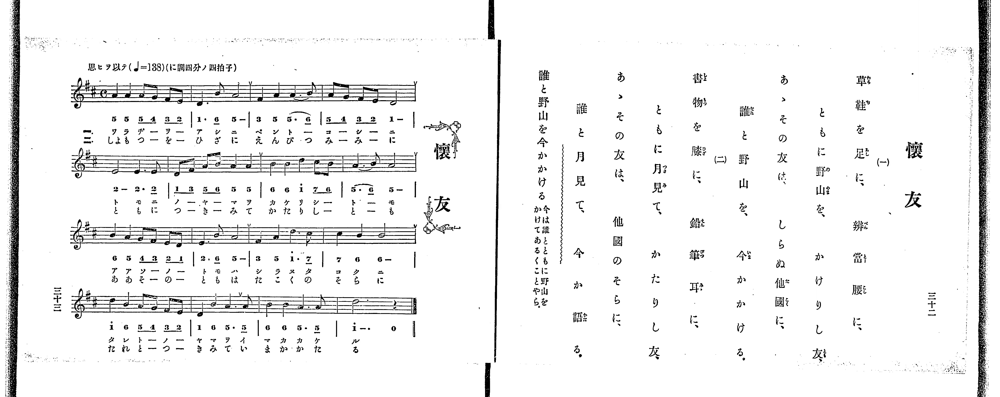

# 懐友

> Re:Shōka 使用 AI 協助辨識與重建樂譜，可能會有錯誤。歡迎回報。

- **鋼琴伴奏版**：<br><audio controls src="kaiyu.mp3"></audio>
- **NEUTRINO 歌聲合成版**：<br><audio controls src="kaiyu_neutrino.mp3"></audio>

- 出處：共益商社樂器店《唱歌教科書 教師用 巻二》第三十二～三十三頁（第十五曲）
- NDL Digital Collections PID 854863（https://dl.ndl.go.jp/pid/854863）掃描 P022.jpg

## 說明

原書資訊與歌詞全文（NDL PID 854863《唱歌教科書 教師用 巻二》第三十二～三十三頁，掃描 P022.jpg）：
調性與拍號：ニ調四分ノ四拍子（D 大調 4/4 拍，譜上記 C），♩=138，「思ヒヲ以テ」
註記：單聲部，分節歌二節（譜下配字二行：一＝片假名、二＝平假名）。全曲四段共十六小節，第一至三段第二、四小節末有換氣記號（v），第四段第二小節第三拍後有換氣記號（v），末小節為附點二分音符加四分休止符。右頁未印「演奏注意」欄。五線譜與簡譜逐音核對一致。
原典語釋：「誰と野山を今かかける」＝今は誰とともに野山をかけてあるくことやら。


## 歌詞

```text
一、
草鞋を足に、辨當腰に、
ともに野山を、かけりし友、
あゝその友は、しらぬ他國に、
誰と野山を、今かかける。

二、
書物を膝に、鉛筆耳に、
ともに月見て、かたりし友、
あゝその友は、他國のそらに、
誰と月見て、今か語る。
```

## ABC

<div class="abc-score" data-abc-src="kaiyu.abc" aria-label="五線譜載入中"></div>

[下載 ABC 原始檔](kaiyu.abc)

## TMD 檔案連結

- [主旋律 TMD 檔案](kaiyu.tmd) [[在 TMD Studio 編輯](https://tmdlang.github.io/Tmd-TS/#tmd=s7IKdvYPcrWy4qpTUCpJTLdSSM7PyUlNLsnMz7PKrsxPzc6ML87Iz05Ugisoy88pzU21yk7MizeKtzA1sTAzRkgW55cWJadaFSdn5OfnxJekVpQk5edno8vHFySmp1oFGBgZIWQKivLLUvMS84C6C4oy80pSU8DaEQpSyzJTUkHSxclAq8tSizLTMlNTkNyVWlQMcjXUipKixLzi5KLMApBXEKrSU_OKUq2SMzJzUopS8-KL8_PSEZJp-UW5VsUlRfkFGZnJCOGSjFSgh9OKMlPzUoozMgvQZVJz81EtyS_KTM_Ms8pNzczKRAoELS2FZ-0TnvZ3K2hpcSnaKhgaW3DZ2yq4cNmY6JvYgXQ_bd_1YubU93tmPW3d-Hx219Opbc-X7Hu2ounpzBVPd01_3ND1dMrGZ2t7nk2d-Xz5xGezdygAWU93rH4-ZYXC0-27n-zqedzQ_XzNmic7Op_2NgK57_fOg7J3dL5c0Ph-TwdQFiw15dnsTe_3dILd7Ofio-ACdHFJYo6CMzz6ixUCPF0UIBEM1JhRUlJQbKWvn5KjlwfE6fl6WQX6BZkp-jAVnc_6mp_19yuAohUoBwxWLn0tBVtqAS4FBYWnffOBnn6xuf3Fiq4XHe3AkHixct7T1hXPprUDXQjyBsLJVAisHjQfAf0IjBqQQ16s2v-sYTnICd29L2bOB4o-bu4GCj6dPftpR9vj5j4gAyj1dO0EoLtcFJ4uWQ6UVADGsgJQFGjwi7VznuzoerFihoIz2NCeRzNX2gKTA5D1uKHnWcPcx82THjdverJ76ePmtscNvWA7V-wGagCljWnrXjRuetm8AqgaaNvz9Q1AXwLdD2QAbQMb3f2yFWj5dKDgi4U9QC1PdgCl5j7vbH_a2P50Qu_jBrB_98x9unMzRAToiscNTaCgnL0J5PZ1W4EpEBgUT1vXPt3QDza5BxxWDS_aNwPDB6gAxAWFYSPI02A1z-asfjan81n_7GcbFgOdCg6YjjKIB0HpDmwuRBtEAyT0QQG1rwenTqCpUNVNu17ObHm5ex5If0fby_mbn69Z9rRrASTQn-yZ-GztIqAIyB_9m4ER-GzOqqe9G0DhuWfK06X9zzaveNbSDwzMZ2tagGqAWeD59lnA0ALG4vMNC4GMlw0TgGY-W7Dj6YZesEe3AJVBk93T1h0vVs172d4NiuqGnherNjxuXPGyve_pxo2PmyY92d31uLEbjCY-buoG2gEMW7DgeohKEGpqety4Gq4Fqrhx2ePGJpCWxv7HjZPByloeN4HiggtkM9AZwAAGx35v58t53UCNL7ZtBpoDFH2xb8XzqdtetALNB3FBirBY09AIcxbQNdOBZQ9cKdDauY8bgWgdSLRxPVjpdJDljWue7J72dA5QEGYwmn9B6Qfdy1AHg1MEiAXMcM87V4Ic3Aa0A2TQy87Zz9e2vWiAuh_Fwc_mdLxYBjQLGHsQB88nysEwd64DiYNcjupgZFMhDgZGItS1QEWUF0pQoKClz8XlnZhZWWoVkJmYl-9QY1BTDbJBwcZCyw7MABaFj5vXA_FKIG4C4j1AvAlM1yg8bloExNuBvG4Qr3kmEG8G4g64PIgH1AFWA9IJrEL0webWKJgq6EKxiYKxghFQxBDI01UwA4uCYA1QHKYGIgPSBVENUQtUAzbNxxBkWT-QDwxNENm4CMyeBDYFGAVgtcB4AeLVcNMfN-4Eq5oMlluBJA4RmQ4m4eohNhmB5IHJrR2sFWTw48YlKJZtglo2Dc2yDiTLtkDVLAHL7AezISSqdeDgBwUnMKChgdwHDcolUHoeOEJA_l8NxBuBvFXwAAeph0QGyAR40BtB7YDQkKA3BgYtJOhBuAbIBgW4roJhHJAwh4Y9Wvwgwh4eepAggXgEJL4OLNYCFtmHEkzdYLGJYLEueHhjMws17HHZBI6Exl6koFyGYtN8EmwCBTs4bYPwXmgAQgIeFqSgCOkHBzsoqEG5owfI3g9L9U2gPIOU2kFBCQo3WOqFRQK21A4OclCg1wAxJBZAGD3IIWkPQs4Fk6DARngL5ClgcQM3HpqgoRlkDTTw5iMleHAGwprgSbcLHNxI5kL0gGTA-qGuwEztwCB83LwGKd0igh2U4iGp_XETOOOAeOBUD0n5IJHViCAHByMk3JFLGFhMgEhEMkeIQEMfAg3QwhySiHrAbgf5HB4OGEkcxGsB-xcsBk2EIBKS7EF6IDwIjEcLcUybQAkcJIOexPHbBI5fLDbVcnHp2imAC38FIEOZCwA)]
- [鋼琴伴奏 TMD 檔案](kaiyu_piano.tmd) [[在 TMD Studio 編輯](https://tmdlang.github.io/Tmd-TS/#tmd=s7IKdvYPcrWy4tLSUnjWPuFpf_f7PR0vu_c8n7DlyZ4tT5f2P-_seL-nU0FLi0vRVsHQ2ILL3lbBhcvGRN_EjqtOQelp-64XM6e-3zPraevG57O7nk5te75k37MVTU9nrni6a_rjhq6nUzY-W9vzbOrM58snPpu9QwHIerpj9fMpKxSebt_9ZFfP44bu52vWPNnR-bS3Ech9v3celL2j8-WCRqBjgLJgqSnPZm8CukQJZKufi4-CS2Z6ZklijoJzfk5OanJJZn5esUKAp4uChamJhZkxUGNGSUlBsZW-fkqOXh4Qp-frZRXoF2Sm6MNUdD7ra37W368QYGBkBJRLV-Li8k7MrCy1CshMzMsP8nCoMaip5lIAAhsLLTswQ19L4XHzeiBeCcRNQLwHiDeB6RqFx02LgHg7kNcN4jXPBOLNQNwBlwfxgDrAakA6uxW09MHm1iiYKuhCsYmCsYIRUMQQyNNVMAOLgmANUBymBiID0gVRDVELVAM2zccQZFk_kP-4qRNENi4CsyeBTXnc2ARW-7hxOhCvhpv-uHEnWNVksNwKJHGIyHQwCVcPsckIJD_9cVM7WCvI4MeNS1As2wS1bBqaZR1Ilm2BqlkCltkPZkNIVOvAwQ8KTmBAQwO5DxqUS6D0PHCEgPy_Gog3Anmr4AEOUg-JDJAJ8KA3gtoBoSFBbwwMWkjQg3ANkA0KcF0FwzggYQ4Ne7T4QYQ9PPQgQQLxCEh8HVisBSyyDyWYusFiE8FiXfDwxmYWatjjsgkcCY29SEG5DMWm-STYBAp2cNoG4b3QAIQEPCxIQRHSDw52UFCDckcPkL0fluqbQHkGKbWDghIUbrDUC4sEbKkdHOSgQK8BYkgsgDB6kEPSHoScCyZBgY3wFshTjxvXw42HJmhoBlkDDbz5SAkenIGwJnjS7QIHN5K5ED0gGbB-qCswUzswCB83r0FKt4hgB6V4SGp_3ATOOCAeONVDUj5IZDUiyMHBCAl35BIGFhMgEpHMESLQ0IdAA7QwhySiHrDbQT6HhwNGEgfxWsD-BYtBEyGIhCR7kB4IDwLj0UIc0yZQAgfJoCdx_DaB4xeLTbUoZb8Pctlvgij7X_R1vWzvfdq64-XsVkj1iBS-8QrRhrEKpvFA2jQ-FigCF4NSEP_ARU2AlAlEHVwTmkq4ODZTYfqhaqFc4lXC7MJuD6avDFCVEmE9mkU4rUcEE9AOUFTo2imAYyPaByiM4BiBOcpcAA)]

## 分析

```text
================================================================================
📊 TMD Song Profile: [ 懐友 ]
================================================================================
⏱  Duration:       0:27 (27.8s), 16 measures total
🎼 Key & Tempo:    首調基準 D, != 138.0 BPM, <4/4>
   - 分析範圍：      由實際發聲的音符與和弦推測調性；播放脈絡另行呈現
🎤 人聲音域:    D4 (MIDI 62) – D5 (MIDI 74) [跨度: 12 個半音 / 1.0 個八度, 難度: easy]
   - 最低音:  D4 in [Kaiyu #1 @ m.2, 0:01]
   - 最高音: D5 in [Kaiyu #1 @ m.7, 0:11]
   - 適合: soprano, mezzo-soprano, contralto, tenor, baritone, bass
🏛  結構:      Kaiyu (27.8s)
⚡ 編曲密度:        Peak 1 軌道同時演奏
🗝  調性診斷：       A 大調（純淨自然大調，未偵測到可信轉調）
   - 風格氣質:    純淨自然大調（陽光明朗、易唱易記，無明顯調外色彩）
   - 轉調歷程:    全曲維持單一推測調性（未偵測到可信轉調）
   - 核心骨幹音:  A, B, D, E, F#
   - 調性數值:    A 大調 [相關度: 0.81, 穩定度: Moderate, 自然音純度: 96.8%]
   - 候選調性 (K-S): A 大調 (0.81), D 大調 (0.76), A 小調 (0.57)
   - 五度圈歷程:   +3
   - 各段落調性細節:
     • [Kaiyu #1]: A 大調 (r: 0.81, 自然音純度: 96.8%, 調外音: G)

  [ 五度圈游移軌跡 ]
               C  
         F            G  
      Bb               D  
      Eb              [A ]*
         Ab           E  
            Db       B  
               F# 
     (* = active key center)

  [ 十二半音累積音高分佈 ]
     C  :                            0.0%
     C# : ██                         3.2%
     D  : █████████████             19.0%
     D# :                            0.0%
     E  : ████████                  11.9%
     F  :                            0.0%
     F# : █████                      7.1%
     G  : ██                         3.2%
     G# :                            0.0%
     A  : ████████████████████████  34.9%
     A# :                            0.0%
     B  : ██████████████            20.6%
--------------------------------------------------------------------------------
Assignment 軌道音域：
  - Piano         : D4 – D5 (12 個半音 / 1.0 個八度, 66 個音符)
================================================================================
```


## 原書掃描頁




