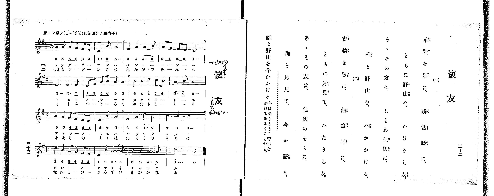

# 懐友

> Re:Shoka 使用 AI 協助辨識與重建樂譜，可能會有錯誤。歡迎回報。

<audio controls src="kaiyu.mp3"></audio>

- 出處：共益商社樂器店《唱歌教科書 教師用 巻二》第三十二～三十三頁（第十五曲）
- NDL Digital Collections PID 854863（https://dl.ndl.go.jp/pid/854863）掃描 P022.jpg

## 說明

原書資訊與歌詞全文（NDL PID 854863《唱歌教科書 教師用 巻二》第三十二～三十三頁，掃描 P022.jpg）：
調性與拍號：ニ調四分ノ四拍子（D 大調 4/4 拍，譜上記 C），♩=138，「思ヒヲ以テ」
註記：單聲部，分節歌二節（譜下配字二行：一＝片假名、二＝平假名）。全曲四段共十六小節，第一至三段第二、四小節末有換氣記號（v），第四段第二小節第三拍後有換氣記號（v），末小節為附點二分音符加四分休止符。右頁未印「演奏注意」欄。五線譜與簡譜逐音核對一致。
原典語釋：「誰と野山を今かかける」＝今は誰とともに野山をかけてあるくことやら。

## 歌詞

```text
一、
草鞋を足に、辨當腰に、
ともに野山を、かけりし友、
あゝその友は、しらぬ他國に、
誰と野山を、今かかける。

二、
書物を膝に、鉛筆耳に、
ともに月見て、かたりし友、
あゝその友は、他國のそらに、
誰と月見て、今か語る。
```

## ABC

```abc
X:1
T:懐友
M:4/4
L:1/16
Q:1/4=138
K:D
V:V1 name="Piano" snm="Pia"
[V:V1]
A4 A4 A2 G2 F2 E2 | D6 B,2 A,8 | F4 A4 A6 B2 | A2 G2 F2 E2 D8 |
E8 E6 E2 | D2 F2 A2 B2 A4 A4 | B4 B4 d4 c2 B2 | A6 B2 A8 |
B4 A4 G2 F2 E2 D2 | E6 B,2 A,8 | F4 A4 d6 c2 | c4 B4 B8 |
d4 B4 A2 G2 F2 E2 | D4 B4 A6 A2 | B4 B4 A6 A2 | d12 z4 |
```

## TMD 檔案連結

- [主旋律 TMD 檔案](kaiyu.tmd) [[在 TMD Studio 編輯](https://tmdlang.github.io/Tmd-TS/#tmd=s7IKdvYPcrWy4qpTUCpJTLdSSM7PyUlNLsnMz7PKrsxPzc6ML87Iz05Ugisoy88pzU21yk7MizeKtzA1sTAzRkgW55cWJadaFSdn5OfnxJekVpQk5edno8vHFySmp1oFGBgZIWQKivLLUvMS84C6C4oy80pSU8DaEQpSyzJTUkHSxclAq8tSizLTMlNTkNyVWlQMcjXUipKixLzi5KLMApBXEKrSU_OKUq2SMzJzUopS8-KL8_PSEZJp-UW5VsUlRfkFGZnJCOGSjFSgh9OKMlPzUoozMgvQZVJz8yGWaGkpPGuf8LS_W0FLi0vRVsHQ2ILL3lbBhcvGRN_EDqTrafuuFzOnvt8z62nrxuezu55ObXu-ZN-zFU1PZ654umv644aup1M2Plvb82zqzOfLJz6bvUMByHq6Y_XzKSsUnm7f_WRXz-OG7udr1jzZ0fm0txHIfb93HpS9o_Plgsb3ezqAsmCpKc9mb3q_pxPsVj8XHwWXzPTMksQcBWd4_BYrBHi6KEBiEKgxo6SkoNhKXz8lRy8PiNPz9bIK9AsyU_RhKjqf9TU_6-9XAMUbUA4Yblz6Wgq21AJcCgoKT_vmAz39YnP7ixVdLzragSHxYuW8p60rnk1rB7oQ5A2Ek6kQWD1oPgL6ERg1IIe8WLX_WcNykBO6e1_MnA8UfdzcDRR8Onv20462x819QAZQ6unaCUB3uSg8XbIcKKkAjGUFoCjQ4Bdr5zzZ0fVixQwFZ7ChPY9mrrQFJgcg63FDz7OGuY-bJz1u3vRk99LHzW2PG3rBdq7YDdQAShvT1r1o3PSyeQVQNdC25-sbgL4Euh_IANoGNrr7ZSvQ8ulAwRcLe4BanuwASs193tn-tLH96YTexw1g_-6Z-3TnZogI0BWPG5pAQTl7E8jt67YCUyAwKJ62rn26oR9scg84rBpetG8Ghg9QAYgLCsNGkKfBap7NWf1sTuez_tnPNiwGOhUcMB1lEA-C0h3YXIg2iAZI6IMCal8PTp1AU6Gqm3a9nNnycvc8kP6OtpfzNz9fs-xp1wJIoD_ZM_HZ2kVAEZA_-jcDI_DZnFVPezeAwnPPlKdL-59tXvGspR8YmM_WtADVALPA8-2zgKEFjMXnGxYCGS8bJgDNfLZgx9MNvWCPbgEqgya7p607Xqya97K9GxTVDT0vVm143LjiZXvf040bHzdNerK763FjNxhNfNzUDbQDGLZgwfUQlSDU1PS4cTVcC1Rx47LHjU0gLY39jxsng5W1PG4CxQUXyGagM4ABDI793s6X87qBGl9s2ww0Byj6Yt-K51O3vWgFmg_ighRhsaahEeYsoGumA8seuFKgtXMfNwLROpBo43qw0ukgyxvXPNk97ekcoCDMYDT_gtIPupehDganCBALmOGed64EObgNaAfIoJeds5-vbXvRAHU_ioOfzel4sQxoFjD2IA6eT5SDYe5cBxIHuRzVwcimQhwMjESoa4GKKC-UoEBBS5-Lyzsxs7LUKiAzMS_focagRqEaZIWCjYWWHZgBLAsfN68H4pVA3ATEe4B4E5iuUXjctAiItwN53SBe80wg3gzEHXB5EA-oA6wGpBNYh-iDza1RMFXQhWITBWMFI6CIIZCnq2AWr2AaD2bpAsWM4arAcmB9EPUQ1UA1CHeC7AW6COqaPqidS6D0PLDLQa5aDcQbgbxVcJeB1ENcDTIB7kYjqB0QGuJGY6ALzOBuqgGyQe7SVTCMAxLmUCdCHAuhkZ0IDjAQ3gu1DOJImPUgx_eDnQhyFijIe4Ds_bCgbAJFBFIQgqwF2QELEJiDsQch2IEgJ9YAMcTNIIzmwP1AK9YghQbCgaBwhITh46YlYBEgDxyWkPAEiaxGOA5sHcSFyBEMczOIRAQeQgTqSgg0ALutlotL104BnFAVgAxlLgA)]
- [鋼琴伴奏 TMD 檔案](kaiyu_piano.tmd) [[在 TMD Studio 編輯](https://tmdlang.github.io/Tmd-TS/#tmd=s7IKdvYPcrWy4tLSUnjWPuFpf_f7PR0vu_c8n7DlyZ4tT5f2P-_seL-nU0FLi0vRVsHQ2ILL3lbBhcvGRN_EjqtOQelp-64XM6e-3zPraevG57O7nk5te75k37MVTU9nrni6a_rjhq6nUzY-W9vzbOrM58snPpu9QwHIerpj9fMpKxSebt_9ZFfP44bu52vWPNnR-bS3Ech9v3celL2j8-WCRqBjgLJgqSnPZm8CukQJZKufi4-CS2Z6ZklijoJzfk5OanJJZn5esUKAp4uChamJhZkxUGNGSUlBsZW-fkqOXh4Qp-frZRXoF2Sm6MNUdD7ra37W368QYGBkBJRLV-Li8k7MrCy1CshMzMsP8nCoMahRqOaysdCy41IAAn0thcfN64F4JRA3AfEeIN4EpmsUHjctAuLtQF43iNc8E4g3A3EHXB7EA-oAqwHp7FbQ0gebW6NgqqALxSYKxgpGQBFDIE9XwSxewTQezNIFihnDVYHlwPog6iGqgWoQ7gTZC3QR1DV9UDuXQOl5YJeDXLUaiDcCeavgLgOph7gaZALcjUZQOyA0xI3GQBeYwd1UA2SD3KWrYBgHJMyhToQ4FkIjOxEcYCC8F2oZxJEw60GO7wc7EeQsUJD3ANn7YUHZBIoIpCAEWQuyAxYgMAdjD0KwA0FOrAFiiJtBGM2B-4FWrEEKDYQDQeEICcPHTUvAIkAeOCwh4QkSWY1wHNg6iAuRIxjmZhCJCDyECNSVEGgAdlstShr1gaVRkDU2Joh0-qKv62V779PWHS9nt0LyMZJj4hWiDWOBoQKkTeNjgSJwMRMgZQIUQVUJEwVCKBOhF5aAYQJEmIphBkkq4RzsbiVKLTZzoWJQY9BUwkQR9gApA0h06NopgGNEAchQ5gIA)]

## 分析

```text
================================================================================
📊 TMD Song Profile: [ 懐友 ]
================================================================================
⏱  Duration:       0:27 (27.8s), 16 measures total
🎼 Key & Tempo:    首調基準 D, != 138.0 BPM, <4/4>
   - 分析範圍：      由實際發聲的音符與和弦推測調性；播放脈絡另行呈現
🎤 人聲音域:    A3 (MIDI 57) – D5 (MIDI 74) [跨度: 17 個半音 / 1.4 個八度, 難度: challenging]
   - 最低音:  A3 in [Kaiyu #1 @ m.2, 0:02]
   - 最高音: D5 in [Kaiyu #1 @ m.7, 0:11]
   - 適合: soprano, mezzo-soprano, contralto, tenor, baritone, bass
🏛  結構:      Kaiyu (27.8s)
⚡ 編曲密度:        Peak 1 軌道同時演奏
🗝  調性診斷：       A 大調（純淨自然大調，未偵測到可信轉調）
   - 風格氣質:    純淨自然大調（陽光明朗、易唱易記，無明顯調外色彩）
   - 轉調歷程:    全曲維持單一推測調性（未偵測到可信轉調）
   - 核心骨幹音:  A, B, D, E, F#
   - 調性數值:    A 大調 [相關度: 0.81, 穩定度: Moderate, 自然音純度: 96.8%]
   - 候選調性 (K-S): A 大調 (0.81), D 大調 (0.76), A 小調 (0.57)
   - 五度圈歷程:   +3
   - 各段落調性細節:
     • [Kaiyu #1]: A 大調 (r: 0.81, 自然音純度: 96.8%, 調外音: G)

  [ 五度圈游移軌跡 ]
               C  
         F            G  
      Bb               D  
      Eb              [A ]*
         Ab           E  
            Db       B  
               F# 
     (* = active key center)

  [ 十二半音累積音高分佈 ]
     C  :                            0.0%
     C# : ██                         3.2%
     D  : █████████████             19.0%
     D# :                            0.0%
     E  : ████████                  11.9%
     F  :                            0.0%
     F# : █████                      7.1%
     G  : ██                         3.2%
     G# :                            0.0%
     A  : ████████████████████████  34.9%
     A# :                            0.0%
     B  : ██████████████            20.6%
--------------------------------------------------------------------------------
Assignment 軌道音域：
  - Piano         : A3 – D5 (17 個半音 / 1.4 個八度, 66 個音符)
================================================================================
```


## 原書掃描頁




