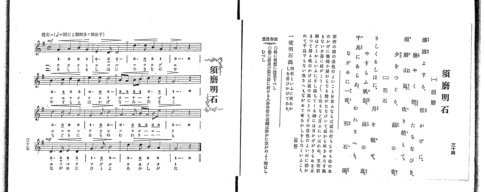

# 須磨明石

*找不到鋼琴伴奏版 TMD，未產生音訊。*

- 出處：共益商社樂器店《唱歌教科書 教師用 巻二》第三十四～三十五頁（第十六曲）
- NDL Digital Collections PID 854863（https://dl.ndl.go.jp/pid/854863）掃描 P023.jpg

## 說明

原書資訊與歌詞全文（NDL PID 854863《唱歌教科書 教師用 巻二》第三十四～三十五頁，掃描 P023.jpg）：
調性與拍號：ト調四分ノ四拍子（G 大調 4/4 拍，譜上記 C），♩=96，「優美ニ」
註記：單聲部，分節歌二節（第一節題「須磨」、第二節題「明石」；譜下配字二行：一＝片假名、二＝平假名）。原書右頁歌詞標題與左頁譜題皆作「須磨明石」（非「須摩明石」）。全曲四段共十六小節，第一段標 mf、第四段標 mp，各段第二小節末有換氣記號（v），各段第四小節為附點二分音符加四分休止符。五線譜與簡譜逐音核對一致。
原典演奏注意：〇特に發想に注意すべし。〇第二段及び第三段に於ける八分音符の連續は滑かに急がぬよー歌はしむべし。
原典曲意：「須磨の浦の景色のよいことを言ふならば、波の打ちよせる松の木のかげに、鹽燒小屋からでる烟がたなびいて、山から吹きおろす風もない夕暮に、鐘がこう〳〵と鳴るなど、言ふにいはれぬ。又明石潟はどうかといふに、さし滿ちてくる潮には月かげがきらめき、止まって居る帆のかげは波の底にうつり、その景色のよいのに浮かれて、千鳥でもない我さへも、ながめて夜あかしをしたといふこと。（俗解）」
原典語釋：「一夜明石潟」＝明石といふに夜あかしを言ひかけてある。

## 歌詞

```text
一、（須磨）
浦波よする、松かげに、
鹽やく煙、たちなびき、
須磨山嵐、吹き絶えて、
夕をつぐる、鐘の音。

二、（明石）
さしくるしほに、月を載せ、
やすらふ帆影、波の底、
千鳥にあらぬ、われさへも、
ながめに一夜、明石潟。
```

## ABC

```abc
X:1
T:須磨明石
M:4/4
L:1/16
Q:1/4=96
K:G
V:V1 name="Piano" snm="Pia"
[V:V1]
!mf! G4 A4 B4 G4 | E6 D2 D8 | d6 d2 B4 G4 | A12 z4 |
B6 c2 d4 B4 | e6 e2 d8 | B2 A2 B2 c2 d6 d2 | G12 z4 |
d6 d2 B4 A4 | G6 B2 d8 | A6 A2 B2 A2 B2 e2 | d12 z4 |
!mp! D6 D2 E4 D4 | G6 A2 B8 | d6 d2 B4 A4 | G12 z4 |
!mf! G4 A4 B4 G4 | E6 D2 D8 | d6 d2 B4 G4 | A12 z4 |
B6 c2 d4 B4 | e6 e2 d8 | B2 A2 B2 c2 d6 d2 | G12 z4 |
d6 d2 B4 A4 | G6 B2 d8 | A6 A2 B2 A2 B2 e2 | d12 z4 |
!mp! D6 D2 E4 D4 | G6 A2 B8 | d6 d2 B4 A4 | G12 z4 |
```

## TMD 檔案連結

- [主旋律 TMD 檔案](suma_akashi.tmd) [[在 TMD Studio 編輯](https://tmdlang.github.io/Tmd-TS/#tmd=s7IKdvYPcrWy4qpTUCpJTLdSSM7PyUlNLsnMz7PKrsxPzc6ML87Iz05Ugisoy88pzU21yk7MizeKtzA1sTAzRkgW55cWJadaFSdn5OfnxJekVpQk5edno8vHFySmp1oFGBgh6Swoyi9LzUvMA-ouKMrMK0lNAWtHKEgty0xJBUkXJwOtLkstykzLTE1BcldqUTHI1VArSooS84qTizILQF5BqEpPzStKtUrOyMxJKUrNiy_Oz0tHSKblF-VaFZcU5RdkZCYjhEsyUoEezknMSwFaXZCKLlGQk5iMIVieWJJapMSlpaXwckHH88Urns3oez5_s4KWFpeirYKlGZe9rYI7l42JvokdSOPT9l0vZk59v2fW09aNz2d3PZ3a9nzJvmcrmp7OXPF01_THDV1Pp2x8trbn2dSZz5dPfDZ7hwKQ9XTH6udTVig83b77ya6exw3dz9esebKj82lv49PZs9_vnQdhP9k15eWCxvd7OoCyIKnWtc9mb3q_pxPsXD8XHwWXzPTMksQcBWd4tBcrBHi6KEAiFqgxo6SkoNhKXz8lRy8PiNPz9bIK9AsyU_RhKjqf9TU_6-9XAEUnUA4YnFz6Wgq21AJcCgoKT_vmAz39YnP7ixVdLzragSHxYuW8p60rnk1rB7oQ5A2Ek6kQWD1oPgL6ERg1IIe8WLX_WcNykBO6e1_MnA8UfdzcARQEmvK0o-1xcx-QAZR6unYC0F3uCk-XLAdKKgBjWQEoCjT4xdo5T3Z0vVgxQ8EZbGjPo5krbS3NgIzHDT1PW1Y939f3uLn7cUMv2LIVu4EqQYli2roXjZteNq8AqgNa83x9A9B7QH8AGZCYfbKjAch-uRBkCiS5AY143NAIkgIrg0hB0iBQ6v2e2WCXdL9sBbp1OlDNi4U9QIuA5rzfM_d5Z_vTxvanE0AmAKWAIk93boaIAB39uKEJEh1P-zcDQwsSF89WzARaAQyXp9uXAQWBhgO5z2e1Pdk7B-4kJNs7Xs6dBxF_NnElkjjYcGC0zt4ECsd1W4G5AZJon27oB3u2B-JZoBTQRoXcNIgfIYrBIgWgIJrQAuRC_A7R-GzO6mdzOp_1z362YTEwSMEx11EGiQG4alAcglU_b9r1cmbLy93zQPo72l7O3_x8zbKnXQsgkfxkz8RnaxcBRYBuBSaY59tnAX0L9PnzDQtB3m6YAFT_bMGOpxt6gQ590b4FqAyahJ-27ni2Z8rTpf3PNq941tIPSjwN7c87dz5uXP185p5nzZuBDIjU48aZjxuB4sCc3wRSA_YKKDz6ux43Al0DSrtALkj9tD2PGyc-bup-2roa7tbHjeteNix-Dkzojeuf7Z74uLEbpLJh6eNGoMiax00dj5v3AOMNKAuyoqkBbheSQ2dvgjkRlqIa1z3bCjL62cz1Lzo3ARkggxpbHjdOfty44nHTpBcrgAYB3bTqcVPn48YNwKh5tnkRSH0nUMFCsOLZQIc-m7sPJDgHZCDYZZOAjgMqfrlz7_P2ScAYeLoRKNgNNmQ5UP3z5vlgdwPJVUDPg20Ehn3j040bIcqeTgC6vvdxY9fjJiA58-UioGOawIpbni6Z-mwW0Baw-RNmgM0BOqbtcQMwvQGduuLl5i1AK8CKVwLVwLywGmzL-sdN4PACpsn-DkgqfbYX6AxgqK0EGQJyPNAXQJVgLQ2NjxunAsPx2e79IP8CHdnYD_LvXrADgDExBxgCEP8Cje0FebAJqAWUy4AJ6nEjMFgWA3U93dgKis4dQPPh4bMeEpJPdwHNBxoFlFryuKkLbONcbDECsvHZVrB2kBfAwdXb_HIzMAUAgxQaOM86gCkDaOAOkAjIKKBgD9hJy54umfO4EagMaDswfQAdMB0c_nDPgmO8oQmYiZ7sn_5i-WJwzgWXWZDU82LVvJft3ZDUA8wFQOMQwQfK53OheR4p-NCsBMcE0EtALtCVwKBsAsUTMIWCLAEaCXQwqBgBp0yg7SBRYOoEBRMoCGaCFTeCkxoihYEUAVPZ4yaglf3PW2eCPQ30FjCuICkLFBVgRWBjgQns6dYJoKADJ7DnW7c9bgSaDQpMsE-XTAUHzZLHjRMg1oFT2DpgFoS7E1TVgNwJ8S7UnZBUAkkcYMZuiPNA6QPocWBQAvMJxA6wU4GeAQptBaaIp3s3wnMVKC1AHQKNWWDCAAYSUCkwxTY-bgIaD4x6RPxCrIbH8WpIvIDMQ0QNuACgvMqGAgUtfS6u4NLcRMfsxOKMTKuAzMS8fIcagxqFapA9CjYWWnZgRnVuWi2YAWw3PG5apvC4eSUQdwHxfIUaILkCKLoTSK8G8-YBcQtQZDUQbwKLdINsAumvUTBU0FUwAmJjIAaxaxTM4oGUroJpPAiBWCBBU4gYkjKQJhg0AIkgHLQdaMVsIF4CZK8HWdi0EchbAMSrwLz9QNYeIG6E0iCHTwbLrEU4DGSTroIJ2GYQG-gwsIgZ1C0gEWOgK4yhakCug3gHh6tAAQIKCqCrgDTItkWQgAO6FxQoU8H2w13XBAxEIA2SaUO4CjkcQCEAs9EYyVWQkAG5DITN4LrQXVWdW4CIxWZQLAKd0DwTiCGxBIqzDbBYBMVecy8Q9wHZ4GBs7kByFjzOwLEH5sKcBnIEtmhEdj6y02q5uHTtFBDJUAGDp8wFAA)]

## 分析

```text
================================================================================
📊 TMD Song Profile: [ 須磨明石 ]
================================================================================
⏱  Duration:       1:20 (80.0s), 32 measures total
🎼 Key & Tempo:    首調基準 G, != 96.0 BPM, <4/4>
   - 分析範圍：      由實際發聲的音符與和弦推測調性；播放脈絡另行呈現
🎤 人聲音域:    D4 (MIDI 62) – E5 (MIDI 76) [跨度: 14 個半音 / 1.2 個八度, 難度: moderate]
   - 最低音:  D4 in [SumaAkashi #1 @ m.2, 0:03]
   - 最高音: E5 in [SumaAkashi #1 @ m.6, 0:12]
   - 適合: soprano, mezzo-soprano, contralto, tenor, baritone, bass
🏛  結構:      SumaAkashi (40.0s) -> SumaAkashi (40.0s)
⚡ 編曲密度:        Peak 1 軌道同時演奏
🗝  調性診斷：       D 大調（純淨自然大調，未偵測到可信轉調）
   - 風格氣質:    純淨自然大調（陽光明朗、易唱易記，無明顯調外色彩）
   - 轉調歷程:    全曲維持單一推測調性（未偵測到可信轉調）
   - 核心骨幹音:  D, G, B, A, E
   - 調性數值:    D 大調 [相關度: 0.84, 穩定度: Moderate, 自然音純度: 98.3%]
   - 候選調性 (K-S): D 大調 (0.84), G 大調 (0.81), B 小調 (0.67)
   - 五度圈歷程:   +2 -> +2
   - 各段落調性細節:
     • [SumaAkashi #1]: D 大調 (r: 0.84, 自然音純度: 98.3%, 調外音: C)
     • [SumaAkashi #2]: D 大調 (r: 0.84, 自然音純度: 98.3%, 調外音: C)

  [ 五度圈游移軌跡 ]
               C  
         F            G  
      Bb              [D ]*
      Eb               A  
         Ab           E  
            Db       B  
               F# 
     (* = active key center)

  [ 十二半音累積音高分佈 ]
     C  : █                          1.7%
     C# :                            0.0%
     D  : ████████████████████████  35.8%
     D# :                            0.0%
     E  : ██████                     8.3%
     F  :                            0.0%
     F# :                            0.0%
     G  : █████████████             20.0%
     G# :                            0.0%
     A  : ███████████               15.8%
     A# :                            0.0%
     B  : ████████████              18.3%
--------------------------------------------------------------------------------
Assignment 軌道音域：
  - Piano         : D4 – E5 (14 個半音 / 1.2 個八度, 104 個音符)
================================================================================
```


## 原書掃描頁




