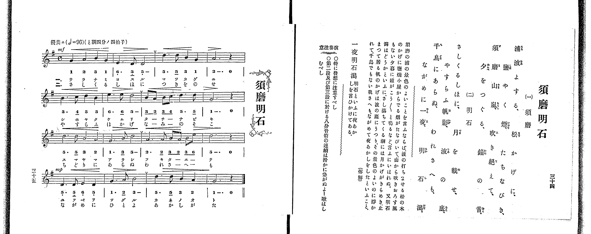

# 須磨明石

> Re:Shōka 使用 AI 協助辨識與重建樂譜，可能會有錯誤。歡迎[回報](https://github.com/TMDLang/reshoka/issues)。

- **鋼琴伴奏版**：<br><audio controls src="suma_akashi.mp3"></audio>
- **NEUTRINO 歌聲合成版**：<br><audio controls src="suma_akashi_neutrino.mp3"></audio>

- 出處：共益商社樂器店《唱歌教科書 教師用 巻二》第三十四～三十五頁（第十六曲）
- NDL Digital Collections PID 854863（https://dl.ndl.go.jp/pid/854863）掃描 P023.jpg

## 說明

原書資訊與歌詞全文（NDL PID 854863《唱歌教科書 教師用 巻二》第三十四～三十五頁，掃描 P023.jpg）：
調性與拍號：ト調四分ノ四拍子（G 大調 4/4 拍，譜上記 C），♩=96，「優美ニ」
註記：單聲部，分節歌二節（第一節題「須磨」、第二節題「明石」；譜下配字二行：一＝片假名、二＝平假名）。原書右頁歌詞標題與左頁譜題皆作「須磨明石」（非「須摩明石」）。全曲四段共十六小節，第一段標 mf、第四段標 mp，各段第二小節末有換氣記號（v），各段第四小節為附點二分音符加四分休止符。五線譜與簡譜逐音核對一致。
原典演奏注意：〇特に發想に注意すべし。〇第二段及び第三段に於ける八分音符の連續は滑かに急がぬよー歌はしむべし。
原典曲意：「須磨の浦の景色のよいことを言ふならば、波の打ちよせる松の木のかげに、鹽燒小屋からでる烟がたなびいて、山から吹きおろす風もない夕暮に、鐘がこう〳〵と鳴るなど、言ふにいはれぬ。又明石潟はどうかといふに、さし滿ちてくる潮には月かげがきらめき、止まって居る帆のかげは波の底にうつり、その景色のよいのに浮かれて、千鳥でもない我さへも、ながめて夜あかしをしたといふこと。（俗解）」
原典語釋：「一夜明石潟」＝明石といふに夜あかしを言ひかけてある。


## 歌詞

```text
一、（須磨）
浦波よする、松かげに、
鹽やく煙、たちなびき、
須磨山嵐、吹き絶えて、
夕をつぐる、鐘の音。

二、（明石）
さしくるしほに、月を載せ、
やすらふ帆影、波の底、
千鳥にあらぬ、われさへも、
ながめに一夜、明石潟。
```

## ABC

<div class="abc-score" data-abc-src="suma_akashi.abc" aria-label="五線譜載入中"></div>

[下載 ABC 原始檔](suma_akashi.abc)

## TMD 檔案連結

- [主旋律 TMD 檔案](suma_akashi.tmd) [[在 TMD Studio 編輯](https://tmdlang.github.io/Tmd-TS/#tmd=s7IKdvYPcrWy4qpTUCpJTLdSSM7PyUlNLsnMz7PKrsxPzc6ML87Iz05Ugisoy88pzU21yk7MizeKtzA1sTAzRkgW55cWJadaFSdn5OfnxJekVpQk5edno8vHFySmp1oFGBgh6Swoyi9LzUvMA-ouKMrMK0lNAWtHKEgty0xJBUkXJwOtLkstykzLTE1BcldqUTHI1VArSooS84qTizILQF5BqEpPzStKtUrOyMxJKUrNiy_Oz0tHSKblF-VaFZcU5RdkZCYjhEsyUoEezknMSwFaXZCKLlGQk5iMIVieWJJahBDML8pMz8yzyk3NzMrEEiz5RSUZ-elFiQUZlVYZmcUlQOXJiTnxwDAGBryWlsLLBR3PF694NqPv-fzNClpaXIq2CpZmXPa2Cu5cNib6JnYgg56273oxc-r7PbOetm58Prvr6dS250v2PVvR9HTmiqe7pj9u6Ho6ZeOztT3Pps58vnzis9k7FICspztWP5-yQuHp9t1PdvU8buh-vmbNkx2dT3sbn86e_X7vPAj7ya4pLxc0vt_TAZQFSbWufTZ70_s9nWDn-7n4KLgA_VaSmKPgDE86xQoBni4KkMQB1JhRUlJQbKWvn5KjlwfE6fl6WQX6BZkp-jAVnc_6mp_19yuAkgRQDhglXPpaCrbUAlwKCgpP--YDPf1ic_uLFV0vOtqBIfFi5bynrSueTWsHuhDkDYSTqRBYPWg-AvoRGDUgh7xYtf9Zw3KQE7p7X8ycDxR93NwBFASa8rSj7XFzH5ABlHq6dgLQXe4KT5csB0oqAGNZASgKNPjF2jlPdnS9WDFDwRlsaM-jmSttLc2AjMcNPU9bVj3f1_e4uftxQy_YshW7gSpBiWLauheNm142rwCqA1rzfH0D0HtAfwAZkJh9sqMByH65EGQKJLkBjXjc0AiSAiuDSEHSIFDq_Z7ZYJd0v2wFunU6UM2LhT1Ai4DmvN8z93ln-9PG9qcTQCYApYAiT3duhogAHf24oQkSHU_7NwNDCxIXz1bMBFoBDJen25cBBYGGA7nPZ7U92TsH7iQk2ztezp0HEX82cSWSONhwYLTO3gQKx3VbgbkBkmifbugHe7YH4lmgFNBGhdw0iB8hisEiBaAgmtAC5EL8DtH4bM7qZ3M6n_XPfrZhMTBIwTHXUQaJAbhqUByCVT9v2vVyZsvL3fNA-jvaXs7f_HzNsqddCyCR_GTPxGdrFwFFgG4FJpjn22cBfQv0-fMNC0HebpgAVP9swY6nG3qBDn3RvgWoDJqEn7bueLZnytOl_c82r3jW0g9KPA3tzzt3Pm5c_XzmnmfNm4EMiNTjxpmPG4HiwJzfBFID9gooPPq7HjcCXQNKu0AuSP20PY8bJz5u6n7auhru1seN6142LH4OTOiN65_tnvi4sRuksmHp40agyJrHTR2Pm_cA4w0oC7KiqQFuF5JDZ2-CORGWohrXPdsKMvrZzPUvOjcBGSCDGlseN05-3LjicdOkFyuABgHdtOpxU-fjxg3AqHm2eRFIfSdQwUKw4tlAhz6buw8kOAdkINhlk4COAyp-uXPv8_ZJwBh4uhEo2A02ZDlQ_fPm-WB3A8lVQM-DbQSGfePTjRshyp5OALq-93Fj1-MmIDnz5SKgY5rAilueLpn6bBbQFrD5E2aAzQE6pu1xAzC9AZ264uXmLUArwIpXAtXAvLAabMv6x03g8AKmyf4OSCp9thfoDGCorQQZAnI80BdAlWAtDY2PG6cCw_HZ7v0g_wId2dgP8u9esAOAMTEHGAIQ_wKN7QV5sAmoBZTLgAnqcSMwWBYDdT3d2AqKzh1A8-Hhsx4Skk93Ac0HGgWUWvK4qQts41xsMQKy8dlWsHaQF8DB1dv8cjMwBQCDFBo4zzqAKQNo4A6QCMgooGAP2EnLni6Z87gRqAxoOzB9AB0wHRz-cM-CY7yhCZiJnuyf_mL5YnDOBZdZkNTzYtW8l-3dkNQDzAVA4xDBB8rnc6F5Hin40KwExwTQS0Au0JXAoGwCxRMwhYIsARoJdDCoGAGnTKDtIFFg6gQFEygIZoIVN4KTGiKFgRQBU9njJqCV_c9bZ4I9DfQWMK4gKQsUFWBFYGOBCezp1gmgoAMnsOdbtz1uBJoNCkywT5dMBQfNkseNEyDWgVPYOmAWhLsTVNWA3AnxLtSdkFQCSRxgxm6I80DpA-hxYFAC8wnEDrBTgZ4BCm0FpoinezfCcxUoLUAdAo1ZYMIABhJQKTDFNj5uAhoPjHpE_EKshsfxaki8gMxDRA24AKC8yoYCBS19Lq7g0txEx-zE4oxMq4DMxLx8hxqDmmqQNQo2Flp2YEZ1blotmAFsNjxuWqbwuHklEHcB8XyFGiC5Aii6E0ivBvPmAXELUGQ1EG8Ci3SDLALpr1EwVNBVMAJiYyAGsWsUzOKBlK6CaTwIgVggQVOIGJIykCYYNACJgA30MQSa39gG5AMDFkQ2rgKT-8F6gEkNrB4YRUB2N9x0YFaGii8BYpA4MAlCZVYj2QNyD9QeI5DcVLDK6WCyH2wnSC9IBiQGEt2NZAJIfAlUvBeoFmQDMF1AZWZjtQccwNuBQTYbiIGOa1oP9sZGIG8BEK8C8_YDWXuAuBFKgyJiMlhmLSKgQSGnq2ACDkkQGxjQYBEzaNiCRIyBoWoMVQMKbUj04AplJD82tcDDACQzESLT1ADEXUi-nw9WtRAeLyB6M1imF3cog82GxRkkTrdCzdsNlemGxhfMHkScQ8IXRM8Fy0zGHcqgBAtKqsBQBtIgixdBEjYw_EGJdio4POGh3QRM5EAaJNOGCGXkdApKobAQNEYKZUjKBYU0CJvBdWEP5ZlQ9--DhzIorYJkmqCh3AmPC4g4KHSgaQwa4qBUD5JZhjuUwbECUgvyMCjOIOkW3Z41CHuaQLENEu-B54QdUBmIDnR7qnMLEKVGM6jUAAZpMzBWmyGlAqiM2AArNUClRTPQB819QDY4mTd3IAUzvIwAlxZgLiyoQYEKcySu6MAa1E2gYgOSvIDtK7DXYIUALNtOQCs2IOzHjcB0AU5owDYNVGYFnqCGJX1gwDU1ogT1JqgMqACFFFUoUQBO6JDipgcqA4pgVHtqubh07RQQpbgCkKfMBQA)]
- [鋼琴伴奏 TMD 檔案](suma_akashi_piano.tmd) [[在 TMD Studio 編輯](https://tmdlang.github.io/Tmd-TS/#tmd=s7IKdvYPcrWy4qpTUCpJTLdSyC8qychPL0osyKi0ysgsLskvykxOzInPTsxLVOLS0lJ4uaDj-eIVz2b0PZ-_-f2ejpfde55P2PJkz5anS_ufd3a839OpoKXFpWirYGnGZW-r4M5lY6JvYgcy_Wn7rhczp77fM-tp68bns7ueTm17vmTfsxVNT2eueLpr-uOGrqdTNj5b2_Ns6sznyyc-m71DAch6umP18ykrFJ5u3_1kV8_jhu7na9Y82dH5tLfx6ezZ7_fOg7Cf7JryckEj0C1AWZBU69pnszcBHaIEstXPxUfBJTM9syQxR8E5PycnNbkkMz-vWCHA00XBwtTEwswYqDGjpKSg2EpfPyVHLw-I0_P1sgr0CzJT9GEqOp_1NT_r71cIMDAyBsqlK3FxBZfmJjpmJxZnZFoFZCbm5Qd5ONQY1FRzKQCBjYWWHZhRnZtWC2boayk8blqm8Lh5JRB3AfF8hRoguQIouhNIrwbz5gFxC1BkNRBvAot0K2jpg_XXKBgq6CoYAbExEIPYNQpm8UBKV8E0HoRALJCgKUQMSRlIEwwagETABvoYAs1vbAPyHzd1gsjGVWByP1jP46YOsPrHjTOB7G646Y8b90HFlwAxSPxx4ySozGoke0DugdpjBJKbClY5HUz2g-0E6QXJgMRAoruRTACJL4GK9wLVgmx43LgOKjMbqz3gAN4ODLLZQAx0XNN6sDc2AnkLgHgVmLcfyNoDxI1QGhQRk8EyaxEBDQo5XQUTcEiC2MCABouYQcMWJGIMDFVjqBpQaEOiB1coI_mxqQUeBiCZiRCZpgYg7kLy_XywqoXweAHRm8EyvbhDGWw2LM4gcboVat5uqEw3NL5g9iDiHBK-IHouWGYy7lAGJVhQUgWGMpAGWbwIkrCB4Q9KtFPB4QkP7SZgIgfSIJk2RCgjp1NQCoWFoDFSKENSLiikQdgMrgt7KM-Eun8fPJRBaRUk0wQN5U54XEDEQaEDTWPQEAelepDMMtyhDI4VkFqQh0FxBkm36PasQdjTBIptkHgPPCfsgMpAdKDbU51bgCg1mkGlBjBIm4Gx2gwpFUBlxAZYqQEqLZqBPmjuA7LByby5AymY4WUEuLQAc2FBDQpUmCNxRQfWoG4CFRuQ5PW4cSfYa7BCAJZtJ6AVGxD240ZgugAntMeNoKADyazAE9SwpA8MuKZGlKDeBJUBFaCQogolCsAJHVLc9EBlQBGMak8tZiHug1yIm0ALcWAsvOjretne-7R1x8vZrZC6DjmI4xWiTeNjFQyBtGEsUKRGwQTINEGIwIpwCBdJHVwvnAFTi2YCQgRKwdTBNcLEMe1BtR1hE06VWFxFyFRM2zF8hN9-A0iE6NopIOIk2gcohyZiBBZR5gIA)]

## 分析

```text
================================================================================
📊 TMD Song Profile: [ 須磨明石 ]
================================================================================
⏱  Duration:       0:40 (40.0s), 16 measures total
🎼 Key & Tempo:    首調基準 G, != 96.0 BPM, <4/4>
   - 分析範圍：      由實際發聲的音符與和弦推測調性；播放脈絡另行呈現
🎤 人聲音域:    D4 (MIDI 62) – E5 (MIDI 76) [跨度: 14 個半音 / 1.2 個八度, 難度: moderate]
   - 最低音:  D4 in [SumaAkashi #1 @ m.2, 0:03]
   - 最高音: E5 in [SumaAkashi #1 @ m.6, 0:12]
   - 適合: soprano, mezzo-soprano, contralto, tenor, baritone, bass
🏛  結構:      SumaAkashi (40.0s)
⚡ 編曲密度:        Peak 1 軌道同時演奏
🗝  調性診斷：       D 大調（純淨自然大調，未偵測到可信轉調）
   - 風格氣質:    純淨自然大調（陽光明朗、易唱易記，無明顯調外色彩）
   - 轉調歷程:    全曲維持單一推測調性（未偵測到可信轉調）
   - 核心骨幹音:  D, G, B, A, E
   - 調性數值:    D 大調 [相關度: 0.84, 穩定度: Moderate, 自然音純度: 98.3%]
   - 候選調性 (K-S): D 大調 (0.84), G 大調 (0.81), B 小調 (0.67)
   - 五度圈歷程:   +2
   - 各段落調性細節:
     • [SumaAkashi #1]: D 大調 (r: 0.84, 自然音純度: 98.3%, 調外音: C)

  [ 五度圈游移軌跡 ]
               C  
         F            G  
      Bb              [D ]*
      Eb               A  
         Ab           E  
            Db       B  
               F# 
     (* = active key center)

  [ 十二半音累積音高分佈 ]
     C  : █                          1.7%
     C# :                            0.0%
     D  : ████████████████████████  35.8%
     D# :                            0.0%
     E  : ██████                     8.3%
     F  :                            0.0%
     F# :                            0.0%
     G  : █████████████             20.0%
     G# :                            0.0%
     A  : ███████████               15.8%
     A# :                            0.0%
     B  : ████████████              18.3%
--------------------------------------------------------------------------------
Assignment 軌道音域：
  - Piano         : D4 – E5 (14 個半音 / 1.2 個八度, 52 個音符)
================================================================================
```


## 原書掃描頁




