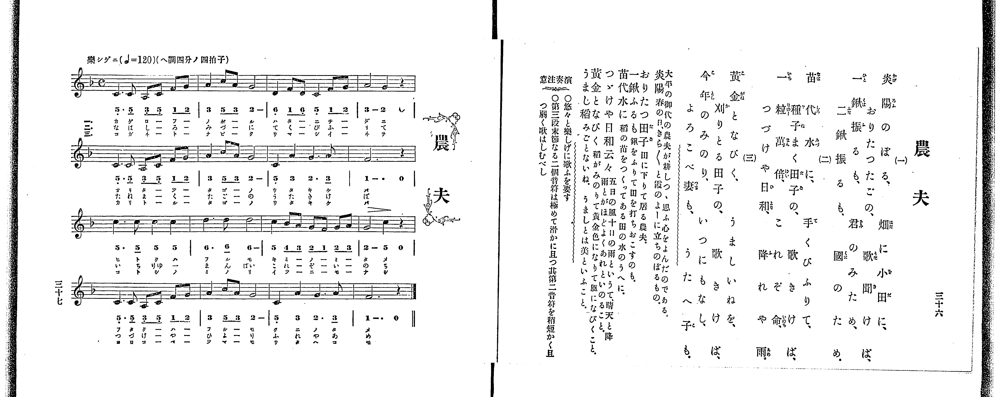

# 農夫

> Re:Shoka 使用 AI 協助辨識與重建樂譜，可能會有錯誤。歡迎回報。

<audio controls src="nofu.mp3"></audio>

- 出處：共益商社樂器店《唱歌教科書 教師用 巻二》第三十六～三十七頁（第十七曲）
- NDL Digital Collections PID 854863（https://dl.ndl.go.jp/pid/854863）掃描 P024.jpg

## 說明

・出處：出處：共益商社樂器店《唱歌教科書 教師用 巻二》第三十六～三十七頁（第十七曲）
・出處：NDL Digital Collections PID 854863（https://dl.ndl.go.jp/pid/854863）掃描 P024.jpg
・調性與拍號：調號 ?= F，拍號 <4/4>，速度 != 120

## 歌詞

```text
（TMD 檔案未包含歌詞註解）
```

## ABC

```abc
X:1
T:農夫
M:4/4
L:1/16
Q:1/4=120
K:F
V:V1 name="Piano" snm="Pia"
[V:V1]
[M:3/4] C3 C A,2 C2 F2 G2 | [M:4/4] A4 c2 A2 G8 | D4 F2 D2 C4 F2 G2 | A8 G4 z4 |
[M:3/4] C3 C A,2 C2 F2 G2 | [M:4/4] A4 c2 A2 G8 | C4 A4 G6 A2 | F12 z4 |
c6 c2 c4 c4 | d6 d2 d8 | c4 B2 A2 G2 F2 G2 A2 | G8 C4 z4 |
[M:3/4] C3 C A,2 C2 F2 G2 | [M:4/4] A4 c2 A2 G8 | C4 A4 G6 A2 | F12 z4 |
[M:3/4] C3 C A,2 C2 F2 G2 | [M:4/4] A4 c2 A2 G8 | D4 F2 D2 C4 F2 G2 | A8 G4 z4 |
[M:3/4] C3 C A,2 C2 F2 G2 | [M:4/4] A4 c2 A2 G8 | C4 A4 G6 A2 | F12 z4 |
c6 c2 c4 c4 | d6 d2 d8 | c4 B2 A2 G2 F2 G2 A2 | G8 C4 z4 |
[M:3/4] C3 C A,2 C2 F2 G2 | [M:4/4] A4 c2 A2 G8 | C4 A4 G6 A2 | F12 z4 |
[M:3/4] C3 C A,2 C2 F2 G2 | [M:4/4] A4 c2 A2 G8 | D4 F2 D2 C4 F2 G2 | A8 G4 z4 |
[M:3/4] C3 C A,2 C2 F2 G2 | [M:4/4] A4 c2 A2 G8 | C4 A4 G6 A2 | F12 z4 |
c6 c2 c4 c4 | d6 d2 d8 | c4 B2 A2 G2 F2 G2 A2 | G8 C4 z4 |
[M:3/4] C3 C A,2 C2 F2 G2 | [M:4/4] A4 c2 A2 G8 | C4 A4 G6 A2 | F12 z4 |
```

## TMD 檔案連結

- [主旋律 TMD 檔案](nofu.tmd) [[在 TMD Studio 編輯](https://tmdlang.github.io/Tmd-TS/#tmd=s7IKdvYPcrWy4qpTUCpJTLdSSM7PyUlNLsnMz7PKrsxPzc6ML87Iz05Ugisoy88pzU21yk7MizeKtzA1sTAzRkgW55cWJadaFSdn5OfnxJekVpQk5edno8vHFySmp1oFGBiZIGQKivLLUvMS84C6C4oy80pSU8DaEQpSyzJTUkHSxclAq8tSizLTMlNTkNyVWlQMcjXUipKixLzi5KLMApBXEKrSU_OKUq2SMzJzUopS8-KL8_PS0SXL84uy0STS8otyrYpLivILMjKTEcIlGanAkACpRxcryEnMA7pdS0vhxb5NT5esVtDS4lK0VTA0MuCyt1Vw47Ix0TexA-l52r7rxcyp7_fMetq68fnsrqdT254v2fdsRdPTmSue7pr-uKHr6ZSNz9b2PJs68_nyic9m71AAsp7uWP18ygqFp9t3P9nV87ih-_maNU92dD7tbXzauvb93nkQ9pMdzS8XNL7f0wGUhXCfzd70fk8n2KV-Lj4KLpnpmSWJOQrO8AgvVgjwdFGARClQY0ZJSUGxlb5-So5eHhCn5-tlFegXZKbow1R0PutrftbfrwCKSKAcMLy49LUUbKkFuBQUFJ72zQd6-sXm9hcrul50tAND4sXKeU9bVzyb1g50IcgbCCdTIbB60HwE9CMwakAOebFq_7OG5SAndPe-mDkfKPq4eQZQ8Ons2U872h439wEZQKmnaycA3eWm8HTJcqCkAjCWFYCiQINfrJ3zZEfXixUzFJzBhvY8mrnSFpgcgKzHDT3ACH_ctP1x06bHzd2PG3rBFq7YDVQNShjT1r1o3PSyeQVQKdCq5-sbgF4EOhvIAFoFNrf7ZSvQ5ulAwRcLe4BanuwASs193tn-tLH96YTexw2NQL8DRZ7u3IwQ2QF0BUIN0FGPG5pAITt7E8gr67YCEyQklJ5u6AfaBZR9tnnFs5Z-SJSAgxEoCDIZSEK0PNkJCd4GiBZI4oMpmwJSBgrqTphsJ1Dw-fZZQC8Aw_X5hoVAxvNZbU97NzzZOwcYKKbxeqbxCsbxCkDSUMEIGC5AA4GmPd_a8nJmy8vdwHSwGhggT7sWQN3Z0fZy_ubna5aBLGpdCVQGUQARBIXehI4XKzqeNrcC3QCJled7dgENBLNBcfJszppnq6Y8m7bnxcpNcHc-m7X62YqZCtU2xsAsW6vwZPfSp_sXPF2_7OnEjuf9-4ChAXQ2xApQ6pjZ9LRhDygk-yF-7wQGCygHApMJUpiAwmFXDzwcoCq7e-EB8rxpl4KzCVCxaTwo8XS0P-3sBVqi4G6i8LJhMZAFcTAk0BAhBgyjF8DUtKcfLNQHVAcMJqC6J_vmwo0GKgWGKNCJ0Pz1tHXHsz1Tni7th0QvKGU3tD9rWvC4ofVx4wpQymyc_rhx0uPG1cB097hx6-OmSS-WNT5unAk0AqgS7stnc1aDkknjqsdN3SDPNXRDY6Nx_bOlQF1ALcue7Z74uLEbaNSTHVMeNy552roNpH1XD1Rl06TnK3qfz18LVtMPVbNnI5ANtno9yCVNQCt2ghgoHpi9Ceb0HmDWA6bzx43rnu5b-GT3YiADUgQ_bgQl1BcNU8H-WfK4ae6zhrlA_zzd3wy0-HFTx-OmyY8bFwDVP25c_rgRmCGBWRHoQ3BuhFjzYtW8l-3dEGueN_W9nLkXGENgxwL19wLNAuciYGKa-2zGUqBBz6YvBVr5uLH3cRNQfPPjhq3AEH05Zx7IDqB9zXuAIfF8NVD7QrCte0BWNgHDe937PbOBVjxu7Hrc1PW4cT7Quc-nbICULWDuFLhFQHFwcAI1AlUue7qxFWgIxMMQQ4Dp-2XvGnC8gQ0H6wKJAP0MEgTpAhnSNOlZJ9D_QJcARYCMmWBHNkEMedE9HRiUzzZsAdoFtXfFblDIdgMjBGjOEmAUPW4EhjUwtkEBB3bVOrB6oL_aHjfuAGqEeQoY9MAQmPi4qQUYPk8n9TzZNRGU1sDGAlMpKNAa171ctAKYSaDs2SuA4fa4sQVsFCh7P5u55emSlaDAnNkLkwWaDHTSSlDAghwDdAZQBKIL6BFgIAM9BSxDQW54ubv5ZftEcGACBYHK1oLCE6R41eNGYNLpR_IjUHY_2ARQQEE0vujcBAoHUEoHCy4CagRzIXqRLAI7eB8wwYGMApsJNg2YrkF2KYAdtxaUymDqwBLrn-_rgzkdmGJAxoFSOygdQgpTEAuS_hDppqHx-VRg5loNKlTAaQKqDikRAeMHlHZAeoBBCKxKG8Hx0LgBqhSSVJ71rIcllcanE2aDbZgPyr5QRcDciqZoDjBw4Yqg7gTXCuB6DCXpND7rBGVtcEhBEx_MPyvWARM4OBRAHgCzoe4EZSA0dz7fNOnFhDVPG0A1GSiEQHE97-nEvXBPA1MkMOkgEhlQAphWQOqaWkApBh6ewHwE1gKJWtREADQaHi_gmAKmdYjqpx3A4gLo-hWQxI7Xtbu7nu6EZARYQgIZDDQP6MbV4PwOtBBYnkFcDiqHgAYAI33n02W7ISEMdgYw6naA7AGJgIs-yltYUKCgpc_F5ZefVmoVkJmYl-9QY1CjUA2yQcHG0EzLDswCNuweN60G4k0Kj5vXAvEeIJ4KpmuAZB8Qz4GKrgaL9APV7oeKdAMxSB9EbQNYBGgnyFxotQpm14Bqel0ghFT7YFoXWPXrKhgBcQ1UPajlDFNvDFYOVAjEIDZIHTKsUTCDmAgxBsyB2oFkMNwYGIQZYwAzBhEEwEzbDMRwr7XAvAUSadoCFe0DiyyDigKDq2kj2OsT6OVtuCdhSpGVgMRqwBZgg5iebp4ExB1AT6wHxyvII6CYB6aG5kVgj4LSw3y418E0NIBAaheCWVCPA52GZBeIDePDaGCcIakAsZH5UO9BWSZIAQALMIjv0IMEHiBYvAf0DDieQN4DeQGYdKFOh3kTJArxKkgNKDkDvQnUA_HeUIrTWi4uXTsFUGZXwEIrcwEA)]

## 分析

```text
================================================================================
📊 TMD Song Profile: [ 農夫 ]
================================================================================
⏱  Duration:       1:31 (91.5s), 48 measures total
🎼 Key & Tempo:    首調基準 F, != 120.0 BPM, <4/4>
   - 分析範圍：      由實際發聲的音符與和弦推測調性；播放脈絡另行呈現
🎤 人聲音域:    A3 (MIDI 57) – D5 (MIDI 74) [跨度: 17 個半音 / 1.4 個八度, 難度: challenging]
   - 最低音:  A3 in [Nofu #1 @ m.1, 0:00]
   - 最高音: D5 in [Nofu #1 @ m.10, 0:17]
   - 適合: soprano, mezzo-soprano, contralto, tenor, baritone, bass
🏛  結構:      Nofu (30.5s) -> Nofu (30.5s) -> Nofu (30.5s)
⚡ 編曲密度:        Peak 1 軌道同時演奏
🗝  調性診斷：       C 大調（純淨自然大調，未偵測到可信轉調）
   - 風格氣質:    純淨自然大調（陽光明朗、易唱易記，無明顯調外色彩）
   - 轉調歷程:    全曲維持單一推測調性（未偵測到可信轉調）
   - 核心骨幹音:  C, G, A, F, D
   - 調性數值:    C 大調 [相關度: 0.83, 穩定度: High, 自然音純度: 99.1%]
   - 候選調性 (K-S): C 大調 (0.83), F 大調 (0.70), A 小調 (0.62)
   - 五度圈歷程:   +0 -> +0 -> +0
   - 各段落調性細節:
     • [Nofu #1]: C 大調 (r: 0.83, 自然音純度: 99.1%, 調外音: A#)
     • [Nofu #2]: C 大調 (r: 0.83, 自然音純度: 99.1%, 調外音: A#)
     • [Nofu #3]: C 大調 (r: 0.83, 自然音純度: 99.1%, 調外音: A#)

  [ 五度圈游移軌跡 ]
              [C ]*
         F            G  
      Bb               D  
      Eb               A  
         Ab           E  
            Db       B  
               F# 
     (* = active key center)

  [ 十二半音累積音高分佈 ]
     C  : ████████████████████████  26.3%
     C# :                            0.0%
     D  : █████████                  9.6%
     D# :                            0.0%
     E  :                            0.0%
     F  : ██████████████            15.8%
     F# :                            0.0%
     G  : ████████████████████████  26.3%
     G# :                            0.0%
     A  : ███████████████████       21.1%
     A# : █                          0.9%
     B  :                            0.0%
--------------------------------------------------------------------------------
Assignment 軌道音域：
  - Piano         : A3 – D5 (17 個半音 / 1.4 個八度, 192 個音符)
================================================================================
```


## 原書掃描頁




