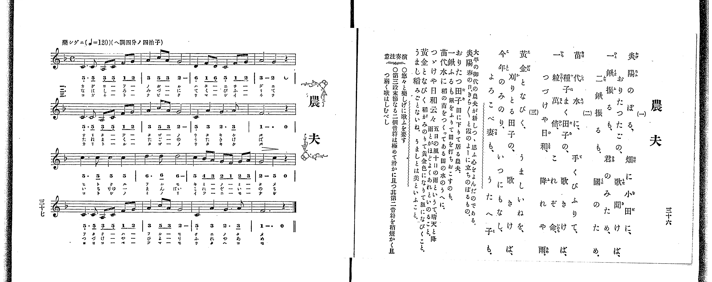

# 農夫

> Re:Shōka 使用 AI 協助辨識與重建樂譜，可能會有錯誤。歡迎回報。

- **NEUTRINO 歌聲合成版**：<br><audio controls src="nofu_neutrino.mp3"></audio>
- **鋼琴伴奏版**：<br><audio controls src="nofu.mp3"></audio>


- 出處：共益商社樂器店《唱歌教科書 教師用 巻二》第三十六～三十七頁（第十七曲）
- NDL Digital Collections PID 854863（https://dl.ndl.go.jp/pid/854863）掃描 P024.jpg

## 說明


- 出處：出處：共益商社樂器店《唱歌教科書 教師用 巻二》第三十六～三十七頁（第十七曲）

- 出處：NDL Digital Collections PID 854863（https://dl.ndl.go.jp/pid/854863）掃描 P024.jpg

- 調性與拍號：調號 ?= F，拍號 <4/4>，速度 != 120


## 歌詞

```text
（TMD 檔案未包含歌詞註解）
```

## ABC

```abc
X:1
T:農夫
M:4/4
L:1/16
Q:1/4=120
K:F
V:V1 name="Piano" snm="Pia"
[V:V1]
[M:3/4] C3 C A,2 C2 F2 G2 | [M:4/4] A4 c2 A2 G8 | D4 F2 D2 C4 F2 G2 | A8 G4 z4 |
w: 1.~か げ ろ _ ふ _ | の ぼ _ る | は た _ に を _ | だ に
w: 2.~な は し _ ろ _ | み づ _ に | て く _ び ふ _ | り て
w: 3.~こ が ね _ と _ | な び _ く | う ま _ し い _ | ね を
[M:3/4] C3 C A,2 C2 F2 G2 | [M:4/4] A4 c2 A2 G8 | C4 A4 G6 A2 | F12 z4 |
w: 1.~お り た _ つ _ | た ご _ の | う た き け | ば
w: 2.~た ね ま _ く _ | た ご _ の | う た き け | ば
w: 3.~か り と _ る _ | た ご _ の | う た き け | ば
c6 c2 c4 c4 | d6 d2 d8 | c4 B2 A2 G2 F2 G2 A2 | G8 C4 z4 |
w: 1.~ひ と く は | ふ る も | き み _ の _ _ _ | た め
w: 2.~い ち りゅ _ | ま ん ばい | こ れ _ ぞ _ い _ | の ち
w: 3.~こ と し の | み の り | い つ _ に _ も _ | な し
[M:3/4] C3 C A,2 C2 F2 G2 | [M:4/4] A4 c2 A2 G8 | C4 A4 G6 A2 | F12 z4 |
w: 1.~ふ た く _ は _ | ふ る _ も | く に の た | め
w: 2.~つ づ け _ や _ | ひ よ _ り | ふ れ や あ | め
w: 3.~よ ろ こ _ べ _ | つ ま _ も | う た へ こ | も
```

## TMD 檔案連結

- [主旋律 TMD 檔案](nofu.tmd) [[在 TMD Studio 編輯](https://tmdlang.github.io/Tmd-TS/#tmd=s7IKdvYPcrWy4qpTUCpJTLdSSM7PyUlNLsnMz7PKrsxPzc6ML87Iz05Ugisoy88pzU21yk7MizeKtzA1sTAzRkgW55cWJadaFSdn5OfnxJekVpQk5edno8vHFySmp1oFGBiZIGQKivLLUvMS84C6C4oy80pSU8DaEQpSyzJTUkHSxclAq8tSizLTMlNTkNyVWlQMcjXUipKixLzi5KLMApBXEKrSU_OKUq2SMzJzUopS8-KL8_PS0SXL84uy0STS8otyrYpLivILMjKTEcIlGanAkACpRxcryEnMA7pdS0vhxb5NT5esVtDS4lK0VTA0MuCyt1Vw47Ix0TexA-l52r7rxcyp7_fMetq68fnsrqdT254v2fdsRdPTmSue7pr-uKHr6ZSNz9b2PJs68_nyic9m71AAsp7uWP18ygqFp9t3P9nV87ih-_maNU92dD7tbXzauvb93nkQ9pMdzS8XNL7f0wGUhXCfzd70fk8n2KV-Lj4KLpnpmSWJOQrO8AgvVgjwdFGARClQY0ZJSUGxlb5-So5eHhCn5-tlFegXZKbow1R0PutrftbfrwCKSKAcMLy49LUUbKkFuBQUFJ72zQd6-sXm9hcrul50tAND4sXKeU9bVzyb1g50IcgbCCdTIbB60HwE9CMwakAOebFq_7OG5SAndPe-mDkfKPq4eQZQ8Ons2U872h439wEZQKmnaycA3eWm8HTJcqCkAjCWFYCiQINfrJ3zZEfXixUzFJzBhvY8mrnSFpgcgKzHDT3ACH_ctP1x06bHzd2PG3rBFq7YDVQNShjT1r1o3PSyeQVQKdCq5-sbgF4EOhvIAFoFNrf7ZSvQ5ulAwRcLe4BanuwASs193tn-tLH96YTexw2NQL8DRZ7u3IwQ2QF0BUIN0FGPG5pAITt7E8gr67YCEyQklJ5u6AfaBZR9tnnFs5Z-SJSAgxEoCDIZSEK0PNkJCd4GiBZI4oMpmwJSBgrqTphsJ1Dw-fZZQC8Aw_X5hoVAxvNZbU97NzzZOwcYKKbxeqbxCsbxCkDSUMEIGC5AA4GmPd_a8nJmy8vdwHSwGhggT7sWQN3Z0fZy_ubna5aBLGpdCVQGUQARBIXehI4XKzqeNrcC3QCJled7dgENBLNBcfJszppnq6Y8m7bnxcpNcHc-m7X62YqZCtU2xsAsW6vwZPfSp_sXPF2_7OnEjuf9-4ChAXQ2xApQ6pjZ9LRhDygk-yF-7wQGCygHApMJUpiAwmFXDzwcoCq7e-EB8rxpl4KzCVCxaTwo8XS0P-3sBVqi4G6i8LJhMZAFcTAk0BAhBgyjF8DUtKcfLNQHVAcMJqC6J_vmwo0GKgWGKNCJ0Pz1tHXHsz1Tni7th0QvKGU3tD9rWvC4ofVx4wpQymyc_rhx0uPG1cB097hx6-OmSS-WNT5unAk0AqgS7stnc1aDkknjqsdN3SDPNXRDY6Nx_bOlQF1ALcue7Z74uLEbaNSTHVMeNy552roNpH1XD1Rl06TnK3qfz18LVtMPVbNnI5ANtno9yCVNQCt2ghgoHpi9Ceb0HmDWA6bzx43rnu5b-GT3YiADUgQ_bgQl1BcNU8H-WfK4ae6zhrlA_zzd3wy0-HFTx-OmyY8bFwDVP25c_rgRmCGBWRHoQ3BuhFjzYtW8l-3dEGueN_W9nLkXGENgxwL19wLNAuciYGKa-2zGUqBBz6YvBVr5uLH3cRNQfPPjhq3AEH05Zx7IDqB9zXuAIfF8NVD7QrCte0BWNgHDe937PbOBVjxu7Hrc1PW4cT7Quc-nbICULWDuFLhFQHFwcAI1AlUue7qxFWgIxMMQQ4Dp-2XvGnC8gQ0H6wKJAP0MEgTpAhnSNOlZJ9D_QJcARYCMmWBHNkEMedE9HRiUzzZsAdoFtXfFblDIdgMjBGjOEmAUPW4EhjUwtkEBB3bVOrB6oL_aHjfuAGqEeQoY9MAQmPi4qQUYPk8n9TzZNRGU1sDGAlMpKNAa171ctAKYSaDs2SuA4fa4sQVsFCh7P5u55emSlaDAnNkLkwWaDHTSSlDAghwDdAZQBKIL6BFgIAM9BSxDQW54ubv5ZftEcGACBYHK1oLCE6R41eNGYNLpR_IjUHY_2ARQQEE0vujcBAoHUEoHCy4CagRzIXqRLAI7eB8wwYGMApsJNg2YrkF2KYAdtxaUymDqwBLrn-_rgzkdmGJAxoFSOygdQgpTEAuS_hDppqHx-VRg5loNKlTAaQKqDikRAeMHlHZAeoBBCKxKG8Hx0LgBqhSSVJ71rIcllcanE2aDbZgPyr5QRcDciqZoDjBw4Yqg7gTXCuB6DCXpND7rBGVtcEhBEx_MPyvWARM4OBRAHgCzoe4EZSA0dz7fNOnFhDVPG0A1GSiEQHE97-nEvXBPA1MkMOkgEhlQAphWQOqaWkApBh6ewHwE1gKJWtREADQaHi_gmAKmdYjqpx3A4gLo-hWQxI7Xtbu7nu6EZARYQgIZDDQP6MbV4PwOtBBYnkFcDiqHgAYAI33n02W7ISEMdgYw6naA7AGJgIs-yltYUKCgpc_F5ZefVmoVkJmYl-9QY1BTDbJAwcbQTMsOzAK26x43rQbiTQqPm9cC8R4gngqma4BkHxDPgYquBov0A9Xuh4p0AzFIH0RtA1gEaCXIXGitCmbXgCp6XSCE1PpgWhdY8-sqGAFxDViNjyHQiMZusDJgqQu0pBfMBvG2QllQlUYglaugcuuBeDpMJVwPVKUxSOVkqMoeIF4LN3MFispqcLMd5lpjqJwpEIPYIFciwxoFM4h_IJ4Ac6A-RPIW3BgYhBljgOpIsMfXwR22B-4ZSGAgWwvyLkzdfDhrNVzHJCSVC9B0I9TBXIocnPvhqpZiqEe2fxlcth_O2gxnwSMK6JYuDPthetHsB0cSJDpRTYPZgGx_G1x2H5wFj_7GFiSVa9Hth4cOqv3gDAAssZuBGJ6wW2CJGiTStAUq2gcWWQYVBWaWpo3ghD-BskQPCSlQiCHH6hLUUALHEkQW5Ddk_8PCCTk8oRkJbCYsqSNSFHmJHp7EYUqRlYDEasDewwaxJXmEV6fAWbBsgLAUOcoROnqR1ADLZKjKDThsx5bgB8x2cPQMlO2gxN4MLFybO4CpAVh0AktzUAIGlffAOqB5ETiBg2qB-fAkD6ahGQOkdiGYBU3wwESBZBeIDePDaGBZiaQCxEbmQ1TA1JoAMSzpwTIKJF2hJ0Z4UsSWsDYhKYSkfuTSClaCglTCyiuwDDh3ACthDOchghy5nMQWXbBIQpjZCGVhS4Kw0gpi3kKwemCTrhWLwbDMDjEUVKOBmiEoJsCUQqo7kLIeuNnz4CzkEhLdBxA3YHEtUjUKUwkJVUTJCzMLuS5ByGDWBsj-R5R1yHUZLB6QaweEqTCbsSRvYGIGl8-g5A1KwsAGCzTpwpI5SBSS1EFqQI0YYDIH6oEkb4rKckiKAqUErGkOKfYhfgbVt5BMDPE1PH4QId_UAZXrRY7dxp0oKge4LIdlJEQVgz0jIYIEHtEoyRCShUCehmUcdIgtI8EyPCyocCU4hCvhWQMe4BDbQW4mwXZwxkAkXniVjNXv2MryHSi2gyIXZDu6bkzba7m4dO0UQC17BSCtzAUA)]
- [鋼琴伴奏 TMD 檔案](nofu_piano.tmd) [[在 TMD Studio 編輯](https://tmdlang.github.io/Tmd-TS/#tmd=s7IKdvYPcrWy4tLSUnixb9PTJavf7-l42b3n-YQtT_Zsebq0_3lnx_s9nQpaWlyKtgqGRgZc9rYKblw2Jvomdlx1CkpP23e9mDn1_Z5ZT1s3Pp_d9XRq2_Ml-56taHo6c8XTXdMfN3Q9nbLx2dqeZ1NnPl8-8dnsHQpA1tMdq59PWaHwdPvuJ7t6Hjd0P1-z5smOzqe9jU9b177fOw_CfrKj-eWCRqBjgLIQ7rPZm4AuUQLZ6ufio-CSmZ5Zkpij4Jyfk5OaXJKZn1esEODpomBhamJhZgzUmFFSUlBspa-fkqOXB8Tp-XpZBfoFmSn6MBWdz_qan_X3KwQYGJkA5dKVuLj88tNKrQIyE_PygzwcagxqqrkUgMDG0EzLDszS11J43LQaiDcpPG5eC8R7gHgqmK4Bkn1APAcquhos0g9Uux8q0g3EIH0QtQ1gES19sLnVNsbAAK0Fs2sUTOMVdIEQSBmDWGCuIRAbAXENWI2PIdCIxm6wsseNk4CW9ILZIN5WKAuq0gikchVUbj0QT4ephOuBqjQGqZwMVdkDxGvhZq5AUVkNjn6Ya42hcqZADGKDXIkMaxTMIP6BeALMgfoQyVtwY2AQZowBqiPBHl8Hd9geuGcggYFsLci7MHXz4azVcB2TkFQuQNONUAdzKXJw7oerWoqhHtn-ZXDZfjhrM5wFjyigW7ow7IfpRbMfHEmQ6EQ1DWYDsv1tcNl9cBY8-htbkFSuRbcfHjqo9oMzwCpg0gVieMJugSVqkEjTFqhoH1hkGVQUmFmaNoIT_gTKEj0kpEAhhhyrS1BDCRxLEFmQ35D9Dwsn5PCEZiSwmbCkjkhR5CV6eBKHKUVWAhKrAXsPG8SW5BFenQJnwbIBwlLkKEfo6EVS87hxIlTlBhy2Y0vwA2Y7OHoGynZQYm8GFq7NHcDUACw6gaU5KAGDyntgHdC8CJzAQbXAfHiSB9PQjAFSuxDMgiZ4YKJAsgvEhvFhNLCsRFIBYiPzISpgak2AGJb0YBkFkq7QEyM8KWJLWJuQFEJSP3JpBStBQSph5RVYBpw7Hjc1YTgPEeTI5SS26IJFEsLMRigLWxKElVYQ8xaC1Xc9bmrFYjAss0MMBdVowBhHNQGmFFLdgZT1wM2eB2chl5DoPoC4AYtrkapRmEpIqCJKXphZyHUJQgazNkD2P6KsQ67LYPGAXDsgTIXZjCV5AxMzuHwGJW9QEgY2WKBJF5bMQaKQpA5SA2rEAJM5UA8keVNUlkNSFCglYE1zSLEP8TOovoVkYoiv4fGDCPmmDqhcL3LsNu5EUTnAZTksIyGqGOwZCREk8IhGSYaQLATyNCzjoENsGQmW4WFBhSvBIVwJzxrwAIfYDnIzCbaDMwYi8cKrZKx-x1aW70CxHRS5INvRdWPaXovcsPdBbtibINr1L_q6Xrb3Pm3d8XJ2K6Trgz1tG8YrRBvGgihsaQkqaxoPpE3jY4EiNQomQLYJWAdICqILRaUB3CjKLMIQwzAJZhOyGNhRCGdCKZg6uGFIKuFi9Hc8MCp17RRAsRntAxSFs42Q2MZgtjIXAA)]

## 分析

```text
================================================================================
📊 TMD Song Profile: [ 農夫 ]
================================================================================
⏱  Duration:       0:30 (30.5s), 16 measures total
🎼 Key & Tempo:    首調基準 F, != 120.0 BPM, <4/4>
   - 分析範圍：      由實際發聲的音符與和弦推測調性；播放脈絡另行呈現
🎤 人聲音域:    A3 (MIDI 57) – D5 (MIDI 74) [跨度: 17 個半音 / 1.4 個八度, 難度: challenging]
   - 最低音:  A3 in [Nofu #1 @ m.1, 0:00]
   - 最高音: D5 in [Nofu #1 @ m.10, 0:17]
   - 適合: soprano, mezzo-soprano, contralto, tenor, baritone, bass
🏛  結構:      Nofu (30.5s)
⚡ 編曲密度:        Peak 1 軌道同時演奏
🗝  調性診斷：       C 大調（純淨自然大調，未偵測到可信轉調）
   - 風格氣質:    純淨自然大調（陽光明朗、易唱易記，無明顯調外色彩）
   - 轉調歷程:    全曲維持單一推測調性（未偵測到可信轉調）
   - 核心骨幹音:  C, G, A, F, D
   - 調性數值:    C 大調 [相關度: 0.83, 穩定度: High, 自然音純度: 99.1%]
   - 候選調性 (K-S): C 大調 (0.83), F 大調 (0.70), A 小調 (0.62)
   - 五度圈歷程:   +0
   - 各段落調性細節:
     • [Nofu #1]: C 大調 (r: 0.83, 自然音純度: 99.1%, 調外音: A#)

  [ 五度圈游移軌跡 ]
              [C ]*
         F            G  
      Bb               D  
      Eb               A  
         Ab           E  
            Db       B  
               F# 
     (* = active key center)

  [ 十二半音累積音高分佈 ]
     C  : ████████████████████████  26.3%
     C# :                            0.0%
     D  : █████████                  9.6%
     D# :                            0.0%
     E  :                            0.0%
     F  : ██████████████            15.8%
     F# :                            0.0%
     G  : ████████████████████████  26.3%
     G# :                            0.0%
     A  : ███████████████████       21.1%
     A# : █                          0.9%
     B  :                            0.0%
--------------------------------------------------------------------------------
Assignment 軌道音域：
  - Piano         : A3 – D5 (17 個半音 / 1.4 個八度, 64 個音符)
================================================================================
```


## 原書掃描頁




