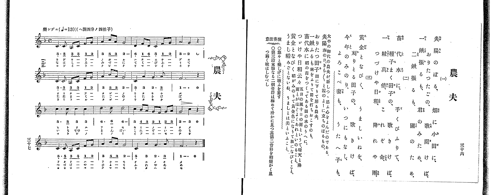

# 農夫

> Re:Shōka 使用 AI 協助辨識與重建樂譜，可能會有錯誤。歡迎回報。

- **鋼琴伴奏版**：<br><audio controls src="nofu.mp3"></audio>
- **NEUTRINO 歌聲合成版**：<br><audio controls src="nofu_neutrino.mp3"></audio>

- 出處：共益商社樂器店《唱歌教科書 教師用 巻二》第三十六～三十七頁（第十七曲）
- NDL Digital Collections PID 854863（https://dl.ndl.go.jp/pid/854863）掃描 P024.jpg

## 說明


- 出處：出處：共益商社樂器店《唱歌教科書 教師用 巻二》第三十六～三十七頁（第十七曲）
- 出處：NDL Digital Collections PID 854863（https://dl.ndl.go.jp/pid/854863）掃描 P024.jpg
- 調性與拍號：調號 ?= F，拍號 <4/4>，速度 != 120


## 歌詞

```text
（TMD 檔案未包含歌詞註解）
```

## ABC

<div class="abc-score" data-abc-src="nofu.abc" aria-label="五線譜載入中"></div>

[下載 ABC 原始檔](nofu.abc)

## TMD 檔案連結

- [主旋律 TMD 檔案](nofu.tmd) [[在 TMD Studio 編輯](https://tmdlang.github.io/Tmd-TS/#tmd=s7IKdvYPcrWy4qpTUCpJTLdSSM7PyUlNLsnMz7PKrsxPzc6ML87Iz05Ugisoy88pzU21yk7MizeKtzA1sTAzRkgW55cWJadaFSdn5OfnxJekVpQk5edno8vHFySmp1oFGBiZIGQKivLLUvMS84C6C4oy80pSU8DaEQpSyzJTUkHSxclAq8tSizLTMlNTkNyVWlQMcjXUipKixLzi5KLMApBXEKrSU_OKUq2SMzJzUopS8-KL8_PS0SXL84uy0STS8otyrYpLivILMjKTEcIlGanAkACpRxcryEnMQ3J7flFmemaeVW5qZlYmllDJLyrJyE8vSizIqLTKyCwuASpPTsyJBwYxMNy1tBRe7Nv0dMlqBS0tLkVbBUMjAy57WwU3LhsTfRM7kBlP23e9mDn1_Z5ZT1s3Pp_d9XRq2_Ml-56taHo6c8XTXdMfN3Q9nbLx2dqeZ1NnPl8-8dnsHQpA1tMdq59PWaHwdPvuJ7t6Hjd0P1-z5smOzqe9jU9b177fOw_CfrKj-eWCxvd7OoCyEO6z2Zve7-kEu9zPxUfBBeitksQcBWd4oilWCPB0UYAkC6DGjJKSgmIrff2UHL08IE7P18sq0C_ITNGHqeh81tf8rL9fAZQYgHLAMOfS11KwpRbgUlBQeNo3H-jpF5vbX6zoetHRDgyJFyvnPW1d8WxaO9CFIG8gnEyFwOpB8xHQj8CoATnkxar9zxqWg5zQ3fti5nyg6OPmGUDBp7NnP-1oe9zcB2QApZ6unQB0l5vC0yXLgZIKwFhWAIoCDX6xds6THV0vVsxQcAYb2vNo5kpbYHIAsh439AAj_HHT9sdNmx43dz9u6AVbuGI3UDUoYUxb96Jx08vmFUClQKuer28AehHobCADaBXY3O6XrUCbpwMFXyzsAWp5sgMoNfd5Z_vTxvanE3ofNzQC_Q4UebpzM0JkB9AVCDVARz1uaAKF7OxNIK-s2wpMkJBQerqhH2gXUPbZ5hXPWvohUQIORqAgyGQgCdHyZCckeBsgWiCJD6ZsCkgZKKg7YbKdQMHn22cBvQAM1-cbFgIZz2e1Pe3d8GTvHGCgmMbrmcYrGMcrAElDBSNguAANBJr2fGvLy5ktL3cD08FqYIA87VoAdWdH28v5m5-vWQayqHUlUBlEAUQQFHoTOl6s6Hja3Ap0AyRWnu_ZBTQQzAbFybM5a56tmvJs2p4XKzfB3fls1upnK2YqVNsYA7NsrcKT3Uuf7l_wdP2ypxM7nvfvA4YG0NkQK0CpY2bT04Y9oJDsh_i9ExgsoBwITCZIYQIKh1098HCAquzuhQfI86ZdCs4mQMWm8aDE09H-tLMXaImCu4nCy4bFQBbEwZBAQ4QYMIxeAFPTnn6wUB9QHTCYgOqe7JsLNxqoFBiiQCdC89fT1h3P9kx5urQfEr2glN3Q_qxpweOG1seNK0Aps3H648ZJjxtXA9Pd48atj5smvVjW-LhxJtAIoEq4L5_NWQ1KJo2rHjd1gzzX0A2Njcb1z5YCdQG1LHu2e-Ljxm6gUU92THncuORp6zaQ9l09UJVNk56v6H0-fy1YTT9UzZ6NQDbY6vUglzQBrdgJYqB4YPYmmNN7gFkPmM4fN657um_hk92LgQxIEfy4EZRQXzRMBftnyeOmuc8a5gL983R_M9Dix00dj5smP25cAFT_uHH540ZghgRmRaAPwbkRYs2LVfNetndDrHne1Pdy5l5gDIEdC9TfCzQLnIuAiWnusxlLgQY9m74UaOXjxt7HTUDxzY8btgJD9OWceSA7gPY17wGGxPPVQO0LwbbuAVnZBAzvde_3zAZa8bix63FT1-PG-UDnPp-yAVK2gLlT4BYBxcHBCdQIVLns6cZWoCEQD0MMAabvl71rwPEGNhysCyQC9DNIEKQLZEjTpGedQP8DXQIUATJmgh3ZBDHkRfd0YFA-27AFaBfU3hW7QSHbDYwQoDlLgFH0uBEY1sDYBgUc2FXrwOqB_mp73LgDqBHmKWDQA0Ng4uOmFmD4PJ3U82TXRFBaAxsLTKWgQGtc93LRCmAmgbJnrwCG2-PGFrBRoOz9bOaWp0tWggJzZi9MFmgy0EkrQQELcgzQGUARiC6gR4CBDPQUsAwFueHl7uaX7RPBgQkUBCpbCwpPkOJVjxuBSacfyY9A2f1gE0ABBdH4onMTKBxAKR0suAioEcyF6EWyCOzgfcAEBzIKbCbYNGC6BtmlAHbcWlAqg6kDS6x_vq8P5nRgigEZB0rtoHQIKUxBLEj6Q6SbhsbnU4GZazWoUAGnCag6pEQEjB9Q2gHpAQYhsCptBMdD4waoUkhSedazHpZUGp9OmA22YT4o-0IVAXMrmqI5wMCFK4K6E1wrgOsxlKTT-KwTlLXBIQVNfDD_rFgHTODgUAB5AMyGuhOUgdDc-XzTpBcT1jxtANVkoBACxfW8pxP3wj0NTJHApINIZEAJYFoBqWtqAaUYeHgC8xFYCyRqURMB0Gh4vIBjCpjWIaqfdgCLC6DrV0ASO17X7u56uhOSEWAJCWQw0DygG1eD8zvQQmB5BnE5qBwCGgCM9J1Pl-2GhDDYGcCo2wGyByQCLvoob2FBgYKWPheXX35aqVVAZmJevkONQU01yAIFG0MzLTswC9iue9y0Gog3KTxuXgvEe4B4KpiuAZJ9QDwHKroaLNIPVLsfKtINxCB9ELUNYBGglSBzobUqmF0Dquh1gRBS64NpXWDNr6tgBMQ1YDU-hkAjGrvByoClLtCSXjAbxNsKZUFVGoFUroLKrQfi6TCVcD1QlcYglZOhKnuAeC3czBUoKqvBzXaYa42hcqZADGKDXIkMaxTMIP6BeALMgfoQyVtwY2AQZowBqiPBHl8Hd9geuGcggYFsLci7MHXz4azVcB2TkFQuQNONUAdzKXJw7oerWoqhHtn-ZXDZfjhrM5wFjyigW7ow7IfpRbMfHEmQ6EQ1DWYDsv1tcNl9cBY8-htbkFSuRbcfHjqo9oMzALDEbgZieMJugSVqkEjTFqhoH1hkGVQUmFmaNoIT_gTKEj0kpEAhhhyrS1BDCRxLEFmQ35D9Dwsn5PCEZiSwmbCkjkhR5CV6eBKHKUVWAhKrAXsPG8SW5BFenQJnwbIBwlLkKEfo6EVSAyyToSo34LAdW4IfMNvB0TNQtoMSezOwcG3uAKYGYNEJLM1BCRhU3gPrgOZF4AQOqgXmw5M8mIZmDJDahWAWNMEDEwWSXSA2jA-jgWUlkgoQG5kPUQFTawLEsKQHyyiQdIWeGOFJEVvC2oSkEJL6kUsrWAkKUgkrr8Ay4NwBrIQxnIcIcuRyElt0wSIJYWYjlIUtCcJKK4h5C8HqgU26ViwGwzI7xFBQjQZqhqCYAFMKqe5AynrgZs-Ds5BLSHQfQNyAxbVI1ShMJSRUESUvzCzkugQhg1kbIPsfUdYh12WweECuHRCmwmzGkryBiRlcPoOSNygJAxss0KQLS-YgUUhSB6kBNWKAyRyoB5K8KSrLISkKlBKwpjmk2If4GVTfQjIxxNfw-EGEfFMHVK4XOXYbd6KoHOCyHJaREFUM9oyECBJ4RKMkQ0gWAnkalnHQIbaMBMvwsKDCleAQroRnDXiAQ2wHuZkE28EZA5F44VUyVr9jK8t3oNgOilyQ7ei6MW2v5eLStVMAtewVgLQyFwA)]
- [鋼琴伴奏 TMD 檔案](nofu_piano.tmd) [[在 TMD Studio 編輯](https://tmdlang.github.io/Tmd-TS/#tmd=s7IKdvYPcrWy4qpTUCpJTLdSyC8qychPL0osyKi0ysgsLskvykxOzInPTsxLVOLS0lJ4sW_T0yWr3-_peNm95_mELU_2bHm6tP95Z8f7PZ0KWlpcirYKhkYGXPa2Cm5cNib6JnYgg5-273oxc-r7PbOetm58Prvr6dS250v2PVvR9HTmiqe7pj9u6Ho6ZeOztT3Pps58vnzis9k7FICspztWP5-yQuHp9t1PdvU8buh-vmbNkx2dT3sbn7aufb93HoT9ZEfzywWNQMcAZSHcZ7M3AV2iBLLVz8VHwSUzPbMkMUfBOT8nJzW5JDM_r1ghwNNFwcLUxMLMGKgxo6SkoNhKXz8lRy8PiNPz9bIK9AsyU_RhKjqf9TU_6-9XCDAwMgHKpStxcfnlp5VaBWQm5uUHeTjUGNRUcykAgY2hmZYdmKWvpfC4aTUQb1J43LwWiPcA8VQwXQMk-4B4DlR0NVikH6h2P1SkG4hB-iBqG8AiWvpgc6ttjIEBWgtm1yiYxivoAiGQMgaxwFxDIDYC4hqwGh9DoBGN3WBljxsnAS3pBbNBvK1QFlSlEUjlKqjceiCeDlMJ1wNVaQxSORmqsgeI18LNXIGishoc_TDXGkPlTIEYxAa5EhnWKJhB_APxBJgD9SGSt-DGwCDMGANUR4I9vg7usD1wz0ACA9lakHdh6ubDWavhOiYhqVyAphuhDuZS5ODcD1e1FEM9sv3L4LL9cNZmOAseUUC3dGHYD9OLZj84kiDRiWoazAZk-9vgsvvgLHj0N7YgqVyLbj88dFDtB2eAVcCkC8TwhN0CS9QgkaYtUNE-sMgyqCgwszRtBCf8CZQlekhIgUIMOVaXoIYSOJYgsiC_IfsfFk7I4QnNSGAzYUkdkaLIS_TwJA5TiqwEJFYD9h42iC3JI7w6Bc6CZQOEpchRjtDRi6TmceNEqMoNOGzHluAHzHZw9AyU7aDE3gwsXJs7gKkBWHQCS3NQAgaV98A6oHkROIGDaoH58CQPpqEZA6R2IZgFTfDARIFkF4gN48NoYFmJpALERuZDVMDUmgAxLOnBMgokXaEnRnhSxJawNiEphKR-5NIKVoKCVMLKK7AMOHc8bmrCcB4iyJHLSWzRBYskhJmNUBa2JAgrrSDmLQSr73rc1IrFYFhmhxgKqtGAMY5qAkwppLoDKeuBmz0PzkIuIdF9AHEDFtciVaMwlZBQRZS8MLOQ6xKEDGZtgOx_RFmHXJfB4gG5dkCYCrMZS_IGJmZw-QxK3qAkDGywQJMuLJmDRCFJHaQG1IgBJnOgHkjypqgsh6QoUErAmuaQYh_iZ1B9C8nEEF_D4wcR8k0dULle5Nht3ImicoDLclhGQlQx2DMSIkjgEY2SDCFZCORpWMZBh9gyEizDw4IKV4JDuBKeNeABDrEd5GYSbAdnDETihVfJWP2OrSzfgWI7KHJBtqPrxrS9Frlh74PcsDdBtOtf9HW9bO992rrj5exWSNcHe9o2jFeINowFUdjSElTWNB5Im8bHAkVqFEyAbBOwDpAURBeKSgO4UZRZhCGGYRLMJmQxsKMQzoRSMHVww5BUwsXo73hgVOraKYBiM9oHKApnGyGxjcFsZS4A)]

## 分析

```text
================================================================================
📊 TMD Song Profile: [ 農夫 ]
================================================================================
⏱  Duration:       0:30 (30.5s), 16 measures total
🎼 Key & Tempo:    首調基準 F, != 120.0 BPM, <4/4>
   - 分析範圍：      由實際發聲的音符與和弦推測調性；播放脈絡另行呈現
🎤 人聲音域:    A3 (MIDI 57) – D5 (MIDI 74) [跨度: 17 個半音 / 1.4 個八度, 難度: challenging]
   - 最低音:  A3 in [Nofu #1 @ m.1, 0:00]
   - 最高音: D5 in [Nofu #1 @ m.10, 0:17]
   - 適合: soprano, mezzo-soprano, contralto, tenor, baritone, bass
🏛  結構:      Nofu (30.5s)
⚡ 編曲密度:        Peak 1 軌道同時演奏
🗝  調性診斷：       C 大調（純淨自然大調，未偵測到可信轉調）
   - 風格氣質:    純淨自然大調（陽光明朗、易唱易記，無明顯調外色彩）
   - 轉調歷程:    全曲維持單一推測調性（未偵測到可信轉調）
   - 核心骨幹音:  C, G, A, F, D
   - 調性數值:    C 大調 [相關度: 0.83, 穩定度: High, 自然音純度: 99.1%]
   - 候選調性 (K-S): C 大調 (0.83), F 大調 (0.70), A 小調 (0.62)
   - 五度圈歷程:   +0
   - 各段落調性細節:
     • [Nofu #1]: C 大調 (r: 0.83, 自然音純度: 99.1%, 調外音: A#)

  [ 五度圈游移軌跡 ]
              [C ]*
         F            G  
      Bb               D  
      Eb               A  
         Ab           E  
            Db       B  
               F# 
     (* = active key center)

  [ 十二半音累積音高分佈 ]
     C  : ████████████████████████  26.3%
     C# :                            0.0%
     D  : █████████                  9.6%
     D# :                            0.0%
     E  :                            0.0%
     F  : ██████████████            15.8%
     F# :                            0.0%
     G  : ████████████████████████  26.3%
     G# :                            0.0%
     A  : ███████████████████       21.1%
     A# : █                          0.9%
     B  :                            0.0%
--------------------------------------------------------------------------------
Assignment 軌道音域：
  - Piano         : A3 – D5 (17 個半音 / 1.4 個八度, 64 個音符)
================================================================================
```


## 原書掃描頁




