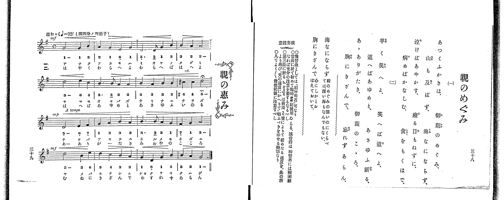

# 親のめぐみ

> Re:Shōka 使用 AI 協助辨識與重建樂譜，可能會有錯誤。歡迎回報。

- **鋼琴伴奏版**：<br><audio controls src="oya_no_megumi.mp3"></audio>
- **NEUTRINO 歌聲合成版**：<br><audio controls src="oya_no_megumi_neutrino.mp3"></audio>

- 出處：共益商社樂器店《唱歌教科書 教師用 巻二》第三十八～三十九頁（第十八曲）
- NDL Digital Collections PID 854863（https://dl.ndl.go.jp/pid/854863）掃描 P025.jpg

## 說明

原書資訊與歌詞全文（NDL PID 854863《唱歌教科書 教師用 巻二》第三十八～三十九頁，掃描 P025.jpg）：
調性與拍號：ト調四分ノ四拍子（G 大調 4/4 拍，譜上記 C），♩=92，「温和ニ」
註記：單聲部，分節歌二節（譜下配字二行：一＝片假名、二＝平假名）。原書右頁歌詞標題作「親のめぐみ」，左頁譜旁裝飾標題作「親の恵み」，依例採右頁標題。全曲四段共十六小節，第一段標 mf，第二段第四小節（第八小節）標 rit. 並於末音 D5 附延長記號（fermata），第三段開頭標 A tempo 與 mp，第四段開頭標 mf；各段第二小節末與第一、二、三段第四小節末有換氣記號（v）。第八小節第一拍臨時升記號（#4 = C#5）依小節內臨時記號慣例亦適用於第二拍之 4。五線譜與簡譜逐音核對一致。
原典演奏注意：〇豫習曲としては「須磨明石」可なり。〇當曲に於て初めて臨時♯記號用ゐらる、該音符は初習者には稍困難なれば充分の注意を要するなるべし。〇第三段に於る A tempo は前段 rit 號によりて緩めたる速度を、此の所より再び「元の速度にかへりて」唱ふべきを示せる樂語なり。〇凡てよく〳〵發想記號に注意すべし。
原典語釋：「海なにならず」＝親のめぐみの深いのにくらべては、深い海もなんでもない；「胸にきざんで」＝心にしかとおぼえておいて。


## 歌詞

```text
一、
あつくふかきは、御親のめぐみ、
山も及ばず、海なにならず、
泣けばあやかす、寢る目もねずに、
病めばかなしむ、食をもくはで。

二、
早く笑へよ、笑へば這へよ、
這へばあゆめと、あさゆふ祈る、
あゝありがたき、御親のこゝろ、
胸にきざんで、忘れずあらん。
```

## ABC

```abc
X:1
T:親のめぐみ
M:4/4
L:1/16
Q:1/4=92
K:G
V:V1 name="Piano" snm="Pia"
[V:V1]
!mf! G8 G4 B4 | A4 G4 E4 G4 | D6 D2 G4 B4 | B4 A4 A8 |
w: 1.~あ つ く | ふ か き は | み お や の | め ぐ み
w: 2.~は や く | わ ら へ よ | わ ら へ ば | は へ よ
d8 e4 c4 | B6 B2 A4 A4 | B4 A4 B4 B4 | ^c4 c4 d8 |
w: 1.~や ま も | お よ ば ず | う み な に | な ら ず
w: 2.~は へ ば | あ ゆ め と | あ さ ゆ ふ | い の る
!mp! D8 E4 F4 | G4 A4 B4 A4 | B6 B2 A4 G4 | F4 G4 A8 |
w: 1.~な け ば | あ や か す | ね る め も | ね ず に
w: 2.~あ あ り | が _ た き | み お や の | こ こ ろ
!mf! d8 B4 e4 | d4 c4 B4 A4 | G4 D4 G4 B4 | B4 A4 G8 |
w: 1.~や め ば | か な し む | しょ く を も | く は で
w: 2.~む ね に | き ざ ん で | わ す れ ず | あ ら ん
```

## TMD 檔案連結

- [主旋律 TMD 檔案](oya_no_megumi.tmd) [[在 TMD Studio 編輯](https://tmdlang.github.io/Tmd-TS/#tmd=s7IKdvYPcrWy4qpTUCpJTLdSSM7PyUlNLsnMz7PKrsxPzc6ML87Iz05Ugisoy88pzU21yk7MizeKtzA1sTAzRkgW55cWJadaFSdn5OfnxJekVpQk5edno8vHFySmp1oFGBiZImQKivLLUvMS84C6C4oy80pSU8DaEQpSyzJTUkHSxclAq8tSizLTMlNTkNyVWlQMcjXUipKixLzi5KLMApBXEKrSU_OKUq2SMzJzUopS8-KL8_PSEZJp-UW5VsUlRfkFGZnJCOGSjFSgh9MSczNzKtFFU3PzUS3IL8pMz8yzyk3NzMpECgAtLYUXy1Y9blz3uKnxceOEx437FbS0uBRtFSyNuOxtFdy5bEz0TexApjxt3_Vi5tT3e2Y9bd34fHbX06ltz5fse7ai6enMFU93TX_c0PV0ysZna3ueTZ35fPnEZ7N3KABZT3esfj5lhcLT7buf7Op53ND9fM2aJzs6n_Y2Pm1d_X7vPAj7yc65Lxc0vt_TAZSFSD2bven9nk6w2_1cfBRcgC4vScxRcIYngWKFAE8XBUgkAzVmlJQUFFvp66fk6OUBcXq-XlaBfkFmij5MReezvuZn_f0KoKgFygGDlktfS8GWWoBLQUHhad98oKdfbG5_saLrRUc7MCRerJz3tHXFs2ntQBeCvIFwMhUCqwfNR0A_AqMG5JAXq_Y_a1gOckJ374uZ84Gij5s7gIJPZ89-2tH2uLkPyABKPV07Aegud4WnS5YDJRWAsawAFAUa_GLtnCc7ul6smKHgDDa059HMlbaWRkDG44aeZztWPp3U87i5-3FDL9iyFbuBKkGJYtq6F42bXjavAKoDWvN8fQPQe0B_ABlAa8Bmdr9sBdo6HSj4YmEPUMuTHUCpuc872582tj-d0Pu4oREoBRR5unMzRARo_eOGJkjAPu3fDPQ3JFSfrZj5cmHPk71zgA5CS7xAZ4EcsH0ZUDHQ0mfTG18snvtyMTCdomt51rgVrv7JvrlP9nU_61sItQWsGGQ1MPpmbwKF17qtwFQPjoq1Tzf0gz3VA46fBqAUUL1CbhpUZFcPUASUkoHBDVUJTtitq2HcTpD6oswSPYUnO5Y9m7bn2ZzVL-dvVnAxVXg5s-Xp7m0vp24Hhik46jrSUotyE0sSIREBSRBA419O6365YC3IGEeFktTcgnwFYHQr5BZA1EDci1ADctrspxNaIO4COhDiEKC1QF0QT0DCHkSCzUd2PlDZszmdz_pnP9uwGO6sMkjUIPsLGhrANNe-4tnMpqe9wIwAVa1somCr4KxsCtQEDGmI8qetyyEKIaqetS4GxsCTXcteNq4EZgJgqEDDsrv3yc5uBROgZU92TXm-fRYwUkGu3rAQyHjZMAEYcM8W7Hi6oRdo94v2LUBl0Lz4tHXHsz1Tni7tf7Z5xbOWflAuaGh_sXH18_2TgFH6uHHF48bpjxuXPW5cD0wRLxd0PF-84tmMvufzNwNTxNP-9Y8bVz1u6gIaB9T1fOo2sJbVQFcBtTztmAtObssg7n80cz3EC0BnP26a8Lip83ETMHc0vli5Cei452tAVgC1AO190dAKNATIfb6i9-nsDS9nLwbb0vO4ccPT1lZQ3gSmSrBrHzdNerEMaMVMkFEgNUByJ8jBEPfAkgHUSU3d8GQAsquzFygFSl8KQEeBLGzqAHmlcdnz7SvBDp8P1PGyYf7TXcuA9gBd-mztEpDNnQ0QlU_beh83AoOh52lrM1AcqhLkcKArdkCMAgXSlI2PQVkI6K5eoDnPl-x63DgbaDKwRnixah5y-D1tXwjSAjS8sf9xA9Dkrc9n7nnWvBkSbCBPQDwN9C7Ml4hIBJr1sr0bHH09z7ZuB5kLcgrQ9M7HjUBBYPadi14GAD2zHei4FpAgSDEwPIGKgUZDorsRIgsyrakJbNTkx43LoezGFmBmARUSzTvAeoFhMQ2qAGzX0_3AQAGKAxMPMDiAqQgYHMBUAfQb0HAgG2gpMHSauEA-gGQsEOtxI9BwYCgDPQkMMqBGoLEglzzdtxCjAANreLpxI9BBT_uBJm4A-7MRm-fBSp9tBqajiWB1TY-bgPYDjZ8JMnv9ImB0PJ8NNBto-VqQBqBmiJ7n01vBNgL1gBMY0DtNILe-XAxMHJPAGoBOBeYCoK-hfgEXD2D7pq8Eyj5fA7QSmBo6gKJQduOGlw3AKIQKgpRC-VCntYGtXAGUAwfHVJBI49bnS4GJDpRhYOHUNBdMAn0OzBnA5AGqGBDh1DgZpKAJJAiuf7BEU-PT_TPA2QroYaBBwPw4GZqkKK_poUBBS5-Ly78y0S_fNzW9NDfTKiAzMS_focagphpkj4KNhZYdmFGdm1YLZgCbG4-bFik8bm4B0usVaoCsqUDWaiBeC2T3g0XmA3mrgPQSIO4DiywEimwAywBtBJlTo2CooAuGINoYiGsUjKA8s3goo0bBFMTUBVEIZSASpBSEQbAGbKCPIdCexiaoGDCVgsl-sA5g9IB53WCyF0yuh8rsh6rvArqwBcxaB5FpagTzJoBJiCq4XUYgnSATwHqh-qB2NYFoYHSBxXaA2R1IMhA5qEzjBqgrQGYhq0bYBQpwcEDOA-JFYGNAQbsCiCcA2bvAIssggd4M9ERzNzjAQayVYHkNUBWtowCtgTUREWAKtccMiE3gIQsKZVjoIsIaRENC30QdpBxEwPQjhT84JCDhuQ_sF1B8gPzXBfV5B9TPwEQNlWmDhy8wA4PJ1VAZMA8ajiDVOMMfLSwhaQCYK-FxuAJJBphhobIgNihdgGQQMQ-qhpDtqs4tQKR8ULA2bQQHPci3oHwAjBpw6t8JDvZeIAbyQOkdElkgEWAkgKIFEfCQRA1N6OYgApIdYCGNCHtYbEByA1gpTCF60gcFFyQ4JmIEByyJQjLATKjMWmhAdcMCCh5dIBlIoEOiAz3oEdkMYjooekHiPXDx-WASlNXwZrLGyWAemGwCqUYOeKQiB5wDQIEKCXhQEIPM2g6kF4BFtj9uXg4ukR43b4JnFBCvH4jbMRM9KHBBCR8iAkr-iIAHhTA4jjDLHFihhTXNQ1MbLOAhgQ1J09PB8g1QGWAt1Q4WhhQVk1DCHiwGLRCWY4Y92BBIaEJiCZZdIMXaNLBZkFAF6YYXSOBYB1YnYDYs80FiD5zFwHogdtVycenaKSBVCwpArjIXAA)]
- [鋼琴伴奏 TMD 檔案](oya_no_megumi_piano.tmd) [[在 TMD Studio 編輯](https://tmdlang.github.io/Tmd-TS/#tmd=s7IKdvYPcrWy4tLSUnixbNXjxnWPmxofN0543Lj__Z6Ol917nk_Y8mTPlqdL-593drzf06mgpcWlaKtgacRlb6vgzmVjom9ix1WnoPS0fdeLmVPf75n1tHXj89ldT6e2PV-y79mKpqczVzzdNf1xQ9fTKRufre15NnXm8-UTn83eoQBkPd2x-vmUFQpPt-9-sqvncUP38zVrnuzofNrb-LR19fu98yDsJzvnvlzQCHQLUBYi9Wz2JqBDlEC2-rn4KLhkpmeWJOYoOOfn5KQml2Tm5xUrBHi6KFiYmliYGQM1ZpSUFBRb6eun5OjlAXF6vl5WgX5BZoo-TEXns77mZ_39CgEGRqZAuXQlLi7_ykS_fN_U9NLcTKuAzMS8_CAPhxqDmmouBSCwsdCyAzOqc9NqwQx9LYXHTYsUHje3AOn1CjVA1lQgazUQrwWy-8Ei84G8VUB6CRD3gUUWAkU2gGW09MHm1CgYKuiCIYg2BuIaBSMozyweyqhRMAUxdUEUQhmIBCkFYRCsARvoYwi0p7EJKva4cQmY7AfreNy4FczrBpO9YHI9VGY_VH0X0IUtYNY6iExTI5g3AUxCVMHtMgLpBJkA1gvVB7WrCUQ_buoEi-0AszuQZCByUJnGDVBXgMxCVo2wCxTg4ICcB8SLwMaAgnYFEE8AsneBRZZBAr0Z6InmbnCAg1grwfIaRZklejoKaalFuYkliZqICDCF2mMGxCbwkAWFMix0EWENoiGhb6IOUg4iYPqRwh8cEpDw3Af2Cyg-QP7rgvq8A-rnx42zoDJt8PB93LgKTK6GyoB50HAEqcYZ_mhhCUkDj5va4HG4AknmceNUqCyIDUoXIBlEzD9uAqUShF3VuQWIlA8K1qaN4KAH-RaUD4BRA079O8HB3gvEQB4ovUMiCyQCjARQtCACHpKooQndHERAsgMspBFhD4sNSG4AK4UpRE_6oOCCBMdEjOCAJVFIBpgJlVkLDahuWEDBowskAwl0SHSgBz0im0FMB0UvSLwHLj4fTIKyGt5M1jgZzAOTTSDVyAGPVOSAcwAoUCEBDwpikFnbgfQCsMj2x83LwSXS4-ZN8IwC4vUDcTtmogcFLijhQ0RAyR8R8KAQBscRZpkDK7SwpnloaoMFPCSwIWl6Oli-ASoz_XFTO1gYUlRMQgl7sBi0QFiOGfZgQyChCYklWHaBFGvTwGZBQhWkG14ggWP9cRMohhCZDxJ74CwG1gOxqxZLreCDXCuYQGsFYMy86Ot62d77tHXHy9mtkNoTqYSPV4g2jIVRNeCUD2SbxscqmABpE6AYTpVQJlwDmkqYfjwq4QJIpkK1YbcdYQKyblwuIE01knuhTFwqMcMASBlAYkXXTgEpYqJ9gJLoQkZgIWUuAA)]

## 分析

```text
================================================================================
📊 TMD Song Profile: [ 親のめぐみ ]
================================================================================
⏱  Duration:       0:41 (41.7s), 16 measures total
🎼 Key & Tempo:    首調基準 G, != 92.0 BPM, <4/4>
   - 分析範圍：      由實際發聲的音符與和弦推測調性；播放脈絡另行呈現
🎤 人聲音域:    D4 (MIDI 62) – E5 (MIDI 76) [跨度: 14 個半音 / 1.2 個八度, 難度: moderate]
   - 最低音:  D4 in [OyaNoMegumi #1 @ m.3, 0:05]
   - 最高音: E5 in [OyaNoMegumi #1 @ m.5, 0:11]
   - 適合: soprano, mezzo-soprano, contralto, tenor, baritone, bass
🏛  結構:      OyaNoMegumi (41.7s)
⚡ 編曲密度:        Peak 1 軌道同時演奏
🗝  調性診斷：       G 大調（純淨自然大調，未偵測到可信轉調）
   - 風格氣質:    純淨自然大調（陽光明朗、易唱易記，無明顯調外色彩）
   - 轉調歷程:    全曲維持單一推測調性（未偵測到可信轉調）
   - 核心骨幹音:  B, A, G, D, E
   - 調性數值:    G 大調 [相關度: 0.78, 穩定度: Moderate, 自然音純度: 96.9%]
   - 候選調性 (K-S): G 大調 (0.78), D 大調 (0.75), B 小調 (0.69)
   - 五度圈歷程:   +1
   - 各段落調性細節:
     • [OyaNoMegumi #1]: G 大調 (r: 0.78, 自然音純度: 96.9%, 調外音: C#)

  [ 五度圈游移軌跡 ]
               C  
         F           [G ]*
      Bb               D  
      Eb               A  
         Ab           E  
            Db       B  
               F# 
     (* = active key center)

  [ 十二半音累積音高分佈 ]
     C  : ███                        3.1%
     C# : ███                        3.1%
     D  : ███████████████████       18.7%
     D# :                            0.0%
     E  : ██████                     6.2%
     F  :                            0.0%
     F# : ███                        3.1%
     G  : █████████████████████     20.3%
     G# :                            0.0%
     A  : ██████████████████████    21.9%
     A# :                            0.0%
     B  : ████████████████████████  23.4%
--------------------------------------------------------------------------------
Assignment 軌道音域：
  - Piano         : D4 – E5 (14 個半音 / 1.2 個八度, 56 個音符)
================================================================================
```


## 原書掃描頁




