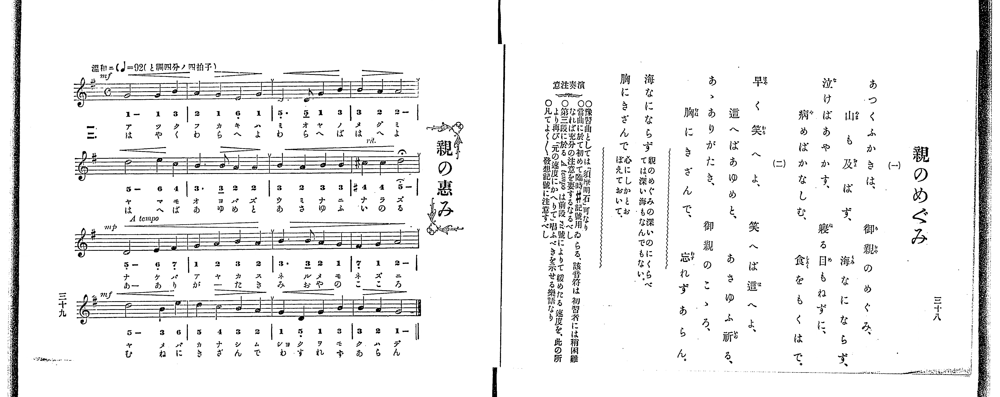

# 親のめぐみ

> Re:Shoka 使用 AI 協助辨識與重建樂譜，可能會有錯誤。歡迎回報。

<audio controls src="oya_no_megumi.mp3"></audio>

- 出處：共益商社樂器店《唱歌教科書 教師用 巻二》第三十八～三十九頁（第十八曲）
- NDL Digital Collections PID 854863（https://dl.ndl.go.jp/pid/854863）掃描 P025.jpg

## 說明

原書資訊與歌詞全文（NDL PID 854863《唱歌教科書 教師用 巻二》第三十八～三十九頁，掃描 P025.jpg）：
調性與拍號：ト調四分ノ四拍子（G 大調 4/4 拍，譜上記 C），♩=92，「温和ニ」
註記：單聲部，分節歌二節（譜下配字二行：一＝片假名、二＝平假名）。原書右頁歌詞標題作「親のめぐみ」，左頁譜旁裝飾標題作「親の恵み」，依例採右頁標題。全曲四段共十六小節，第一段標 mf，第二段第四小節（第八小節）標 rit. 並於末音 D5 附延長記號（fermata），第三段開頭標 A tempo 與 mp，第四段開頭標 mf；各段第二小節末與第一、二、三段第四小節末有換氣記號（v）。第八小節第一拍臨時升記號（#4 = C#5）依小節內臨時記號慣例亦適用於第二拍之 4。五線譜與簡譜逐音核對一致。
原典演奏注意：〇豫習曲としては「須磨明石」可なり。〇當曲に於て初めて臨時♯記號用ゐらる、該音符は初習者には稍困難なれば充分の注意を要するなるべし。〇第三段に於る A tempo は前段 rit 號によりて緩めたる速度を、此の所より再び「元の速度にかへりて」唱ふべきを示せる樂語なり。〇凡てよく〳〵發想記號に注意すべし。
原典語釋：「海なにならず」＝親のめぐみの深いのにくらべては、深い海もなんでもない；「胸にきざんで」＝心にしかとおぼえておいて。

## 歌詞

```text
一、
あつくふかきは、御親のめぐみ、
山も及ばず、海なにならず、
泣けばあやかす、寢る目もねずに、
病めばかなしむ、食をもくはで。

二、
早く笑へよ、笑へば這へよ、
這へばあゆめと、あさゆふ祈る、
あゝありがたき、御親のこゝろ、
胸にきざんで、忘れずあらん。
```

## ABC

```abc
X:1
T:親のめぐみ
M:4/4
L:1/16
Q:1/4=92
K:G
V:V1 name="Piano" snm="Pia"
[V:V1]
!mf! G8 G4 B4 | A4 G4 E4 G4 | D6 D2 G4 B4 | B4 A4 A8 |
d8 e4 c4 | B6 B2 A4 A4 | B4 A4 B4 B4 | ^c4 c4 d8 |
!mp! D8 E4 F4 | G4 A4 B4 A4 | B6 B2 A4 G4 | F4 G4 A8 |
!mf! d8 B4 e4 | d4 c4 B4 A4 | G4 D4 G4 B4 | B4 A4 G8 |
```

## TMD 檔案連結

- [主旋律 TMD 檔案](oya_no_megumi.tmd) [[在 TMD Studio 編輯](https://tmdlang.github.io/Tmd-TS/#tmd=s7IKdvYPcrWy4qpTUCpJTLdSSM7PyUlNLsnMz7PKrsxPzc6ML87Iz05Ugisoy88pzU21yk7MizeKtzA1sTAzRkgW55cWJadaFSdn5OfnxJekVpQk5edno8vHFySmp1oFGBiZImQKivLLUvMS84C6C4oy80pSU8DaEQpSyzJTUkHSxclAq8tSizLTMlNTkNyVWlQMcjXUipKixLzi5KLMApBXEKrSU_OKUq2SMzJzUopS8-KL8_PSEZJp-UW5VsUlRfkFGZnJCOGSjFSgh9MSczNzKtFFU3PzIRZoaSm8WLbqceO6x02NjxsnPG7cr6ClxaVoq2BpxGVvq-DOZWOib2IH0v20fdeLmVPf75n1tHXj89ldT6e2PV-y79mKpqczVzzdNf1xQ9fTKRufre15NnXm8-UTn83eoQBkPd2x-vmUFQpPt-9-sqvncUP38zVrnuzofNrb-LR19fu98yDsJzvnvlzQ-H5PB1AWIvVs9qb3ezrBbvZz8VFwyUzPLEnMUXCGx3GxQoCniwIkFoEaM0pKCoqt9PVTcvTygDg9Xy-rQL8gM0UfpqLzWV_zs_5-BVDcAeWAYcelr6VgSy3ApaCg8LRvPtDTLza3v1jR9aKjHRgSL1bOe9q64tm0dqALQd5AOJkKgdWD5iOgH4FRA3LIi1X7nzUsBzmhu_fFzPlA0cfNHUDBp7NnP-1oe9zcB2QApZ6unQB0l7vC0yXLgZIKwFhWAIoCDX6xds6THV0vVsxQcAYb2vNo5kpbSyMg43FDz7MdK59O6nnc3P24oRds2YrdQJWgRDFt3YvGTS-bVwDVAa15vr4B6D2gP4AMoDVgM7tftgJtnQ4UfLGwB6jlyQ6g1Nznne1PG9ufTuh93NAIlAKKPN25GSICtP5xQxMkYJ_2bwb6GxKqz1bMfLmw58neOUAHoSVeoLNADti-DKgYaOmz6Y0vFs99uRiYTtG1PGvcClf_ZN_cJ_u6n_UthNoCVgyyGhh9szeBwmvdVmCqB0fF2qcb-sGe6gHHTwNQCqheITcNKrKrBygCSsnA4IaqBCfs1tUwbidIfVFmiZ7Ckx3Lnk3b82zO6pfzNyu4mCq8nNnydPe2l1O3A8MUHHUdaalFuYkliZCIgCQIoPEvp3W_XLAWZIyjQklqbkG-AjC6FXILIGog7kWoATlt9tMJLRB3AR0IcQjQWqAuiCcgYQ8iweYjOx-o7Nmczmf9s59tWAx3VhkkapD9BQ0NYJprX_FsZtPTXmBGgKpWNlGwVXBWNgVqAoY0RPnT1uUQhRBVz1oXA2Pgya5lLxtXAjMBMFSgYdnd-2Rnt4IJ0LInu6Y83z4LGKkgV29YCGS8bJgADLhnC3Y83dALtPtF-xagMmhefNq649meKU-X9j_bvOJZSz8oFzS0v9i4-vn-ScAofdy44nHj9MeNyx43rgemiJcLOp4vXvFsRt_z-ZuBKeJp__rHjaseN3UBjQPqej51G1jLaqCrgFqedswFJ7dlEPc_mrke4gWgsx83TXjc1Pm4CZg7Gl-s3AR03PM1ICuAWoD2vmhoBRoC5D5f0ft09oaXsxeDbel53LjhaWsrKG8CUyXYtY-bJr1YBrRiJsgokBoguRPkYIh7YMkA6qSmbngyANnV2QuUAqUvBaCjQBY2dYC80rjs-faVYIfPB-p42TD_6a5lQHuALn22dgnI5s4GiMqnbb2PG4HB0PO0tRkoDlUJcjjQFTsgRoECacrGx6AsBHRXL9Cc50t2PW6cDTQZWCO8WDUPOfyeti8EaQEa3tj_uAFo8tbnM_c8a94MCTaQJyCeBnoX5ktEJALNetneDY6-nmdbt4PMBTkFaHrn40agIDD7zkUvA4Ce2Q50XAtIEKQYGJ5AxUCjIdHdCJEFmdbUBDZq8uPG5VB2Ywsws4AKieYdYL3AsJgGVQC26-l-YKAAxYGJBxgcwFQEDA5gqgD6DWg4kA20FBg6TVwgH0AyFoj1uBFoODCUgZ4EBhlQI9BYkEue7luIUYCBNTzduBHooKf9QBM3gP3ZiM3zYKXPNgPT0USwuqbHTUD7gcbPBJm9fhEwOp7PBpoNtHwtSANQM0TP8-mtYBuBesAJDOidJpBbXy4GJo5JYA1ApwJzAdDXUL-AiwewfdNXAmWfrwFaCUwNHUBRKLtxw8sGYBRCBUFKoXyo09rAVq4AyoGDYypIpHHr86XARAfKMLBwapoLJoE-B-YMYPIAVQyIcGqcDFLQBBIE1z9Yoqnx6f4Z4GwF9DDQIGB-nAxNUpTX9FCgoKXPxeVfmeiX75uaXpqbaRWQmZiX71BjUKNQDbJIwcZCyw7MqM5NqwUzgO2Nx02LFB43twDp9Qo1QNZUIGs1EK8FsvvBIvOBvFVAegkQ94FFFgJFNoBlgFaCzKlRMFTQBUMQbQzENQpGUJ5ZPJRRo2AKYuqCKIQyEAlSCsIgWAN3GNjCeUC8CGQp2AkrgHgCkL0LLLIM4rjmLiDuBjsMxFoJltcA1WU6CtCqShPhUFOoPWZAbAJ3Acg1MFcg3ASiIa40UQcpBxEw_RB3VucWIEISZH3TRrATQc4DhSvQC-DQ3Al2Xi8QA3mg8IN4CiQCdCzI-QgHQgIJGnDmIAISvDAXIdwIczUkdMFKYQqRnYgU2eAwBVkPcSLIMSBHbwfSC8Ai2x83LwenhcfNm-BBD-L1A3E7ZjCCnAEKSogIKEARTgS5BewbzNiGJZcarlouLl07BaRkqwDkKnMBAA)]

## 分析

```text
================================================================================
📊 TMD Song Profile: [ 親のめぐみ ]
================================================================================
⏱  Duration:       0:41 (41.7s), 16 measures total
🎼 Key & Tempo:    首調基準 G, != 92.0 BPM, <4/4>
   - 分析範圍：      由實際發聲的音符與和弦推測調性；播放脈絡另行呈現
🎤 人聲音域:    D4 (MIDI 62) – E5 (MIDI 76) [跨度: 14 個半音 / 1.2 個八度, 難度: moderate]
   - 最低音:  D4 in [OyaNoMegumi #1 @ m.3, 0:05]
   - 最高音: E5 in [OyaNoMegumi #1 @ m.5, 0:11]
   - 適合: soprano, mezzo-soprano, contralto, tenor, baritone, bass
🏛  結構:      OyaNoMegumi (41.7s)
⚡ 編曲密度:        Peak 1 軌道同時演奏
🗝  調性診斷：       G 大調（純淨自然大調，未偵測到可信轉調）
   - 風格氣質:    純淨自然大調（陽光明朗、易唱易記，無明顯調外色彩）
   - 轉調歷程:    全曲維持單一推測調性（未偵測到可信轉調）
   - 核心骨幹音:  B, A, G, D, E
   - 調性數值:    G 大調 [相關度: 0.78, 穩定度: Moderate, 自然音純度: 96.9%]
   - 候選調性 (K-S): G 大調 (0.78), D 大調 (0.75), B 小調 (0.69)
   - 五度圈歷程:   +1
   - 各段落調性細節:
     • [OyaNoMegumi #1]: G 大調 (r: 0.78, 自然音純度: 96.9%, 調外音: C#)

  [ 五度圈游移軌跡 ]
               C  
         F           [G ]*
      Bb               D  
      Eb               A  
         Ab           E  
            Db       B  
               F# 
     (* = active key center)

  [ 十二半音累積音高分佈 ]
     C  : ███                        3.1%
     C# : ███                        3.1%
     D  : ███████████████████       18.7%
     D# :                            0.0%
     E  : ██████                     6.2%
     F  :                            0.0%
     F# : ███                        3.1%
     G  : █████████████████████     20.3%
     G# :                            0.0%
     A  : ██████████████████████    21.9%
     A# :                            0.0%
     B  : ████████████████████████  23.4%
--------------------------------------------------------------------------------
Assignment 軌道音域：
  - Piano         : D4 – E5 (14 個半音 / 1.2 個八度, 56 個音符)
================================================================================
```


## 原書掃描頁




