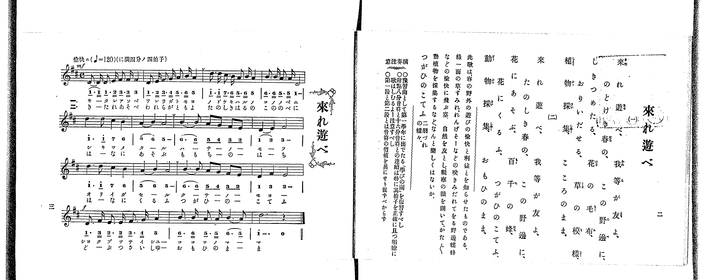

# 來れ遊べ

> Re:Shōka 使用 AI 協助辨識與重建樂譜，可能會有錯誤。歡迎回報。

- **鋼琴伴奏版**：<br><audio controls src="kitare_asobe.mp3"></audio>
- **NEUTRINO 歌聲合成版**：<br><audio controls src="kitare_asobe_neutrino.mp3"></audio>

- 出處：共益商社樂器店《唱歌教科書 教師用 巻二》第二～三頁（第一曲）
- NDL Digital Collections PID 854863（https://dl.ndl.go.jp/pid/854863）掃描 P007.jpg

## 說明

原書資訊與歌詞全文（NDL PID 854863《唱歌教科書 教師用 巻二》第二～三頁，掃描 P007.jpg）：
調性與拍號：ニ調四分ノ四拍子（D 大調 4/4 拍），♩=120，「愉快ニ」
註記：全曲十五小節，分節歌兩節；譜下配字第一節以片假名、第二節以平假名印刷。第一、四段為附點八分音符＋十六分音符節奏，第二、三段為一般音符。標題據歌詞頁作「來れ遊べ」。
原典演奏注意：作為預習曲，應復習第一學年所學〈學びの園〉；附點八分音符與十六分音符之連結，特須使學生正確且明瞭地唱出其拍子；第一段與第二段音符之時值不同，不可混淆。
原典曲意：「此歌は、春の野外の遊びの愉快と利益とを知らせたものである。綠一面の草、すみれ、れんげそーなどの咲きみだれてをる野邊、蝶蜂などの愉快に飛ぶ空。自然を友とし、觀察の眼を開いて、かた〴〵動植物を採集するなど、なんと樂しくはないか。」
原典語釋：「つがひのこてふ」即二羽づれの蝶々（成對的蝴蝶）。


## 歌詞

```text
一、
來れ遊べ、我等が友よ、
のどけき春の、この野邊に、
しきつめたる、花の毛布、
おりいだせる、草の模樣、
植物採集、こころのまま。

二、
來れ遊べ、我等が友よ、
たのしき春の、この野邊に、
花にあそぶ、百千の蜂、
花にくるふ、つがひのこてふ、
動物採集、おもひのまま、
```

## ABC

<div class="abc-score" data-abc-src="kitare_asobe.abc" aria-label="五線譜載入中"></div>

[下載 ABC 原始檔](kitare_asobe.abc)

## TMD 檔案連結

- [主旋律 TMD 檔案](kitare_asobe.tmd) [[在 TMD Studio 編輯](https://tmdlang.github.io/Tmd-TS/#tmd=s7IKdvYPcrWy4qpTUCpJTLdSSM7PyUlNLsnMz7PKrsxPzc6ML87Iz05Ugisoy88pzU21yk7MizeKtzA1sTAzRkgW55cWJadaFSdn5OfnxJekVpQk5edno8vHFySmp1oFGBiYI2QKivLLUvMS84C6C4oy80pSU8DaEQpSyzJTUkHSxclAq8tSizLTMlNTkNyVWlQMcjXUipKixLzi5KLMApBXEKrSU_OKUq2SMzJzUopS8-KL8_PSEZJp-UW5VsUlRfkFGZnJCOGSjFSgh_MSS0qLUtFFi1MTgWYUowsX5CTmIbkdIpiYl5mbmIMQzS_KTM_Ms8pNzczKxBJWUOny1OKS1KK8-NzUnPyUSmTpkoz89KLEgoxKq4zM4hKg8uTEnHhgvAAjS0tL4cm-tsdNPS8bux437lTQ0uJStFUwNDLgsrdVcOGyMdE3sQOZ9LR914uZU9_vmfW0dePz2V1Pp7Y9X7Lv2YqmpzNXPN01_XFD19MpG5-t7Xk2debz5ROfzd6hAGQ93bH6-ZQVCk-3736yq-dxQ_fzNWuAjPd75z3Z0flyQeP7PR0gkR0Nz2Zver-nE-xgPxcfBRegb0oScxSc4QmsWCHA00UBkoSAujJKSgqKrfT1U3L08oA4PV8vq0C_IDNFH6ai81lf87P-fgVQwgHKASOOS19LwZZagEtBQeFp33ygL19sbn-xoutFRzvQ6y9WznvauuLZtHagC0HeQDiZzNDpQfMF0F_A8AdZ_mLV_mcNy0HWdve-mDkfKPq4uRso-HT27KcdbY-b-4AMoNTTtROAbnFReLpkOVBSARiVCkBRsDE9j2autAXGMpD1uKHnWUvn0_2rgWY8bugFm79i94sVM8CRvQIYOU97G5_smvJ0Q__z9Q1ADUArgAygd562rgSLzH6xds6THd0vW4E2TodEKVD8ye6lzzvbnza2P53Q-7ihEeI9iPjTnZsh4k97Nzzt2P64oQmiC6gM5PJ1W5837Xo5s-XlbmCIrgZa93L-5udrlr3f0w10ydPWtXARoGlPl_YDnQQxHKgdGHYQ7UDTXnSsgSgDmv9sxcyXC3ueTZ4FiShg-D7ZOwfoc-S0D_Q8UCU0cp-27ni2ZwrQ9GebVzxrAdoxC6gB5KwFE57vnwROsT3P2juf7lsJ5EJc_3Ttjqc7tzzrBDEeN3SAyMbNjxvXPZ0z6XEDMMxnY3oJGIVoXnqys_tlw-LnW4Ex1_O8c-fLBR1P9u4HGvV8yvxnaxc_XwT02JRnM_qez1v7dM4GYKoC5sunrdtgkT0bmqHWbQWaDAkUIBtu8rOZTU8b9jzZ0ft0Qg_QfBCjf_2z7dufbW9D9fnsTRA_g9LG2iXAMHvcuB4Yus9mLAX652V739Ml00AMULCBfAhNP40rnnasBBYOQMbjpknP5y993NT5uHH248b5j5uagMoeNy5_3Nj0uAmYzJqeb1sAdOjLuYuA4i96O4GGP26c-bhxPzA2QGwg2TT5ceOkx41zHzfvedy46nHjSlBQTtr0uLEXpKxxAUhN4zKgRUADgU562dQF1Phi7rYXc4B2QdXDHLb65WKgM7Y9X7kLaPWL9lXPW7YBNT7t7wY5tRFYfDW-WN7wdP18oJbnc_YApV5OA0q1gMwHOQzInv-4Ycvjhq1Pu6c-W9L7vHMlUM2zvoUvZ7eBnA30EcRGkOJVYJevAJaNIJMb-0FBB5IFmgbyODSLQQL6xap5L9u7IQH9uHHJ40YgCfQhMKSARix73LgVqPpp72ZQxtm393EjMECBCtYBPfm4oRWYtZ91THi6off5rJYXc7cABYE5GxSNIOMhmQnMQknhjc86Jj5fC4yVHpDnmzqgisBWAgNsIjB0IZEM9grQEaDYBgVt42q4UqCngFGw5HETUAUwZoGeanzRtREU2utnP93RDFfX9RikD-jtBaBEAFEHjGmguhULn61YDFUHCU5oWEItnfy4CWgD0En7QAjmJXAGJ8FLoNiEuJaAl8CuB6YSYITNBaYSUGE1c9_T3mZQUAMTE6qifnBsAyMGaBjWCAOrBqYTVF8BAwNoPEQpxFdgdZRXRlCgoKXPxeUNrDeBjZaAzMS8fIcag5pqkBUKNoZmWnZgVnVuWi2YAawNHzetVQBmLSC9H0ivAdKLgHgvkD1ToQZIroeINq8EioLoDiAGqmheAZbtA-JOoMxGqDn9QLwaLA6UbdoMVQHCM4G4G-Q6kL01CoYKukBoCKWNFIzBtDGU1oWrgMmYKJiCaTMoDVYRBzEkTsEcRQ5ZjRmKiCnUVASsAbvHxxDo3MZeqBgwyUDoph4guwkqNheId8LNfdzUj1DT1AlVA1K_AireBMQdCPWN66BqgAHZOBHK7gXi9VD13XA1EPWToWrWIendCcSrsfvAiPY-gJoJdtF0qvsAnBa3Q9NRCxAvBDsSlCqBqROYqkDpDZS-QLwuKA1KWXvAMqA0CRKZipTGIOkDAsEcSDoBpQeYK2EpBSYC48PdBpeBqQKpMAFiULo0AquApSkQDwRhaRgthsBpDBJusFgCxRew-IDxmxrhtsJCG0k1MHzR3QYLe2QzV8FZSHEBjEt0dVuxuxKcjvCZCos9kDqYqaC0BWNtw3Qliu0Q3uPGhdjcicVmmDpUd4JTyypgfANx0xIg3QC2aDdyamkClV2gkm0r1tSyAswbsNQCSyWwVIPqP0hq6UIOiSYQD1iRwkNmAdxWYMWKZgr21ALJ8cihOxXOwpZaEPkfHZKTWmC2I9yGJRUi5QeIih4wuQmbO6ElDEh0GW4TIVUeco23_XHzcmjymAYpbEBJBJSMQFJLoYkEVH2BqzBQgQRKOvPgyWceekVmDI1G9OoKWxWEnERAYmhJDxkaoPgBWoI8bmqHehVYGkKzGyjQYJEJSiJgZa0YIQWigW0qeEgCGyDooYVFDAbjUV0DjvuVUDGiHQJJ0uDKBRqplDiklotL104B0t5RALKUuQA)]
- [鋼琴伴奏 TMD 檔案](kitare_asobe_piano.tmd) [[在 TMD Studio 編輯](https://tmdlang.github.io/Tmd-TS/#tmd=s7IKdvYPcrWy4qpTUCpJTLdSyC8qychPL0osyKi0ysgsLskvykxOzInPTsxLVOLS0lJ4sq_tcVPPy8aux4073-_peNm95_mELU_2bHm6tP95Z8f7PZ0KWlpcirYKhkYGXPa2Ci5cNib6JnYg45-273oxc-r7PbOetm58Prvr6dS250v2PVvR9HTmiqe7pj9u6Ho6ZeOztT3Pps58vnzis9k7FICspztWP5-yQuHp9t1PdvU8buh-vmYNkPF-77wnOzpfLmgEOgAksqPh2exNQKuVQNb4ufgouGSmZ5Yk5ig45-fkpCaXZObnFSsEeLooWJiaWJgZA3VllJQUFFvp66fk6OUBcXq-XlaBfkFmij5MReezvuZn_f0KAQYG5kC5dCUuLm-gkUWpVgGZiXn5QR4ONQY11VwKQGBjaKZlB2ZV56bVghn6WgqPm9YqPG7eA6T3A-k1QHoREO8Fsmcq1ADJ9RDR5pVAURDdAcRAFc0rwLJ9QNwJlNkINacfiFeDxYGyTZuhKkB4JhB3K2jpg-2tUTBU0AVCQyhtpGAMpo2htC5cBUzGRMEUTJtBabCKOIghcQrmKHLIasxQREyhpiJgDdg9PoZA5zb2QsUeN86H0E09QHYTVGwuEO-Em_u4qR-hpqkTqgakfgVUvAmIOxDqG9dB1QADsnEilN0LxOuh6rvhaiDqJ0PVrEPSuxOIV2P3gRHtfQA1E-yi6VT3ATgtboemoxYgXgh2JChVAlMnMFWB0hsofYF4XVAalLL2gGVAaRIkMhUpjUHSBwSCOZB0AkoPMFfCUgpMBMaHuw0uA1MFUmECxKB0aQRWAUtTIB4IwtIwWgyB0xgk3GCxBIqvx41LYPymRritsNBGUg0MX3S3wcIe2cxVcBZSXADjEl3dVuyuBKcjfKbCYg-kDmYqKG3BWNswXYliO4T3uHEhNndisRmmDtWd4NSyChjfQNy0BEg3gC3ajZxamkBlF6hk24o1tawA8wYstcBSCSzVoPoPklq6kEOiCcR73NgCD5kFcFsfN85GMwV7aoHkeOTQnQpnYUstiPyPDslJLTDbEW7DkgqR8gNERQ-Y3ITNndASBiS6DLeJkCoPucbb_rh5OTR5TIMUNqAkAkpGIKml0EQCqr7AVRioQAIlnXnw5DMPvSIzhkYjenWFrQpCTiIgMbSkhwwNUPwALUEeN7VDvQosDaHZDRRosMgEJRGwslaMkALRj5t64SH5uHEfemhhEYPBeFTXgON-JVSMaIdAkjS4coFGKiUOqUVt7vggN3dMoK0dYJS_6Ot62d77tHXHy9mtkDYgUgTGK0QbxiqYxgNp0_hYoAgwn8M4JkDaBCgGVYshDoRQJtQYmEpspkLF0MyEcrGpRIjR1FS4AIpqqAlo5kLNAFIGkODXtVOAxEC0D1AciWcE5ilzAQA)]

## 分析

```text
================================================================================
📊 TMD Song Profile: [ 來れ遊べ ]
================================================================================
⏱  Duration:       0:30 (30.0s), 15 measures total
🎼 Key & Tempo:    首調基準 D, != 120.0 BPM, <4/4>
   - 分析範圍：      由實際發聲的音符與和弦推測調性；播放脈絡另行呈現
🎤 人聲音域:    D4 (MIDI 62) – D5 (MIDI 74) [跨度: 12 個半音 / 1.0 個八度, 難度: easy]
   - 最低音:  D4 in [Kitare #1 @ m.1, 0:00]
   - 最高音: D5 in [Kitare #1 @ m.3, 0:04]
   - 適合: soprano, mezzo-soprano, contralto, tenor, baritone, bass
🏛  結構:      Kitare (30.0s)
⚡ 編曲密度:        Peak 1 軌道同時演奏
🗝  調性診斷：       D 大調（純淨自然大調，未偵測到可信轉調）
   - 風格氣質:    純淨自然大調（陽光明朗、易唱易記，無明顯調外色彩）
   - 轉調歷程:    全曲維持單一推測調性（未偵測到可信轉調）
   - 核心骨幹音:  D, A, B, F#, E
   - 調性數值:    D 大調 [相關度: 0.88, 穩定度: High, 自然音純度: 100.0%]
   - 候選調性 (K-S): D 大調 (0.88), B 小調 (0.75), A 大調 (0.71)
   - 五度圈歷程:   +2
   - 各段落調性細節:
     • [Kitare #1]: D 大調 (r: 0.88, 自然音純度: 100.0%)

  [ 五度圈游移軌跡 ]
               C  
         F            G  
      Bb              [D ]*
      Eb               A  
         Ab           E  
            Db       B  
               F# 
     (* = active key center)

  [ 十二半音累積音高分佈 ]
     C  :                            0.0%
     C# : ████                       4.7%
     D  : ████████████████████████  25.8%
     D# :                            0.0%
     E  : █████████                  9.3%
     F  :                            0.0%
     F# : ████████████              13.1%
     G  : ██                         2.5%
     G# :                            0.0%
     A  : ██████████████████████    23.7%
     A# :                            0.0%
     B  : ███████████████████       20.8%
--------------------------------------------------------------------------------
Assignment 軌道音域：
  - Piano         : D4 – D5 (12 個半音 / 1.0 個八度, 72 個音符)
================================================================================
```


## 原書掃描頁




