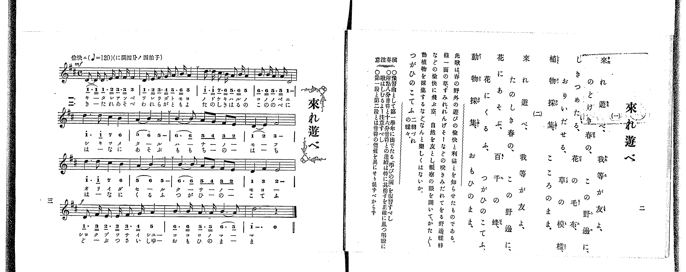

# 來れ遊べ

*找不到鋼琴伴奏版 TMD，未產生音訊。*

- 出處：共益商社樂器店《唱歌教科書 教師用 巻二》第二～三頁（第一曲）
- NDL Digital Collections PID 854863（https://dl.ndl.go.jp/pid/854863）掃描 P007.jpg

## 說明

原書資訊與歌詞全文（NDL PID 854863《唱歌教科書 教師用 巻二》第二～三頁，掃描 P007.jpg）：
調性與拍號：ニ調四分ノ四拍子（D 大調 4/4 拍），♩=120，「愉快ニ」
註記：全曲十五小節，分節歌兩節；譜下配字第一節以片假名、第二節以平假名印刷。第一、四段為附點八分音符＋十六分音符節奏，第二、三段為一般音符。標題據歌詞頁作「來れ遊べ」。
原典演奏注意：作為預習曲，應復習第一學年所學〈學びの園〉；附點八分音符與十六分音符之連結，特須使學生正確且明瞭地唱出其拍子；第一段與第二段音符之時值不同，不可混淆。
原典曲意：「此歌は、春の野外の遊びの愉快と利益とを知らせたものである。綠一面の草、すみれ、れんげそーなどの咲きみだれてをる野邊、蝶蜂などの愉快に飛ぶ空。自然を友とし、觀察の眼を開いて、かた〴〵動植物を採集するなど、なんと樂しくはないか。」
原典語釋：「つがひのこてふ」即二羽づれの蝶々（成對的蝴蝶）。

## 歌詞

```text
一、
來れ遊べ、我等が友よ、
のどけき春の、この野邊に、
しきつめたる、花の毛布、
おりいだせる、草の模樣、
植物採集、こころのまま。

二、
來れ遊べ、我等が友よ、
たのしき春の、この野邊に、
花にあそぶ、百千の蜂、
花にくるふ、つがひのこてふ、
動物採集、おもひのまま、
```

## ABC

```abc
X:1
T:來れ遊べ
M:4/4
L:1/16
Q:1/4=120
K:D
V:V1 name="Piano" snm="Pia"
[V:V1]
!mf! D3 D D3 E F3 F F4 | D3 E F3 G A3 B A4 | d3 d c3 B A3 B A4 | B3 B A3 A D8 |
d6 d2 c4 B4 | A4 B4 A8 | B6 B2 A2 G2 F2 E2 | D4 E4 F8 |
d6 d2 c4 B4 | A4 B4 A8 | B6 B2 A2 G2 F2 E2 | D4 F4 E8 |
!f! D3 F E3 E F3 G A4 | B3 B A3 A B6 A2 | d12 z4 | !mf! D3 D D3 E F3 F F4 |
D3 E F3 G A3 B A4 | d3 d c3 B A3 B A4 | B3 B A3 A D8 | d6 d2 c4 B4 |
A4 B4 A8 | B6 B2 A2 G2 F2 E2 | D4 E4 F8 | d6 d2 c4 B4 |
A4 B4 A8 | B6 B2 A2 G2 F2 E2 | D4 F4 E8 | !f! D3 F E3 E F3 G A4 |
B3 B A3 A B6 A2 | d12 z4 |
```

## TMD 檔案連結

- [主旋律 TMD 檔案](kitare_asobe.tmd) [[在 TMD Studio 編輯](https://tmdlang.github.io/Tmd-TS/#tmd=s7IKdvYPcrWy4qpTUCpJTLdSSM7PyUlNLsnMz7PKrsxPzc6ML87Iz05Ugisoy88pzU21yk7MizeKtzA1sTAzRkgW55cWJadaFSdn5OfnxJekVpQk5edno8vHFySmp1oFGBiYI2QKivLLUvMS84C6C4oy80pSU8DaEQpSyzJTUkHSxclAq8tSizLTMlNTkNyVWlQMcjXUipKixLzi5KLMApBXEKrSU_OKUq2SMzJzUopS8-KL8_PSEZJp-UW5VsUlRfkFGZnJCOGSjFSgh_MSS0qLUtFFi1MTgWYUowsX5CTmIbkdIpiYl5mbmKPEpaWl8GRf2-OmnpeNXY8bdypoaXEp2ioYGhlw2dsquHDZmOib2IG0Pm3f9WLm1Pd7Zj1t3fh8dtfTqW3Pl-x7tqLp6cwVT3dNf9zQ9XTKxmdre55Nnfl8-cRns3coAFlPd6x-PmWFwtPtu5_s6nnc0P18zRog4_3eeU92dL5c0Ph-TwdIZEfDs9mb3u_pBLvQz8VHwSUzPbMkMUfBGR77xQoBni4KkPgF6sooKSkottLXT8nRywPi9Hy9rAL9gswUfZiKzmd9zc_6-xVAsQqUA4Yql76Wgi21AJeCgsLTvvlAX77Y3P5iRdeLjnag11-snPe0dcWzae1AF4K8gXAymaHTg-YLoL-A4Q-y_MWq_c8aloOs7e59MXM-UPRxczdQ8Ons2U872h439wEZQKmnaycA3eKi8HTJcqCkAjAqFYCiYGN6Hs1caQuMZSDrcUPPs5bOp_tXA8143NALNn_F7hcrZoAjewUwcp72Nj7ZNeXphv7n6xuAGoBWABlA7zxtXQkWmf1i7ZwnO7pftgJtnA6JUqD4k91Ln3e2P21sfzqh93FDI8R7EPGnOzdDxJ_2bnjasf1xQxNEF1AZyOXrtj5v2vVyZsvL3cAQXQ207uX8zc_XLHu_pxvokqeta-EiQNOeLu0HOgliOFA7MOwg2oGmvehYA1EGNP_ZipkvF_Y8mzwLElHA8H2ydw7Q58hpH-h5oEpo5D5t3fFszxSg6c82r3jWArRjFlADyFkLJjzfPwmcYnuetXc-3bcSyIW4_unaHU93bnnWCWI8bugAkY2bHzeuezpn0uMGYJjPxvQSMArRvPRkZ_fLhsXPtwJjrud5586XCzqe7N0PNOr5lPnP1i5-vgjosSnPZvQ9n7f26ZwNwFQFzJdPW7fBIns2NEOt2wo0GRIoQDbc5Gczm5427Hmyo_fphB6g-SBG__pn27c_296G6vPZmyB-BqWNtUuAYfa4cT0wdJ_NWAr0z8v2vqdLpoEYoGAD-RCafhpXPO1YCSwcgIzHTZOez1_6uKnzcePsx43zHzc1AZU9blz-uLHpcRMwmTU937YA6NCXcxcBxV_0dgINf9w483HjfmBsgNhAsmny48ZJjxvnPm7e87hx1ePGlaCgnLTpcWMvSFnjApCaxmVAi4AGAp30sqkLqPHF3G0v5gDtgqqHOWz1y8VAZ2x7vnIX0OoX7auet2wDanza3w1yaiOw-Gp8sbzh6fr5QC3P5-wBSr2cBpRqAZkPchiQPf9xw5bHDVufdk99tqT3eedKoJpnfQtfzm4DORvoI4iNIMWrwC5fASwbQSY39oOCDiQLNA3kcWgWgwT0i1XzXrZ3QwL6ceOSx41AEuhDYEgBjVj2uHErUPXT3s2gjLNv7-NGYIACFawDevJxQyswaz_rmPB0Q-_zWS0v5m4BCgJzNigaQcZDMhOYhZLCG591THy-FhgrPSDPN3VAFYGtBAbYRGDoQiIZ7BWgI0CxDQraxtVwpUBPAaNgyeMmoApgzAI91fiiayMotNfPfrqjGa6u6zFIH9DbC0CJAKIOGNNAdSsWPluxGKoOEpzQsIRaOvlxE9AGoJP2gRDMS-AMToKXQLEJcS0BL4FdD0wlwAibC0wloMJq5r6nvc2goAYmJlRF_eDYBkYM0DCsEQZWDUwnqL4CBgbQeIhSiK_A6iivjKBAQUufi8sbWG8CWxQBmYl5-Q41BjUK1SA7FGwMzbTswKzq3LRaMANYHT5uWqsAzFtAej-QXgOkFwHxXiB7pkINkFwPEW1eCRQF0R1ADFTRvAIs2wfEnUCZjVBz-oF4NVgcKNu0GaoChGcCcTfIeSB7axQMFXSB0BBKGykYg2ljKK0LVwGTMVEwBdNmUBqsIg5iSJyCOYocshozFBFTqKkIWIMIh-1QP7QA8UKw-0EhAgwZoI9AfgX5DcTrgtIgX-0By4DCAyQyFcl_ELdBIJgDcSPILTC3wVwJE4Hx4W6Dy8BUgVSYADEoTIyQQgnCg4QgTv-tAroQiJuWAOkGsP92I_uvCRTToHSwFav_VoB5A-Y_mL9g_kT1XzVyet7-uHk51DvTINEJ8hLI2yCppVBPgRInOIGCohzk1Xlw785DT6bGUGvREyO2BIbsJZAYWlAhQwO4H2q5uHTtFCD5VgGFpcwFAA)]

## 分析

```text
================================================================================
📊 TMD Song Profile: [ 來れ遊べ ]
================================================================================
⏱  Duration:       1:00 (60.0s), 30 measures total
🎼 Key & Tempo:    首調基準 D, != 120.0 BPM, <4/4>
   - 分析範圍：      由實際發聲的音符與和弦推測調性；播放脈絡另行呈現
🎤 人聲音域:    D4 (MIDI 62) – D5 (MIDI 74) [跨度: 12 個半音 / 1.0 個八度, 難度: easy]
   - 最低音:  D4 in [Kitare #1 @ m.1, 0:00]
   - 最高音: D5 in [Kitare #1 @ m.3, 0:04]
   - 適合: soprano, mezzo-soprano, contralto, tenor, baritone, bass
🏛  結構:      Kitare (30.0s) -> Kitare (30.0s)
⚡ 編曲密度:        Peak 1 軌道同時演奏
🗝  調性診斷：       D 大調（純淨自然大調，未偵測到可信轉調）
   - 風格氣質:    純淨自然大調（陽光明朗、易唱易記，無明顯調外色彩）
   - 轉調歷程:    全曲維持單一推測調性（未偵測到可信轉調）
   - 核心骨幹音:  D, A, B, F#, E
   - 調性數值:    D 大調 [相關度: 0.88, 穩定度: High, 自然音純度: 100.0%]
   - 候選調性 (K-S): D 大調 (0.88), B 小調 (0.75), A 大調 (0.71)
   - 五度圈歷程:   +2 -> +2
   - 各段落調性細節:
     • [Kitare #1]: D 大調 (r: 0.88, 自然音純度: 100.0%)
     • [Kitare #2]: D 大調 (r: 0.88, 自然音純度: 100.0%)

  [ 五度圈游移軌跡 ]
               C  
         F            G  
      Bb              [D ]*
      Eb               A  
         Ab           E  
            Db       B  
               F# 
     (* = active key center)

  [ 十二半音累積音高分佈 ]
     C  :                            0.0%
     C# : ████                       4.7%
     D  : ████████████████████████  25.8%
     D# :                            0.0%
     E  : █████████                  9.3%
     F  :                            0.0%
     F# : ████████████              13.1%
     G  : ██                         2.5%
     G# :                            0.0%
     A  : ██████████████████████    23.7%
     A# :                            0.0%
     B  : ███████████████████       20.8%
--------------------------------------------------------------------------------
Assignment 軌道音域：
  - Piano         : D4 – D5 (12 個半音 / 1.0 個八度, 144 個音符)
================================================================================
```


## 原書掃描頁




