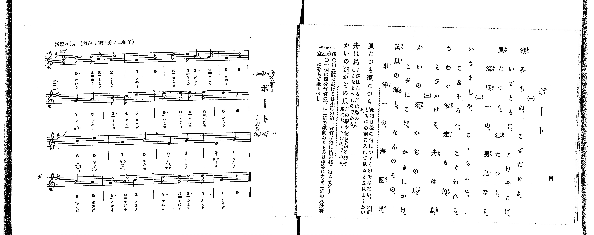

# ボート

> Re:Shōka 使用 AI 協助辨識與重建樂譜，可能會有錯誤。歡迎回報。

- **鋼琴伴奏版**：<br><audio controls src="boto.mp3"></audio>
- **NEUTRINO 歌聲合成版**：<br><audio controls src="boto_neutrino.mp3"></audio>

- 出處：共益商社樂器店《唱歌教科書 教師用 巻二》第四～五頁（第一學期第二曲）
- NDL Digital Collections PID 854863（https://dl.ndl.go.jp/pid/854863）掃描 P008.jpg

## 說明

原書資訊與歌詞全文（NDL PID 854863《唱歌教科書 教師用 巻二》第四～五頁，掃描 P008.jpg）：
調性與拍號：ト調四分ノ二拍子（G 大調 2/4 拍），♩=126，「活潑ニ」
註記：共益商社唱歌教科書教師用巻二 第五頁 / 1.
原典演奏注意：第三段各小節之第一音符須特稍強聲歌唱；一個四分音符下配有兩個音節歌詞者，平均分作兩個八分音符歌唱。
原典語釋：「風たつも浪たつも」一句不接後句，移至「いざともに」之前理解則意義自明；「舟は鳥」謂飛馳之舟如鳥；「かいの羽、かぢの爪」以鳥之羽與爪比喻船之櫂與柁（舵）。


## 歌詞

```text
一、
潮みちぬ こぎだせよ
いざともに こげやこげ
風たつも 浪たつも
海國一の 男兒なり

二、
いさましや こゝちよや
こゑそろへ こぐわれら
さわぐ波 走る魚
とびかける 舟は鳥

三、
かいの羽 かぢの爪
こぎにこげ かきにかけ
萬里の海も なんのその
東洋一の 海國兒
```

## ABC

<div class="abc-score" data-abc-src="boto.abc" aria-label="五線譜載入中"></div>

[下載 ABC 原始檔](boto.abc)

## TMD 檔案連結

- [主旋律 TMD 檔案](boto.tmd) [[在 TMD Studio 編輯](https://tmdlang.github.io/Tmd-TS/#tmd=s7IKdvYPcrWy4qpTUCpJTLdSSM7PyUlNLsnMz7PKrsxPzc6ML87Iz05Ugisoy88pzU21yk7MizeKtzA1sTAzRkgW55cWJafGFySmp1oFGBhYoMtYFSdn5OfnxJekVpQk5ednI-QLivLLUvMS84BqCooy80pSU8CKEApSyzJTUkHSxclAq8tSizLTMlNTkNyVWlQMcjXUCSVFiXnFyUWZBSCvIFSl5RflWhWXFOUXZGQmI4RLMlKBfgLrKcgvQrIVIlGeWJJahBDML8pMz8yzyk3NzMpE8oqWlsLj5jmPm_c8bu5Q0NLiUrRVMDQy47K3VXDnsjHSN7EDGfC0fdeLmVPf75n1tHXj89ldT6e2PV-y79mKpqczVzzdNf1xQ9fTKRufre15NnXm8-UTn83eoQBkPd2x-vmUFQpPt-9-sqvncUP38zVrns6e_X7vvCe7prxc0Ph-TwdQ5MmOhqdrdzybMx_E3tXzbPam93s6wW72c_FRcAG6uCQxR8EZHr3FCgGeLgqQCASakFFSUlBspa-fkqOXB8Tp-XpZBfoFmSn6MBWdz_qan_X3K4CiFSiXrsTFpa-lYEstwKWgoPC0bz7Qxy82t79Y0fWiox0YDC9WznvauuLZtHagC0HeQDiZzJDqQfMF0F_AuABZ_mLV_mcNy0HWdve-mDkfKAqMRqAgUP_TjrbHzX2gQO3ufbp2AtAt7gpPlywHSioAo1UBKAo2pufRzJW2wBgHsh439DzbsvvZ3omPm7sfN_SCzV-x-8WKGWgRj-YFuA8gHlAARyXI4Qr6CoZ60CB62rrj2Z4pT5f2P9u84llLP9BEcOx3Plu39emElqcb-p-vb3iyE-R1YJJ4OX_z8zXLXi7oeN658_mK3qd7tr9o3AS0Emjx-z2zQWmmoRviQ4jKJzu6X7b2PpvT-bR1JVAKJLi-ARIRLxpagT57unPz07ntQPVP9s6BqHnauhquHWLy44YmhFtfrJr3sr0bFJwNPS8XrXjcOP9x45LHTU3Ptq6Cs4FBBHJK_9InO3qf9S19uq8HyAZa9nz57hftm4EaHze2PG6c9rhxBUhx42qQ-p3dTzt7n09oe7F88dPOdmBAPN-38kX7qmcz-oAeA2p50QE0fP3LzUuBil-saXq5ePbLZZuBuoDiT5c1AcUhyh43doMNX_d8397HDY1g7iIQt2MVyJbdS4EqQaG5by8waQAFn62f8nTa7hcdO4GCz1Y3gdLLfFAOfNGxFZgIQD4HeR3oG6BhINazveseN-5_3LjwceMahceNkx839j1uXPC4cfbjpg6QPJrPIEomPW4CioIYICXIoaaAHGxg87dufzqnG2Rf4zqF51O2P22d9Lhx1eOmLog7QLkA7A6wPVMfN-573DgdaDrYnqa5IHc1dQD5ECVAoYmPG-c-bup93LgD4pQJj5v6Hzf1PG7qhCiZCuI3Tni2eZHCi60bHjd1v1wLzj4gHzRuBgffRKCoAjz4oeEBDBqoOxDhDeFAQxvmAlD4rIZ4HiIPdAuQDzIXnI0mrHnZDoy1dUCPg8ID7FmgYmAoA32zDhwkczc-2wILEkj4AEMFJEN5MQUFClr6XFxO-SX5VgGZiXn5DjUGNdUgCxRsDM207MCs6ty0WjADWEo-btoOrBpmA_F8IG5UqAGSPSCyaTMQrwPyGoD0brD4CpDZIH01CqYKukBoqmAMpo2AIoZglq6CAZQmSg3YNB9DoOGN08Eijxt3A_F-KHshyFpg4oSojoebDIwDqIo-IF4AZc8GO7sDXTXEDiOQrhaoyqlAvA_Kng7WBZHBbsdksEvAbKDpWFVD7DAG6eqG6gKl43VQ9nqweWux2AFTvQhJ9RKwHY1Y7QDH2BIg3gaOkQ4gBmpt7obH2CYgDyS_GSyyCRFjsLA3gtsOiRcTaDyBRMzAtBmchsUh9hiDhQKwkEDy0QpoSIHS_2osoQnMOtDwA4mBZCZhD01wjEF0gcybiGTWXKhYL5C9A4sdE4By_VA1kMTcid0OcIzB7QCmJoRZELdDYh_mQuQYA9kNUwMO_kaYC1HtqEbOa8BCtGkP2EH7gfHUAo5DUPx1gfMfQhwkCo85SDyBchLMFbC4hMkAYw5mKUwKGHUYQkhxB_EFyO1zkPw2Hy66BCEKjEmYKLB8h2RNqHKEOoQq5NgDlchwzROQdK6CiyKbtx5WCoDMg7kQJNEGF4XHBFL8AYt6RDLpguUjqE6EDUhOBHsFoQlFByRtoYjC4g9YYCsAS2xwoADzGLC0BLa9wHEILCObQbkPWDMB4xIksgoz_hA5DxIjRkjxBysrYTT-shJUT8GdCaxhYIGMXMYtRPMXtJQE-vpx4wyomlVgr3RBVWHLf5DcDFK7GcksWB6YiBZPW6Hia8FlHoS9Ap8d4PgD1s6ICO5AcPD5BrmUheX6frAMxG_INtVycenaKYCqRAUgrcwFAA)]
- [鋼琴伴奏 TMD 檔案](boto_piano.tmd) [[在 TMD Studio 編輯](https://tmdlang.github.io/Tmd-TS/#tmd=s7IKdvYPcrWy4tLSUnjcPOdx857HzR3v93S87N7zfMKWJ3u2PF3a_7wTKNKpoKXFpWirYGhkxmVvq-DOZWOkb2LHVaeg9LR914uZU9_vmfW0dePz2V1Pp7Y9X7Lv2YqmpzNXPN01_XFD19MpG5-t7Xk2debz5ROfzd6hAGQ93bH6-ZQVCk-3736yq-dxQ_fzNWuezp79fu-8J7umvFzQCHQAUOTJjoana3c8mzMfxN7V82z2JqAzlEBW-rn4KLhkpmeWJOYoOOfn5KQml2Tm5xUrBHi6KFiYmliYGQNNyCgpKSi20tdPydHLA-L0fL2sAv2CzBR9mIrOZ33Nz_r7FQIMDCyAculKXFxO-SX5VgGZiXn5QR4ONQY11VwKQGBjaKZlB2ZV56bVghn6wOBq2g4MstlAPB-IGxVqgGQPiGzaDMTrgLwGIL0bLL5CQUsfrK9GwVRBFwhNFYzBtBFQxBDM0lUwgNJEqQGb5mMINLxxOljkceNuIN4PZS8EWdu4Bqo6Hm7y48bJUBV9QLwAyp4NdnYHumqIHUYgXS1QlVOBeB-UPR2sCyKD3Y7JYJeA2UDTsaqG2GEM0tUN1dUCxOug7PVg89ZisQOmehGS6iVgOxqx2gGOsSVAvA0cIx1ADNTa3A2PsU1AHkh-M1hkEyLGYGFvBLcdEi8m0HgCiZiBaTM4DYtD7DEGC4XHjdOQfLQCGlJNQPZqLKE5CR5-IDGQzCTsoQmOMYgukHkTkcyaCxXrBbJ3YLFjAlCuH6oGkpg7sdsBjjG4HcDUhDAL4nZI7MNciBxjILthasDB3whzIaod1ch5bTUQ7wE7aD8wnlrAcQiKvy5w_kOIg0ThMQeJJ1BOgrkCFpcwGWDMwSyFSQGjDkMIKe4gvgC5fQ6S3-bDRZcgRIExCRNdBcuaUOUIdQhVyLE3FRYNkEhB6FwFF0U2bz2sFACZB3MhSKINLgqPCaT42_C4CZFMumD5CKoTYQOSE8FeQWhC0QFJWyiisPh7tnW7wtM5kLwGzGPA0vJxcx84DoFlZDMo9-0AxyVIZBVm_CFyHiRGjJDiD1ZWwmj8ZWU3cuab_LgRFsjIZdxCNH9BS0mgrx83zoCqWQX2ShdUFbb8B8nNILWbkcyC5YGJaPG0FSq-FlzmQdgr8NkBjr8VyBHcgeDg8w1yKQvL9f1gGYjfkG2qRa4RfZBrRBNohQiM2xd9XS_be5-27ng5uxXSYECq7OLjFaJN42OBTGC8ANmGECZWcWx6TIBsEwwmmg4kg5GYuNWj2IDLiUCmASQIdO0UQKEQ7QOUgbONkNjGYLYyFwA)]

## 分析

```text
================================================================================
📊 TMD Song Profile: [ ボート ]
================================================================================
⏱  Duration:       0:15 (15.2s), 16 measures total
🎼 Key & Tempo:    首調基準 G, != 126.0 BPM, <2/4>
   - 分析範圍：      由實際發聲的音符與和弦推測調性；播放脈絡另行呈現
🎤 人聲音域:    D4 (MIDI 62) – E5 (MIDI 76) [跨度: 14 個半音 / 1.2 個八度, 難度: moderate]
   - 最低音:  D4 in [Boto #1 @ m.12, 0:10]
   - 最高音: E5 in [Boto #1 @ m.7, 0:05]
   - 適合: soprano, mezzo-soprano, contralto, tenor, baritone, bass
🏛  結構:      Boto (15.2s)
⚡ 編曲密度:        Peak 1 軌道同時演奏
🗝  調性診斷：       G 大調（純淨自然大調，未偵測到可信轉調）
   - 風格氣質:    純淨自然大調（陽光明朗、易唱易記，無明顯調外色彩）
   - 轉調歷程:    全曲維持單一推測調性（未偵測到可信轉調）
   - 核心骨幹音:  D, G, B, E, A
   - 調性數值:    G 大調 [相關度: 0.90, 穩定度: High, 自然音純度: 100.0%]
   - 候選調性 (K-S): G 大調 (0.90), D 大調 (0.71), B 小調 (0.70)
   - 五度圈歷程:   +1
   - 各段落調性細節:
     • [Boto #1]: G 大調 (r: 0.90, 自然音純度: 100.0%)

  [ 五度圈游移軌跡 ]
               C  
         F           [G ]*
      Bb               D  
      Eb               A  
         Ab           E  
            Db       B  
               F# 
     (* = active key center)

  [ 十二半音累積音高分佈 ]
     C  : █                          0.9%
     C# :                            0.0%
     D  : ████████████████████████  28.6%
     D# :                            0.0%
     E  : █████████                 10.7%
     F  :                            0.0%
     F# :                            0.0%
     G  : ███████████████████████   27.7%
     G# :                            0.0%
     A  : ████████                   9.8%
     A# :                            0.0%
     B  : ███████████████████       22.3%
--------------------------------------------------------------------------------
Assignment 軌道音域：
  - Piano         : D4 – E5 (14 個半音 / 1.2 個八度, 38 個音符)
================================================================================
```


## 原書掃描頁




