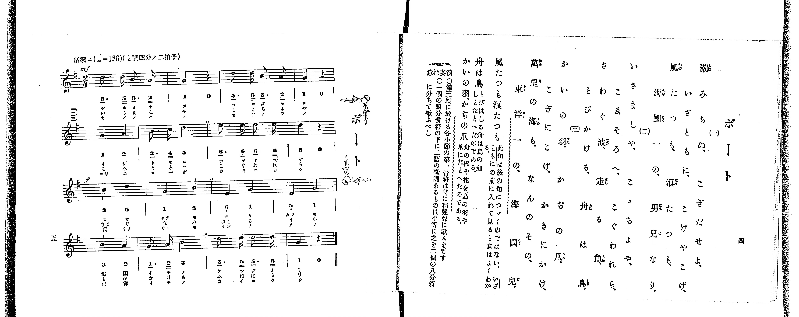

# ボート

> Re:Shoka 使用 AI 辨識樂譜，可能會有錯誤。歡迎回報。

<audio controls src="boto.mp3"></audio>

- 出處：共益商社樂器店《唱歌教科書 教師用 巻二》第四～五頁（第一學期第二曲）
- NDL Digital Collections PID 854863（https://dl.ndl.go.jp/pid/854863）掃描 P008.jpg

## 說明

原書資訊與歌詞全文（NDL PID 854863《唱歌教科書 教師用 巻二》第四～五頁，掃描 P008.jpg）：
調性與拍號：ト調四分ノ二拍子（G 大調 2/4 拍），♩=126，「活潑ニ」
註記：共益商社唱歌教科書教師用巻二 第五頁 / 1.
原典演奏注意：第三段各小節之第一音符須特稍強聲歌唱；一個四分音符下配有兩個音節歌詞者，平均分作兩個八分音符歌唱。
原典語釋：「風たつも浪たつも」一句不接後句，移至「いざともに」之前理解則意義自明；「舟は鳥」謂飛馳之舟如鳥；「かいの羽、かぢの爪」以鳥之羽與爪比喻船之櫂與柁（舵）。

## 歌詞

```text
一、
潮みちぬ こぎだせよ
いざともに こげやこげ
風たつも 浪たつも
海國一の 男兒なり

二、
いさましや こゝちよや
こゑそろへ こぐわれら
さわぐ波 走る魚
とびかける 舟は鳥

三、
かいの羽 かぢの爪
こぎにこげ かきにかけ
萬里の海も なんのその
東洋一の 海國兒
```

## ABC

```abc
X:1
T:ボート
M:2/4
L:1/16
Q:1/4=126
K:G
V:V1 name="Piano" snm="Pia"
[V:V1]
!mf! d3 d B3 A | G4 z4 | d3 d B3 A | G4 z4 |
G4 A4 | B3 c d4 | e3 e e3 e | d4 z4 |
!f! B4 d4 | G4 B4 | E4 G4 | D4 G4 |
B4 A4 | G3 A B4 | d3 d d3 d | G4 z4 |
!mf! d3 d B3 A | G4 z4 | d3 d B3 A | G4 z4 |
G4 A4 | B3 c d4 | e3 e e3 e | d4 z4 |
!f! B4 d4 | G4 B4 | E4 G4 | D4 G4 |
B4 A4 | G3 A B4 | d3 d d3 d | G4 z4 |
!mf! d3 d B3 A | G4 z4 | d3 d B3 A | G4 z4 |
G4 A4 | B3 c d4 | e3 e e3 e | d4 z4 |
!f! B4 d4 | G4 B4 | E4 G4 | D4 G4 |
B4 A4 | G3 A B4 | d3 d d3 d | G4 z4 |
```

## TMD 檔案連結

- [主旋律 TMD 檔案](boto.tmd) [[在 TMD Studio 編輯](https://tmdlang.github.io/Tmd-TS/#tmd=s7IKdvYPcrWy4qpTUCpJTLdSSM7PyUlNLsnMz7PKrsxPzc6ML87Iz05Ugisoy88pzU21yk7MizeKtzA1sTAzRkgW55cWJafGFySmp1oFGBhYoMtYFSdn5OfnxJekVpQk5ednI-QLivLLUvMS84BqCooy80pSU8CKEApSyzJTUkHSxclAq8tSizLTMlNTkNyVWlQMcjXUCSVFiXnFyUWZBSCvIFSl5RflWhWXFOUXZGQmI4RLMlKBfgLrKcgvQrIVIlGeWJJapMSlpaXwuHnO4-Y9j5s7FLS0uBRtFQyNzLjsbRXcuWyM9E3sQNqetu96MXPq-z2znrZufD676-nUtudL9j1b0fR05oqnu6Y_buh6OmXjs7U9z6bOfL584rPZOxSArKc7Vj-fskLh6fbdT3b1PG7ofr5mzdPZs9_vnfdk15SXCxrf7-kAijzZ0fB07Y5nc-aD2Lt6ns3e9H5PJ9ilfi4-Ci6Z6ZkliTkKzvD4K1YI8HRRgMQQ0ISMkpKCYit9_ZQcvTwgTs_XyyrQL8hM0Yep6HzW1_ysv18BFG9AuXQlLi59LQVbagEuBQWFp33zgT5-sbn9xYquFx3twGB4sXLe09YVz6a1A10I8gbCyWSGVA-aL4D-AsYFyPIXq_Y_a1gOsra798XM-UBRYDQCBYH6n3a0PW7uAwVqd-_TtROAbnFXeLpkOVBSARitCkBRsDE9j2autAXGOJD1uKHn2Zbdz_ZOfNzc_bihF2z-it0vVsxAi3g0L8B9APGAAjgqQQ5X0Fcw1IMG0dPWHc_2THm6tP_Z5hXPWvqBJoJjv_PZuq1PJ7Q83dD_fH3Dk50grwOTxMv5m5-vWfZyQcfzzp3PV_Q-3bP9ReMmoJVAi9_vmQ1KMw3dEB9CVD7Z0f2ytffZnM6nrSuBUiDB9Q2QiHjR0Ar02dOdm5_ObQeqf7J3DkTN09bVcO0Qkx83NCHc-mLVvJft3aDgbOh5uWjF48b5jxuXPG5qerZ1FZwNDCKQU_qXPtnR-6xv6dN9PUA20LLny3e_aN8M1Pi4seVx47THjStAihtXg9Tv7H7a2ft8QtuL5YufdrYDA-L5vpUv2lc9m9EH9BhQy4sOoOHrX25eClT8Yk3Ty8WzXy7bDNQFFH-6rAkoDlH2uLEbbPi65_v2Pm5oBHMXgbgdq0C27F4KVAkKzX17gUkDKPhs_ZSn03a_6NgJFHy2ugmUXuaDcuCLjq3ARADyOcjrQN8ADQOxnu1d97hx_-PGhY8b1yg8bpz8uLHvceOCx42zHzd1gOTRfAZRMulxE1AUxAApQQ41BeRgA5u_dfvTOd0g-xrXKTyfsv1p66THjaseN3VB3AHKBWB3gO2Z-rhx3-PG6UDTwfY0zQW5q6kDyIcoAQpNfNw493FT7-PGHRCnTHjc1P-4qedxUydEyVQQv3HCs82LFF5s3fC4qfvlWnD2AfmgcTM4-CYCRRXgwQ8ND2DQQN2BCG8IBxraMBeAwmc1xPMQeaBbgHyQueBsNGHNy3ZgrK0DehwUHmDPAhUDQxnom3XgIJm78dkWWJBAwgcYKiAZyospKFDQ0uficsovybcKyEzMy3eoMahRqAbZoGBjaKZlB2ZV56bVghnAYvJx03Zg3TAbiOcDcaNCDZDsAZFNm4F4HZDXAKR3g8VXgAwH6atRMFXQBUJTBWMwbQQUMQSzdBUMoDRRahCuWALE28C2dADxIiDuhrtiE5AHkt8MFtmEcAXMPCO4nRC7TKB2g0TMwLQZnIa5C90V1chhAkztTXvAtu0H2t0CdhfITV3gcEKIg0ThroHYDfIxzG6Y-2AyQNfEQ5kwKaBzMIRg7gCmEAVgEgHbB_Q_MHaAhT3YLcA4aQaFDDArAN0EElmF6Q5EqEBMNkJyByxuYDS2uKnl4tK1UwClJQUstDIXAA)]

## 分析

```text
================================================================================
📊 TMD Song Profile: [ ボート ]
================================================================================
⏱  Duration:       0:45 (45.7s), 48 measures total
🎼 Key & Tempo:    首調基準 G, != 126.0 BPM, <2/4>
   - 分析範圍：      由實際發聲的音符與和弦推測調性；播放脈絡另行呈現
🎤 人聲音域:    D4 (MIDI 62) – E5 (MIDI 76) [跨度: 14 個半音 / 1.2 個八度, 難度: moderate]
   - 最低音:  D4 in [Boto #1 @ m.12, 0:10]
   - 最高音: E5 in [Boto #1 @ m.7, 0:05]
   - 適合: soprano, mezzo-soprano, contralto, tenor, baritone, bass
🏛  結構:      Boto (15.2s) -> Boto (15.2s) -> Boto (15.2s)
⚡ 編曲密度:        Peak 1 軌道同時演奏
🗝  調性診斷：       G 大調（純淨自然大調，未偵測到可信轉調）
   - 風格氣質:    純淨自然大調（陽光明朗、易唱易記，無明顯調外色彩）
   - 轉調歷程:    全曲維持單一推測調性（未偵測到可信轉調）
   - 核心骨幹音:  D, G, B, E, A
   - 調性數值:    G 大調 [相關度: 0.90, 穩定度: High, 自然音純度: 100.0%]
   - 候選調性 (K-S): G 大調 (0.90), D 大調 (0.71), B 小調 (0.70)
   - 五度圈歷程:   +1 -> +1 -> +1
   - 各段落調性細節:
     • [Boto #1]: G 大調 (r: 0.90, 自然音純度: 100.0%)
     • [Boto #2]: G 大調 (r: 0.90, 自然音純度: 100.0%)
     • [Boto #3]: G 大調 (r: 0.90, 自然音純度: 100.0%)

  [ 五度圈游移軌跡 ]
               C  
         F           [G ]*
      Bb               D  
      Eb               A  
         Ab           E  
            Db       B  
               F# 
     (* = active key center)

  [ 十二半音累積音高分佈 ]
     C  : █                          0.9%
     C# :                            0.0%
     D  : ████████████████████████  28.6%
     D# :                            0.0%
     E  : █████████                 10.7%
     F  :                            0.0%
     F# :                            0.0%
     G  : ███████████████████████   27.7%
     G# :                            0.0%
     A  : ████████                   9.8%
     A# :                            0.0%
     B  : ███████████████████       22.3%
--------------------------------------------------------------------------------
Assignment 軌道音域：
  - Piano         : D4 – E5 (14 個半音 / 1.2 個八度, 114 個音符)
================================================================================
```


## 原書掃描頁




